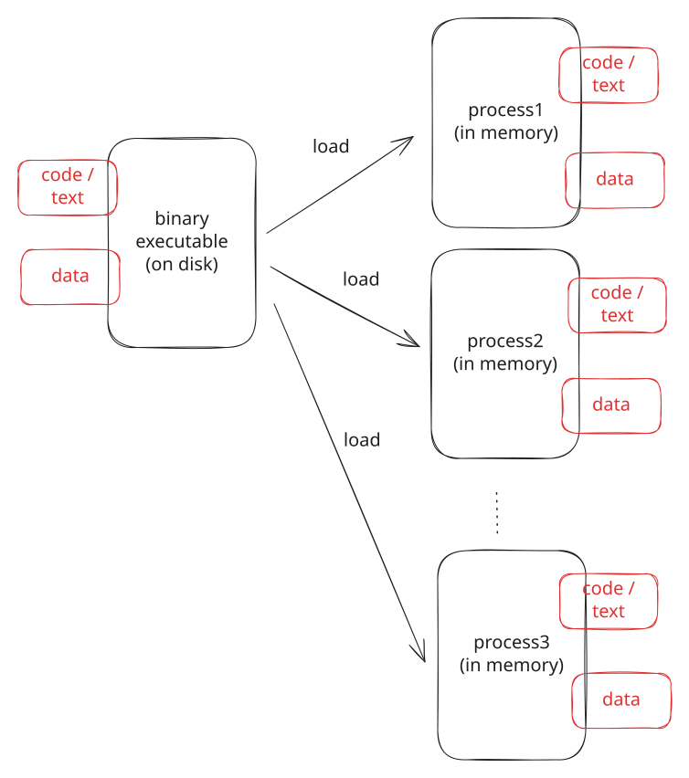
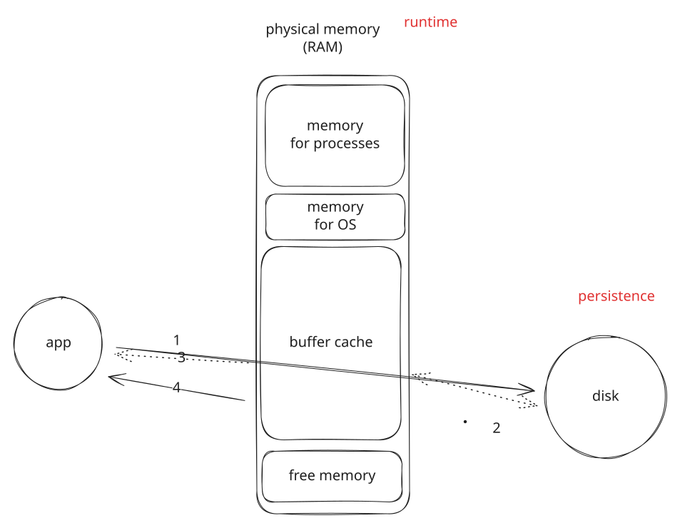
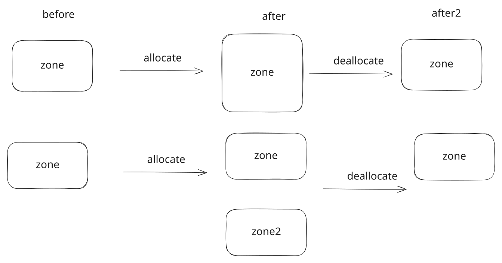
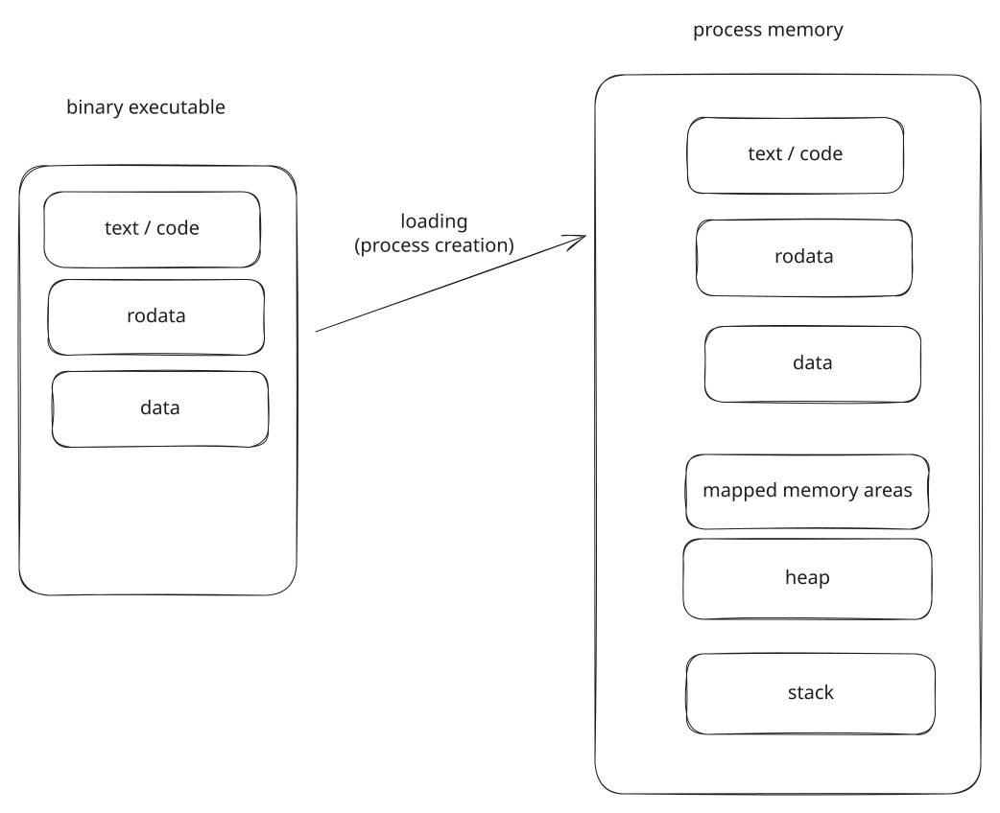
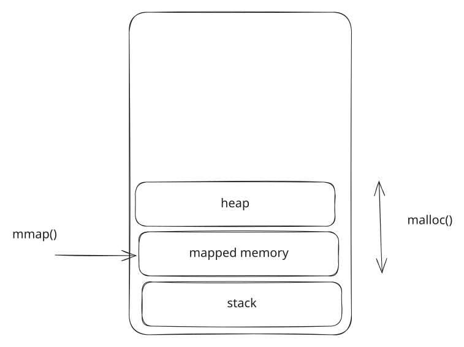
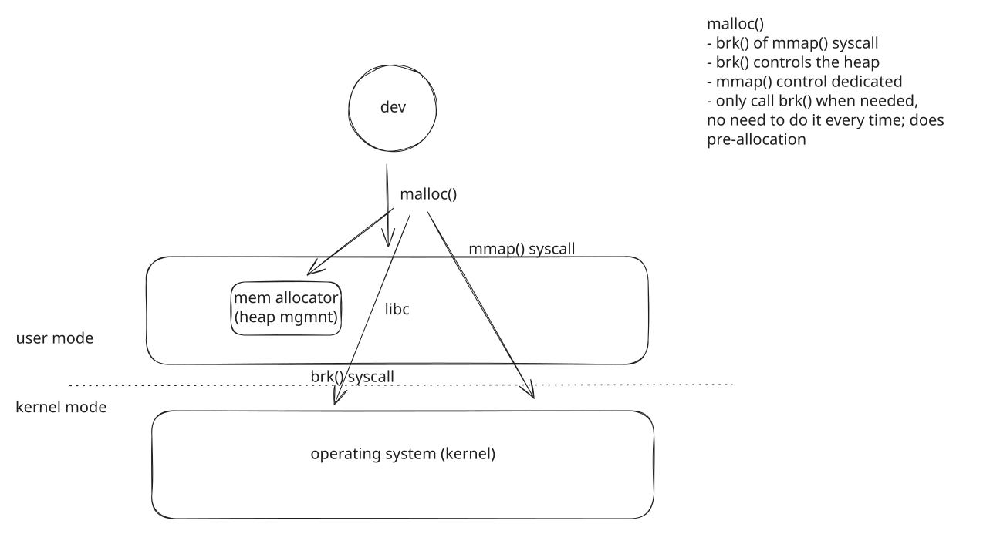

# 00. Pitch

## Memory is what runs out

```text
$ ps -e -o pid,comm,rss --sort -rss | head -5
    PID COMMAND           RSS
  33283 chrome          1657396
  31705 chrome          1394884
  32312 chrome          982264
  34405 Discord          850136
```

1.6 GB for one browser process, and there are dozens of them.

::: {.notes}
Run it on the lecture machine, whatever it shows. The browser at the top is the usual outcome.
:::

## Memory you do not see is working for you

```text
$ free -h
               total        used        free      shared  buff/cache   available
Mem:            59Gi        25Gi       4.7Gi       2.0Gi        31Gi        33Gi
```

31 GB of files, kept in memory by the kernel in case they are read again.

Drop it (`echo 3 > /proc/sys/vm/drop_caches`) and every program start goes back to the disk.

## Where data sits decides speed

Two programs fill the same 64 MB array, row by row and column by column.

```text
$ sudo perf stat -e instructions,cache-misses ./row
     1,279,597,512      instructions
         1,261,585      cache-misses
       0.089 seconds time elapsed

$ sudo perf stat -e instructions,cache-misses ./column
     1,280,513,994      instructions
        57,935,620      cache-misses
       0.910 seconds time elapsed
```

Same instructions. Forty-six times the cache misses. Nine times the time.

## Memory you forget to free is gone

```text
$ valgrind --leak-check=full ./task > /dev/null
==758988== 39,556 bytes in 4,000 blocks are definitely lost in loss record 1 of 1
==758988==    at 0x484A858: malloc (...)
==758988==    by 0x4939EDE: strdup (strdup.c:42)
==758988==    by 0x109253: createTask (task.c:25)
```

Forty bytes per task. The program is "correct": right output, exit status 0.

## Five reasons

* **Functionality** --- instructions and data both live in memory; no memory, no program.
* **Correctness** --- outside an area, after freeing, without permission: a crash, or worse, not.
* **Security** --- read past a buffer and leak; write past it and run what you wrote.
* **Performance** --- 0.09 s or 0.9 s, depending on where the data sits.
* **Efficiency** --- allocated and unused, or used and not returned, is memory nobody else can have.

## The story

{fig-align="center" width="78%"}

# 01. Memory and the CPU

## An array of bytes

{fig-align="center" width="80%"}

The CPU reads and writes bytes **by address**. A pointer is a variable whose value is an address.

## Who uses memory

* **Processes**, in user mode --- each one its own slice.
* **The kernel**, in kernel mode --- its own code and data, and the bookkeeping for every process.

The kernel also decides which process gets which slice.
That is next lecture; this one takes it for granted.

## The hierarchy

{fig-align="center" width="60%"}

| level | size | a byte takes | holds |
| --- | --- | --- | --- |
| registers | bytes | a cycle | what the instruction uses now |
| cache | KB--MB | nanoseconds | what was used recently |
| memory | GB | ~100 ns | the running programs |
| storage | TB | µs--ms | everything, persistently |

## Loading

{fig-align="center" width="52%"}

Storage is for persistence, memory is for running.
Running a program means copying it from the one into the other.

## The buffer cache

{fig-align="center" width="58%"}

(1) the program asks · (2) the disk delivers into the cache · (3) the program gets a copy · (4) next time, memory speed

# 02. Memory Operations

## Allocate and deallocate

{fig-align="center" width="66%"}

Allocation does not create memory. It fences it off: this area, for this program.

## A new area, or a larger one

{fig-align="center" width="70%"}

```c
struct area { unsigned long start; unsigned long size; };
```

Which happens is up to the allocator, not the program.

## Read, write, execute

* **read** --- `a = *p`
* **write** --- `*p = a`
* **execute** --- a call, a return, a jump to the address

Every area has permissions, `rwx`.
Anything else: the hardware stops the instruction, the kernel sends **`SIGSEGV`**.

## Four of the five work

```text
$ ./basic
----- Allocate memory -----
----- Write to memory -----
----- Read from memory -----
----- Execute memory -----
Segmentation fault (core dumped)
```

```text
--- SIGSEGV {si_code=SEGV_ACCERR, si_addr=0x5de1b060b2b0} ---
0x0000555555559000 0x000055555557a000  rw-p  [heap]
```

The address exists. The access kind is wrong. The heap is `rw-` on purpose.

::: {.notes}
Let it crash live, ask which step failed. Then gdb to show the address is in the heap.
NX: data you can write must not be runnable. Lab 05 is what attackers do about that.
:::

## Permissions are per area

| access | `.data` (`rw-`) | `.text` (`r-x`) | address 0 |
| --- | --- | --- | --- |
| read | ok | ok | `SEGV_MAPERR` |
| write | ok | `SEGV_ACCERR` | |
| execute | `SEGV_ACCERR` | ok | |

`memory-access`: the four that work, and three lines to uncomment.

# 03. The Process Address Space

## A list of areas

{fig-align="center" width="66%"}

## `pmap`, line by line

```text
$ pmap -x $(pidof see-pmap-static)
Address           Kbytes     RSS   Dirty Mode  Mapping
0000000000400000       4       4       4 r---- see-pmap-static
0000000000401000     564     564     564 r-x-- see-pmap-static
000000000048e000     172     164     164 r---- see-pmap-static
00000000004be000      24      24      24 rw--- see-pmap-static
00000000004c4000      40      16      16 rw---   [ anon ]
0000000034c5d000     136      16      16 rw---   [ anon ]
00007ffd49694000     136      12      12 rw---   [ stack ]
```

Header, `.text`, `.rodata`, `.data`; `.bss`; the heap; the stack.
Twelve areas, 1.1 MB, 47 bits of nothing in between.

## Roles

| area | holds | perms | size | from |
| --- | --- | --- | --- | --- |
| text | code | `r-x` | fixed | the executable |
| rodata | constants | `r--` | fixed | the executable |
| data | initialised globals | `rw-` | fixed | the executable |
| bss | zeroed globals | `rw-` | fixed | a size in the executable |
| heap | `malloc()` | `rw-` | grows, shrinks | `brk()` |
| stack | frames, locals | `rw-` | grows down | the kernel, on a fault |
| mappings | `mmap()`, libraries | any | come and go | `mmap()` |

**Static**: fixed by the file, there before `main()`. **Dynamic**: made at run time, zero-filled.

## Static and dynamic executables

```text
$ pmap -x $(pidof see-pmap)
0000000000401000       4       4       4 r-x-- see-pmap            .text: 4 KB, not 564
00007b222c828000    1620    1112       0 r-x-- libc.so.6           libc, an area of its own
00007b222cafc000     184     184       0 r-x-- ld-linux-x86-64.so.2
00007ffe0519b000     136      20      20 rw---   [ stack ]
total kB            2804    1724     156
```

Twice the areas; a fifth of the dirty pages.
libc's 1112 KB of code is resident, clean, and shared with every process. Lecture 04.

# 04. When Memory Is Allocated

## Two moments

**Load time** --- the kernel creates the process from the executable: the static areas, allocated and filled from the file, before `main()`.

**Run time** --- the program executes: the stack as functions are called, the heap and mappings as it asks. Allocated empty.

## The loader builds the map

{fig-align="center" width="56%"}

## Sections become areas

```text
$ readelf -S see-pmap-static
  [ 6] .text             PROGBITS        00000000004011c0  08c18d
  [ 8] .rodata           PROGBITS        000000000048e000  0209fc
  [22] .data             PROGBITS        00000000004be0c0  005a20
  [23] .bss              NOBITS          00000000004c3ae0  009828

$ size see-pmap-static
   text    data     bss
 749834   41848   39016
```

`.bss`: an address and a size, no bytes in the file. The loader zero-fills it.

## Who decided the address?

```text
$ ./allocation-types
ro_data: 0x402020               .rodata
init_data: 0x408080             .data
local_scope_data: 0x4080a0      .data      static local
non_init_data: 0x40c0e0         .bss
heap_data: 0x316932c0           heap
stack_buffer: 0x7ffd4f5633f0    stack
mapped_data: 0x7c51ef5c0000     mapping
```

`nm allocation-types` prints the first four from the file. The linker decided; the program only reads them out.

`static` says *when* --- load time --- not *where it is visible*.

# 05. Run-Time Allocation

## Implicit and explicit

{fig-align="center" width="46%"}

**Stack**: implicit --- a call allocates the frame, a return frees it.

**Heap, mappings**: explicit --- `malloc()`/`free()`, `mmap()`/`munmap()`.

## The stack grows by itself

```text
00007ffc7f72d000     136      16      16 rw---   [ stack ]      before
00007ffc7f72d000     136      76      76 rw---   [ stack ]      alloca(64 KB), touched
00007ffc7f6e6000     420     420     420 rw---   [ stack ]      100 calls deep
```

The start address dropped by 284 KB.
No system call: the first write past the end faulted, and the kernel extended the area.

## The heap grows on request

```text
00005c74ca0dc000     132      12      12 rw---   [ anon ]      before
00005c74ca0dc000     268     268     268 rw---   [ anon ]      4 x malloc(64 KB)
00005c74ca0dc000     140     140     140 rw---   [ anon ]      4 x free()
```

Extended with `brk()`, and shrunk with `brk()` --- but only from the top.

## What `malloc()` does

{fig-align="center" width="60%"}

A libc function over an **allocator** that owns the heap.
It asks the kernel only when it runs out: `brk()` to extend the heap, `mmap()` for a block of its own.

## Ten `malloc()`s, six `brk()`s

```text
$ strace -e trace=brk,mmap,munmap ./malloc_kb 100
brk(NULL)                               = 0x62161b3b5000
brk(0x62161b3d6000)                     = 0x62161b3d6000
brk(0x62161b408000)                     = 0x62161b408000
brk(0x62161b43a000)                     = 0x62161b43a000
brk(0x62161b46c000)                     = 0x62161b46c000
brk(0x62161b49e000)                     = 0x62161b49e000
brk(0x62161b4d0000)                     = 0x62161b4d0000
brk(0x62161b4b7000)                     = 0x62161b4b7000      <- free(): down
```

Each `brk()` adds 200 KB, room for two blocks: the next `malloc()` costs nothing.

## Ten `malloc()`s, ten `mmap()`s

```text
$ strace -e trace=brk,mmap,munmap ./malloc_kb 1000
mmap(NULL, 1028096, PROT_READ|PROT_WRITE, MAP_PRIVATE|MAP_ANONYMOUS, -1, 0) = 0x765b4323e000
mmap(NULL, 1028096, PROT_READ|PROT_WRITE, MAP_PRIVATE|MAP_ANONYMOUS, -1, 0) = 0x765b42f05000
...
munmap(0x765b4272d000, 1028096)         = 0
```

Above 128 KB, every block gets an area of its own, and `free()` is `munmap()`.
A megabyte in the middle of the heap would stop it from ever shrinking.

Lecture 02 again: libc decides when to cross.

# 06. Conclusion

## What we covered

* why memory matters: five reasons, four measurements
* an array of bytes, addresses, pointers; cache, memory, disk; the buffer cache
* allocate and free, by areas; read, write, execute, by permission; `SIGSEGV` for the rest
* the address space as a list of areas with roles, static and dynamic
* the loader turning sections into areas; `bss` costing nothing on disk
* the stack growing on a fault; `malloc()` over an allocator, over `brk()` and `mmap()`

## {background-color="#f0f0f0"}

::: {style="font-size: 1.25em; text-align: center; margin-top: 1.5em;"}
A process sees its memory as a **list of areas**.

Static ones are built from the file before `main()`;
dynamic ones grow while it runs --- the stack by itself,
the heap and mappings through an allocator, over `brk()` and `mmap()`.

Everything is an address into one of them.
Anything else is a fault.
:::

## Next

* **Lecture 04** --- the word "virtual": how every process starts at `0x400000`, how libc is shared, what happens on the first touch of a new stack page.
* **Lab 03** --- a file copied through a global buffer, a `malloc()`'d one and an `mmap()`'d one; `realloc()`; `valgrind` as a requirement.
