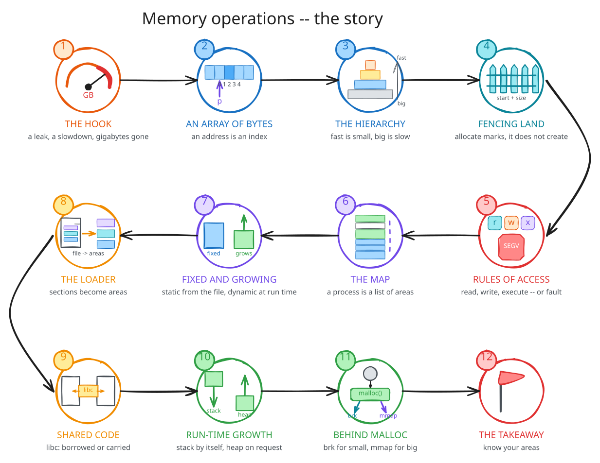
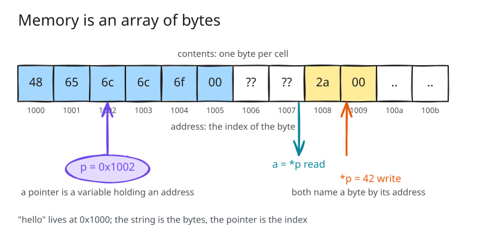
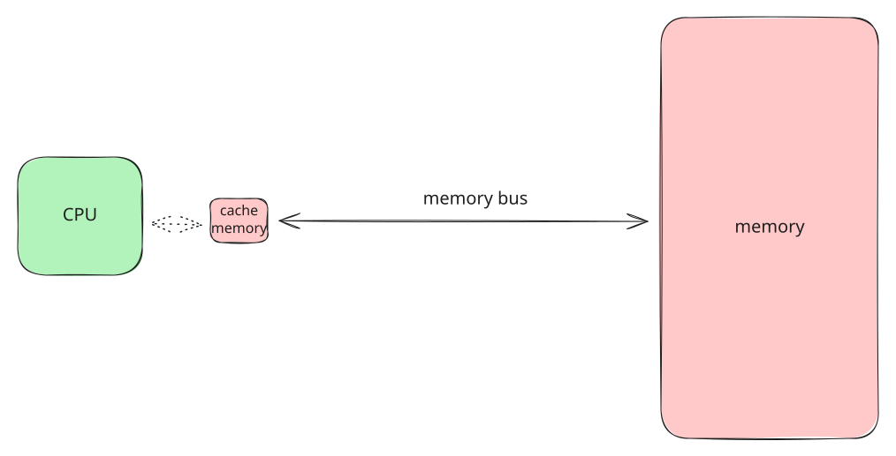

## Why care about memory? {background-color="#f7f7f7"}

```text
$ ps -e -o pid,comm,rss --sort -rss | head -3
    PID COMMAND           RSS
  33283 chrome          1657396        1.6 GB, one process of dozens

$ time ./row        0.05 s             same instructions,
$ time ./column     0.46 s             nine times slower

$ valgrind --leak-check=full ./task
39,556 bytes in 4,000 blocks are definitely lost
```

Functionality · correctness · security · performance · efficiency.

::: {.notes}
Run `ps` on the lecture machine. `time ./row` and `./column` need no privileges.
`valgrind` on `task`, point at `strdup` in the trace.
Do not `drop_caches` on this machine; show `free -h` instead.
:::

## The story

{fig-align="center" width="78%"}

## Memory is an array of bytes

{fig-align="center" width="80%"}

An **address** is the index. A **pointer** is a variable holding one.

## Fast is small, big is slow

{fig-align="center" width="62%"}

| | size | a byte takes |
| --- | --- | --- |
| cache | KB--MB | nanoseconds |
| memory | GB | ~100 ns |
| disk | TB | µs--ms |

The cache hides memory from the CPU; the **buffer cache** hides the disk from programs.

::: {.notes}
`free -h`: 31 GB of 59 is buff/cache. That is files kept in memory in case they are read again.
Row/column from the pitch is the cache: same bytes, nine times slower when the next one is not in the cache.
:::

## Allocate marks, it does not create

{fig-align="center" width="70%"}

An **area** = start + size. Allocate: new area, or extend one. Free: remove, or shrink.

## Read, write, execute --- or fault

```text
$ ./basic
----- Allocate memory -----
----- Write to memory -----
----- Read from memory -----
----- Execute memory -----
Segmentation fault (core dumped)      SEGV_ACCERR, in the heap, rw-
```

Every area has permissions. The hardware checks them. There is no third option.

::: {.notes}
Run it, let it crash, ask which step failed before scrolling up.
`gdb -batch -ex run -ex bt -ex 'info proc mappings' ./basic` shows the address is in [heap] rw-p.
Execute is a permission. Data you can write must not be runnable.
:::

## A process is a list of areas

{fig-align="center" width="68%"}

## `pmap`, line by line

```text
$ pmap -x $(pidof see-pmap-static)
0000000000400000       4 r---- see-pmap-static     ELF header
0000000000401000     564 r-x-- see-pmap-static     .text  (libc inside)
000000000048e000     172 r---- see-pmap-static     .rodata
00000000004be000      24 rw--- see-pmap-static     .data
00000000004c4000      40 rw---   [ anon ]          .bss
0000000034c5d000     136 rw---   [ anon ]          heap
00007ffd49694000     136 rw---   [ stack ]         stack
```

Static: from the file, fixed. Dynamic: made at run time, zero-filled, resizable.

::: {.notes}
Two terminals. Walk down the list once, slowly.
Then `./see-pmap`: libc.so.6 and ld-linux appear as areas of their own, the executable's .text drops to 4 KB.
1112 KB of libc code resident, 0 dirty: shared with every process. Lecture 04.
:::

## The loader builds the map

{fig-align="center" width="58%"}

```text
$ size see-pmap-static
   text    data     bss      .bss: 38 KB in memory, 0 bytes in the file
 749834   41848   39016
```

## Who decided the address?

```text
$ ./allocation-types
ro_data: 0x402020               .rodata   the linker, before the run
init_data: 0x408080             .data
local_scope_data: 0x4080a0      .data     static local: load time, not "global"
non_init_data: 0x40c0e0         .bss
heap_data: 0x316932c0           heap      malloc(), at run time
stack_buffer: 0x7ffd4f5633f0    stack     the call, at run time
mapped_data: 0x7c51ef5c0000     mapping   mmap(), at run time
```

`nm allocation-types` already knows the first four.

## The stack grows by itself, the heap on request

```text
[ stack ]   136 KB  ->  420 KB     100 calls deep; the kernel extended it on a fault
heap        132 KB  ->  268 KB     4 x malloc(64 KB)
            268 KB  ->  140 KB     4 x free()
mapping          +  64 KB          mmap(), then munmap()
```

::: {.notes}
`./allocation` in one terminal, `pmap -x` at every prompt in the other.
Nobody asked for the stack growth; the first write past the end faulted and the kernel fixed it.
The heap shrank only because the freed blocks were at the top.
:::

## Behind `malloc()`

{fig-align="center" width="60%"}

## Ten `malloc()`s

```text
$ strace -e trace=brk,mmap ./malloc_kb 100       # 10 x 100 KB
brk(0x62161b3d6000)   brk(0x62161b408000)   brk(0x62161b43a000)
brk(0x62161b46c000)   brk(0x62161b49e000)   brk(0x62161b4d0000)
brk(0x62161b4b7000)                              <- free(): the heap shrinks

$ strace -e trace=brk,mmap ./malloc_kb 1000      # 10 x 1000 KB
mmap(NULL, 1028096, ...) = 0x765b4323e000        x 10
munmap(0x765b4272d000, 1028096)
```

Six crossings for ten requests; or one each, when the block is worth it.

::: {.notes}
libc decides when to cross: lecture 02's point, with memory.
Threshold is 128 KB. The allocator asks for more than it needs so the next malloc is free.
:::

## {background-color="#f7f7f7"}

::: {style="font-size: 1.25em; text-align: center; margin-top: 1.5em;"}
A process sees its memory as a **list of areas**.

Static ones are built from the file before `main()`;
dynamic ones grow while it runs --- the stack by itself,
the heap and mappings through an allocator, over `brk()` and `mmap()`.

Everything is an address into one of them.
Anything else is a fault.
:::
