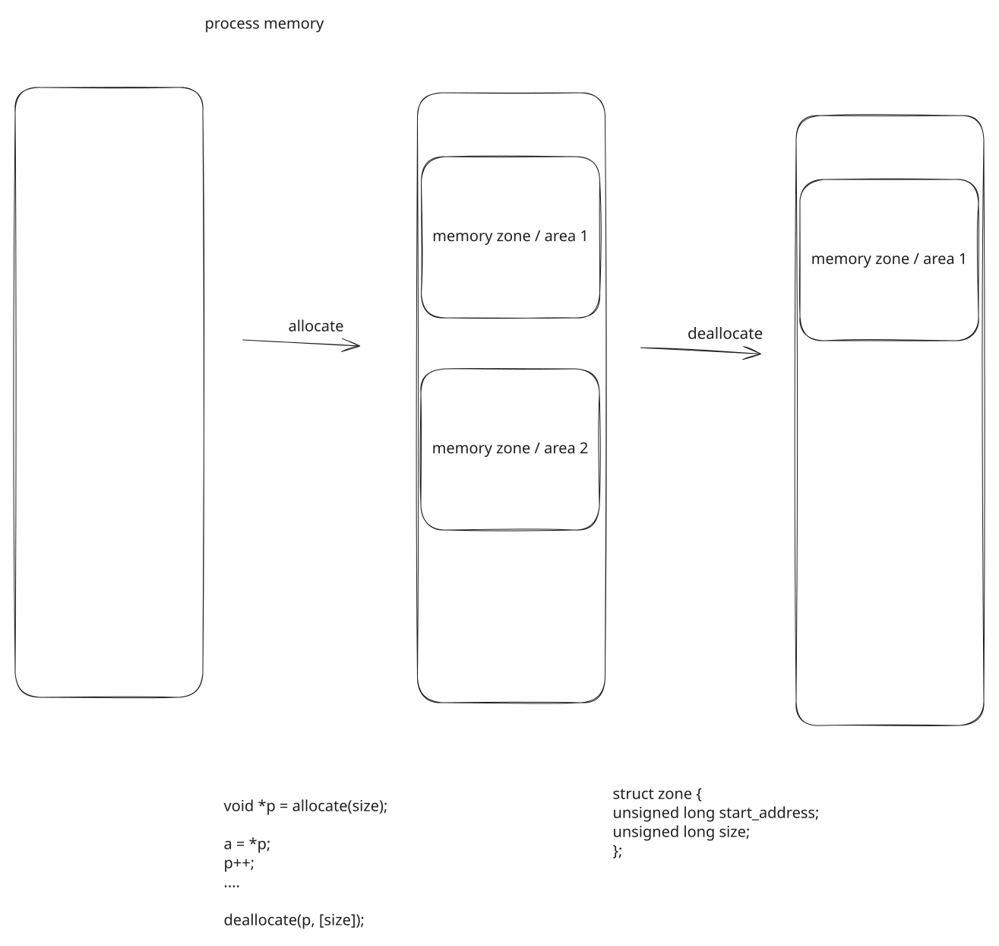
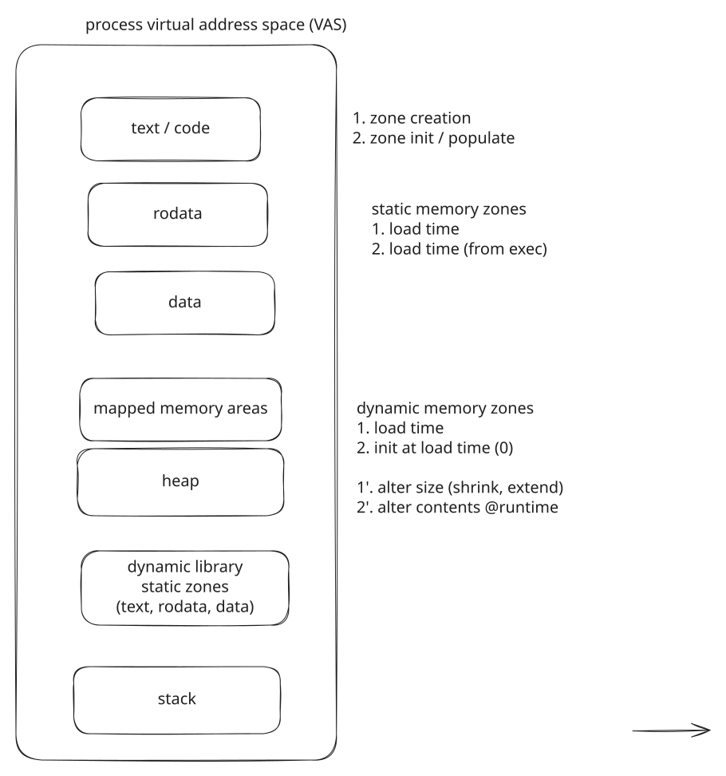
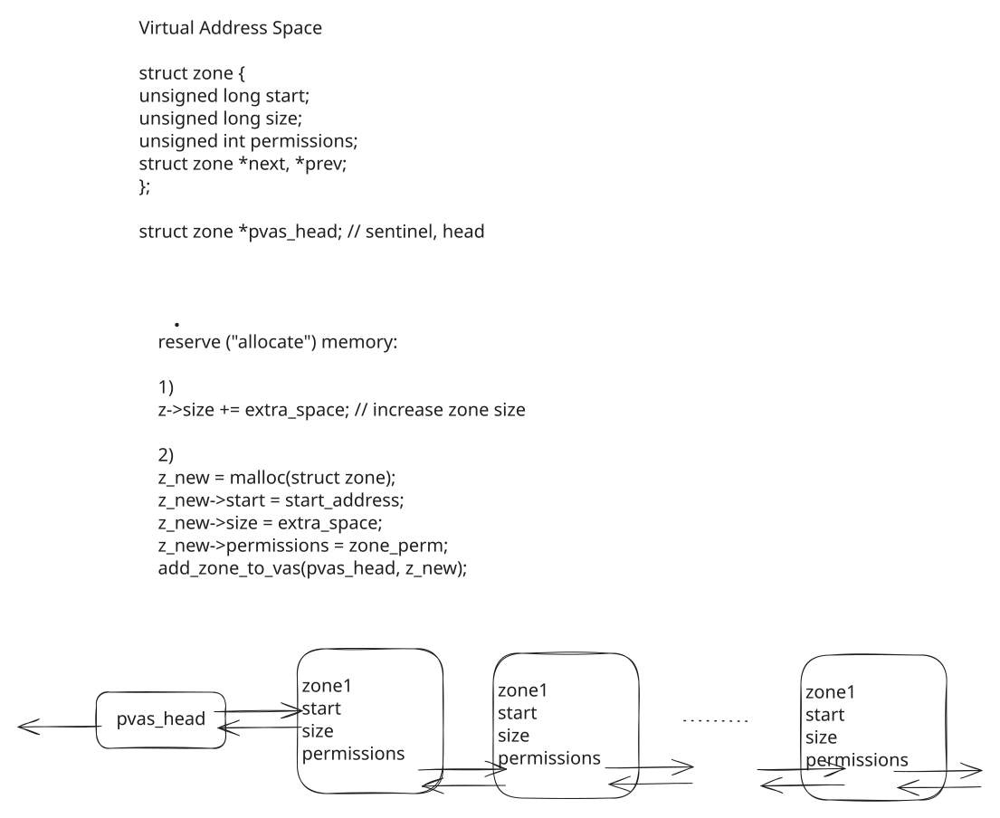
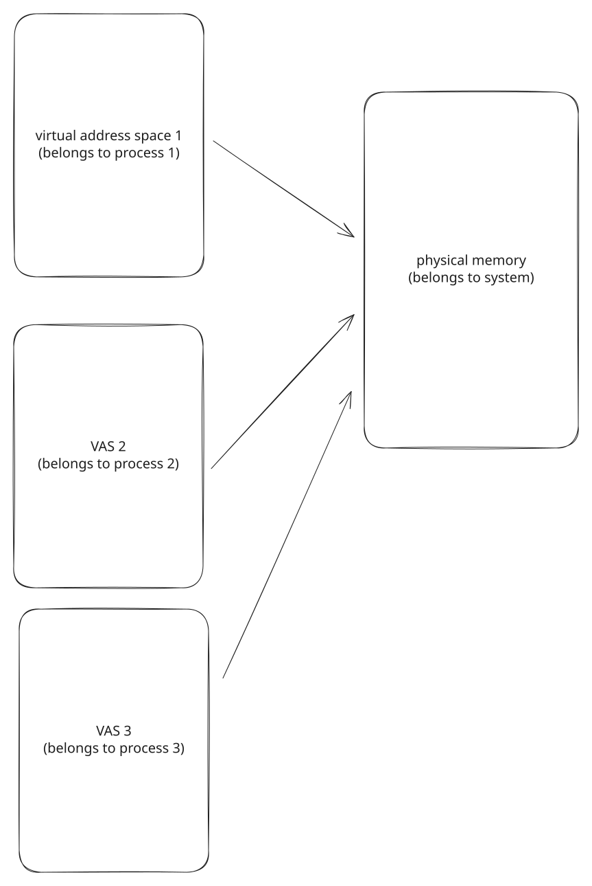

# 00. Pitch

## A browser with 1.5 TB of memory

```text
$ ps -e -o pid,vsz,rss,comm --sort -vsz | head -4
    PID    VSZ   RSS COMMAND
  32573 1544448496 879760 chrome
  34405 1533182040 904016 Discord
 253577 1528348464 346232 signal-desktop
```

1,544,448,496 KB is 1.44 TiB.
The machine has 59 GB of RAM and 80 GB of swap.

::: {.notes}
Run it on the lecture machine, whatever it shows. Anything Chromium-based is in the terabytes.
Do not explain the second column yet; part 03 names it.
:::

## Ten terabytes in a blink

```c
for (unsigned int i = 0; i < num_gb; i++)
	mmap(NULL, ONE_GB, PROT_READ | PROT_WRITE, MAP_PRIVATE | MAP_ANONYMOUS, -1, 0);
```

```text
$ ps -o pid,vsz,rss,cmd -p $(pidof allocate_gb)
    PID    VSZ   RSS CMD
1195513   2752  1824 ./allocate_gb 10240       before
1195513 10737420992  1824 ./allocate_gb 10240  after
```

Ten thousand calls, a fraction of a second, and 1,824 KB resident before and after.

## The same address, twice

```text
$ ./same_address                       $ ./same_address
pid 1209178: &value = 0x404040,        pid 1209182: &value = 0x404040,
             value = 1209178                        value = 1209182
pid 1209178: code   = 0x401253         pid 1209182: code   = 0x401253
```

Same address, two values.
Press Enter in either: its value is still its own.

::: {.notes}
Two terminals, read the two &value lines aloud.
Built -no-pie so the address is stable; mention ASLR only if asked.
:::

## Three facts, one conclusion

* There are not 1.5 TB of places.
* A program cannot take ten of something the machine has one of.
* One place holds one value.

**An address is not a place in RAM.**
This lecture is about what it is instead.

## The story

{fig-align="center" width="78%"}

# 01. What We Already Know

## A process is a list of areas

{fig-align="center" width="66%"}

## Allocation changes the list

{fig-align="center" width="66%"}

A new area, or a larger one; an area removed, or a smaller one.

## Behind `malloc()`

{fig-align="center" width="60%"}

An allocator in libc; `brk()` to grow the heap, `mmap()` for a block of its own.

## Four megabytes, four ways

```text
                            Kbytes     RSS   Dirty
after malloc(4 MB)            4100       4       4 rw---   [ anon ]   a new area
after mmap(4 MB)              4096       0       0 rw---   [ anon ]   a new area
after 1024 x malloc(4 KB)     4224    4108    4108 rw---   [ anon ]   the heap, grown
after 1024 x mmap(4 KB)       3704       0       0 rw---   [ anon ]   1024 calls, 4 areas
```

A thousand `mmap()`s made four lines: adjacent areas with the same permissions are merged.

::: {.notes}
memory_ops_pages under pmap -x if the room is hazy on lecture 03; otherwise read the lines here.
malloc-size under strace: one mmap for the single call, 35 brk for the thousand.
:::

## The column nobody read

```text
after 1024 x malloc(4 KB)     4224    4108    4108 rw---   [ anon ]
after mmap(4 MB)              4096       0       0 rw---   [ anon ]
```

Both added 4 MB to the list.
One has 4 MB in physical memory; the other has none.

The list of areas does not say which.
Nothing in lecture 03 did.

# 02. The Process Virtual Address Space

## One space per process

* `0x404040` names a byte **in a process**; every process has a complete set of names of its own.
* No instruction can form an address outside its own space: that is **isolation**.
* Every program is linked for the same addresses; `main()` at `0x401253` in both copies.

## The space is a list of zones

{fig-align="center" width="52%"}

## A zone is a few numbers

```c
struct zone {
	unsigned long start;
	unsigned long size;
	unsigned int permissions;
	struct zone *next, *prev;
};

struct zone *pvas_head;
```

{fig-align="center" width="60%"}

## Reserving

Extend a zone:

```c
z->size += extra_space;
```

Or add one:

```c
z_new = malloc(sizeof(struct zone));
z_new->start = start_address;
z_new->size = extra_space;
z_new->permissions = zone_perm;
add_zone_to_vas(pvas_head, z_new);
```

That is all `mmap()` did ten thousand times.
No byte was found, cleared or handed over.

## Why "virtual"

* A zone is **bookkeeping**: a range of addresses, and what may be done with them.
* Creating one is **reserving**; nothing stands behind the addresses yet.
* The space is a set of promises about addresses, not a set of bytes.
* The kernel may refuse: `./allocate_gb 140000` stops with `ENOMEM` near 128 TiB.

## Why virtual memory at all

* **Simplicity** --- every program sees the same layout; addresses are fixed at build time.
* **Isolation** --- a process can only name its own bytes.
* **More than there is** --- reserving is free; what is not in use can be elsewhere.
* **Sharing** --- two spaces can name the same physical bytes; one libc for everyone.

# 03. Virtual Memory and Physical Memory

## Two kinds of memory

| | virtual | physical |
| --- | --- | --- |
| belongs to | a process, one space each | the machine, one of it |
| how large | what the process reserves, up to 128 TiB | what is installed |
| what it is | a set of addresses, a promise | the bytes |
| obtained by | reserving: `mmap()`, `brk()`, `malloc()` | the kernel, page by page |
| used by | every program, through every address | nobody directly |

## Three spaces, one RAM

{fig-align="center" width="40%"}

## The two sizes of a process

| process | `VSZ` | `RSS` | ratio |
| --- | ---: | ---: | ---: |
| `./hello` | 2,752 KB | 1,696 KB | 1.6 |
| `bash` | 10,452 KB | 4,268 KB | 2.4 |
| `chrome` | 1,544,448,496 KB | 879,760 KB | 1,755 |

`VSZ`: the sum of the zones.
`RSS`: the physical memory held right now.
The first is never smaller.

::: {.notes}
ps -o pid,vsz,rss,cmd -p $$ first: the shell they are looking at has two sizes too.
:::

## Reserving costs nothing

```text
    PID    VSZ   RSS CMD
1195603   2752  1696 ./reserve_mem      before
1195603   6848  1696 ./reserve_mem      after mmap(4 MB, rw)
1195603  10944  1696 ./reserve_mem      after mmap(4 MB, r)
1195603  15040  1696 ./reserve_mem      after mmap(4 MB, rwx)
1195603  10944  1696 ./reserve_mem      after munmap()
1195603   6848  1696 ./reserve_mem      after munmap()
1195603   2752  1696 ./reserve_mem      after munmap()
```

`VSZ` moves by 4,096 KB a step.
`RSS` is 1,696 KB seven times.

::: {.notes}
Seven prompts, ps at each, read RSS aloud every time.
:::

## What a virtual size is made of

{fig-align="center" width="80%"}

# 04. Reserve, Allocate, Map

## Three steps, not one

{fig-align="center" width="56%"}

1. **Reserve** virtual memory: an entry in the list of zones.
1. **Allocate** physical memory: a free page of RAM.
1. **Map** one to the other: this virtual page is backed by that physical page.

## Who, and when

| step | done by | when | costs |
| --- | --- | --- | --- |
| reserve | `mmap()`, `brk()`, `malloc()`; the loader; the kernel for the stack | at the call | an entry in a list |
| allocate | the kernel | at the first access to each page | a page, found and zeroed |
| map | the kernel | right after allocating | a page table entry |

Step 1 happens alone all the time.
Steps 2 and 3 never happen apart.

## Paying on the first touch

{fig-align="center" width="92%"}

## Touch half, pay for half

```text
                                    VSZ   RSS  faults   the zone, in pmap
before                             2752  1696      65   --
after mmap(4 MB)                   6848  1696      65   4096       0       0 rw---   [ anon ]
after writing to 512 pages         6848  3744     577   4096    2048    2048 rw---   [ anon ]
after munmap()                     2752  1696     577   --
```

512 pages written, 2,048 KB resident, 512 page faults.
The other 512 pages cost nothing.

::: {.notes}
Before the touch step, ask what RSS will be after it. Half the room says 4 MB.
:::

## One fault per page, once

```text
$ ./page_faults
mmap():                          0 page faults
first write to every page:    1024 page faults
second write to every page:      0 page faults
```

Once mapped, the hardware translates on its own; the kernel is out of the picture.

## The zero page

```text
first read of every page:     1024 page faults
then first write:             1024 page faults
```

Read a fresh page and the kernel maps it to one shared, read-only page of zeroes.
Write to it and it faults again, and gets a page of its own: copy-on-write.

## Why `VSZ` > `RSS`, resolved

* **reserved, never touched** --- step 1 without 2 and 3
* **file, not read yet** --- the executable's own pages, read in at first access by the same fault
* **swapped out** --- the kernel took the frame back; the next access brings it in
* **shared** --- inside `RSS`, counted once per process, existing once

The browser: one terabyte zone, reserved on purpose, almost none of it touched.

## Where the mapping goes

For every virtual page touched: which physical page holds it.

* read by the hardware, on every access
* written by the kernel, one entry per page fault
* one per process

That structure is the page table.

# 05. Pages and the Page Table

## Pages and frames

{fig-align="center" width="56%"}

Virtual memory in **pages**, physical memory in **frames**, 4 KB each.
Any page to any frame.

## An address is a page number and an offset

```text
0x7cc0081e7abc  =  page 0x7cc0081e7  +  offset 0xabc
```

* page number: the address divided by 4096 --- the address without its last three hex digits
* offset: the remainder --- the last three digits
* mapping a page: replace the page number by the frame number, keep the offset

## Why pages

* allocating a frame is taking any free one; no "not enough room in one piece"
* sharing, swapping, protecting, copying: whole pages, one entry each
* the price is at the edges: 100 bytes take a 4 KB page

Why 4 KB and not 4 MB: next lecture.

## The page table

{fig-align="center" width="62%"}

## One entry per page

```c
struct page_table_entry {
	bool valid;
	unsigned int frame_index;
	unsigned int permissions;
	unsigned int flags;
};

struct page_table_entry page_table[N];
```

* **index**: the virtual page number
* **out**: the frame number, if `valid`
* the kernel writes it; the hardware reads it; one per process

## Translation, on every access

{fig-align="center" width="62%"}

```c
frame_index = page_table[page_index].frame_index;
physical_address = frame_index * PAGE_SIZE + offset;
```

## Reading your own page table

```text
$ ./pagemap
after mmap(), before any access:
  page 0: virtual 0x7cc0081e7000  index 0x7cc0081e7  present 0
  page 1: virtual 0x7cc0081e8000  index 0x7cc0081e8  present 0
after writing to pages 0 and 2:
  page 0: virtual 0x7cc0081e7000  index 0x7cc0081e7  present 1
  page 1: virtual 0x7cc0081e8000  index 0x7cc0081e8  present 0
  page 2: virtual 0x7cc0081e9000  index 0x7cc0081e9  present 1
```

`/proc/self/pagemap`: one 64-bit entry per page, at offset `index * 8`.
The file *is* the array.

::: {.notes}
Point at the index column next to the address: the page number is the address without its last three digits.
:::

## Any page, any frame

```text
$ sudo ./pagemap
  page 0: virtual 0x7e62419b6000  index 0x7e62419b6  present 1  frame 0x3bef35
  page 1: virtual 0x7e62419b7000  index 0x7e62419b7  present 1  frame 0x6c7f90
  page 2: virtual 0x7e62419b8000  index 0x7e62419b8  present 1  frame 0x8b48ec
  page 3: virtual 0x7e62419b9000  index 0x7e62419b9  present 0  frame 0x0
```

Three consecutive pages; frames 16 GB, 29 GB and 37 GB into the RAM.
Frame `0x6c7f90` is the zero page: page 1 was only read.

## One frame, two processes

```text
$ sudo ./shared_frame
pid 1209193: printf() is at 0x76398c263f90 -> frame 0xfac4bd
$ sudo ./shared_frame
pid 1209195: printf() is at 0x722fcc463f90 -> frame 0xfac4bd
```

One copy of libc's code in memory.
`/proc/kpagecount`: 229 page tables point at that frame.

## The pitch, resolved

* **`0x404040` twice**: two page tables, the same index, two frames.
* **`printf()` twice**: two page tables, two indices, one frame.
* **1.5 TB**: a page table in which almost every entry is invalid, and an invalid entry costs nothing.
* **10 TB in a blink**: ten thousand zones, zero entries written.

## What the segmentation fault was

The MMU raises a page fault for an entry that is not valid, or forbids the access.
The kernel decides what it means:

* inside a reserved zone, access allowed: **demand paging**, allocate and map
* outside every zone, or access forbidden: **`SIGSEGV`**, `SEGV_MAPERR` or `SEGV_ACCERR`

Same hardware event.
The list of zones tells them apart.

## What this costs

* 128 TiB of space, 4 KB pages: 2^35 entries, 256 GB of table per process, if flat
* read on every load, store and fetch

Neither happens.
Lecture 05: tables in levels, a cache of translations, and what the kernel does when the page is on disk.

# 06. Conclusion

## What we covered

* three facts that rule out "an address is a place in RAM"
* the recap: a list of areas, allocation as a change to it, `malloc()` over `brk()` and `mmap()`
* one virtual address space per process: a list of zones, reservation as an entry, four reasons
* virtual against physical, `VSZ` against `RSS`, and what the gap is made of
* reserve, allocate, map; demand paging; the page fault, once per page
* pages and frames, the page table as an array indexed by page number, the MMU on every access

## {background-color="#f0f0f0"}

::: {style="font-size: 1.25em; text-align: center; margin-top: 1.5em;"}
**All addresses are virtual.**

Each process has a space of its own, a list of zones;
allocating only adds to the list.

Physical memory arrives at the first touch of each page,
through a page fault, once.

The page table, one per process, maps pages to frames,
and the hardware reads it on every access.
:::

## Next

* **Lecture 05** --- inside the page fault: pages on disk, tables in levels, the TLB, `fork()` and copy-on-write.
* **Lab 03** --- `mmap()` as a buffer; 32,400 page faults per 63 MiB frame in the `malloc()` tuning bonus.
* **Lab 04** --- every `SIGSEGV` is an entry that said no; `gdb` and `valgrind` find the access that asked.
