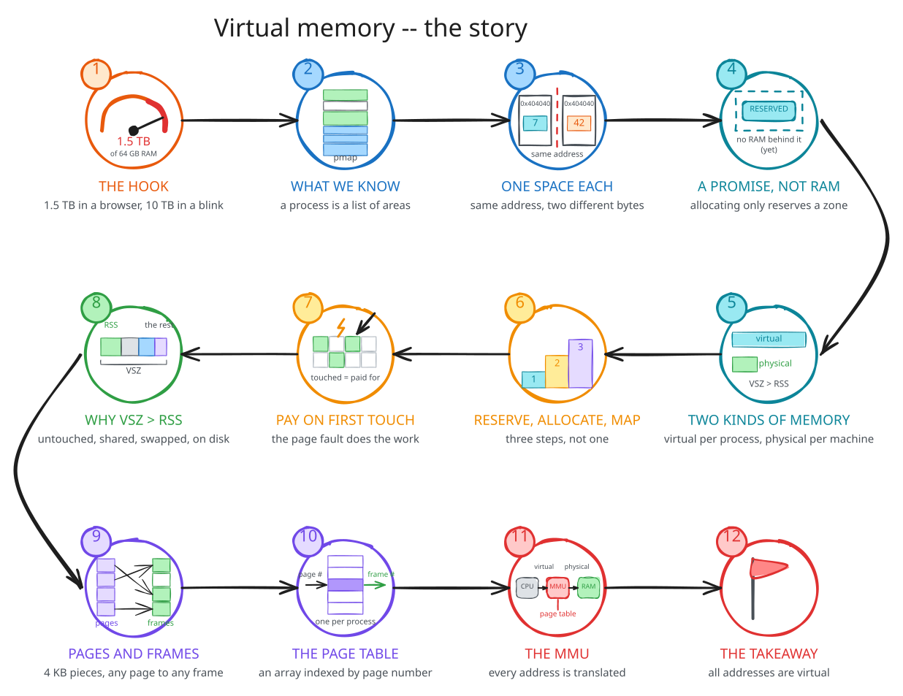
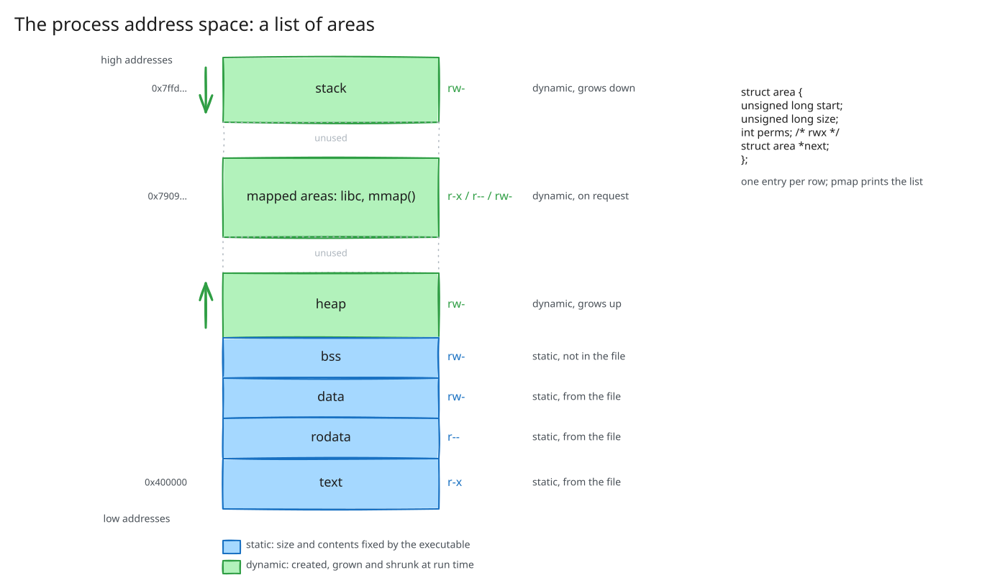
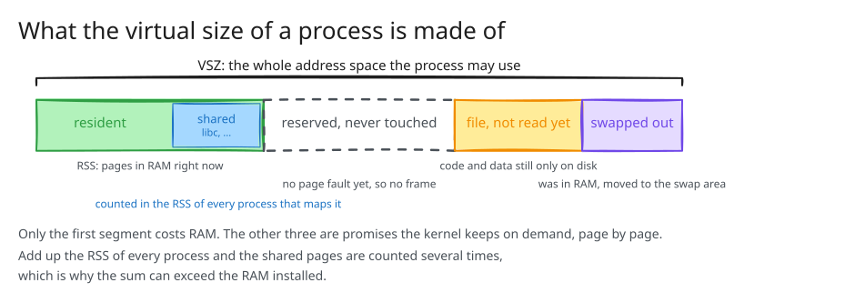
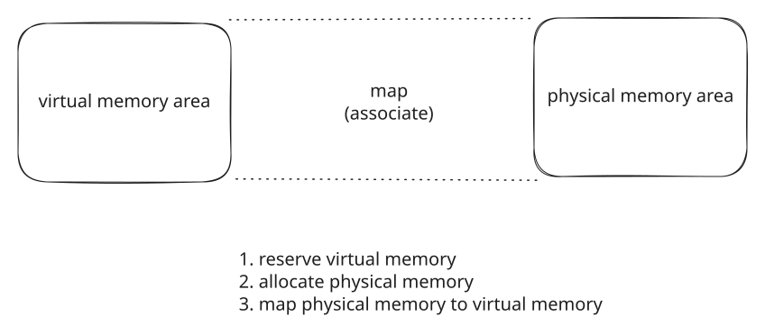
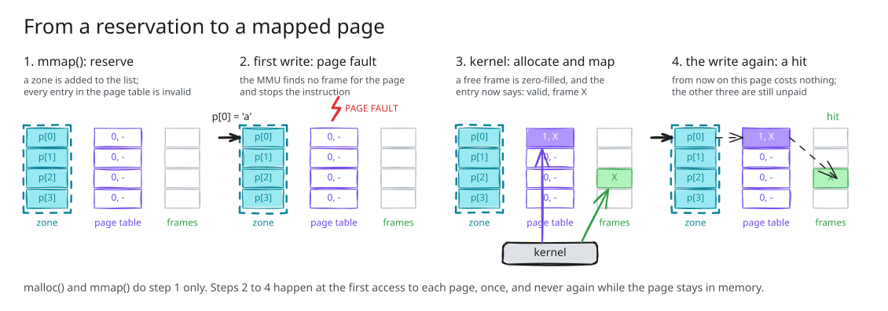
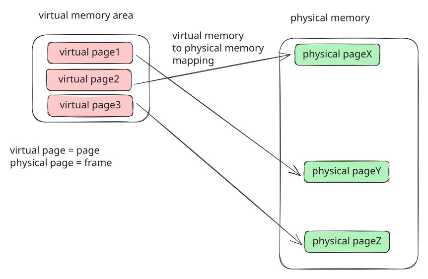
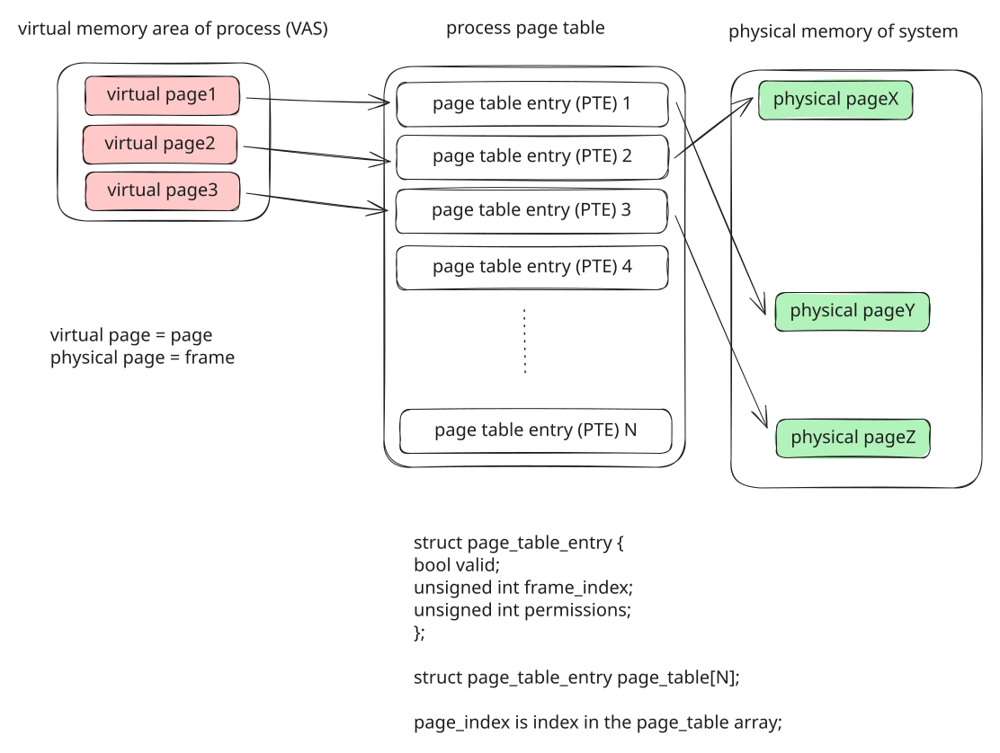
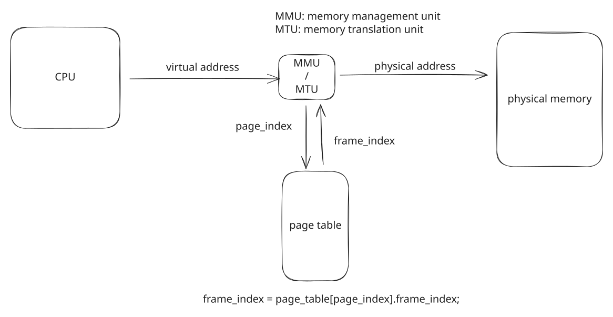

## Three things that cannot be {background-color="#f7f7f7"}

```text
$ ps -e -o pid,vsz,rss,comm --sort -vsz | head -2
    PID    VSZ   RSS COMMAND
  32573 1544448496 879760 chrome          1.44 TiB, on 59 GB of RAM

$ ps -o vsz,rss -p $(pidof allocate_gb)
       2752  1824                         before 10,240 x mmap(1 GB)
10737420992  1824                         after: 10 TiB, same RSS

pid 1209178: &value = 0x404040, value = 1209178
pid 1209182: &value = 0x404040, value = 1209182
```

If an address were a place in RAM, none of these would be possible.

::: {.notes}
ps on the lecture machine. allocate_gb 10240 with ps in a second terminal. Two copies of same_address.
State it as a puzzle; each fact gets resolved later: 10 TB in part 03, the browser in 04, the same address in 05.
:::

## The story

{fig-align="center" width="78%"}

## What we know: a list of areas

{fig-align="center" width="50%"}

```text
after 1024 x malloc(4 KB)   4224    4108    4108 rw---   [ anon ]
after mmap(4 MB)            4096       0       0 rw---   [ anon ]
```

Both added 4 MB to the list. The list does not say which is in RAM.

::: {.notes}
Recap from the figure; memory_ops_pages under pmap only if the room needs it.
End on the RSS column: that is the gap this lecture fills.
:::

## One list per process, and it is only a list

```c
struct zone { unsigned long start, size; unsigned int permissions; struct zone *next, *prev; };

z->size += extra_space;                      /* extend a zone  */
add_zone_to_vas(pvas_head, z_new);           /* or add one     */
```

* `0x404040` is a name **inside a process**; the kernel keeps the spaces apart.
* Allocating adds to the list. Nothing else happens. We call it **reserving**.
* "Virtual": a promise about addresses, not a set of bytes.

::: {.notes}
Same address, two bytes: isolation. Same layout for every program: the linker never asks.
Four reasons: simplicity, isolation, more than there is, sharing.
:::

## Two kinds of memory

| | virtual | physical |
| --- | --- | --- |
| belongs to | a process, one space each | the machine, one of it |
| how large | what the process reserves (up to 128 TiB) | what is installed |
| what it is | addresses, a promise | the bytes |
| used by | every program, through every address | nobody directly |

## `VSZ` and `RSS`

```text
    PID    VSZ   RSS CMD
1195603   2752  1696 ./reserve_mem      before
1195603   6848  1696 ./reserve_mem      after mmap(4 MB)
1195603  10944  1696 ./reserve_mem      after mmap(4 MB)
1195603  15040  1696 ./reserve_mem      after mmap(4 MB)
1195603   2752  1696 ./reserve_mem      after 3 x munmap()
```

| | `VSZ` | `RSS` |
| --- | ---: | ---: |
| `./hello` | 2,752 KB | 1,696 KB |
| `chrome` | 1,544,448,496 KB | 879,760 KB |

::: {.notes}
ps -o vsz,rss -p $$ first. Then reserve_mem, ps at every prompt, RSS read aloud seven times.
Virtual memory is not swap: say it here.
:::

## What a virtual size is made of

{fig-align="center" width="82%"}

## Reserve, allocate, map

{fig-align="center" width="46%"}

| step | who | when |
| --- | --- | --- |
| reserve | `mmap()`, `brk()`, `malloc()`, the loader | at the call |
| allocate | the kernel | at the **first access** to each page |
| map | the kernel | right after, same page |

## Pay on first touch

{fig-align="center" width="94%"}

## Touch half, pay for half

```text
                              VSZ   RSS  faults
after mmap(4 MB)             6848  1696      65
after writing to 512 pages   6848  3744     577      +2048 KB, +512 faults

$ ./page_faults
mmap():                          0 page faults
first write to every page:    1024 page faults
second write to every page:      0 page faults
```

Once per page, and never again while the page stays in memory.

::: {.notes}
Ask what RSS will be before the touch step. Half the room says 4 MB.
The browser, resolved: one terabyte zone, reserved on purpose, never touched.
Zero page and copy-on-write only if the room is ahead.
:::

## Pages and frames

{fig-align="center" width="46%"}

```text
0x7cc0081e7abc  =  page 0x7cc0081e7  +  offset 0xabc
```

4 KB each. Any page to any frame. Keep the offset, swap the page number for the frame number.

## The page table

{fig-align="center" width="52%"}

```c
struct page_table_entry { bool valid; unsigned int frame_index; unsigned int permissions; };
struct page_table_entry page_table[N];     /* index: the virtual page number; one per process */
```

## Translated on every access

{fig-align="center" width="48%"}

```text
$ sudo ./pagemap
  page 0: virtual 0x7e62419b6000  index 0x7e62419b6  present 1  frame 0x3bef35
  page 2: virtual 0x7e62419b8000  index 0x7e62419b8  present 1  frame 0x8b48ec
  page 3: virtual 0x7e62419b9000  index 0x7e62419b9  present 0  frame 0x0
$ sudo ./shared_frame
pid 1209193: printf() at 0x76398c263f90 -> frame 0xfac4bd
pid 1209195: printf() at 0x722fcc463f90 -> frame 0xfac4bd
```

::: {.notes}
pagemap as user first: present bits flip at the touch. The index is the address without its last three digits; the file offset is index * 8. The file is the array.
sudo twice for shared_frame: two indices, one frame. Then the pitch: same index, two frames.
Not valid or not allowed: page fault; the kernel decides between demand paging and SIGSEGV.
:::

## {background-color="#f7f7f7"}

::: {style="font-size: 1.25em; text-align: center; margin-top: 1.5em;"}
**All addresses are virtual.**

Each process has a space of its own, a list of zones;
allocating only adds to the list.

Physical memory arrives at the first touch of each page,
through a page fault, once.

The page table, one per process, maps pages to frames,
and the hardware reads it on every access.
:::

::: {.notes}
Next time: inside the page fault, tables in levels, the TLB, fork and copy-on-write.
:::
