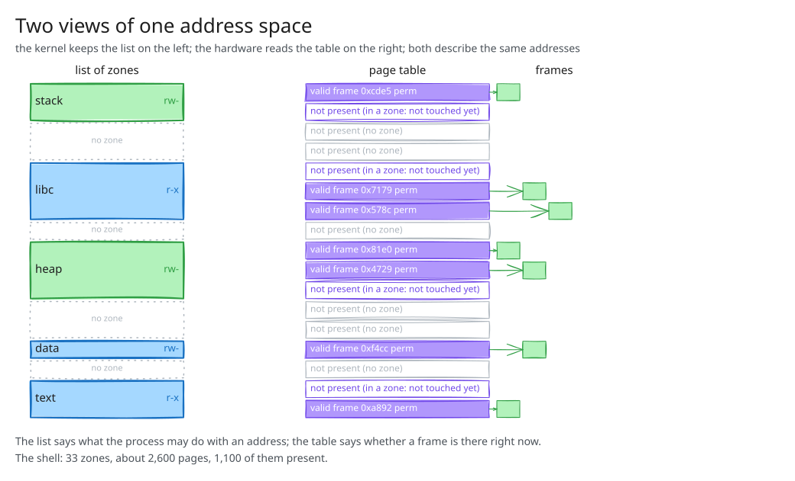
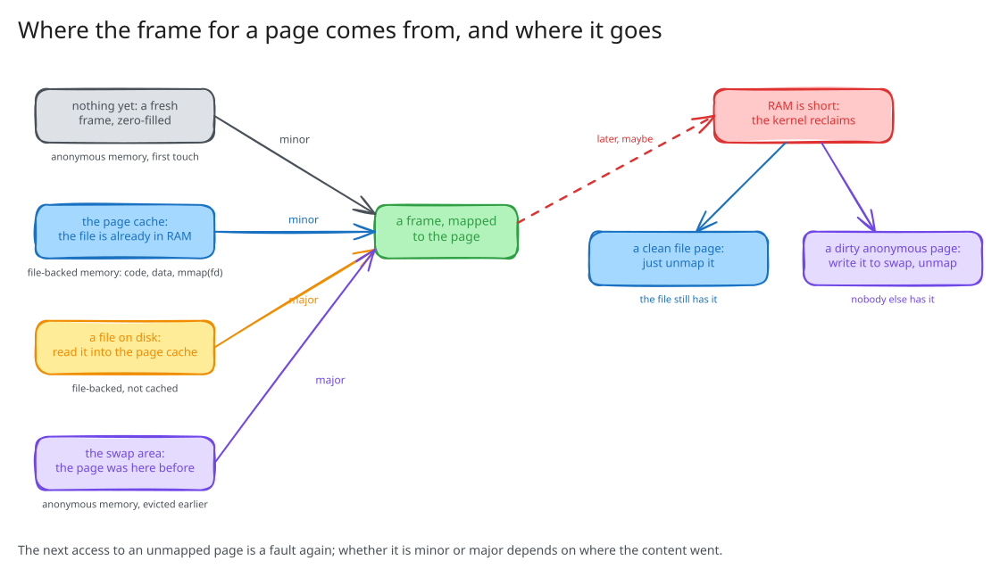
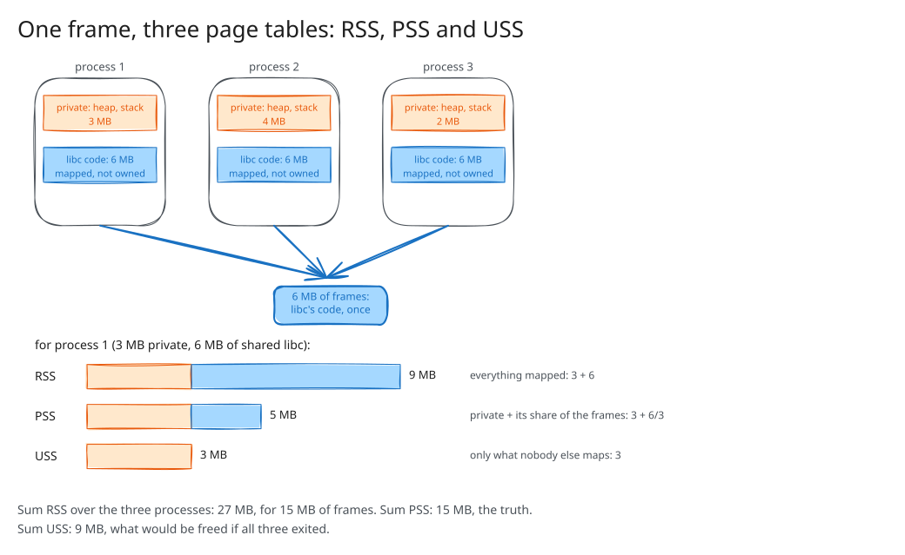
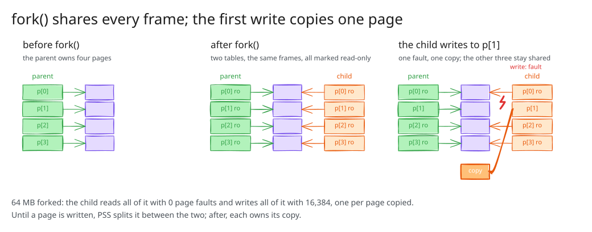
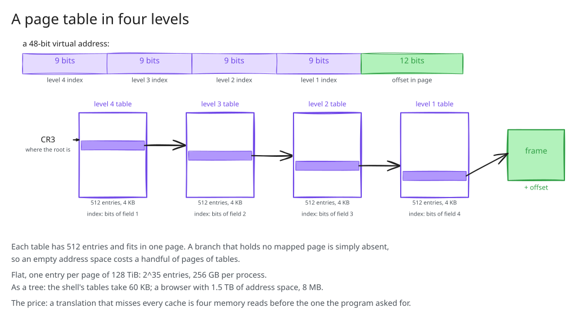

# 00. Pitch

## Ten billion page faults

```text
$ grep -E '^pgfault|^pgmajfault' /proc/vmstat
pgfault 9687532485
pgmajfault 148220
$ awk '{printf "up %.1f days\n", $1 / 86400}' /proc/uptime
up 16.9 days
$ ps -eo pid,min_flt,maj_flt,rss,comm --sort -min_flt | head -2
    PID  MINFL  MAJFL   RSS COMMAND
  38939 1651432334  3 626112 chrome
```

6,600 a second, on an idle machine.
One in 65,000 needed the disk.

::: {.notes}
Do the division aloud. Each one is an instruction the hardware stopped and the kernel finished.
:::

## More resident memory than memory

```text
$ ps -eo rss= | awk '{ s += $1 } END { print s / 1024 " MB" }'
58339 MB
$ free -m
               total        used        free      shared  buff/cache   available
Mem:           60900       41409        2891        3839       21688       19490
$ smem -tk -c "uss pss rss" | tail -1
   32.3G    34.2G    55.5G
```

The processes claim 58 GB.
The machine has 61 and uses 41.

## Memory that is not in memory

```text
$ swapon --show
NAME      TYPE      SIZE   USED PRIO
/dev/dm-1 partition  80G 834.2M   -2
```

834 MB of some processes' memory is on a disk partition.
They have not noticed.

## Three numbers, one mechanism

* **Inside the page fault**: what the kernel does 6,600 times a second.
* **Where the frame comes from**, and where it goes when RAM is short.
* **One frame in many tables**: why `RSS` overcounts.
* **The table itself**: how it fits, and how it is read without slowing everything down.

## The story

{fig-align="center" width="78%"}

# 01. Two Views of One Address Space

## The list and the table

{fig-align="center" width="70%"}

## What each one says

```c
struct zone {                          struct page_table_entry {
	unsigned long start;                   bool valid;
	unsigned long size;                    unsigned int frame_index;
	unsigned int permissions;              unsigned int permissions;
	struct zone *next, *prev;              unsigned int flags;
};                                     };
```

| | list of zones | page table |
| --- | --- | --- |
| kept by | the kernel | the kernel, for the hardware |
| read by | the kernel | the MMU, on every access |
| edited by | system calls: `mmap()`, `brk()`, `mprotect()` | the page fault handler |
| says | what the process **may** do | what the process **has** |

## The shell, counted both ways

```text
$ grep -c . /proc/$$/maps
33
$ grep -E 'VmSize|VmRSS' /proc/$$/status
VmSize:    10588 kB
VmRSS:      4392 kB
$ awk ... /proc/$$/status
pages: 2647  present: 1098
```

33 zones.
2,647 entries, 1,098 of them valid.
The other 1,549: allowed, and absent.

## Translation, again

{fig-align="center" width="62%"}

## Two edits

{fig-align="center" width="90%"}

## Which step edits which

```text
                                       VSZ   RSS  MINFL
before                                2752  1692     64
after mmap(4 MB)                      6848  1692     64
after writing byte 0 of every page    6848  5788   1088
after writing byte 4095 of every page 6848  5788   1088
after munmap()                        2752  1692   1088
```

`mmap()`: the list.
First writes: the table, one fault per entry.
Second writes: nothing; the entries are valid.

::: {.notes}
reserve_allocate with ps at every prompt. The third prompt, where nothing changes, is the moment.
:::

# 02. The Page Fault

## Step by step

{fig-align="center" width="68%"}

## Four verdicts

| verdict | the address is | the frame | the process sees | time |
| --- | --- | --- | --- | --- |
| minor fault | in a zone, allowed | found in memory | nothing | ~1 µs |
| major fault | in a zone, allowed | read from disk | a delay | ms |
| `SEGV_MAPERR` | in no zone | -- | `SIGSEGV` | -- |
| `SEGV_ACCERR` | in a zone that forbids it | -- | `SIGSEGV` | -- |

One trap.
The hardware knows the table; the list is what lets the kernel decide.

## Two kinds of no

```text
$ ./segfault 6
Reserve ro page with mmap.
Write to first byte in page.
SIGSEGV at 0x7dd401855000: SEGV_ACCERR: the zone forbids this access

$ ./segfault 3
Reserve rw page with mmap.
Read out of bounds.
SIGSEGV at 0x755bca209000: SEGV_MAPERR: no zone covers the address
```

Eight accesses, the same trap every time; three frames, four `MAPERR`, one `ACCERR`.

::: {.notes}
Run 1 as well so they see the same access succeed. strace -e trace=none ./segfault 3 shows the kernel's version.
:::

## Two kinds of yes

```text
$ ./major_fault
16384 pages of data.bin

first pass (from disk):           1 minor,  16384 major faults, 0.302 s
second pass (from the cache):  1024 minor,      0 major faults, 0.002 s
```

Same file, same instructions.
Where the content was when the fault arrived: a factor of 150.

::: {.notes}
Say "the second pass is the same code" before running it. Not on /tmp.
1,024 not 16,384 on the cached pass: fault-around, 16 pages per fault when the frames are there.
:::

## The hardware's way into the kernel

* A **system call** is the program asking the kernel.
* A **page fault** is the hardware asking the kernel, on the program's behalf.

Everything from here on happens inside that handler, between the trap and the retry.

# 03. Where Frames Come From

## Four sources

{fig-align="center" width="74%"}

## The page cache

```text
$ free -m
               total        used        free      shared  buff/cache   available
Mem:           60900       41409        2891        3839       21688       19490
$ fincore /usr/bin/bash /usr/lib/x86_64-linux-gnu/libc.so.6 2>/dev/null
  RES PAGES  SIZE FILE
 1.7M   426  1.7M /usr/bin/bash
 2.1M   532  2.1M /usr/lib/x86_64-linux-gnu/libc.so.6
```

21 GB of files kept in memory.
The text zone of a process **is** a mapping of its file; the frames are the page cache's.

## When RAM is short

* The kernel **reclaims**: picks pages not used recently, invalidates their entries, frees their frames.
* A clean file page: just unmap it; the file still has it.
* A dirty anonymous page: write it to **swap** first, then unmap.
* The next access: a major fault, from the file or from swap.

## Swap, in a box

```text
$ systemd-run --user --scope -p MemoryMax=64M ./swap
start:                   RSS      1 MB   swap      0 MB   major faults      0   0.00 s
after writing 256 MB:    RSS     63 MB   swap    193 MB   major faults      3   0.62 s
after reading it back:   RSS     64 MB   swap    192 MB   major faults   8424   2.19 s
```

| | without the box | inside 64 MB |
| --- | ---: | ---: |
| resident at the end | 257 MB | 64 MB |
| in swap | 0 | 192 MB |
| major faults on the read | 0 | 8,424 |
| time of the read | 0.00 s | 2.19 s |

::: {.notes}
Plain run first. Let the two seconds pass in silence. The program never knew; it only got slower.
:::

# 04. Memory Sharing

## One frame, three page tables

{fig-align="center" width="66%"}

## Three metrics

| metric | a frame shared by n processes counts as | summed over all processes |
| --- | --- | --- |
| `RSS` | one full page, in each of the n | more than the memory in use |
| `PSS` | 1/n of a page, in each | the memory the processes use |
| `USS` | nothing, unless n is 1 | what exiting them all would free |

```text
62c63257a000-62c6326b0000 r-xp 00030000 fc:03 29884740   /usr/bin/bash
Rss:                1240 kB
Pss:                  63 kB
62c66092d000-62c660f62000 rw-p 00000000 00:00 0          [heap]
Rss:                6228 kB
Pss:                6228 kB
```

## Ten processes, four ways

| ten processes from | `USS` each | `PSS` each | `RSS` each | real total |
| --- | ---: | ---: | ---: | ---: |
| one static executable | 52 KB | 115 KB | 708 KB | 1.2 MB |
| one dynamic executable | 100 KB | 104 KB | 1,688 KB | 1.1 MB |
| ten static executables | 708 KB | 708 KB | 712 KB | 7.1 MB |
| ten dynamic executables | 116 KB | 120 KB | 1,692 KB | 1.2 MB |

Nobody asked for the sharing.
The pitch's 58 GB against 34 GB is this, across a desktop.

::: {.notes}
Run one-static and ten-static live, the other two from the table. kill.sh between.
:::

## Copy-on-write

{fig-align="center" width="88%"}

## `fork()`, measured

```text
parent before fork():   Rss 67096 kB  Pss 65654 kB  Shared_Dirty     0 kB  Private_Dirty 65648 kB
child  after fork():    Rss 66348 kB  Pss 32839 kB  Shared_Dirty 65616 kB  Private_Dirty    28 kB
child  reads every page:     0 page faults
child  writes to every page: 16384 page faults
child  after writing:   Rss 66604 kB  Pss 65610 kB  Shared_Dirty    76 kB  Private_Dirty 65568 kB
parent p[0] is still 1
```

`fork()` copied the table, not the pages.
Reading: free.
Writing: one fault, one copy, per page.

## Sharing on request

* `mmap()` with `MAP_SHARED`, `shm_open()`: a zone two processes agree to share and write.
* No copy on write; the fastest way to communicate; needs synchronisation.
* The inter-process communication lectures.

# 05. Storing the Page Table

## A table too big

* One entry per page of 128 TiB: 2^35 entries, 8 bytes each, **256 GB** per process.
* It cannot "only cover the zones": stack at `0x7ffd...`, libraries at `0x7f...`, program at `0x5...`, and an array indexed by page number spans the distance.

## Four levels

{fig-align="center" width="78%"}

## What it actually costs

```text
$ grep -E 'VmSize|VmRSS|VmPTE' /proc/$$/status
VmSize:    10588 kB
VmRSS:      4392 kB
VmPTE:        60 kB
$ grep -E 'VmSize|VmRSS|VmPTE' /proc/$(pgrep -f chrom | tail -1)/status
VmSize: 1522658872 kB
VmRSS:   1284720 kB
VmPTE:      7812 kB
```

60 KB for the shell.
8 MB for 1.5 TB of address space, where a flat table would be 3 GB.
The tree follows what is mapped, not what is reserved.

## A table too slow

* A translation from scratch: **four memory reads** before the one the program asked for.
* Every load, every store, every instruction fetch.

{fig-align="center" width="60%"}

## The TLB, defeated on purpose

```text
$ sudo perf stat -e dTLB-load-misses,dTLB-loads ./tlb
one byte per 4 KB page, 512 MB, 4 KB pages: 6.5 ns per access
         1,488,442      dTLB-load-misses   #   91.92% of all dTLB cache accesses
         1,619,221      dTLB-loads

$ sudo perf stat -e dTLB-load-misses,dTLB-loads ./tlb huge
one byte per 4 KB page, 512 MB, 2 MB pages: 4.9 ns per access
            13,569      dTLB-load-misses   #   53.85% of all dTLB cache accesses
            25,198      dTLB-loads
```

131,072 translations through a TLB of a few thousand; or 256 that fit.
What remains of the 4.9 ns is the data cache miss, which no TLB can help.

::: {.notes}
Read the miss counts, not the nanoseconds, which vary. Needs sudo; unsupported in most VMs.
:::

## What the TLB costs

* Its entries belong to one address space.
* Switching processes means flushing it, or tagging every entry with an address-space id.
* Part of what a context switch costs: lecture 06.

# 06. Conclusion

## What we covered

* ten billion faults, 58 GB of `RSS` on 41 GB in use, 834 MB in swap
* two views: the kernel's list of zones, edited by system calls; the page table, edited by the fault handler, read by the MMU
* the page fault step by step, and four verdicts: minor, major, `SEGV_MAPERR`, `SEGV_ACCERR`
* frames from zero, from the page cache, from disk, from swap; reclaim, and a program squeezed until it swapped
* one frame in many tables; `RSS`, `PSS`, `USS`; copy-on-write in `fork()`
* a four-level tree, 60 KB instead of 256 GB; a TLB, so that the tree is rarely read

## {background-color="#f0f0f0"}

::: {style="font-size: 1.25em; text-align: center; margin-top: 1.5em;"}
**The page fault is where the kernel does its memory work.**

It decides, from the list of zones, between fixing and killing;
it brings frames from zero, from files and from swap;
it shares frames between processes and copies them only on a write.

The page table makes it affordable:
a tree, so that it fits, and a TLB, so that it is rarely read.
:::

## Next

* **Lecture 06** --- the address space as what a process owns: `fork()` and `exec()`, threads sharing one, and the cost of a context switch, TLB included.
* **Lab 04** --- every crash is a verdict from part 02; `gdb` shows the address, `valgrind` the access.
* **Lab 05** --- an exploit needs a page both writable and executable; the permissions bit is what stands in the way.
