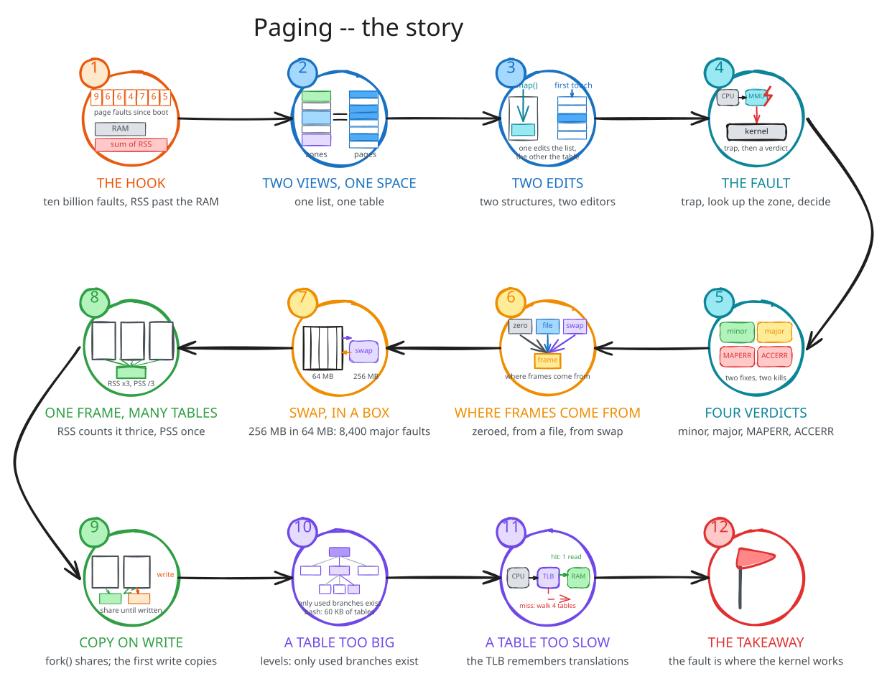
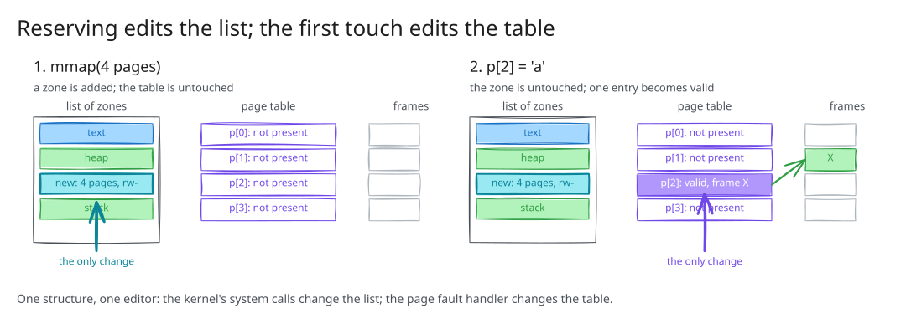
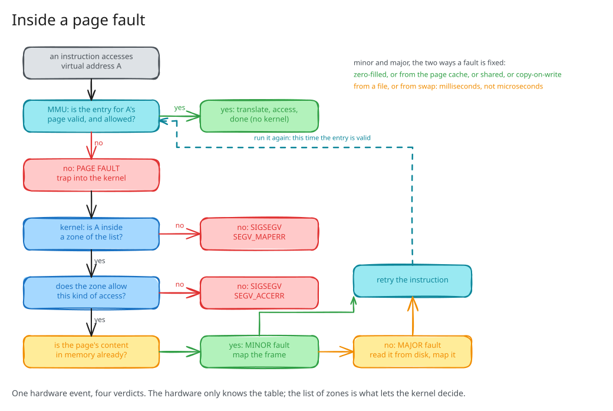
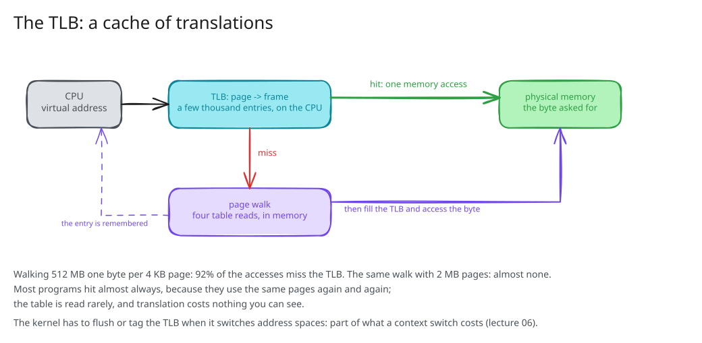

## Three numbers {background-color="#f7f7f7"}

```text
$ grep ^pgfault /proc/vmstat
pgfault 9687532485                     17 days: 6,600 a second

$ ps -eo rss= | awk '{ s += $1 } END { print s / 1024 " MB" }'
58339 MB                               on a machine with 61 GB, 41 in use

$ swapon --show
/dev/dm-1 partition  80G 834.2M        memory that is not in memory
```

Lecture 04: physical memory arrives in a page fault.
This lecture: what happens inside one.

::: {.notes}
Run all three on the lecture machine. Say which part answers which: the faults in 02 and 03, the RSS sum in 04, the swap in 03.
:::

## The story

{fig-align="center" width="78%"}

## Two views of one address space

{fig-align="center" width="58%"}

```text
$ grep -c . /proc/$$/maps                           33 zones
pages: 2647  present: 1098                          from VmSize and VmRSS
```

::: {.notes}
The kernel keeps the list and reads it; the kernel writes the table and the MMU reads it.
The list: what the process may do. The table: what it has.
:::

## Two edits

{fig-align="center" width="76%"}

```text
                                       VSZ   RSS  MINFL
after mmap(4 MB)                      6848  1692     64      the list
after writing byte 0 of every page    6848  5788   1088      the table, one fault each
after writing byte 4095 of every page 6848  5788   1088      nothing
```

::: {.notes}
reserve_allocate with ps at every prompt. The third prompt is the moment: valid entries, no kernel.
:::

## Inside a page fault

{fig-align="center" width="62%"}

## Four verdicts

| verdict | the address is | the frame | the process sees |
| --- | --- | --- | --- |
| minor fault | in a zone, allowed | found in memory | nothing, ~1 µs |
| major fault | in a zone, allowed | read from disk | a delay, ms |
| `SEGV_MAPERR` | in no zone | -- | `SIGSEGV` |
| `SEGV_ACCERR` | in a zone that forbids it | -- | `SIGSEGV` |

```text
$ ./segfault 6        SIGSEGV at 0x7dd401855000: SEGV_ACCERR: the zone forbids this access
$ ./segfault 3        SIGSEGV at 0x755bca209000: SEGV_MAPERR: no zone covers the address
$ ./major_fault       first pass (from disk):    16384 major faults, 0.302 s
                      second pass (from cache):   1024 minor faults, 0.002 s
```

::: {.notes}
Run segfault 1, 6, 3. Then major_fault, saying the second pass is the same code. Not on /tmp.
One trap; the list of zones decides.
:::

## Where frames come from

{fig-align="center" width="70%"}

::: {.notes}
free -m: 21 GB of buff/cache. fincore on bash: every page resident, those frames are the page cache's.
Virtual memory is not swap: swap is one of four sources.
:::

## Swap, in a box

```text
$ systemd-run --user --scope -p MemoryMax=64M ./swap
start:                   RSS      1 MB   swap      0 MB   major faults      0   0.00 s
after writing 256 MB:    RSS     63 MB   swap    193 MB   major faults      3   0.62 s
after reading it back:   RSS     64 MB   swap    192 MB   major faults   8424   2.19 s
```

Without the box: 257 MB resident, 0 major faults, 0.00 s.

The program never knew.
It only got slower.

::: {.notes}
Plain run first. Let the two seconds pass in silence. vmstat 1 in a second terminal if rehearsed.
:::

## One frame, many tables

{fig-align="center" width="56%"}

```text
62c63257a000-62c6326b0000 r-xp  /usr/bin/bash    Rss: 1240 kB   Pss:   63 kB
62c66092d000-62c660f62000 rw-p  [heap]           Rss: 6228 kB   Pss: 6228 kB
```

## Ten processes, four ways

| ten processes from | `USS` each | `PSS` each | `RSS` each | real total |
| --- | ---: | ---: | ---: | ---: |
| one static executable | 52 KB | 115 KB | 708 KB | 1.2 MB |
| one dynamic executable | 100 KB | 104 KB | 1,688 KB | 1.1 MB |
| ten static executables | 708 KB | 708 KB | 712 KB | 7.1 MB |
| ten dynamic executables | 116 KB | 120 KB | 1,692 KB | 1.2 MB |

`RSS`: once per process. `PSS`: split, sums to the truth. `USS`: only what nobody else maps.

::: {.notes}
Run one-static and ten-static live; the other two from the table. kill.sh between.
The pitch's 58 GB against 34 GB is this across a desktop.
:::

## Copy-on-write

{fig-align="center" width="80%"}

```text
child  after fork():         Pss 32839 kB  Shared_Dirty 65616 kB
child  reads every page:         0 page faults
child  writes to every page: 16384 page faults
```

## A table too big

{fig-align="center" width="66%"}

```text
flat: 2^35 entries x 8 B = 256 GB per process      VmPTE: bash 60 kB, chrome 7812 kB
```

## A table too slow

{fig-align="center" width="54%"}

```text
$ sudo perf stat -e dTLB-load-misses,dTLB-loads ./tlb         1,488,442 misses   91.9%   6.5 ns
$ sudo perf stat -e dTLB-load-misses,dTLB-loads ./tlb huge       13,569 misses   53.9%   4.9 ns
```

::: {.notes}
Read the miss counts, not the nanoseconds. 131,072 translations through a TLB of a few thousand; or 256 that fit.
Flushed or tagged on every context switch: lecture 06.
:::

## {background-color="#f7f7f7"}

::: {style="font-size: 1.25em; text-align: center; margin-top: 1.5em;"}
**The page fault is where the kernel does its memory work.**

It decides, from the list of zones, between fixing and killing;
it brings frames from zero, from files and from swap;
it shares frames between processes and copies them only on a write.

The page table makes it affordable:
a tree, so that it fits, and a TLB, so that it is rarely read.
:::

::: {.notes}
Next time: the process as the owner of an address space; fork() and exec(); threads; the cost of a context switch.
:::
