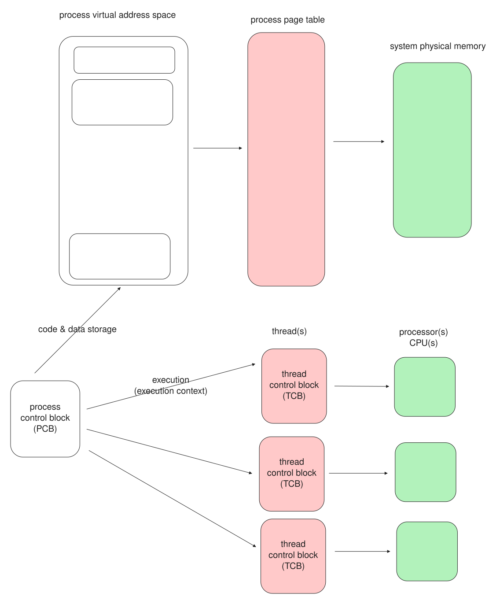
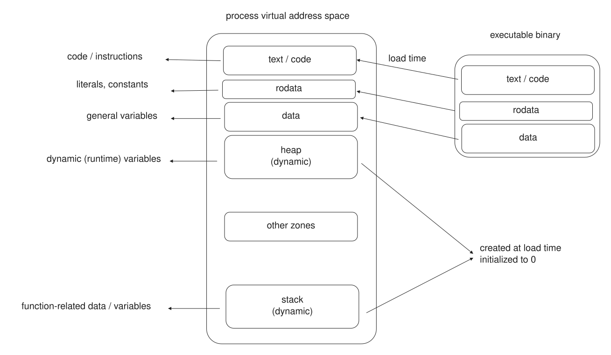
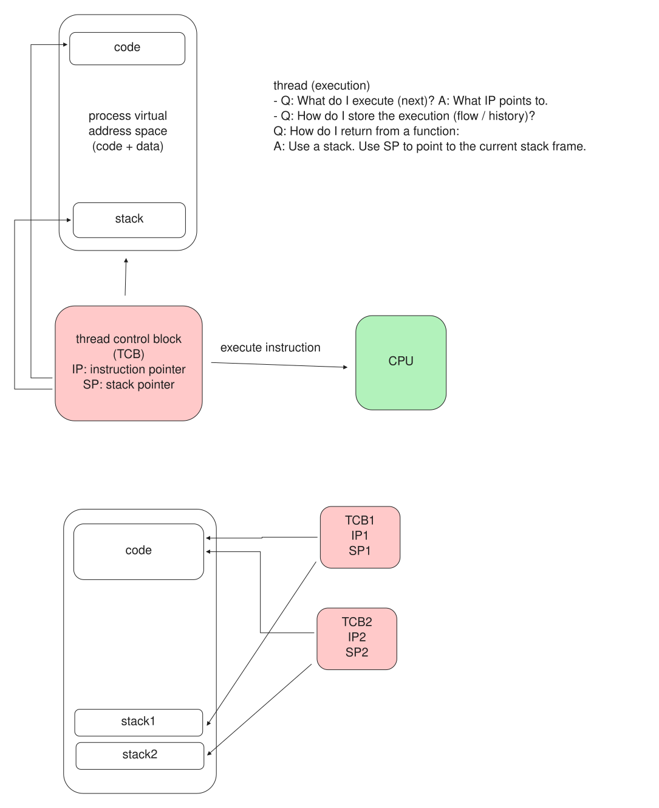
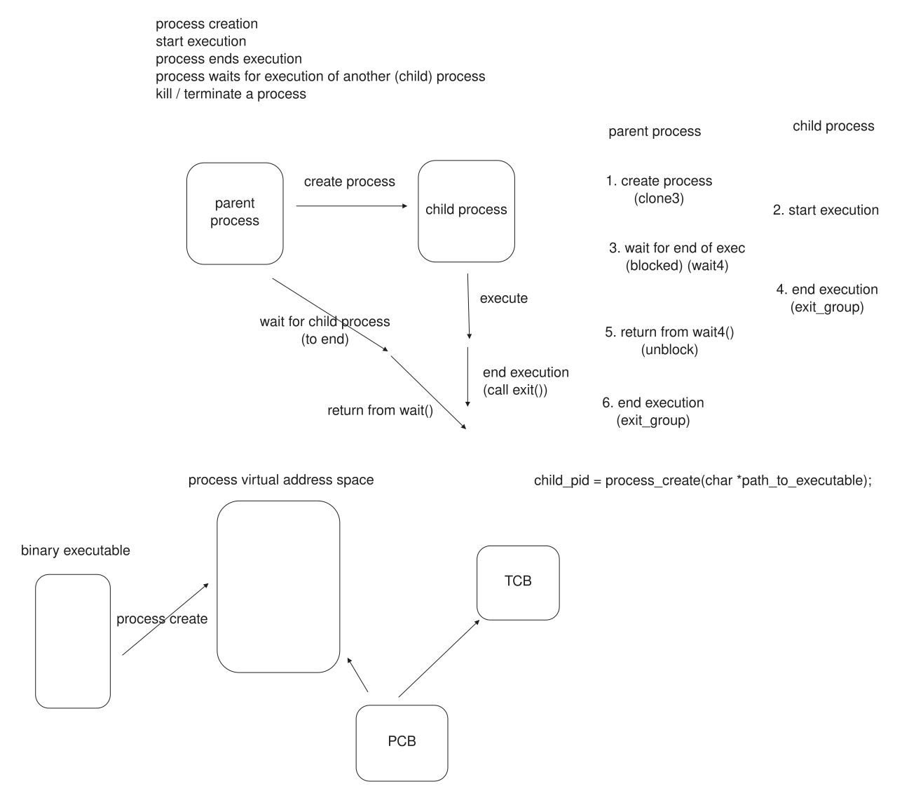
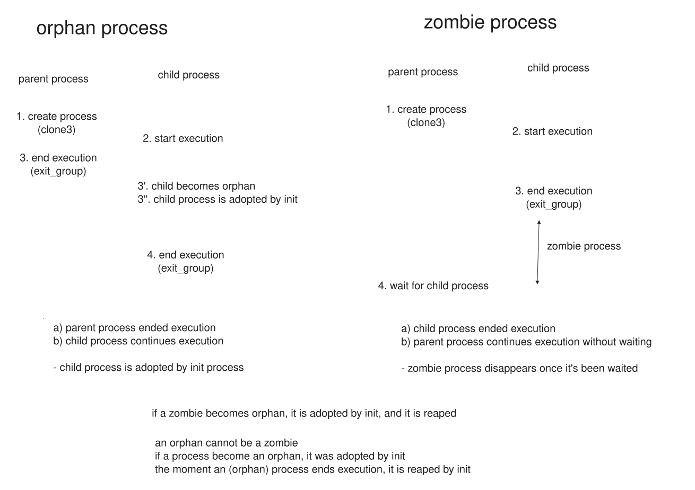
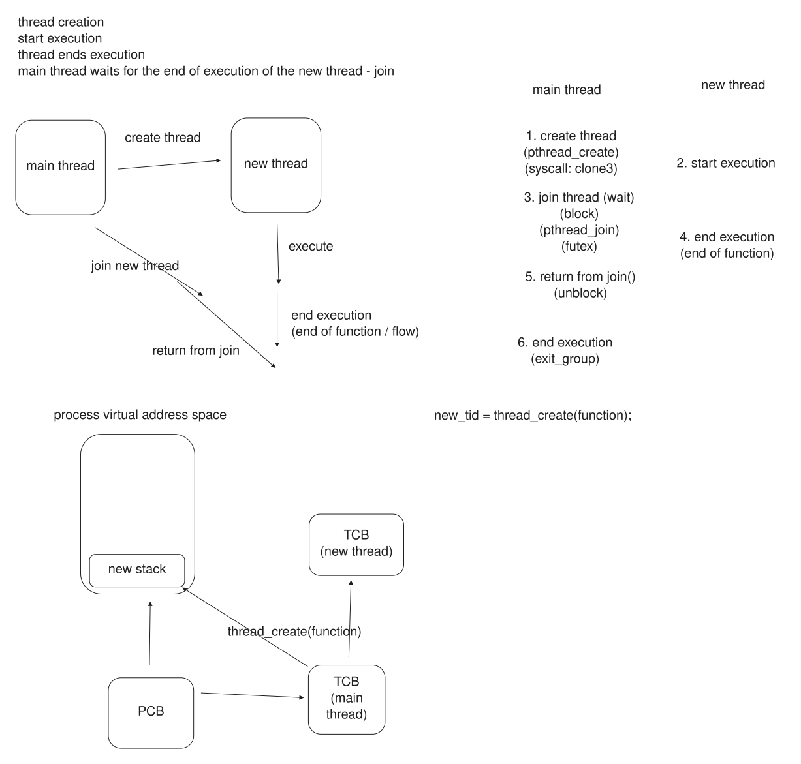

# Session 06: Processes and Threads - Full Contents

This is the complete version of the sixth lecture: the argument in full sentences, the diagrams, the demos with their reference output, and the reading behind each part.

Read it before the lecture if you want to follow the live delivery without taking notes, and after it for everything that was said once and quickly.
The one-page plan used during the lecture is [`06-processes-threads-live/`](../06-processes-threads-live).

Lectures 03, 04 and 05 were about memory: a process sees its memory as a list of zones, every address is virtual, and the page table maps the ones in use to physical frames.
That whole picture belongs to a process, and this lecture is about the process itself: what it is, how it is made, and how it runs.
It opens with the two halves of a process, the address space it owns and the threads that run inside it; it shows what a thread needs to execute and what all the threads of a process share; and it ends with the two ways a program gets a second thing to run, another process with `fork()` and `exec()`, or another thread with `pthread_create()`.

This is the first of the lectures on compute.
Memory was where a program keeps things; from here on the subject is how it runs.

## Learning objectives

By the end of this lecture you should be able to:

* Define a process as an address space plus one or more threads, and say which part holds code and data and which part runs it.
* Name what a thread needs in order to execute, an instruction pointer and a stack, and explain what the threads of one process share and what each keeps to itself.
* Describe the life of a process, created by another process, waited for by it, and the two states a child can be left in: zombie and orphan.
* Tell process creation from thread creation, `fork()` plus `exec()` against `pthread_create()`, and explain why both end up at the same system call underneath.
* Read the process and thread list of a running system with `ps`, `/proc` and `pmap`, and tell a multi-threaded process from several single-threaded ones.

## What is here

| Part | What it answers | Demos |
| --- | --- | --- |
| [00. Pitch](#00-pitch-everything-is-a-process) | What is running on this machine right now? | [`00-pitch/`](demos/00-pitch) |
| [01. Running an application](#01-running-an-application) | What is a process made of? | [`01-run-apps/`](demos/01-run-apps) |
| [02. The process address space](#02-the-process-address-space) | What does a process hold, and where did it come from? | -- |
| [03. Threads](#03-threads) | What does it take to run, and what do threads share? | [`03-threads/`](demos/03-threads) |
| [04. Process operations](#04-process-operations) | How is a process created, waited for and ended? | [`04-process-ops/`](demos/04-process-ops) |
| [05. Thread operations](#05-thread-operations) | How is a thread created and joined? | [`05-thread-ops/`](demos/05-thread-ops) |
| [06. fork() and exec()](#06-fork-and-exec) | What are the raw calls under process creation? | [`06-fork-exec/`](demos/06-fork-exec) |
| [07. Conclusion](#07-conclusion) | What should survive the week? | -- |

The slides are in [`slides/`](slides); the demos, with build instructions and reference output, are in [`demos/`](demos).

## 00. Pitch: Everything Is a Process

Three readings from an ordinary desktop, before any definitions.

**A crowd of programs.**

```text
$ ps -e --no-headers | wc -l
620
$ ps -e -o comm --no-headers | sort -u | wc -l
377
```

Six hundred and twenty processes, from three hundred and seventy-seven different programs.
The shell, the browser, the editor, the window manager, a dozen background services: every one of them is a process, and nothing runs on the machine that is not one.
Running an application *is* making a process.
The [processes-and-threads demo](demos/00-pitch/processes-and-threads) counts them.

**One program on many cores.**

```text
$ ps -o pid,comm,%cpu -C ffmpeg
    PID COMMAND         %CPU
  12632 ffmpeg           641
```

One `ffmpeg` process, encoding a video, is using 641% of a CPU, which is impossible for one CPU.
It is using seven of them at once, because it is one process with many **threads**, and the machine has many cores.
The [libx264 demo](demos/00-pitch/libx264) runs it and watches the threads share the work.

**A thread is not a process.**

```text
$ ps -e -o pid,nlwp --sort -nlwp | head -2
    PID NLWP
  15672   56
$ ls /proc/15672/task | wc -l
56
$ diff /proc/15672/maps /proc/15672/task/15674/maps && echo "same address space"
same address space
```

This process has fifty-six threads, and `/proc` lists each of them as a task of its own.
Every one of them sees the same memory: the process's address space, identical down to the last zone, no matter which thread you ask through.

Lectures 03 to 05 described the address space.
This lecture is about the thing that owns it and the things that run inside it.

> **Takeaway.**
> A process is how the operating system runs an application, and everything on the machine is one.
> A process is an address space and one or more threads; the threads share the address space, which is why one program can use many cores at once.

## 01. Running an Application

### Two halves of a process

An application on disk is a file, an executable.
To run it, the operating system makes a **process**: a running instance of the program, with everything it needs to execute.

A process has two halves, and the rest of the lecture is about keeping them apart.



* The **address space** is where the process keeps things: its code and its data, the virtual memory of lectures 03 to 05, backed by physical frames through the page table.
  It is storage, and on its own it does nothing.
* The **thread** is what runs: an execution context that fetches instructions from the code and works on the data.
  A process has at least one, the **main thread**, created with it; it may have more.

The kernel records the whole thing in a **process control block** (PCB): one per process, holding the address space, the list of open files, the owner, the parent, and a **thread control block** (TCB) for each thread.
The address space answers "what can I run and where do I keep it"; the threads answer "what is running right now".

### What is running, from outside

`ps` lists the processes, and with `-L` it lists the threads inside them.
The [processes-and-threads demo](demos/00-pitch/processes-and-threads) and the [threads-in-address-space demo](demos/01-run-apps/threads-in-address-space) read both.

```text
$ ps -e --no-headers | wc -l
620
$ ps -e -L --no-headers | wc -l
3412
$ ps -e -o pid,comm,nlwp --sort -nlwp | head -4
    PID COMMAND         NLWP
  15672 Discord           56
  27044 slack             46
   3690 chrome            41
```

Six hundred and twenty processes, but three thousand four hundred and twelve threads: most processes have one, and a few have dozens.
The column `nlwp`, the number of light-weight processes, is the number of threads; Linux schedules threads, and calls each one a task.

Every thread of a process lives in `/proc/<pid>/task/`, as a directory of its own, and shares the process's `/proc/<pid>/maps`:

```text
$ ls /proc/15672/task | head -4
15672
15673
15674
15675
$ diff /proc/15672/maps /proc/15672/task/15674/maps && echo identical
identical
```

The first task, with the same number as the process, is the main thread.
The rest were created while the program ran.
Their address space is one and the same, which is the whole point of a thread and the subject of part 03.

> **Takeaway.**
> A process is a running program: an address space that holds its code and data, and one or more threads that execute.
> `ps -L` and `/proc/<pid>/task/` show the threads; a process always has a main thread and may have more, and they all share one address space.

## 02. The Process Address Space

### A list of zones, built and grown

Lecture 03 described the address space as a list of zones and `pmap` as the way to read it; lecture 04 made every address in it virtual; lecture 05 mapped the pages in use to frames.
This part is a one-screen recap, because it is the thing the threads of part 03 share.



```text
$ pmap -x $$ | head
140820:   -bash
Address           Kbytes     RSS   Dirty Mode  Mapping
...               r-x--            bash          code
...               r----            bash          constants
...               rw---            bash          data + bss
...               rw---            [ heap ]      heap
...               r-x--            libc.so.6     library code
...               rw---            [ stack ]     main thread stack
```

Each zone is a start, a size and a set of permissions, and it has a role and an origin:

* **Code** (`r-x`), **constants** (`r--`) and **initialised data** (`rw-`) come straight from the executable, laid down by the loader before `main()` runs.
* **bss** (`rw-`) is the zeroed data: the executable records its size, not its bytes, and the kernel gives zeroed pages.
* The **heap** (`rw-`) and the **memory mappings** (libraries, large `malloc()`s, files) grow and shrink while the program runs, through `brk()` and `mmap()`.
* The **stack** (`rw-`) grows by itself as functions are called.
  There is one stack per thread, and that is the one zone that is *not* shared.

The static zones are built from the file once; the dynamic ones change throughout the run.
Either way the whole list belongs to the process, and every thread in it reaches every zone, bar the other threads' stacks.

> **Takeaway.**
> A process's memory is a list of zones with a role and an origin: code and data come from the executable, the heap and mappings grow at run time, and there is one stack per thread.
> The address space is shared by all of a process's threads; keep that in mind for the next part.

## 03. Threads

### What it takes to run

A thread is an **execution context**: the minimum a CPU needs to run a flow of instructions.
It is surprisingly little, two pointers:

* the **instruction pointer** (IP), which says *what to execute next*: an address in the code;
* the **stack pointer** (SP), which points at the thread's **stack**, and that is *how execution is stored*: the return path from one function call to the next, and the local variables and parameters of each call.



That is all a thread fundamentally is: an IP, an SP and the stack it points at.
The CPU takes the instruction at the IP, runs it, advances; a call pushes a frame on the stack and jumps; a return pops the frame and comes back.
Give a CPU an IP and an SP and it has an execution flow.

### What threads share, and what they do not

A process can have several threads, and they run in one address space.
They **share** everything in it: the code, so two threads can run the same function; the constants and the global data; the heap, so a pointer one thread stores another can read; the open files.
They do **not** share one thing: each thread has its **own stack**, because each has its own chain of function calls in progress.

The [ip-sp demo](demos/03-threads/ip-sp) makes two groups of threads, three running one function and three running another, and prints each thread's IP and SP:

```text
[thread 129133308802752] IP: 0x40127d, SP: 0x757230ffedec
[thread 129133300410048] IP: 0x40127d, SP: 0x7572307fddec
[thread 129133292017344] IP: 0x40127d, SP: 0x75722fffcdec
[thread 129133283624640] IP: 0x4012f6, SP: 0x75722f7fbdec
[thread 129133275231936] IP: 0x4012f6, SP: 0x75722effadec
[thread 129133266839232] IP: 0x4012f6, SP: 0x75722e7f9dec
$ nm ip_sp | grep ' t thread'
0000000000401256 t thread_sleep1
00000000004012cf t thread_sleep2
```

The three threads in `thread_sleep1` all report `IP: 0x40127d`, the three in `thread_sleep2` all report `0x4012f6`, and `nm` confirms those addresses are inside the two functions.
Same code, same instruction pointer: the threads share the text.
Every SP is different, and the values are about 8 MB apart: each thread has its own stack.

Those stacks are real zones in the address space.
The [new-stack-area demo](demos/03-threads/new-stack-area) creates threads one at a time and watches the stacks appear:

```text
$ ulimit -s
8192
$ pmap $(pidof create_threads)
...
0000705b3b9fd000   24588K rw---   [ anon ]      three thread stacks
00007ffef8be2000     136K rw---   [ stack ]     main thread stack
```

Each new thread adds a fresh anonymous zone of about 8 MB, the default stack size, to the list.
The main thread's stack is the `[ stack ]` zone the kernel set up at start; the others are plain `mmap()`ed anonymous memory, one per thread.
Threads share the single address space of part 02, and each adds its own stack to it.

> **Takeaway.**
> A thread is an execution context: an instruction pointer, which says what to run, and a stack pointer to a stack, which holds the call chain and the locals.
> The threads of a process share the whole address space, the code, the data and the heap; the one thing each keeps to itself is its stack.

## 04. Process Operations

### Create, wait, terminate

A process does not appear from nothing: it is created by another process.
There are three operations, and a process spends its life among them:

* **create** a new process, to run a program;
* **wait** for a process to finish, and read how it ended;
* **terminate**, on its own with `exit()` or by a signal from outside.



The simplest way to create a process from a program is [`posix_spawn()`](https://man7.org/linux/man-pages/man3/posix_spawn.3.html), which takes the path of an executable and its arguments and gives back the child's PID.
The [posix_spawn demo](demos/04-process-ops/posix_spawn) runs `/usr/bin/sleep` as a child and waits for it:

```text
$ ./posix_spawn
PID: 24687, parent PID: 8217, child PID: 24688
Process exited with status 0
Process exited successfully.
```

The parent reads the end of the child with `waitpid()`, which blocks until the child finishes and fills in a status word.
Two macros take the word apart: `WIFEXITED()` says whether the child called `exit()` rather than being killed, and `WEXITSTATUS()` gives the value it passed.
Waiting is not only how a parent gets the result; it is a duty, for the reason the next section gives.

### The process hierarchy

Every process has a parent, the process that created it, and so the processes of a running system form a tree.
At the root is the first process the kernel starts, PID 1, the init system (`systemd` on most Linux desktops); everything else descends from it.
`ps -ef` prints the PID and the parent PID (`PPID`) of every process, and `pstree` draws the tree.

Because a parent is supposed to wait for its children, two things can go wrong, and both have names.



A **zombie** is a process that has finished but has not been waited for yet.
It is dead, holding no memory and running nothing, but the kernel keeps its entry and its exit status until the parent collects them with `wait()`.
The [zombie demo](demos/04-process-ops/zombie) makes one by sleeping before it waits:

```text
$ ps -o pid,stat,cmd -C sleep
    PID STAT CMD
 222221 Z    [sleep] <defunct>
```

The `Z` and the `<defunct>` are the zombie: an ended child whose parent has not called `wait()`.
Once the parent waits, the entry is gone.
A parent that never waits leaks zombies, which is a bug.

An **orphan** is the opposite: a process whose parent ended first.
An orphan is adopted by PID 1, which becomes its new parent and, crucially, waits for it when it ends.
The [orphan demo](demos/04-process-ops/orphan) has the parent exit while the child runs on:

```text
$ ps -o pid,ppid,cmd -C sleep
    PID    PPID CMD
  24533    4984 /usr/bin/sleep 100
$ ps -o pid,cmd --no-headers -p 4984
   4984 /usr/lib/systemd/systemd --user
```

The child's parent is now `systemd`, not the process that created it.
This is why an orphan can never stay a zombie: the moment it ends, its adoptive parent reaps it.

> **Takeaway.**
> A process is created by another, which should wait for it and read its exit status with `WIFEXITED()` and `WEXITSTATUS()`; the processes of a system form a tree rooted at PID 1.
> A finished child not yet waited for is a zombie; a child whose parent ended is an orphan, adopted and later reaped by PID 1.

## 05. Thread Operations

### Create and join, from a function

A thread is created from a **function**, not an executable: `pthread_create()` starts a new thread running a function you name, in the same address space, and returns its thread id.
`pthread_join()` is the thread version of `waitpid()`: it blocks until the thread's function returns, and hands back what it returned.



```c
pthread_t tid;
pthread_create(&tid, NULL, worker, arg);   /* worker runs in a new thread */
void *result;
pthread_join(tid, &result);                /* wait for it, collect its return */
```

The [create-join demo](demos/05-thread-ops/create-join) starts several threads, each computing a partial sum over its own slice of an array, and the main thread joins them and adds the results:

```text
$ ./create_join
thread 0 summed its slice: 31250125000
thread 1 summed its slice: 93750125000
thread 2 summed its slice: 156250125000
thread 3 summed its slice: 218750125000
total: 500000500000
matches single-threaded sum: yes
```

Each thread writes only its own result and reads only its own slice, so no two threads touch the same memory for writing, and the program needs no lock.
The main thread reads a thread's result only after joining it, when the thread has certainly finished.
That discipline, give each thread its own memory and read the results after the join, is what makes this correct; the moment threads *share* writable memory the story changes, and that is the subject of lecture 08 and of the synchronisation in the labs.

Each new thread gets its own stack, the 8 MB zone of part 03, and its own TCB; everything else it shares with the process.
Underneath, `pthread_create()` is a `clone3()` with the flags that keep the memory shared, and `pthread_join()` waits on a `futex`; the next part shows the same system call from the process side.

> **Takeaway.**
> A thread is created from a function with `pthread_create()` and waited for with `pthread_join()`, which returns the thread's result.
> Give each thread its own memory and read results only after the join, and no lock is needed; sharing writable memory is what forces synchronisation, later in the course.

## 06. fork() and exec()

### Copy, then replace

`posix_spawn()` is a convenience; underneath it, and under every shell and every process launcher, are two older and more fundamental calls.


[`fork()`](https://man7.org/linux/man-pages/man2/fork.2.html) creates a new process as a **copy** of the one that calls it: same code, same data, same open files, a duplicate of the whole address space.
The copy is cheap because it is copy-on-write, the mechanism from lecture 05: parent and child share every frame read-only until one of them writes.
`fork()` is the one call that **returns twice**, once in each process: it returns `0` to the child and the child's PID to the parent, which is how each tells which one it is.

[`exec()`](https://man7.org/linux/man-pages/man2/execve.2.html) does the other half: it **replaces** the calling process's address space with a new program loaded from an executable.
It does not return on success, because the code that called it is gone, overwritten by the new program.

The pair is the pattern: `fork()` to make a second process, then `exec()` in the child to turn it into the program you actually wanted to run, while the parent keeps its own code and goes on to `wait()`.
The [fork-exec demo](demos/06-fork-exec/fork-exec) is `posix_spawn` written out by hand:

```text
$ ./fork_exec
PID: 105188, parent PID: 11471, child PID: 105189
Process exited with status 0
Process exited successfully.
```

### One process, or one thread

`fork()` and `pthread_create()` are the two ways to get a second thing running, and they are opposites:

* `fork()` **copies**: the child gets its own address space, and the two processes share nothing afterwards.
  That is **multi-processing**, used when the parts must be isolated.
* `pthread_create()` **shares**: the new thread runs in the same address space.
  That is **multi-threading**, used when the parts must cooperate on the same data, as `ffmpeg` does in the pitch.

Underneath, Linux makes both with the same system call, `clone()` (or its newer form `clone3()`): a process is a `clone` that copies the address space, a thread is a `clone` that shares it.
The [strace demo](demos/06-fork-exec/strace) traces both `fork()`+`exec()` and `posix_spawn()` and finds the same two calls:

```text
$ strace -f -e clone,clone3,execve ./fork_exec
clone(child_stack=NULL, flags=CLONE_CHILD_CLEARTID|CLONE_CHILD_SETTID|SIGCHLD, ...) = 105189
[pid 105189] execve("/usr/bin/sleep", ["/usr/bin/sleep", "100"], NULL) = 0

$ strace -f -e clone,clone3,execve ./posix_spawn
clone3({flags=CLONE_VM|CLONE_VFORK|CLONE_CLEAR_SIGHAND, exit_signal=SIGCHLD, ...}) = 105405
[pid 105405] execve("/usr/bin/sleep", ["/usr/bin/sleep", "100"], NULL) = 0
```

Both create the child with `clone`/`clone3` and load the new program with `execve`: `posix_spawn()` is `fork()` and `exec()` wrapped up, and `fork()` itself is a `clone` with no sharing flags.

> **Takeaway.**
> `fork()` copies a process and returns twice; `exec()` replaces a process's program and does not return.
> The pair makes and launches a new process; `fork()` copies and `pthread_create()` shares, and Linux builds both, and `posix_spawn()`, on one system call, `clone()`.

## 07. Conclusion

The lecture covered:

* everything on the machine is a process: 620 of them from 377 programs, one of them using seven cores through its threads
* a process is an address space, which holds code and data, and one or more threads, which run
* a thread is an instruction pointer and a stack pointer; the threads of a process share the whole address space and keep only their own stack
* processes are created by processes, form a tree under PID 1, and must be waited for; a zombie is unwaited, an orphan is re-parented
* threads are created from a function with `pthread_create()` and joined with `pthread_join()`
* `fork()` copies and `exec()` replaces; `fork()` makes a process, `pthread_create()` makes a thread, and both are `clone()` underneath

If one thing survives the week, make it this.

> **Takeaway.**
> A process is an address space plus one or more threads: the space holds the program, the threads run it and share the space, each with its own stack.
> A process is made by another and waited for by it; a second flow of control is another process with `fork()`+`exec()` if it must be isolated, or another thread with `pthread_create()` if it must share, and underneath both is `clone()`.

## Where this goes next

* **Lab 06** is this lecture by hand: a small shell built on `fork()`, `exec()` and `waitpid()`, and multi-threaded programs built on `pthread_create()` and `pthread_join()`, with each thread kept to its own memory exactly as part 05 describes.
  Start at [`labs/06-processes-threads-full/`](../../labs/06-processes-threads-full).
* **Lecture 07** is scheduling: there are 3,412 threads and 14 cores on the pitch machine, so most threads are waiting, and the scheduler decides which ones run.
  It is where a thread's states, ready, running and blocked, and the cost of switching between them, are covered.
* **Lecture 08** is concurrency: what happens when the discipline of part 05 is dropped and threads *do* share writable memory, and the mutexes and semaphores that make that safe.
* **The assignments** build on all of it: `minishell` is `fork()`/`exec()`/`wait()` and pipes at full size, and `mini-libc` implements the process and thread primitives against raw system calls.

## References

### Manuals

* `man 2 fork`, `man 2 execve`, `man 3 exec`, `man 2 wait`, `man 2 waitpid`, `man 3 posix_spawn`, `man 2 _exit`, `man 3 exit`
* `man 3 pthread_create`, `man 3 pthread_join`, `man 3 pthread_exit`, `man 3 pthread_self`
* `man 2 clone`, `man 2 clone3`, for the one system call under all of the above
* `man 1 ps` (`-L`, `nlwp`, `stat`), `man 1 pmap`, `man 1 pstree`, `man 5 proc` (`/proc/[pid]/task`, `/proc/[pid]/maps`, `/proc/[pid]/status`)

### Books

* Arpaci-Dusseau, [*Operating Systems: Three Easy Pieces*](https://pages.cs.wisc.edu/~remzi/OSTEP/), chapters 4 (the abstraction: the process), 5 (process API, `fork()`/`exec()`/`wait()`), 26 (concurrency and threads) and 27 (the thread API)
* Bryant and O'Hallaron, *Computer Systems: A Programmer's Perspective*, chapter 8 (exceptional control flow: processes, `fork`, `exec`, `wait`, signals) and section 12.3 (concurrent programming with threads)
* Kerrisk, *The Linux Programming Interface*, chapters 24 to 28 (process creation, `exec`, process termination, monitoring children) and 29 to 33 (threads)

### Worth reading

* Gustavo Duarte, [The Birth of a Program](https://manybutfinite.com/post/how-the-kernel-manages-your-memory/) and the process/thread posts, for the kernel's side of `fork()` and the task
* The `clone(2)` manual's description of the flags, which is the clearest statement of what a thread and a process actually differ by
