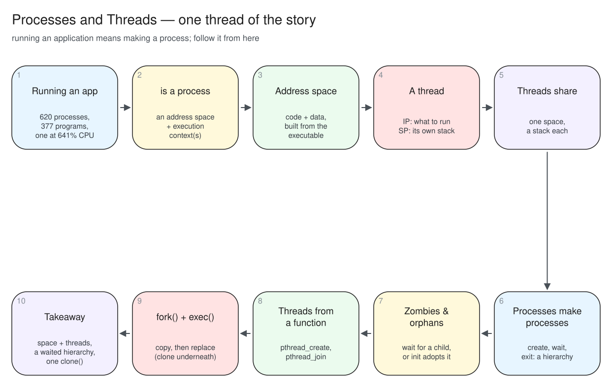

# Storyline: Processes and Threads

The planned narrative of the live delivery, one thread from start to finish.
The figure walks through it, station by station: [the storyline](media/00-pitch/storyline.svg).

1. **The hook:** this desktop runs 620 processes from 377 different programs, one `ffmpeg` is using 641% of a CPU, and one process has 56 threads that all see the same memory.
   Running an application means making a process; a process can use many cores at once because it has many threads.
   The three numbers are the lecture: what a process is, what a thread is, and how both are made.
1. **A process is two halves.**
   An address space, which holds the program's code and data, the virtual memory of the last three lectures; and one or more threads, which run.
   The space stores; the threads execute.
   The kernel keeps a process control block for the whole thing and a thread control block for each thread.
1. **The address space, recapped.**
   A list of zones with a role and an origin: code and constants and initialised data come from the executable, the heap and the libraries grow at run time, and there is one stack per thread.
   The whole list belongs to the process, and the threads share all of it bar each other's stacks.
1. **What a thread is.**
   Two pointers: an instruction pointer, which says what to execute next, and a stack pointer to a stack, which holds the call chain and the local variables.
   Give a CPU an IP and an SP and it has a flow of execution; that is all a thread fundamentally is.
1. **What threads share.**
   Several threads run in one address space and share everything in it, the code, the globals, the heap, the open files, so two threads can run the same function and read each other's data.
   The one thing each keeps is its own stack, about 8 MB, a new zone per thread.
1. **Processes make processes.**
   A process is created by another, waited for by it, and read for how it ended.
   Every process has a parent, so the system is a tree rooted at PID 1; `posix_spawn()` is the simple way to start one and `waitpid()` the way to collect it.
1. **Zombies and orphans.**
   A child that has finished but not been waited for is a zombie: dead, but still in the table until the parent calls `wait()`.
   A child whose parent ended first is an orphan: adopted by PID 1, which waits for it.
   Waiting is a duty, not only a convenience.
1. **Threads are made from a function.**
   `pthread_create()` starts a function running in a new thread of the same address space; `pthread_join()` waits for it and hands back what it returned.
   Give each thread its own slice of memory and read results only after the join, and no lock is needed; sharing writable memory is a later lecture.
1. **fork() and exec().**
   `fork()` copies the whole process and returns twice, 0 in the child and the child's PID in the parent; `exec()` replaces the copy's program with a new one and does not return.
   The pair makes a process and launches a program; `posix_spawn()` is the two wrapped together.
1. **One primitive underneath.**
   `fork()` copies the address space, `pthread_create()` shares it, and Linux builds both with the same system call, `clone()`, differing only in the flags.
   Copy for isolation, share for cooperation; `ffmpeg` in the pitch shares.
1. **What should survive the week:** a process is an address space plus one or more threads.
   The space holds the program, the threads run it and share the space, each with its own stack; a process is made by another and waited for by it; a second flow of control is another process if it must be isolated, another thread if it must share, and both are `clone()` underneath.
   Next time: 3,412 threads on 14 cores, so most are waiting, and the scheduler that decides which run.

## How the stations map onto the lecture

| Stations | Part |
| --- | --- |
| 1 | 00. Pitch |
| 2 | 01. Running an application |
| 3 | 02. The process address space |
| 4, 5 | 03. Threads |
| 6, 7 | 04. Process operations |
| 8 | 05. Thread operations |
| 9, 10 | 06. fork() and exec() |
| 11 | 07. Conclusion |

Station 1's three numbers are the three threads of the lecture: the process count is answered by part 01, the 641% by parts 03 and 05, and the shared address space by part 03.
Station 10 is worth holding to the end, because `clone()` under both `fork()` and `pthread_create()` is what ties process creation and thread creation into one idea.
