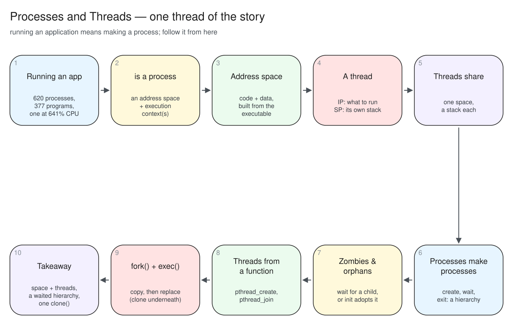
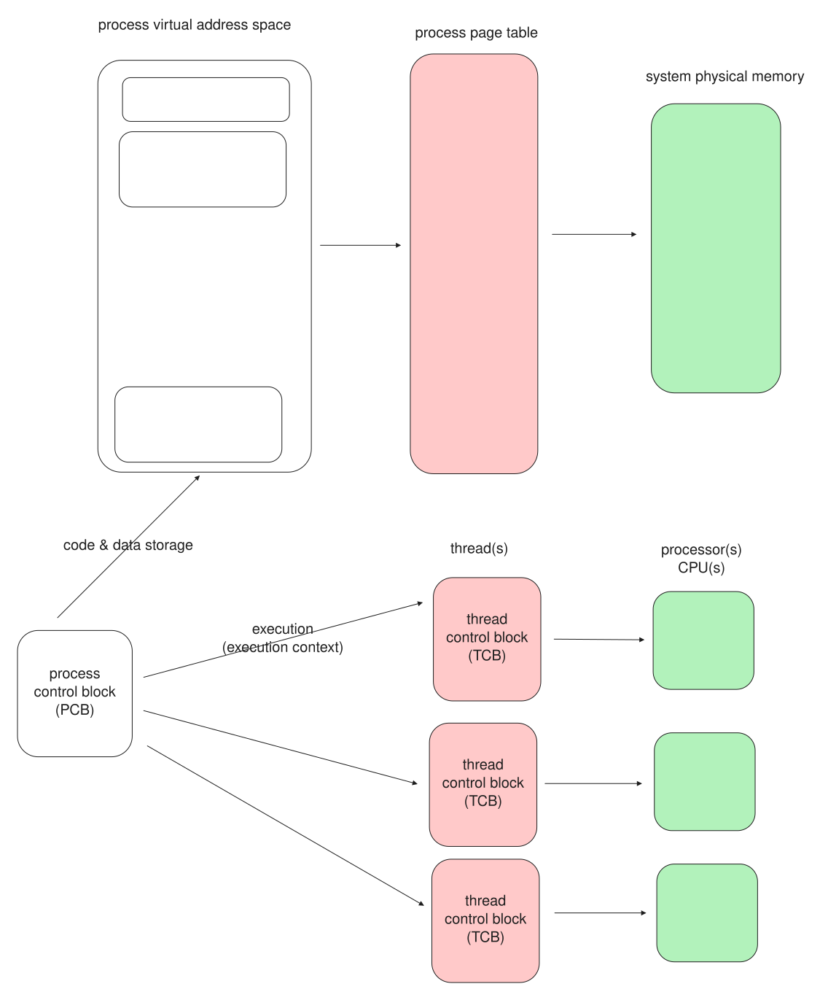
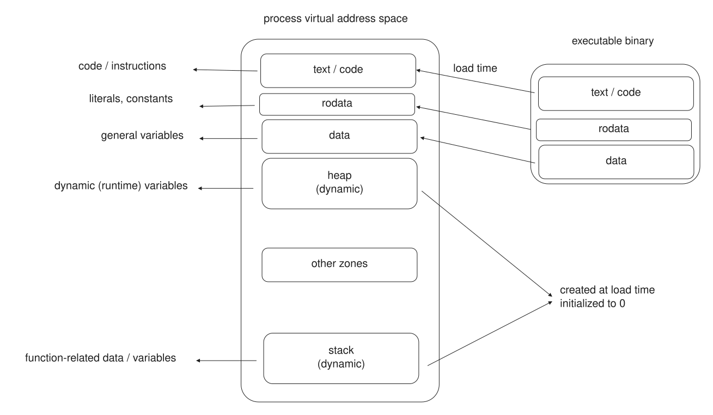
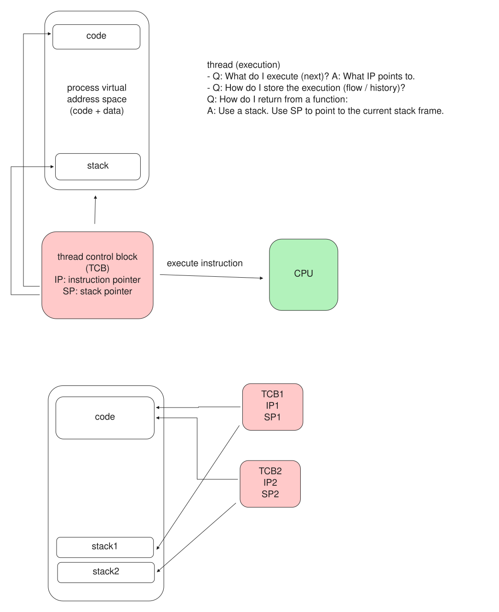
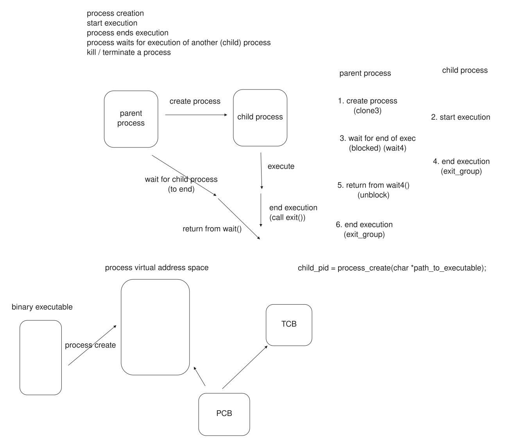
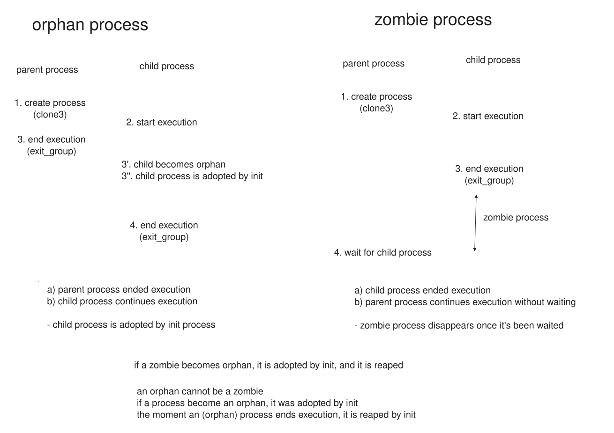
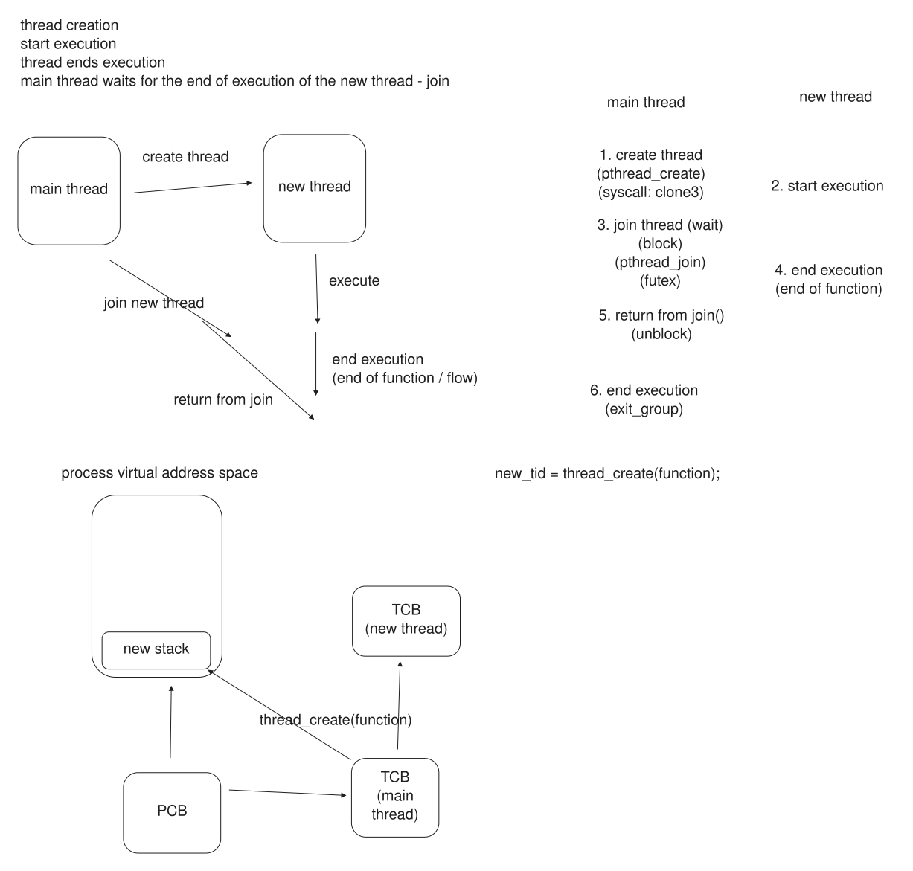
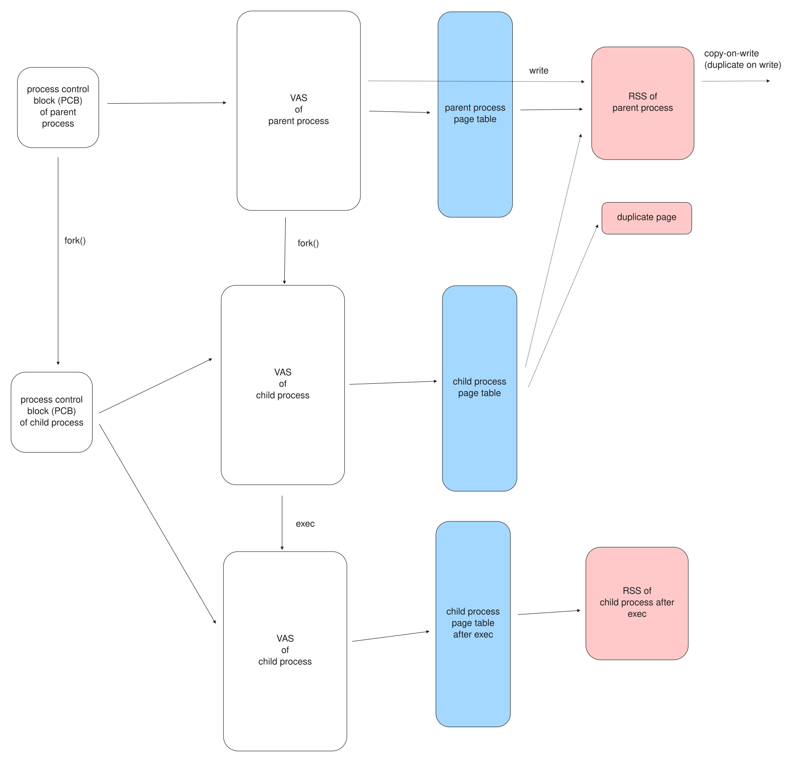

# 00. Pitch

## Everything is a process

```text
$ ps -e --no-headers | wc -l
620
$ ps -e -o comm --no-headers | sort -u | wc -l
377
```

620 processes, from 377 different programs.

The shell, the browser, the editor, every service: each one is a process.
Running an application *is* making a process.

::: {.notes}
Run both on the lecture machine. Nothing runs that is not a process.
:::

## One program, many cores

```text
$ ps -o pid,comm,%cpu -C ffmpeg
    PID COMMAND         %CPU
  12632 ffmpeg           641
```

641% of a CPU: impossible for one CPU.

One process, many **threads**, many cores.

::: {.notes}
The libx264 demo. htop shows the cores busy. This is the second thread of the lecture.
:::

## A thread is not a process

```text
$ ps -e -o pid,nlwp --sort -nlwp | head -2
    PID NLWP
  15672   56
$ diff /proc/15672/maps /proc/15672/task/15674/maps && echo "same address space"
same address space
```

56 threads, one address space, identical through any of them.

## The story

{fig-align="center" width="82%"}

# 01. Running an application

## Two halves of a process

{fig-align="center" width="60%"}

The **address space** holds the code and data; the **thread(s)** run.
The kernel keeps a PCB per process and a TCB per thread.

::: {.notes}
Space stores and does nothing on its own; the thread executes. Keep the two apart all lecture.
:::

## What is running

```text
$ ps -e --no-headers | wc -l            620 processes
$ ps -e -L --no-headers | wc -l        3412 threads
$ ls /proc/15672/task | head -2
15672                                   the main thread
15673                                   created later
```

`ps -L` and `/proc/<pid>/task/` show the threads.
A process always has a main thread; it may have more, all sharing one address space.

# 02. The process address space

## A list of zones, built and grown

{fig-align="center" width="64%"}

Code and data from the executable; heap and libraries grown at run time; **one stack per thread**.
The whole list belongs to the process; the threads share all of it bar each other's stacks.

::: {.notes}
A one-screen recap of lectures 03-05. The point to carry forward: this is what threads share.
:::

# 03. Threads

## What it takes to run

A thread is an **execution context**: two pointers.

* **IP**, the instruction pointer: *what to execute next*, an address in the code.
* **SP**, the stack pointer: points at the thread's **stack**, which holds the call chain and the locals.

Give a CPU an IP and an SP and it has a flow of execution.
That is all a thread fundamentally is.

## Shared, and not shared

{fig-align="center" width="58%"}

Threads share the code, the globals, the heap, the open files.
Each keeps its own **stack**.

## IP and SP, measured

```text
[thread ...802752] IP: 0x40127d, SP: 0x757230ffedec    thread_sleep1
[thread ...410048] IP: 0x40127d, SP: 0x7572307fddec    thread_sleep1
[thread ...624640] IP: 0x4012f6, SP: 0x75722f7fbdec    thread_sleep2
$ nm ip_sp | grep ' t thread'
0000000000401256 t thread_sleep1
00000000004012cf t thread_sleep2
```

Same function, same IP: the code is shared.
Every SP different, ~8 MB apart: a stack each.

::: {.notes}
ip_sp. Read one IP against nm. The SPs are one stack-size apart.
:::

## A stack per thread

```text
$ ulimit -s
8192
$ pmap $(pidof create_threads)
... 24588K rw---   [ anon ]      three thread stacks
...   136K rw---   [ stack ]     main thread stack
```

Each new thread adds its own ~8 MB anonymous zone.

::: {.notes}
new-stack-area, one ENTER at a time, pmap in a second terminal between creations.
:::

# 04. Process operations

## Create, wait, terminate

{fig-align="center" width="70%"}

A process is created by another, which **waits** for it and reads how it ended.

## posix_spawn(), measured

```text
$ ./posix_spawn
PID: 24687, parent PID: 8217, child PID: 24688
Process exited with status 0
Process exited successfully.
```

`posix_spawn()` starts a child from an executable; `waitpid()` blocks until it ends.
`WIFEXITED()` and `WEXITSTATUS()` take the status apart.

## The process hierarchy

Every process has a parent: the system is a tree rooted at **PID 1** (`systemd`).

```text
$ pstree -p | head -3
```

A parent is supposed to wait for its children.
Two things go wrong when the timing is off, and both have names.

## Zombies and orphans

{fig-align="center" width="62%"}

```text
$ ps -o pid,stat,cmd -C sleep       222221 Z  [sleep] <defunct>   zombie: ended, not waited
$ ps -o pid,ppid,cmd -C sleep        24533 4984 /usr/bin/sleep    orphan: re-parented to init
```

::: {.notes}
zombie waits before wait(); orphan's parent exits first. An orphan never stays a zombie: init reaps it.
:::

# 05. Thread operations

## Create and join

{fig-align="center" width="58%"}

```c
pthread_create(&tid, NULL, worker, arg);   /* run worker in a new thread */
pthread_join(tid, &result);                /* wait for it, collect its return */
```

A thread is created from a **function** and joined for its result.

## create_join, measured

```text
$ ./create_join
thread 0 summed its slice: 31250125000
thread 3 summed its slice: 218750125000
total: 500000500000
matches single-threaded sum: yes
```

Each thread has its own slice; results read only after the join.
No shared writable memory, so no lock.
Sharing writable memory is lecture 08.

# 06. fork() and exec()

## Copy, then replace

{fig-align="center" width="64%"}

`fork()` **copies** the process and returns **twice** (0 to child, PID to parent).
`exec()` **replaces** the program and does **not** return.

## One process, or one thread

| | `fork()` | `pthread_create()` |
| --- | --- | --- |
| address space | a copy | shared |
| afterwards | isolated | cooperating |
| this is | multi-processing | multi-threading |

`ffmpeg` in the pitch shares: multi-threading.

## The same call underneath

```text
$ strace -f -e clone,clone3,execve ./fork_exec
clone(... SIGCHLD ...) = 105189
[pid 105189] execve("/usr/bin/sleep", ...) = 0

$ strace -f -e clone,clone3,execve ./posix_spawn
clone3({flags=CLONE_VM|CLONE_VFORK|...}) = 105405
[pid 105405] execve("/usr/bin/sleep", ...) = 0
```

Both: `clone`/`clone3` to create, `execve` to load.
A thread's `clone3` adds `CLONE_VM`: the one flag that keeps the memory shared.

# 07. Conclusion

## What we covered

* everything is a process: 620 of them, one using seven cores through its threads
* a process is an address space and one or more threads
* a thread is an IP and an SP; threads share the space, each with its own stack
* processes form a tree under PID 1 and must be waited for; zombie, orphan
* `pthread_create()` and `pthread_join()` for threads
* `fork()` copies, `exec()` replaces, both are `clone()` underneath

## {background-color="#f7f7f7"}

::: {style="font-size: 1.2em; text-align: center; margin-top: 1.2em;"}
**A process is an address space plus one or more threads.**

The space holds the program; the threads run it and share the space, each with its own stack.

A second flow of control is another process with `fork()`+`exec()` if it must be isolated,
or another thread with `pthread_create()` if it must share --- and both are `clone()`.
:::

## Next

* **Lab 06:** a shell on `fork()`/`exec()`/`waitpid()`, and multi-threaded programs on `pthread_create()`/`pthread_join()`.
* **Lecture 07:** scheduling --- 3,412 threads on 14 cores, so most wait; the states ready/running/blocked, and what a switch costs.
* **Lecture 08:** concurrency --- when threads *do* share writable memory, and the locks that make it safe.

::: {.notes}
End on the bridge to scheduling: most of those 3,412 threads are not running right now.
:::
