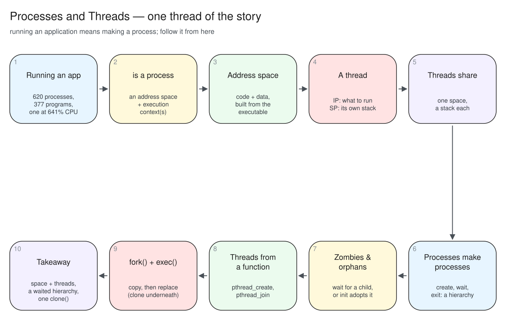
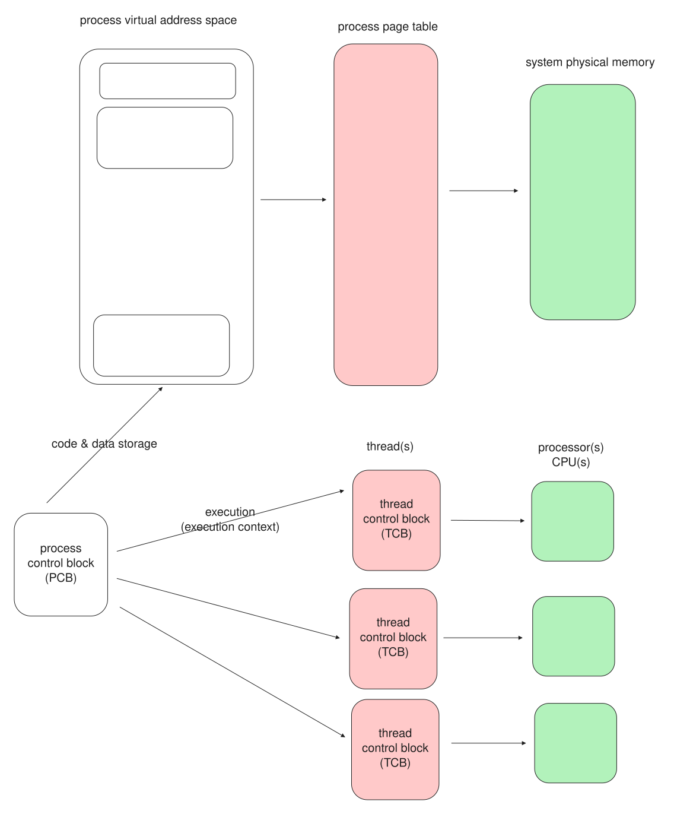
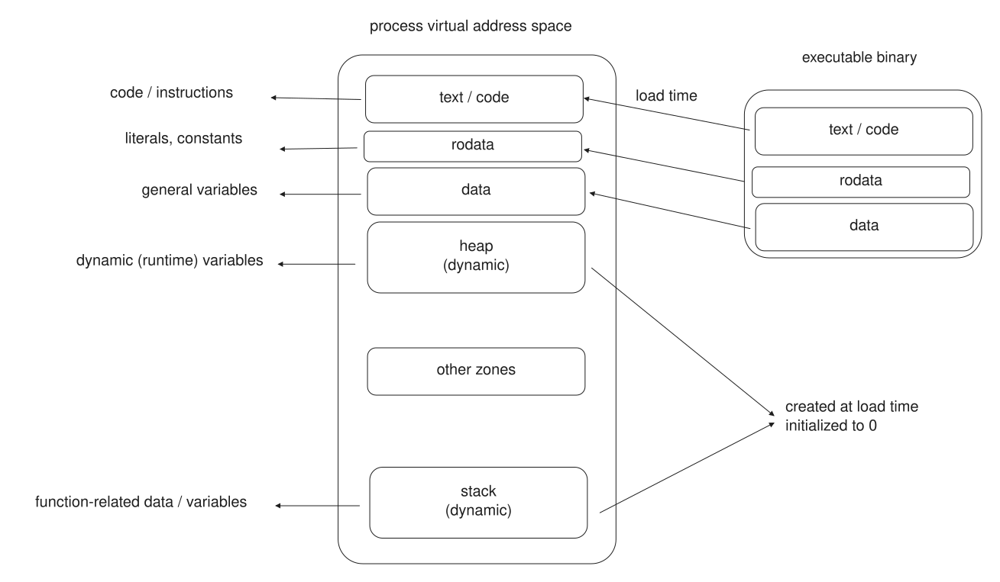
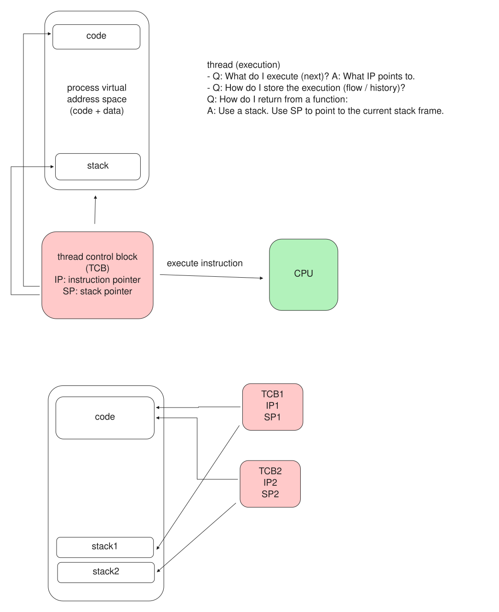
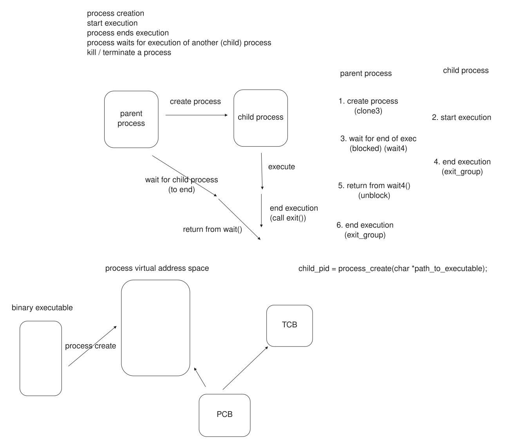
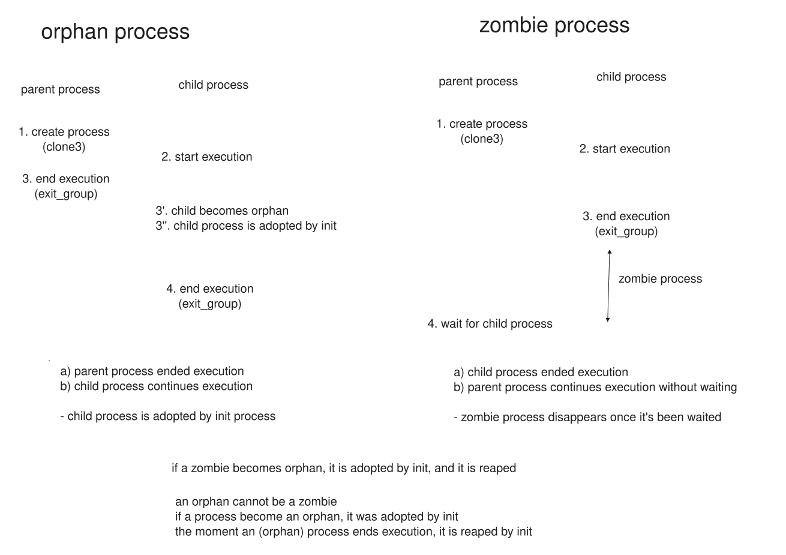
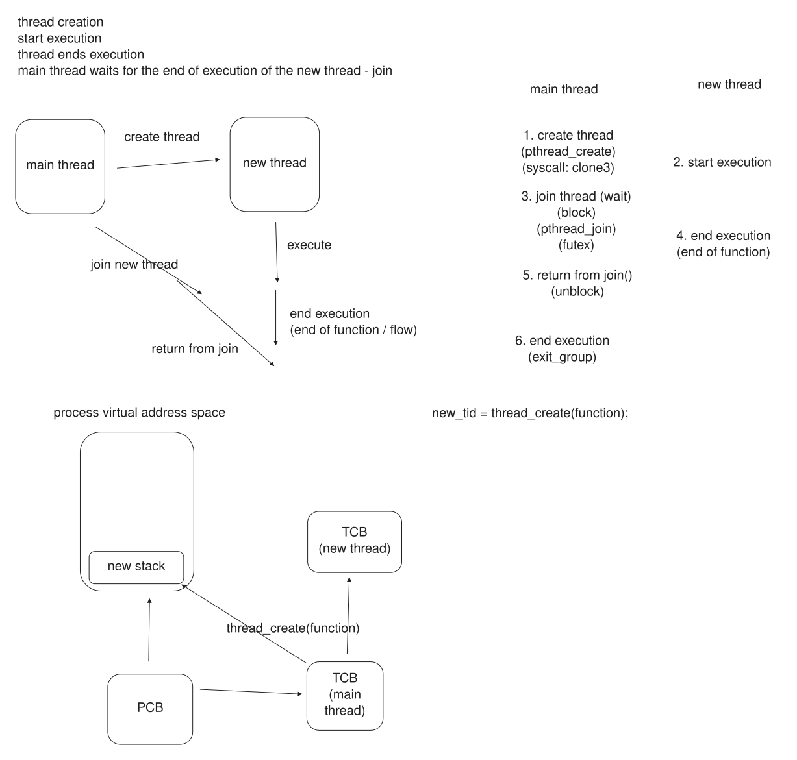
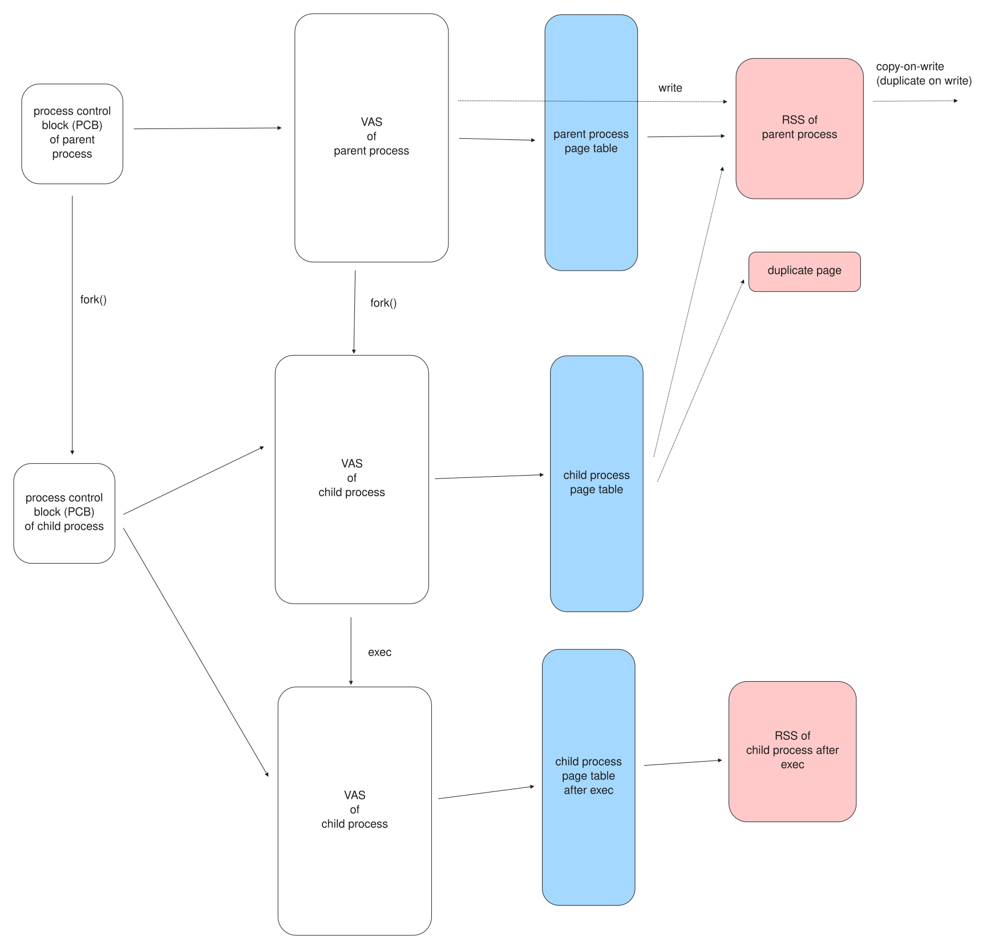

## Three numbers {background-color="#f7f7f7"}

```text
$ ps -e --no-headers | wc -l
620                                    from 377 different programs

$ ps -o pid,comm,%cpu -C ffmpeg
  12632 ffmpeg   641                   one process, 641% of a CPU

$ diff /proc/15672/maps /proc/15672/task/15674/maps
                                       56 threads, one address space
```

Running an application means making a **process**.
This lecture: what a process is, and what runs inside it.

::: {.notes}
Run the three on the lecture machine. Process count -> part 01; 641% -> parts 03, 05; shared maps -> part 03.
:::

## The story

{fig-align="center" width="82%"}

## A process is two halves

{fig-align="center" width="60%"}

```text
$ ps -e --no-headers | wc -l        620 processes
$ ps -e -L --no-headers | wc -l    3412 threads
```

The **address space** stores; the **thread(s)** run.

::: {.notes}
PCB per process, TCB per thread. Keep the two halves apart all lecture.
:::

## The address space, recapped

{fig-align="center" width="62%"}

Code and data from the executable; heap and libraries grown at run time; **one stack per thread**.
The threads share all of it bar each other's stacks.

## What a thread is

A thread is an **execution context**: two pointers.

* **IP** --- what to execute next, an address in the code.
* **SP** --- the thread's stack: the call chain and the locals.

Give a CPU an IP and an SP and it has a flow of execution.

## Shared, and not shared

{fig-align="center" width="58%"}

```text
IP: 0x40127d  SP: 0x7572...edec     thread_sleep1
IP: 0x40127d  SP: 0x7572...ddec     thread_sleep1   same IP, other SP
IP: 0x4012f6  SP: 0x7572...bdec     thread_sleep2   other IP
```

Same function, same IP: shared code. Every SP different: a stack each.

::: {.notes}
ip_sp, then nm. new-stack-area with pmap if time: a new ~8 MB zone per thread.
:::

## Create, wait, terminate

{fig-align="center" width="66%"}

```text
$ ./posix_spawn
PID: 24687, parent PID: 8217, child PID: 24688
Process exited with status 0
```

A process is created by another, which **waits** and reads how it ended.

## Zombies and orphans

{fig-align="center" width="60%"}

```text
$ ps -o pid,stat,cmd -C sleep     222221 Z   [sleep] <defunct>   ended, not waited
$ ps -o pid,ppid,cmd -C sleep      24533 4984 /usr/bin/sleep     parent is now init
```

::: {.notes}
zombie: wait before wait(). orphan: parent exits first, init adopts. An orphan never stays a zombie.
:::

## Threads from a function

{fig-align="center" width="56%"}

```c
pthread_create(&tid, NULL, worker, arg);
pthread_join(tid, &result);
```

```text
$ ./create_join      total: 500000500000   matches single-threaded sum: yes
```

Own slice each, read after the join: no lock.
Sharing writable memory is lecture 08.

## fork() and exec()

{fig-align="center" width="62%"}

`fork()` **copies** and returns **twice**; `exec()` **replaces** and does **not** return.

## One call underneath

```text
$ strace -f -e clone,clone3,execve ./fork_exec
clone(... SIGCHLD ...) = 105189
[pid 105189] execve("/usr/bin/sleep", ...) = 0

$ strace -f -e clone,clone3,execve ./posix_spawn
clone3({flags=CLONE_VM|CLONE_VFORK|...}) = 105405
```

`fork()` copies, `pthread_create()` shares: both are `clone()`.
A thread's `clone3` adds `CLONE_VM`.

::: {.notes}
posix_spawn is fork+exec wrapped. The one flag CLONE_VM is the thread/process difference.
:::

## {background-color="#f7f7f7"}

::: {style="font-size: 1.2em; text-align: center; margin-top: 1.2em;"}
**A process is an address space plus one or more threads.**

The space holds the program; the threads run it and share the space, each with its own stack.

A second flow of control is another process with `fork()`+`exec()`,
or another thread with `pthread_create()` --- and both are `clone()`.
:::

::: {.notes}
Next time: 3,412 threads on 14 cores, so most wait; the scheduler decides which run.
:::
