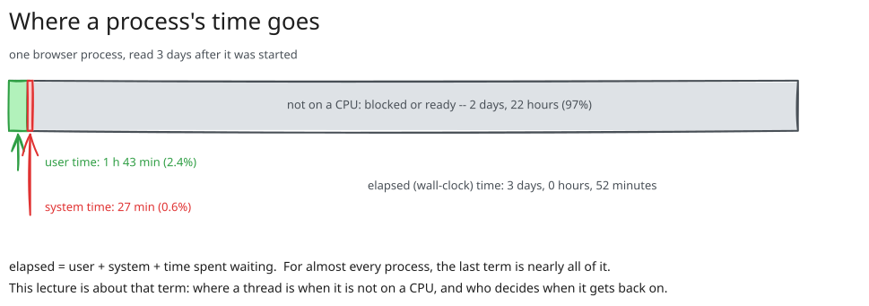
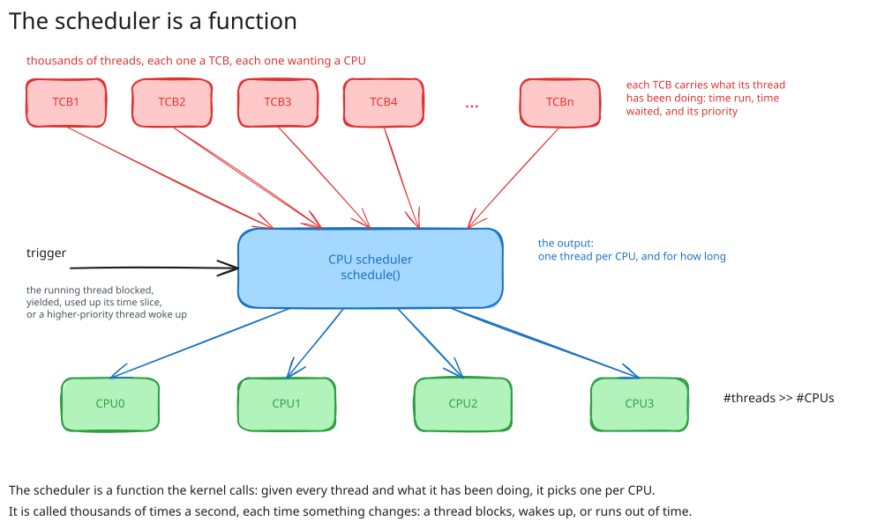
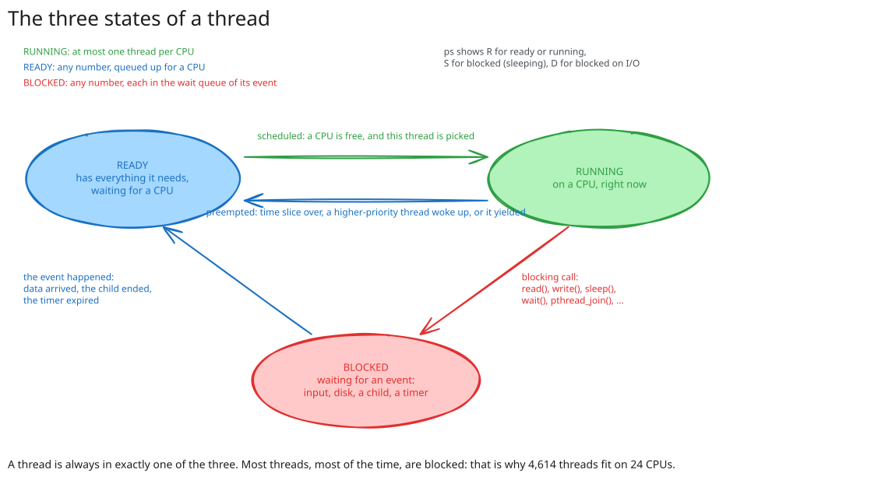
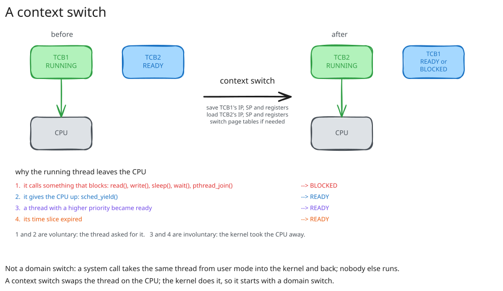
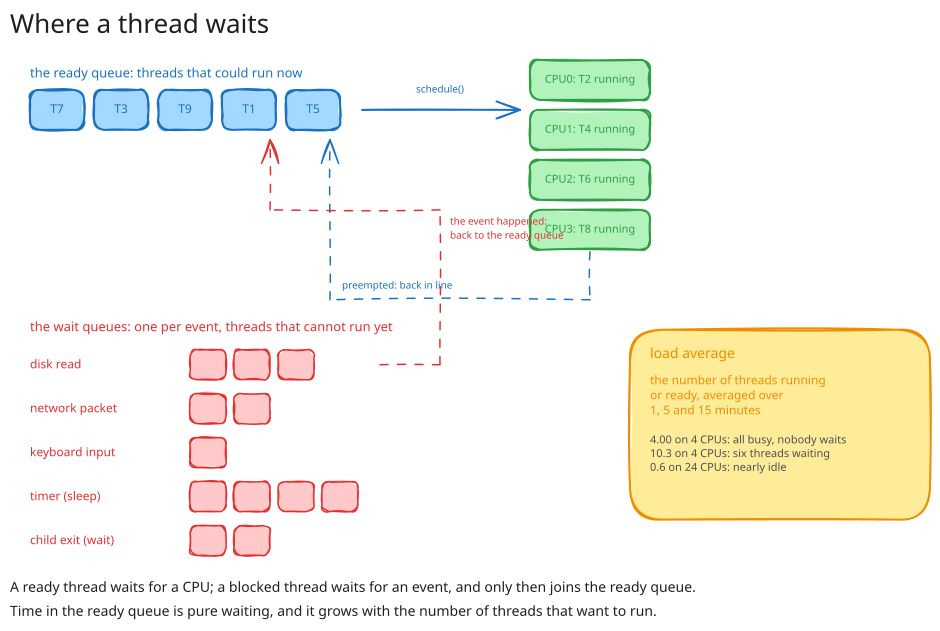
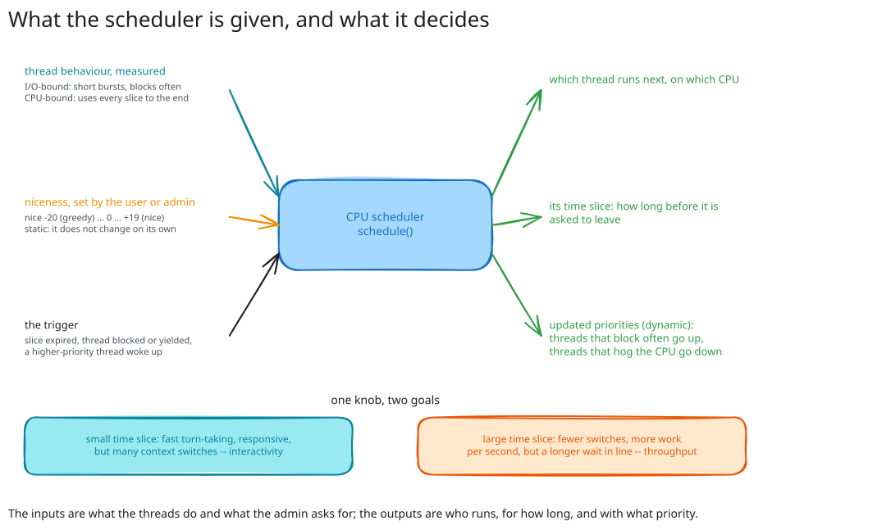

# Session 07: Scheduling - Full Contents

This is the complete version of the seventh lecture: the argument in full sentences, the diagrams, the demos with their reference output, and the reading behind each part.

Read it before the lecture if you want to follow the live delivery without taking notes, and after it for everything that was said once and quickly.
The one-page plan used during the lecture is [`07-scheduling-live/`](../07-scheduling-live).

Lecture 06 ended with a count: thousands of threads on a machine with a couple of dozen CPUs, so most of them are not running at any moment.
This lecture is about those threads: where a thread is when it is not on a CPU, how it gets on and off one, and who decides.
It closes two doors left open by lecture 06 first, process creation and what `fork()` really costs; then it introduces the scheduler as a function, the three states of a thread, the context switch that moves a thread between them, the queues a thread waits in, and the inputs, measured behaviour and the nice value, from which the scheduler sets a priority and a time slice.

This is the second of the lectures on compute.
Lecture 06 was what runs; this one is when.

## Learning objectives

By the end of this lecture you should be able to:

* Read the three times of a process, user, system and elapsed, and explain why the third is usually far larger than the sum of the first two.
* Describe what `fork()` copies and what it shares, and measure copy-on-write as page faults in the parent and the child.
* Define the scheduler as a function, say when it is called and what it is given, and name its two outputs: which thread runs, and for how long.
* Place a thread in one of three states, running, ready or blocked, read the state from `ps`, and say which events move a thread between states.
* Explain a context switch, tell it from a domain switch, and classify a switch as voluntary or involuntary from its cause.
* Measure time spent in the ready queue, read a load average, and say what a context switch costs beyond the registers it saves.
* Explain how thread behaviour and the nice value feed the scheduler's priority and time slice, and state the trade-off between interactivity and throughput.

## What is here

| Part | What it answers | Demos |
| --- | --- | --- |
| [00. Pitch](#00-pitch-where-does-the-time-go) | Where does a process's time go, and who hands out the CPU? | [`00-pitch/`](demos/00-pitch) |
| [01. Processes, recapped](#01-processes-recapped) | How is a process created and ended, and what can go wrong? | [`01-process-ops/`](demos/01-process-ops) |
| [02. Copy-on-write](#02-copy-on-write) | What does `fork()` cost, and why is that cheap enough for multi-processing? | [`02-copy-on-write/`](demos/02-copy-on-write) |
| [03. Scheduling, an overview](#03-scheduling-an-overview) | What is the scheduler, when does it run, and what does it need? | -- |
| [04. Thread states](#04-thread-states) | Where is a thread when it is not running? | [`04-thread-states/`](demos/04-thread-states) |
| [05. The context switch](#05-the-context-switch) | How does one thread leave the CPU and another enter, and why? | [`05-context-switch/`](demos/05-context-switch) |
| [06. Queues, waiting and load](#06-queues-waiting-and-load) | How long does a thread wait, what is the load, and what does a switch cost? | [`06-state-transitions/`](demos/06-state-transitions) |
| [07. Nuts and bolts](#07-nuts-and-bolts) | What does the scheduler decide from, and what does it decide? | [`07-scheduling-nuts-and-bolts/`](demos/07-scheduling-nuts-and-bolts) |
| [08. Conclusion](#08-conclusion) | What should survive the week? | -- |

The slides are in [`slides/`](slides); the demos, with build instructions and reference output, are in [`demos/`](demos).
The planned narrative of the live delivery is in [`STORYLINE.md`](STORYLINE.md), with [the storyline figure](media/00-pitch/storyline.svg) that walks through it.

## 00. Pitch: Where Does the Time Go?

Three readings from a desktop that has been up for twelve days.

**Thousands of threads, two dozen CPUs, six running.**

```text
$ nproc
24
$ ps -e -L --no-headers | wc -l
4614
$ ps -e -L -o state --no-headers | sort | uniq -c
    259 I
      6 R
   4349 S
```

4,614 threads on 24 CPUs: even if every CPU were busy, 4,590 threads would not be running.
In fact only 6 are running or about to; 4,349 are sleeping, waiting for something, and 259 are idle kernel threads.
The [threads-vs-cpus demo](demos/00-pitch/threads-vs-cpus) takes the three readings.

**A process that is alive but not running.**

```text
$ ./get_times_for_pid.sh 887053
user time:       6172.63s
system time:     1638.40s
elapsed time:  262379.00s
$ ps -o pid,comm,etime,cputime,%cpu -p 887053
    PID COMMAND             ELAPSED     TIME %CPU
 887053 chrome           3-00:52:59 02:10:11  2.9
```

One browser process has existed for three days and has used two hours and ten minutes of CPU, 2.9% of its life.
The other 97% it spent waiting: for a key, for the network, for a timer.
The [process-times demo](demos/00-pitch/process-times) reads the three times of any process, and the [start-process-times demo](demos/00-pitch/start-process-times) shows the same gap on a `find` that waits for the disk.



**Billions of switches.**

```text
$ grep ctxt /proc/stat
ctxt 2832438754
$ vmstat 1 3 | awk '{ print $12 }'
cs
3
14915
21037
```

Since boot, the kernel has replaced the thread running on some CPU 2.8 billion times, and it is doing it 15,000 to 20,000 times a second right now.
Every one of those is a decision: this thread stops, that one starts.

Lecture 06 said a process is an address space and threads, and that threads are what run.
This lecture is about the gap in the second reading: where a thread is when it is not running, how it gets on and off a CPU, and the function that decides.

> **Takeaway.**
> There are far more threads than CPUs, and almost all of them are waiting at any moment; a process's elapsed time is mostly time off the CPU.
> Sharing the CPUs between the threads is a decision taken thousands of times a second, and the part of the kernel that takes it is the scheduler.

## 01. Processes, Recapped

### Create, wait, terminate

Before the scheduler, the threads it schedules, and lecture 06 said where they come from.
This part is a recap, with the same programs; the [demos of part 01](demos/01-process-ops) are the lecture 06 demos, copied so that nothing here points elsewhere.

A process is created by another process, and the creator is supposed to wait for it.
There are two ways to create one, and they are one underneath:

* [`posix_spawn()`](https://man7.org/linux/man-pages/man3/posix_spawn.3.html) takes an executable and its arguments and gives back the child's PID; the [posix_spawn demo](demos/01-process-ops/posix_spawn) runs `/usr/bin/sleep` this way and reads its exit status with `waitpid()`.
* [`fork()`](https://man7.org/linux/man-pages/man2/fork.2.html) copies the calling process and returns twice, `0` in the child and the child's PID in the parent; [`exec()`](https://man7.org/linux/man-pages/man2/execve.2.html) replaces the calling process's program and does not return.
  The [fork-exec demo](demos/01-process-ops/fork-exec) is `posix_spawn()` written out by hand.

```text
$ ./fork_exec
PID: 105188, parent PID: 11471, child PID: 105189
Process exited with status 0
Process exited successfully.
```

### Zombies and orphans

Two things go wrong when the timing between parent and child is off, and both have names.

A **zombie** is a child that has ended but has not been waited for: it holds no memory and runs nothing, but the kernel keeps its entry and its exit status until the parent calls `wait()`.
The [zombie demo](demos/01-process-ops/zombie) makes one by pausing before `waitpid()`:

```text
$ ps -o pid,stat,cmd -C sleep
    PID STAT CMD
 222221 Z    [sleep] <defunct>
```

An **orphan** is a child whose parent ended first; it is adopted by PID 1, which waits for it when it ends, so an orphan never stays a zombie.
The [orphan demo](demos/01-process-ops/orphan) has the parent exit while the child sleeps on:

```text
$ ps -o pid,ppid,cmd -C sleep
    PID    PPID CMD
  24533    4984 /usr/bin/sleep 100
```

From the scheduler's side, a zombie is a thread that will never be scheduled again, and an orphan is a thread like any other; the parent–child relation is bookkeeping, not scheduling.

> **Takeaway.**
> A process is created by another, with `posix_spawn()` or with `fork()` and `exec()`, and must be waited for.
> A finished child not yet waited for is a zombie; a child whose parent ended is an orphan, adopted by PID 1.

## 02. Copy-on-Write

### What a fork costs

`fork()` says it copies the process, address space included.
A browser's address space is gigabytes; if `fork()` copied it, every shell command would take seconds to start.
It does not, and lecture 05 said why: the kernel copies the page table, not the pages.


After the fork, parent and child have separate page tables that point at the same frames, and every entry is marked read-only in both.
Reads go through as before.
The first write to a page, from either side, hits a read-only entry and faults; the kernel sees that the zone is private and writable, allocates a frame, copies that one page, points the writer's entry at the copy, and retries the write.
That is **copy-on-write**: the copy is paid for one page at a time, and only for the pages that are actually written.

The [fork-faults demo](demos/02-copy-on-write/fork-faults) makes it visible as page faults.
The parent maps 1,024 pages and touches them all, then forks; the child reads half of the pages, then writes the other half; after the child ends, the parent writes all of them.
`ps` in a second terminal reads the minor fault count and the resident size at every step:

```text
                   PID    PPID COMMAND          MINFL  MAJFL   RSS    VSZ
init p before fork
               1379177    5790 fork_faults       1154      0  5784   6848
child begin
               1379177    5790 fork_faults       1161      0  5912   6848
               1379187 1379177 fork_faults         22      0  4980   6848
child after read
               1379187 1379177 fork_faults         23      0  4980   6848
child after write
               1379187 1379177 fork_faults        535      0  4980   6848
parent after wait
               1379177    5790 fork_faults       1165      0  5912   6848
end
               1379177    5790 fork_faults       2190      0  5912   6848
```

Four things to read off it:

* Touching 1,024 fresh pages costs the parent 1,024 faults, one per page: lecture 05's first touch.
* Creating the child costs it 22 faults, for a process whose address space is already 4 MB of touched memory; the pages were shared, not copied.
* Reading 512 of them costs the child 1 fault.
  Reading shared pages is free.
* Writing the other 512 costs the child 512 faults, one per page, each one a copy.
  The parent, writing all 1,024 pages at the end, pays 1,025 faults too, even though the child is gone: the entries were still marked read-only, and each fault lets the kernel notice that the frame is no longer shared and simply make the entry writable again.

### Why it matters for scheduling

Copy-on-write is why making a process is cheap, and cheap processes are one of the two ways to put many CPUs to work: **multi-processing**, several processes each with its own address space, as against multi-threading, several threads in one.
A shell pipeline, a web server with a worker per connection, `make -j` all rely on `fork()` being a few microseconds and a few page faults.
Either way, the result is more threads than CPUs, which is the problem the rest of the lecture is about.

> **Takeaway.**
> `fork()` copies the page table and marks every page read-only in both processes; the first write to a page faults once and copies that page, and nothing else is ever copied.
> Making a process costs a handful of faults, which is what makes multi-processing a practical way to use many CPUs.

## 03. Scheduling, an Overview

### Fewer CPUs than threads

The pitch's first reading is the whole problem: 4,614 threads, 24 CPUs.
A CPU runs one thread at a time, so the CPUs have to be shared **in time**: a thread gets a CPU for a while, then another thread gets it.
Done fast enough, every thread appears to make progress at once; this is time multiplexing, and it is what lets a laptop with four cores run a browser, an editor, a compiler and a music player together.



### The scheduler is a function

The part of the kernel that does the sharing is the **scheduler**, and the most useful way to think of it is as a function, `schedule()`, that the kernel calls:

* its **input** is the set of threads and what each has been doing: how long it has run, how long it has waited for I/O, how long it has waited for a CPU, and what priority it has been given;
* its **output** is one thread per CPU, and how long that thread may keep the CPU before the question is asked again;
* its **trigger** is any event that changes the answer: the running thread blocks, or yields, or uses up its time, or a thread that was waiting becomes ready.

It is called thousands of times a second, which is the pitch's third reading.
It is not a process or a thread of its own; it is code that runs in the kernel, on the CPU whose thread is being replaced, in the context of the thread that triggered it.

### What the scheduler needs

To make its decision the kernel keeps, per thread, a thread control block with a few things the scheduler reads and writes:

* the list of all threads, and for each one its **state**: running, ready to run, or waiting for something (part 04);
* the list of threads that are **ready**, kept as a queue per CPU, so that picking the next thread does not mean scanning thousands (part 06);
* **accounting**: how much time the thread has spent running, waiting for I/O, waiting in the ready queue (part 07);
* the thread's saved **execution context**, an IP, an SP and the registers, which is what a context switch loads and stores (part 05).

The rest of the lecture goes through these in the order a thread meets them.

> **Takeaway.**
> There are more threads than CPUs, so the CPUs are shared in time.
> The scheduler is a function the kernel calls whenever something changes: given every thread and its history, it picks one thread per CPU and how long it may run.

## 04. Thread States

### Running, ready, blocked

At any moment a thread is in exactly one of three states.



* **Running**: it is on a CPU, executing instructions.
  There can be at most one running thread per CPU.
* **Ready**: it has everything it needs to run, except a CPU.
  It sits in a **ready queue**, and it will run when the scheduler picks it.
* **Blocked** (also *sleeping*, or *waiting*): it cannot run even if a CPU were free, because it is waiting for an event.
  It sits in a **wait queue** for that event, and it moves to the ready queue when the event happens.

The events are the everyday things a program waits for: input from the keyboard or the network, a block from the disk, a child process ending, a thread ending, a timer expiring.
In code, they are the blocking calls: `read()`, `write()` on a full pipe, `sleep()`, `wait()`, `pthread_join()`, `accept()`, a lock that is taken.
The pitch's 4,349 sleeping threads are all in some wait queue, and this is what they look like from outside.

### Reading the state

`ps` shows the state of every thread in one letter; the [show-states demo](demos/04-thread-states/show-states) lists them:

```text
$ ps -e -L -o pid,lwp,comm,state | head -3
    PID     LWP COMMAND         S
      1       1 systemd         S
      2       2 kthreadd        S
$ ps -e -L -o state --no-headers | sort | uniq -c
    262 I
      3 R
   4452 S
```

`R` is running or ready, which `ps` does not tell apart; `S` is blocked, in an interruptible sleep; `D` is blocked too, in an uninterruptible one, usually on disk I/O; `I` is an idle kernel thread; `Z` is a zombie, which will never run again; `T` is stopped by a signal or a debugger.
Nearly everything is `S`.

The [change-state demo](demos/04-thread-states/change-state) shows one thread moving between two of the states.
It burns the CPU for a while, then waits for `ENTER`, then burns again:

```text
$ ps -o pid,comm,state,etime,cputime -p $(pidof change_state)
    PID COMMAND         S     ELAPSED     TIME
1378742 change_state    S       00:01 00:00:00      waiting at the prompt
1378742 change_state    R       00:04 00:00:03      in the CPU-intensive phase
1378742 change_state    S       00:13 00:00:03      back at the prompt
1378742 change_state    R       00:16 00:00:06      burning again
```

While it is `R`, both the elapsed time and the CPU time advance; while it is `S`, only the elapsed time does.
That is the pitch's second reading, one thread at a time: the browser's three days of elapsed time are mostly `S`, and its two hours of CPU time were all `R`.

> **Takeaway.**
> A thread is running, on a CPU; ready, waiting for a CPU in the ready queue; or blocked, waiting for an event in that event's wait queue.
> At most one thread per CPU runs; `ps` shows `R` for the first two states and `S` or `D` for the third, and almost every thread is blocked almost all the time.

## 05. The Context Switch

### Swapping the thread on a CPU

A thread is an execution context: an instruction pointer, a stack pointer, and the registers in between, which is what lecture 06 said a thread fundamentally is.
A CPU runs whichever context is loaded into it.
A **context switch** is the kernel replacing that context with another one: it saves the running thread's IP, SP and registers into its thread control block, loads the next thread's from its TCB, and the CPU continues where that thread left off.
If the two threads belong to different processes, the page table is switched as well.



This is not the **domain switch** of lecture 02.
A system call takes the *same* thread from user mode into the kernel and back; no other thread is involved, and the thread's context is kept.
A context switch replaces the thread.
The two are related in one way: a context switch is done by the kernel, so it always begins with a domain switch, through a system call or an interrupt, and may or may not end in a different thread.

### Entering, and leaving

The thread that enters the CPU is always one from the ready queue: the scheduler's choice.
The thread that leaves does so for one of four reasons, and this list is worth knowing by heart:

| | Cause | The thread goes to |
| --- | --- | --- |
| 1 | it calls something that blocks: `read()`, `write()`, `sleep()`, `wait()`, `pthread_join()`, a lock | blocked |
| 2 | it gives up the CPU with `sched_yield()` | ready |
| 3 | a thread with a higher priority became ready | ready |
| 4 | its time slice expired | ready |

Causes 1 and 2 are **voluntary**: the thread asked for it, by calling something.
Causes 3 and 4 are **involuntary**: the thread was in the middle of its work and the kernel took the CPU away, in the first case because something more urgent appeared and in the second because its turn was over; both are called **preemption**.
Linux counts the two kinds separately, per thread.

### Counting switches

The [show-context-switches demo](demos/05-context-switch/show-context-switches) reads the counters of the `change_state` thread of part 04 while it alternates between burning the CPU and waiting at a prompt:

```text
$ grep switches /proc/$(pidof change_state)/task/$(pidof change_state)/sched
nr_switches                                  :                    1       waiting at the prompt
nr_voluntary_switches                        :                    1
nr_involuntary_switches                      :                    0

nr_switches                                  :                   99       in the CPU-intensive phase
nr_voluntary_switches                        :                    1
nr_involuntary_switches                      :                   98

nr_switches                                  :                  101       back at the prompt
nr_voluntary_switches                        :                    2
nr_involuntary_switches                      :                   99
```

Every wait for `ENTER` is one voluntary switch: the thread called `read()` and left.
Every few seconds of burning the CPU are a hundred involuntary ones: the thread never asked to leave, and the kernel took the CPU away each time its slice ran out or another thread needed it, then gave it back.

The [buffer-cache demo](demos/05-context-switch/buffer-cache) counts the switches of a whole run, with `/usr/bin/time -v`, for a `find` over `/usr/share` done twice, once from a cold disk and once from the page cache:

```text
                                          first run       second run
Percent of CPU this job got:                   13%              99%
Elapsed (wall clock) time:                   2.35 s           0.16 s
Voluntary context switches:                 26865                1
Involuntary context switches:                  51                3
File system inputs:                        220256                0
```

The first time, every directory read went to the disk, and every time it did the thread blocked and left the CPU: 26,865 voluntary switches, and 13% of its elapsed time on the CPU.
The second time the whole tree was in the page cache, nothing blocked, and the thread kept the CPU: one voluntary switch, at the end, and 99% CPU.
The two runs executed the same instructions; the difference is entirely in how often the thread had to wait.

> **Takeaway.**
> A context switch saves the running thread's IP, SP and registers into its TCB and loads another thread's; it is not a domain switch, though it begins with one.
> A thread leaves the CPU because it blocks or yields, voluntarily, or because a higher-priority thread appeared or its slice expired, involuntarily; the kernel counts both, and a thread that waits for I/O switches at every wait.

## 06. Queues, Waiting and Load

### The transitions, and the queues behind them

Putting parts 04 and 05 together gives the full picture of a thread's life: the three states and the four transitions, with a queue behind each waiting state.



* ready → running: the scheduler picks the thread, because a CPU became free or because it decided the running thread should leave;
* running → ready: the thread is preempted, by a higher-priority thread or by the end of its time slice, or yields;
* running → blocked: the thread calls something that blocks, and joins the wait queue of the event it asked for;
* blocked → ready: the event happens, an interrupt or another thread signals it, and the kernel moves the thread to the ready queue.

A blocked thread never goes straight to running: the event makes it ready, and the scheduler makes it run.
The two queues are different in kind.
The ready queue holds threads that are waiting for the *kernel*; the wait queues hold threads that are waiting for the *world*, and the kernel can do nothing for them until the world answers.

### Time in the ready queue

Time in the ready queue is pure waiting: the thread could run, and does not, because something else is.
The [waiting-time demo](demos/06-state-transitions/waiting-time) measures it.
Each of N threads does some work, calls `sched_yield()`, which moves it from running to ready, and times how long it takes to get back onto a CPU:

| Threads | Average wait | Longest wait | Waits over 100 µs |
| ---: | ---: | ---: | ---: |
| 1 | 1 µs | 2 µs | 0 of 5 |
| 8 | 0 µs | 1 µs | 0 of 40 |
| 24 | 32 µs | 2.1 ms | 4 of 120 |
| 64 | 2.6 ms | 21 ms | 135 of 320 |
| 128 | 11 ms | 40 ms | 510 of 640 |
| 512 | 52 ms | 175 ms | 2,256 of 2,560 |

On this 24-CPU machine, up to 24 threads yield and are back on a CPU in a microsecond, because there is a free CPU to go back to.
Beyond that, every yield is a real wait in the queue, and the wait grows with the number of threads that want to run: 512 threads wait 50 milliseconds on average and up to 175, which a user would feel.
This is the number the scheduler is trying to keep small for the threads that matter, and part 07 is about how.

### Load average

The **load average** is the system-wide version of the same measurement: the number of threads that are running or ready, averaged over the last 1, 5 and 15 minutes.
Linux adds the threads in uninterruptible sleep, `D`, so that a machine stuck on a slow disk shows up as loaded.
`uptime`, `top` and `/proc/loadavg` all print it.

A load of 4.0 on a 4-CPU machine means every CPU is busy and nobody waits; 10.3 on the same machine means six threads are waiting in the ready queue at a typical moment; 0.13 on 24 CPUs is an idle desktop.
The [load-average demo](demos/06-state-transitions/load-average) starts 48 CPU-bound threads on the 24-CPU machine and watches the one-minute average climb towards 48:

```text
$ cat /proc/loadavg
0.13 4.88 8.10 1/4726 1386866                   before
7.49 6.30 8.53 50/4753 1386942                  after 10 s
13.72 7.68 8.95 49/4761 1386985                 after 20 s
19.07 9.02 9.37 49/4770 1387036                 after 30 s
27.70 11.64 10.23 50/4770 1387612               after 50 s
```

The fourth field is the plain count behind the averages: 50 threads running or ready out of 4,770, which is 48 workers and whatever else was awake.
The averages lag by design; they answer "how busy has the machine been", not "how busy is it this instant".

### What a switch costs

A context switch is not free, and the cost is not where it looks.
Saving and loading a few dozen registers takes well under a microsecond.
The expensive part comes after: the new thread's code and data are not in the CPU's caches, its translations are not in the TLB, and if it belongs to another process the page table has been switched and the TLB flushed, so the first thousands of instructions run slowly while the caches refill.
A switch between two threads of the same process keeps the page table and is cheaper; a switch to a thread that was running on this CPU a moment ago finds some of its data still cached, which is why schedulers prefer to keep a thread on the CPU it last ran on.

That cost is why the pitch's 15,000 switches a second is a number to watch rather than to ignore, and it is the reason the scheduler cannot simply switch as often as it likes.
Part 07 is the balance it strikes.

> **Takeaway.**
> A blocked thread becomes ready when its event happens and running when the scheduler picks it; the ready queue is waiting for the kernel, a wait queue is waiting for the world.
> Time in the ready queue grows with the number of threads that want to run, the load average is that number averaged over minutes, and a context switch costs mostly in cold caches and a cold TLB.

## 07. Nuts and Bolts

### Two inputs

The scheduler decides from two inputs, one it measures and one it is told.



The input it measures is the thread's **behaviour**, and threads come in two broad kinds.
An **I/O-bound** thread runs for a short burst and blocks: a shell waiting for a key, a server waiting for a request, the browser of the pitch at 2.9% CPU.
It rarely uses up a time slice, and when it becomes ready it usually has something a user is waiting for.
A **CPU-bound** thread uses every slice to the end: a compiler, an encoder, the `cpu` program of the demo below.
It is never in a hurry, because nobody is waiting on any particular instruction of it.
The kernel does not ask which kind a thread is; it watches how long the thread runs before blocking and how long it sleeps, and the answer changes over the thread's life.

The input it is told is the **nice value**, the one knob a user or an administrator has.
It runs from -20, the least nice, which asks for more of the CPU, to +19, the nicest, which gives way to everyone else; the default is 0.
`nice -n 10 command` starts a command nicer, `renice` changes a running one, and only root may go below 0.
It is **static**: it changes only when someone changes it.

### Two outputs

From the two inputs the scheduler sets two things per thread.

The **priority** says who goes first when several threads are ready.
It is **dynamic**: the scheduler raises it for threads that block often, so that an I/O-bound thread gets the CPU as soon as its event arrives and the user sees the response, and lowers it for threads that run their slices to the end, so that a CPU hog does not crowd out the interactive ones.
The nice value shifts the whole range up or down.

The **time slice** says how long the thread may keep the CPU before the scheduler is called again, if it does not block first.
A thread that blocks after a millisecond never notices its slice; a CPU-bound thread feels nothing else.

The [nice demo](demos/07-scheduling-nuts-and-bolts/nice) starts three groups of 24 CPU-bound processes on the 24-CPU machine, one group at each of nice -20, 0 and +19, so that 72 threads compete for 24 CPUs; alone, one of them takes 1.6 seconds.

```text
$ grep Elapsed pri-20-*.txt | sort -t: -k3 | sed -n '1p;$p'
pri-20-1.txt:   Elapsed (wall clock) time (h:mm:ss or m:ss): 0:03.10
pri-20-24.txt:  Elapsed (wall clock) time (h:mm:ss or m:ss): 0:03.71
$ grep Elapsed pri0-*.txt | sort -t: -k3 | sed -n '1p;$p'
pri0-1.txt:     Elapsed (wall clock) time (h:mm:ss or m:ss): 0:05.85
pri0-24.txt:    Elapsed (wall clock) time (h:mm:ss or m:ss): 0:07.63
$ grep Elapsed pri+19-*.txt | sort -t: -k3 | sed -n '1p;$p'
pri+19-1.txt:   Elapsed (wall clock) time (h:mm:ss or m:ss): 0:07.99
pri+19-24.txt:  Elapsed (wall clock) time (h:mm:ss or m:ss): 0:09.77
$ grep Percent pri-20-1.txt pri0-1.txt pri+19-1.txt
pri-20-1.txt:   Percent of CPU this job got: 85%
pri0-1.txt:     Percent of CPU this job got: 41%
pri+19-1.txt:   Percent of CPU this job got: 29%
```

The groups finish in nice order.
The -20 group gets most of the CPUs and finishes in about 3 seconds; the default group takes 7; the +19 group waits for the others and takes 9.
Nothing was starved, which is the point: a nice value shifts a thread's share, it does not switch it off.

### The trade-off

Behind the two outputs is one trade-off, and every scheduler ever written picks a point on it.

A **small time slice** means fast turn-taking: a thread that becomes ready waits at most a few milliseconds for a CPU, the machine feels responsive, and every thread gets its fair share quickly.
It also means many context switches, each with the cost of part 06.
A **large time slice** means fewer switches and more useful work per second, and a longer wait in the ready queue for everybody else.

The first goal is called **interactivity**, or fairness; the second, **throughput**.
A desktop leans to the first, a batch server to the second, and Linux's scheduler, [EEVDF](https://docs.kernel.org/scheduler/sched-eevdf.html) since 6.6 and CFS before it, computes a slice per thread from the number of ready threads and their weights so that the same code does both tolerably.
The two goals are not a detail of Linux; they are the reason the scheduler has a priority *and* a time slice, and the reason the nice value exists.

> **Takeaway.**
> The scheduler measures each thread's behaviour, I/O-bound or CPU-bound, and is told its nice value; from the two it sets a dynamic priority, who goes first, and a time slice, for how long.
> A small slice buys interactivity at the price of switches, a large one buys throughput at the price of waiting, and every scheduler picks a point between the two.

## 08. Conclusion

The lecture covered:

* 4,614 threads on 24 CPUs with 6 running, a browser alive for three days with two hours of CPU, and 2.8 billion context switches: three numbers this lecture explains
* process creation recapped, and what `fork()` costs: a page table copied, pages shared read-only, one fault and one copy per page written
* the scheduler as a function the kernel calls whenever something changes: every thread and its history in, one thread per CPU and a time slice out
* the three states, running, ready and blocked, read from `ps`, and the queues behind the two waiting ones
* the context switch, what it saves and loads, how it differs from a domain switch, and the four reasons a thread leaves the CPU, two voluntary and two not
* time in the ready queue, growing from microseconds to tens of milliseconds with the number of threads; the load average; the cost of a switch in cold caches
* the inputs, measured behaviour and the nice value, the outputs, priority and time slice, and the trade-off between interactivity and throughput

If one thing survives the week, make it this.

> **Takeaway.**
> The scheduler is a function the kernel calls, voluntarily when a thread blocks or yields and involuntarily when a slice ends or a higher-priority thread wakes, to pick one thread per CPU.
> A thread is running, ready or blocked; a context switch moves it between the first two; what it does and what the admin asks for set its priority, which says who goes first, and its time slice, which says for how long.

## Where this goes next

* **Lab 07** puts many CPUs to work from one program: the same job split across processes and across threads, measured, and the point where more threads stop helping.
  Start at [`labs/07-parallel-full/`](../../labs/07-parallel-full).
* **Lecture 08** is concurrency: the threads this lecture schedules also share memory, a context switch can happen between any two instructions, and that is where races come from and why locks exist.
  A thread blocked on a lock is in a wait queue of this lecture.
* **Lecture 06**, behind: what a thread is, an IP and an SP, is exactly what the context switch saves; and `fork()` returning twice is the copy-on-write of part 02 seen from the program.
* **The assignments**: `minishell` creates and waits for the processes of part 01, and runs pipelines whose stages block on each other exactly as part 05 describes.

## References

### Manuals

* `man 7 sched`, the overview of Linux scheduling: policies, priorities, the nice value, and what `SCHED_OTHER` means
* `man 1 nice`, `man 1 renice`, `man 2 nice`, `man 2 setpriority`, `man 2 sched_yield`, `man 2 sched_setscheduler`, `man 1 chrt`
* `man 1 ps` (`state`, `etime`, `cputime`, `nlwp`, `PROCESS STATE CODES`), `man 1 time`, `man 1 uptime`, `man 5 proc` (`/proc/stat` `ctxt`, `/proc/loadavg`, `/proc/[pid]/stat`, `/proc/[pid]/sched`)
* `man 2 fork`, `man 2 wait`, `man 3 posix_spawn`, `man 2 getrusage` (`ru_nvcsw`, `ru_nivcsw`)
* `man 8 vmstat` (the `cs` and `r` columns)

### Kernel documentation

* [CFS Scheduler](https://docs.kernel.org/scheduler/sched-design-CFS.html), the design notes of the scheduler that ran Linux from 2007 to 2023, still the clearest statement of "fair share of the CPU"
* [EEVDF Scheduler](https://docs.kernel.org/scheduler/sched-eevdf.html), its replacement since Linux 6.6, and the lag and deadline that replace CFS's virtual runtime
* [Scheduler statistics](https://docs.kernel.org/scheduler/sched-stats.html), for what `/proc/[pid]/sched` and `/proc/schedstat` report
* [Scheduler domains](https://docs.kernel.org/scheduler/sched-domains.html), for how the per-CPU queues are balanced across cores

### Books

* Arpaci-Dusseau, [*Operating Systems: Three Easy Pieces*](https://pages.cs.wisc.edu/~remzi/OSTEP/), chapters 6 (limited direct execution: the context switch and the timer interrupt), 7 (scheduling: introduction), 8 (the multi-level feedback queue), 9 (lottery and stride scheduling) and 10 (multiprocessor scheduling)
* Silberschatz, Galvin and Gagne, *Operating System Concepts*, chapters 3 (processes: states, the PCB, the context switch) and 5 (CPU scheduling: criteria and algorithms)
* Tanenbaum and Bos, *Modern Operating Systems*, section 2.4 (scheduling), for the batch, interactive and real-time goals side by side
* Love, *Linux Kernel Development*, chapter 4 (process scheduling), for the Linux side of priorities, time slices and the run queue
* Kerrisk, *The Linux Programming Interface*, chapter 35 (process priorities and scheduling)

### Worth reading

* Jonathan Corbet, [An EEVDF CPU scheduler for Linux](https://lwn.net/Articles/925371/), on LWN, for why CFS was replaced and what changed
* Ingo Molnár's [CFS announcement](https://lwn.net/Articles/230501/), the original mail, short and readable
* Brendan Gregg, [Linux Load Averages: Solving the Mystery](https://www.brendangregg.com/blog/2017-08-08/linux-load-averages.html), on why Linux counts uninterruptible sleep in the load and where that came from
* Gustavo Duarte, [What Your Computer Does While You Wait](https://manybutfinite.com/post/what-your-computer-does-while-you-wait/), for the scale of the waits a thread blocks on
