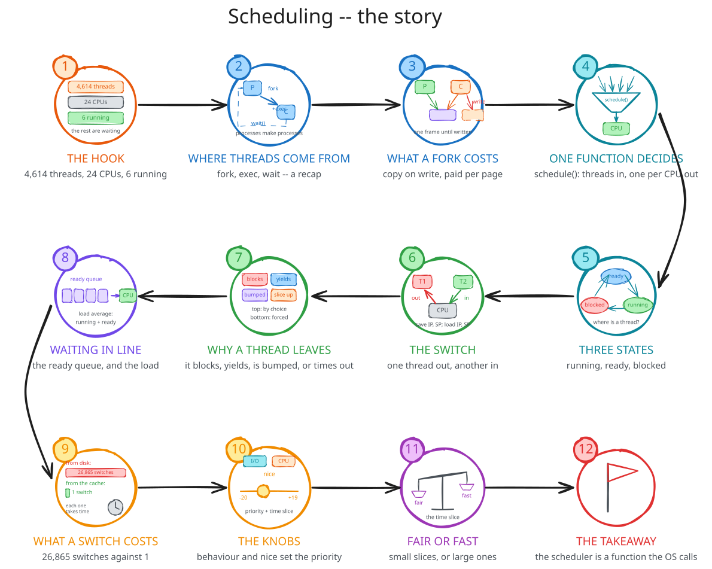

# Storyline: Scheduling

The planned narrative of the live delivery, one thread from start to finish.
The figure walks through it, station by station: [the storyline](media/00-pitch/storyline.svg).

1. **The hook:** this machine has 4,614 threads and 24 CPUs, and at this moment 6 threads are running.
   A browser process that has been alive for three days has used two hours of CPU; for the other 97% of its life it was waiting.
   Since the machine booted, the kernel has swapped the thread on a CPU 2.8 billion times.
   Where is a thread when it is not running, and who decides which ones run?
   That is the lecture.
1. **Where threads come from.**
   A quick walk back through lecture 06: a process is created by another, with `fork()` and `exec()` or `posix_spawn()`, and waited for with `wait()`.
   A child that ended before being waited for is a zombie; a child whose parent ended is an orphan, adopted by PID 1.
   Every thread the scheduler will ever see started this way.
1. **What a fork costs.**
   `fork()` copies a process, but not its memory: both point at the same frames, marked read-only, and the first write to a page faults and copies that one page.
   Creating a child costs a handful of faults; reading the parent's 4 MB costs none; writing half of it costs 512.
   Copy-on-write is what makes multi-processing a reasonable way to use many CPUs.
1. **One function decides.**
   Thousands of threads, two dozen CPUs: the CPU has to be shared in time, and the scheduler is the function that does the sharing.
   `schedule()` is given every thread and what each has been doing, and it picks one thread per CPU; it is called whenever something changes.
1. **Three states.**
   A thread is running, on a CPU; or ready, with everything it needs except a CPU; or blocked, waiting for an event: input, a disk read, a child, a timer.
   At most one thread per CPU is running; any number can be ready or blocked.
   `ps` shows the state in one letter, and a thread that burns the CPU flips from `R` to `S` the moment it asks for input.
1. **The switch.**
   A thread is an execution context, an IP and an SP.
   A context switch saves the running thread's IP, SP and registers into its TCB and loads another thread's: one leaves the CPU, another enters.
   It is not a domain switch, which takes the same thread into the kernel and back; but the kernel does it, so it starts with one.
1. **Why a thread leaves.**
   Four reasons: it calls something that blocks, it yields, a higher-priority thread became ready, or its time slice ran out.
   The first two are voluntary and the last two are involuntary, and the kernel counts both per thread.
   A `find` over a cold disk makes 26,865 voluntary switches; the same `find` from the cache makes one.
1. **Waiting in line.**
   A ready thread is in the ready queue, and the time it spends there is pure waiting: eight threads on 24 CPUs wait a microsecond, 512 wait 50 milliseconds.
   The load average is the length of that line plus the threads running: 0.13 on an idle machine, climbing towards 48 with 48 busy threads.
1. **What a switch costs.**
   Saving and loading registers is cheap; losing the caches and the TLB behind the old thread is not.
   Thousands of switches a second is normal; the scheduler's job is to keep them worth it.
1. **The knobs.**
   The scheduler watches each thread's behaviour: an I/O-bound thread runs briefly and blocks, a CPU-bound thread uses every slice to the end.
   The administrator adds a static input, the nice value, from -20 to +19.
   From these the scheduler sets a dynamic priority, which decides who goes first, and a time slice, which decides for how long.
   Three groups of CPU hogs at nice -20, 0 and +19 finish in that order: 3 seconds, 7 seconds, 9 seconds.
1. **Fair or fast.**
   A small time slice means fast turn-taking, a responsive machine and many switches; a large one means fewer switches, more work done and a longer wait in line.
   Interactivity and throughput pull the same knob in opposite directions, and every scheduler picks a point between them.
1. **What should survive the week:** the scheduler is a function the kernel calls, voluntarily or not, to pick one thread per CPU.
   A thread is running, ready or blocked; a context switch moves it between the first two; what it does and what the admin asks for set its priority and its time slice.
   Next time: what happens when the threads that share a CPU also share memory, and the locks that keep them honest.

## How the stations map onto the lecture

| Stations | Part |
| --- | --- |
| 1 | 00. Pitch |
| 2 | 01. Processes, recapped |
| 3 | 02. Copy-on-write |
| 4 | 03. Scheduling, an overview |
| 5 | 04. Thread states |
| 6, 7 | 05. The context switch |
| 8, 9 | 06. Queues, waiting and load |
| 10, 11 | 07. Nuts and bolts |
| 12 | 08. Conclusion |

Station 1's three numbers are the lecture's three threads: the thread count against the CPU count is answered by stations 4 and 5, the browser's missing 97% by stations 5 and 8, and the billions of switches by stations 6, 7 and 9.
Stations 2 and 3 close lecture 06 rather than open this one; they are short on purpose, and the hook should already be on the board when they are told.
