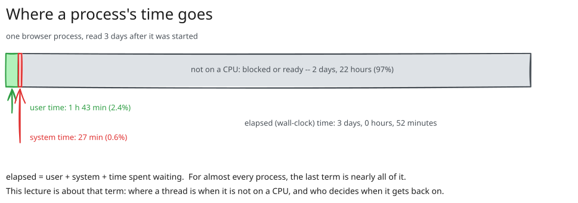
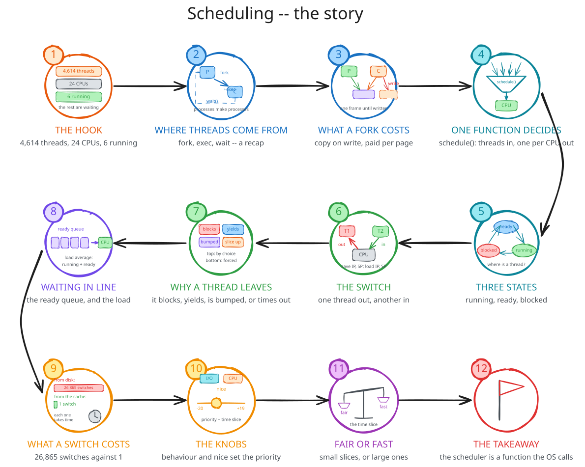
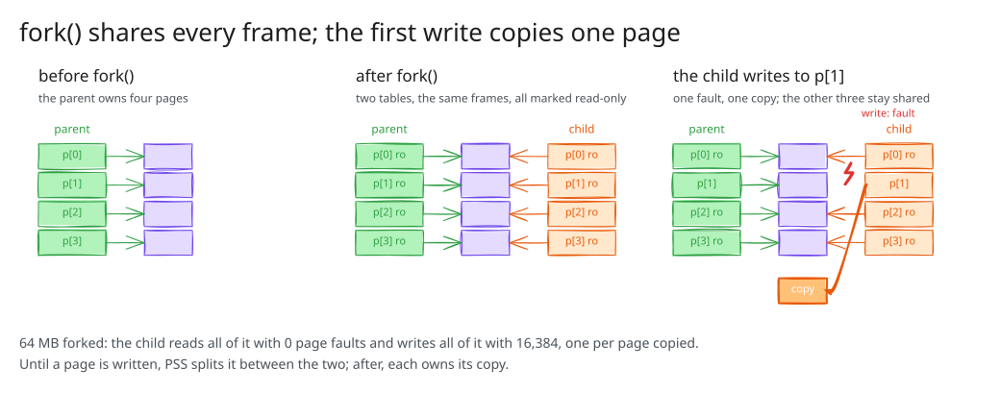
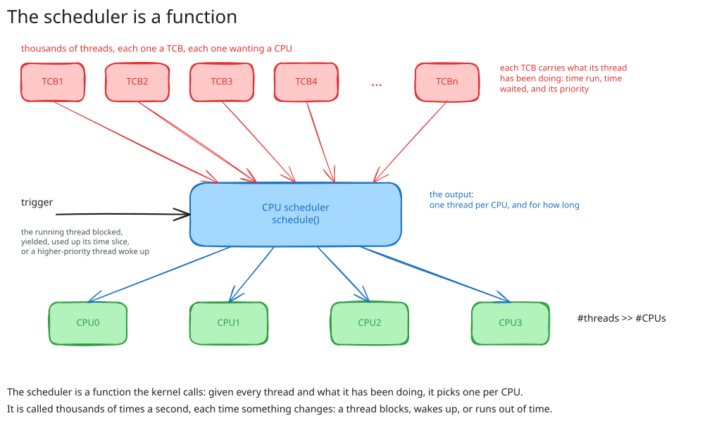
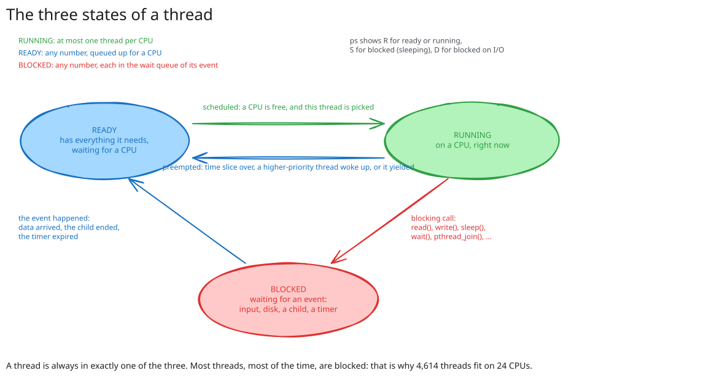
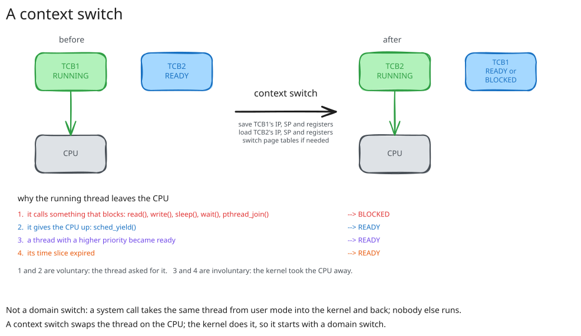
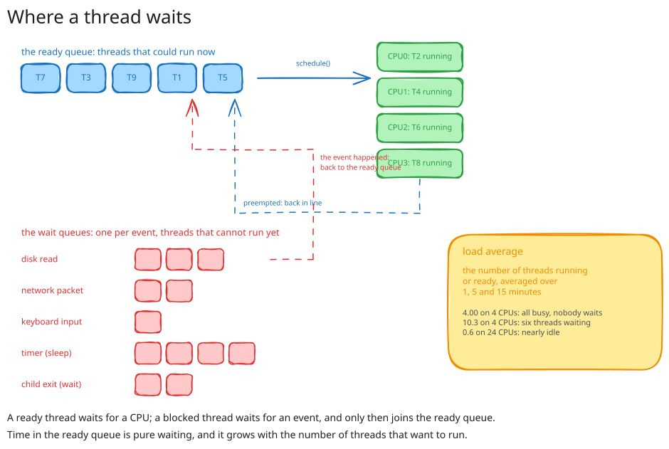
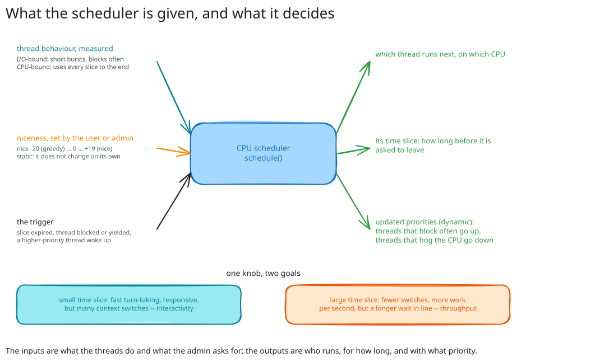

# 00. Pitch

## Thousands of threads, two dozen CPUs

```text
$ nproc
24
$ ps -e -L --no-headers | wc -l
4614
$ ps -e -L -o state --no-headers | sort | uniq -c
    259 I
      6 R
   4349 S
```

4,614 threads, 24 CPUs, **6 running or ready**.
4,349 are sleeping, waiting for something.

::: {.notes}
Run all three on the lecture machine. Sit on the R line: that is the lecture.
:::

## A process alive, but not running

```text
$ ./get_times_for_pid.sh 887053
user time:       6172.63s
system time:     1638.40s
elapsed time:  262379.00s
$ ps -o pid,comm,etime,cputime,%cpu -p 887053
    PID COMMAND             ELAPSED     TIME %CPU
 887053 chrome           3-00:52:59 02:10:11  2.9
```

Three days alive, two hours on a CPU: **2.9%**.
The other 97%: waiting.

## Where a process's time goes

{fig-align="center" width="88%"}

## Billions of switches

```text
$ grep ctxt /proc/stat
ctxt 2832438754
$ vmstat 1 3 | awk '{ print $12 }'
cs
3
14915
21037
```

2.8 billion times since boot, 15,000 to 20,000 times a second right now, the kernel replaced the thread on a CPU.
Each one is a decision.

::: {.notes}
Where is a thread when it is not running? How does it get on and off a CPU? Who decides? That is the lecture.
:::

## The story

{fig-align="center" width="82%"}

# 01. Processes, recapped

## Create, wait, terminate

A process is created by another process, which waits for it.

* `posix_spawn()`: an executable in, a PID out.
* `fork()` copies and returns **twice**; `exec()` replaces and does **not** return.

```text
$ ./fork_exec
PID: 105188, parent PID: 11471, child PID: 105189
Process exited with status 0
```

::: {.notes}
Lecture 06's demos, copied here. Keep it to three minutes; the hook is already on the board.
:::

## Zombies and orphans

```text
$ ps -o pid,stat,cmd -C sleep
    PID STAT CMD
 222221 Z    [sleep] <defunct>          ended, not yet waited for

$ ps -o pid,ppid,cmd -C sleep
    PID    PPID CMD
  24533    4984 /usr/bin/sleep 100       parent gone; PPID is now init
```

A zombie will never be scheduled again.
An orphan is a thread like any other; parent and child are bookkeeping, not scheduling.

# 02. Copy-on-write

## What a fork costs

{fig-align="center" width="78%"}

`fork()` copies the **page table**, not the pages; every entry is read-only in both.
The first write to a page faults, and copies that one page.

## fork_faults, measured

```text
                      PID    PPID COMMAND       MINFL   RSS
init p before fork  1379177    5790 fork_faults   1154  5784
child begin         1379187 1379177 fork_faults     22  4980
child after read    1379187 1379177 fork_faults     23  4980
child after write   1379187 1379177 fork_faults    535  4980
end (parent)        1379177    5790 fork_faults   2190  5912
```

* creating the child: **22** faults, for 4 MB of touched memory
* reading 512 shared pages: **1**
* writing 512 pages: **512**, one copy each
* the parent writing 1,024 pages afterwards: **1,025**, no copies

::: {.notes}
The parent's 1,025: the entries stayed read-only; each fault finds the frame unshared and just flips the bit. Ask the room first.
:::

## Why it matters here

Cheap processes are one of the two ways to use many CPUs: **multi-processing**.
A pipeline, a server with a worker per connection, `make -j`.

Either way: more threads than CPUs.

# 03. Scheduling, an overview

## The scheduler is a function

{fig-align="center" width="70%"}

## Input, output, trigger

* **input**: every thread, and what it has been doing --- time run, time waited for I/O, time waited for a CPU, priority
* **output**: one thread per CPU, and for how long
* **trigger**: something changed --- a thread blocked, yielded, ran out of time, or woke up

Not a process. Code in the kernel, run on the CPU being handed over, in the context of the thread that triggered it.

## What it needs

* the list of all threads, each with a **state**
* the **ready queue** (one per CPU)
* **accounting**: time run, time waited
* each thread's saved **context**: IP, SP, registers

The rest of the lecture, in the order a thread meets them.

# 04. Thread states

## Running, ready, blocked

{fig-align="center" width="72%"}

## Reading the state

```text
$ ps -e -L -o state --no-headers | sort | uniq -c
    262 I
      3 R
   4452 S
```

`R` running or ready --- `S` blocked (sleeping) --- `D` blocked on I/O --- `I` idle kernel thread --- `Z` zombie --- `T` stopped.

Nearly everything is `S`.

## change_state, watched

```text
    PID COMMAND         S     ELAPSED     TIME
1378742 change_state    S       00:01 00:00:00      at the prompt
1378742 change_state    R       00:04 00:00:03      burning
1378742 change_state    S       00:13 00:00:03      at the prompt
1378742 change_state    R       00:16 00:00:06      burning
```

`R`: both times move. `S`: only the elapsed time does.
The browser of the pitch, in miniature.

::: {.notes}
ps in the second terminal, once at the prompt, once during the burn. Point at which column moves.
:::

# 05. The context switch

## Swapping the thread on a CPU

{fig-align="center" width="76%"}

## Not a domain switch

* **domain switch** (lecture 02): the *same* thread, user mode to kernel and back; a system call.
* **context switch**: the thread on the CPU is *replaced*; IP, SP, registers saved into one TCB, loaded from another.

A context switch is done by the kernel, so it *begins* with a domain switch.
It may or may not end in a different thread.

## Why a thread leaves

| | cause | goes to | |
| --- | --- | --- | --- |
| 1 | blocks: `read()`, `sleep()`, `wait()`, `pthread_join()`, a lock | blocked | voluntary |
| 2 | yields: `sched_yield()` | ready | voluntary |
| 3 | a higher-priority thread became ready | ready | involuntary |
| 4 | its time slice expired | ready | involuntary |

3 and 4 are **preemption**.
Linux counts the two kinds separately, per thread.

## Counting switches

```text
$ grep switches /proc/$pid/task/$pid/sched
nr_switches                      :      1        at the prompt
nr_voluntary_switches            :      1
nr_involuntary_switches          :      0

nr_switches                      :     99        burning
nr_voluntary_switches            :      1
nr_involuntary_switches          :     98

nr_switches                      :    101        at the prompt again
nr_voluntary_switches            :      2
nr_involuntary_switches          :     99
```

One voluntary per wait. A hundred involuntary per burst, on a thread that never asked to leave.

## 26,865 against 1

```text
                                      cold        warm
Percent of CPU this job got:           13%         99%
Elapsed (wall clock) time:           2.35 s      0.16 s
Voluntary context switches:         26865           1
Involuntary context switches:          51           3
File system inputs:                220256           0
```

The same `find /usr/share`, from the disk and from the page cache.
Same instructions; the difference is how often the thread had to wait.

::: {.notes}
Drop the cache first. Read only the CPU percentage and the two switch counts.
:::

# 06. Queues, waiting and load

## Where a thread waits

{fig-align="center" width="74%"}

## Four transitions

* ready → running: the scheduler picks it
* running → ready: preempted, or yielded
* running → blocked: a blocking call; into the wait queue of the event
* blocked → ready: the event happened

Never blocked → running.
The ready queue waits for the **kernel**; a wait queue waits for the **world**.

## Time in the ready queue

| threads | average wait | longest | waits > 100 µs |
| ---: | ---: | ---: | ---: |
| 8 | 0 µs | 1 µs | 0 of 40 |
| 24 | 32 µs | 2.1 ms | 4 of 120 |
| 64 | 2.6 ms | 21 ms | 135 of 320 |
| 128 | 11 ms | 40 ms | 510 of 640 |
| 512 | 52 ms | 175 ms | 2,256 of 2,560 |

`sched_yield()` on 24 CPUs: free while threads ≤ CPUs, then pure waiting, growing with the crowd.

## Load average

```text
$ cat /proc/loadavg
0.13 4.88 8.10 1/4726 1386866        before
7.49 6.30 8.53 50/4753 1386942       after 10 s
19.07 9.02 9.37 49/4770 1387036      after 30 s
30.82 12.84 10.64 49/4776 1387673    after 60 s
```

Threads **running or ready**, averaged over 1, 5, 15 minutes.
48 busy threads on 24 CPUs: the one-minute average heads for 48.

::: {.notes}
Start load_average before the queues figure, come back to it here. Linux also counts D; one sentence.
:::

## What a switch costs

Registers: under a microsecond.
Afterwards: cold caches, cold TLB, and a flushed TLB if the page table changed.

Thousands of switches a second is normal.
Switching as often as you like is not free --- which is the next part.

# 07. Nuts and bolts

## Two inputs, two outputs

{fig-align="center" width="72%"}

## What the scheduler measures, and is told

* **behaviour**, measured: **I/O-bound** threads run briefly and block; **CPU-bound** threads use every slice.
  The kernel watches; the answer changes over the thread's life.
* **nice**, told: `-20` (least nice) to `+19` (nicest), default `0`; static; below 0 needs root.

## What it decides

* **priority**, dynamic: who goes first.
  Up for threads that block often; down for threads that run their slice out.
  Nice shifts the range.
* **time slice**: how long before the question is asked again.

## nice, measured

72 CPU hogs on 24 CPUs, 1.6 s of work each; three groups.

```text
nice -20:   3.10 s ... 3.71 s     85% of a CPU each
nice   0:   5.85 s ... 7.63 s     41%
nice +19:   7.99 s ... 9.77 s     29%
```

They finish in nice order.
Nothing was starved: nice shifts the share, it does not switch a thread off.

::: {.notes}
sudo for the -20 group. htop while it runs: every CPU at 100%; nice decides who gets them.
:::

## Fair, or fast

| | small time slice | large time slice |
| --- | --- | --- |
| switches | many | few |
| wait in the ready queue | short | long |
| feels | responsive | fast |
| goal | **interactivity**, fairness | **throughput** |

Every scheduler picks a point between the two.
Linux: CFS (2007--2023), EEVDF since 6.6 --- a slice computed from the number of ready threads and their weights.

# 08. Conclusion

## What we covered

* 4,614 threads, 24 CPUs, 6 running; a browser at 2.9%; 2.8 billion switches
* `fork()` recapped, and what it costs: a page table, then one fault per page written
* the scheduler as a function: threads and history in, one per CPU and a slice out
* three states, and the queues behind the two waiting ones
* the context switch, the four reasons to leave, voluntary and involuntary
* waiting time, load average, the cost of a switch
* behaviour and nice in; priority and time slice out; interactivity against throughput

## {background-color="#f7f7f7"}

::: {style="font-size: 1.2em; text-align: center; margin-top: 1.2em;"}
**The scheduler is a function the kernel calls to pick one thread per CPU.**

Voluntarily, when a thread blocks or yields; involuntarily, when a slice ends or a higher-priority thread wakes.

A thread is running, ready or blocked; a context switch moves it between the first two;
what it does and what the admin asks for set its priority --- who goes first --- and its time slice --- for how long.
:::

## Next

* **Lab 07:** one job across processes and across threads, measured; where more threads stop helping.
* **Lecture 08:** concurrency --- a switch can happen between any two instructions; races, and the locks that stop them.
* **The assignments:** `minishell` creates, waits for, and pipes the processes of part 01.

::: {.notes}
End on the bridge: the threads that share a CPU also share memory, and a switch can land anywhere.
:::
