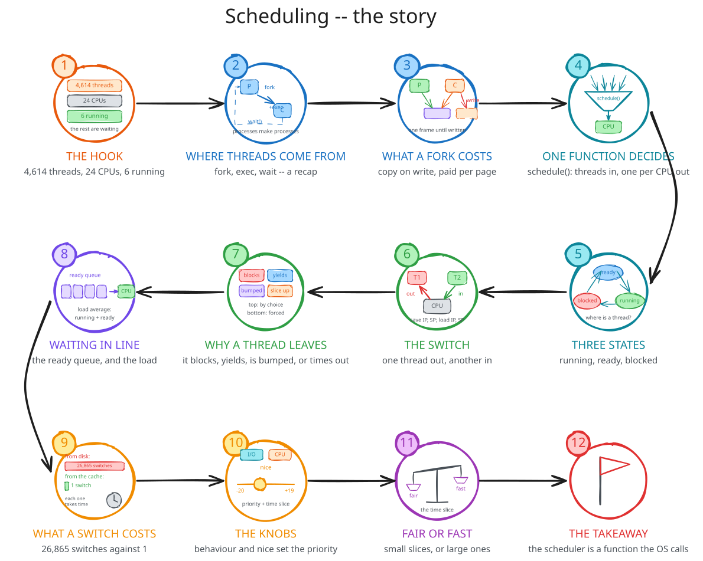
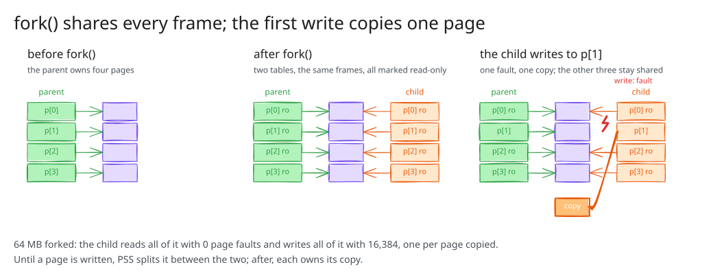
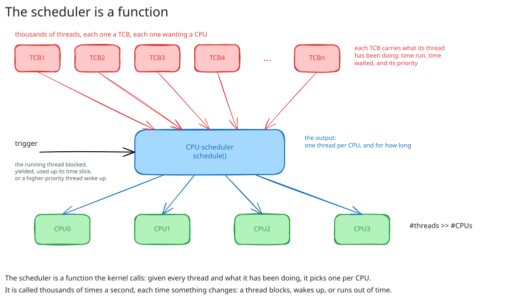
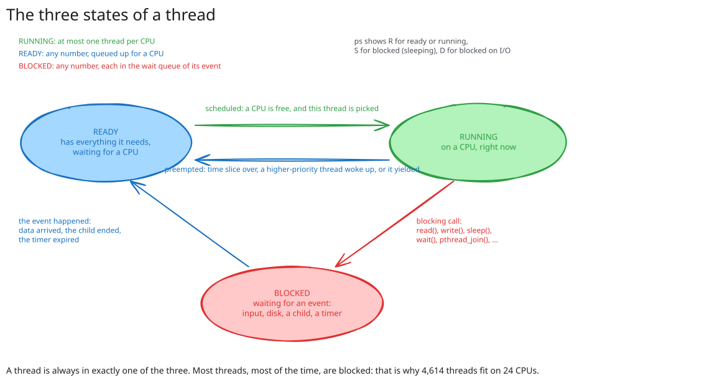
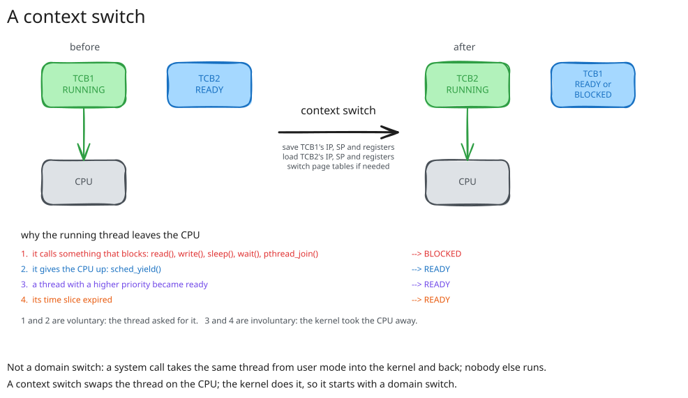
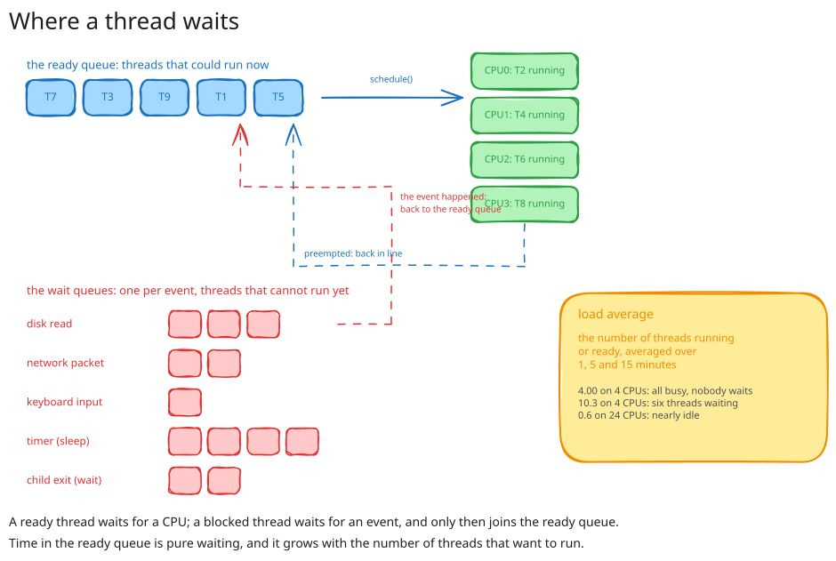
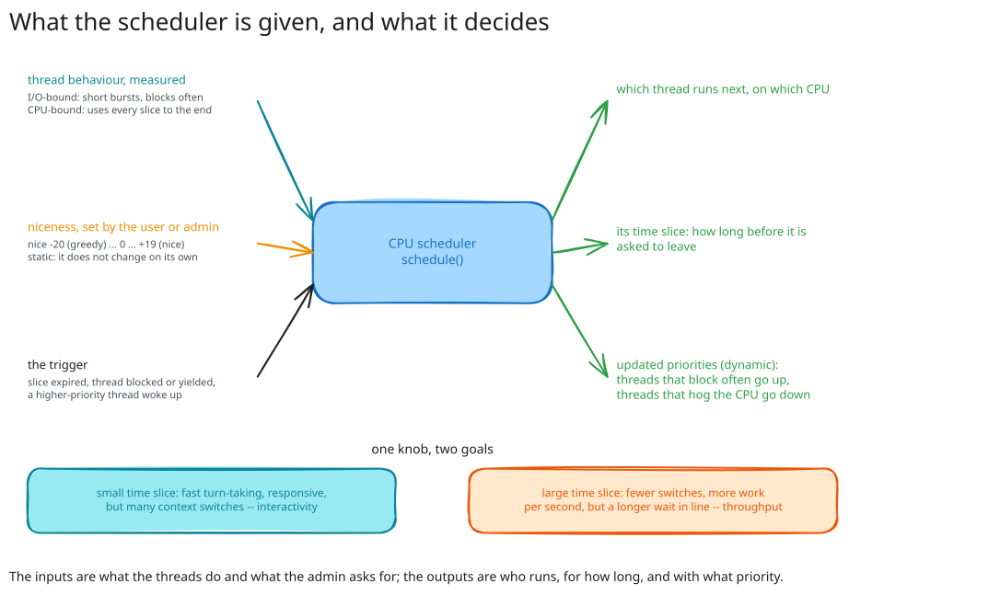

## Three numbers {background-color="#f7f7f7"}

```text
$ ps -e -L --no-headers | wc -l
4614                                   threads, on 24 CPUs; 6 in R

$ ps -o pid,comm,etime,cputime,%cpu -p 887053
 887053 chrome  3-00:52:59 02:10:11 2.9  three days alive, two hours on a CPU

$ grep ctxt /proc/stat
ctxt 2832438754                        switches since boot
```

Where is a thread when it is not running?
Who decides which ones run?

::: {.notes}
Run the three on the lecture machine. Thread count -> parts 03, 04; the 2.9% -> parts 04, 06; the switches -> parts 05, 06.
:::

## The story

{fig-align="center" width="82%"}

## What a fork costs

{fig-align="center" width="64%"}

```text
child begin        MINFL   22      4 MB shared, nothing copied
child after read   MINFL   23      reading shared pages is free
child after write  MINFL  535      512 writes, 512 faults, 512 copies
```

::: {.notes}
fork_exec and zombie first, three minutes, "the tail of lecture 06". Then fork_faults with ps at every prompt. The parent's 1,025 at the end: ask the room.
:::

## The scheduler is a function

{fig-align="center" width="62%"}

**Input:** every thread and its history. **Output:** one per CPU, and for how long. **Trigger:** something changed.

## Three states

{fig-align="center" width="64%"}

## One thread, watched

```text
$ ps -e -L -o state --no-headers | sort | uniq -c
    262 I        3 R     4452 S

    PID COMMAND         S     ELAPSED     TIME
1378742 change_state    S       00:01 00:00:00      at the prompt
1378742 change_state    R       00:04 00:00:03      burning
1378742 change_state    S       00:13 00:00:03      at the prompt
```

`R`: both times move. `S`: only the elapsed time does.

::: {.notes}
show-states histogram, then change_state with ps in the second terminal. Point at which column moves.
:::

## The context switch

{fig-align="center" width="70%"}

::: {.notes}
IP, SP, registers: what lecture 06 said a thread is. Not a domain switch, but it begins with one.
:::

## Why a thread leaves

| | cause | goes to | |
| --- | --- | --- | --- |
| 1 | blocks: `read()`, `sleep()`, `wait()`, a lock | blocked | voluntary |
| 2 | yields | ready | voluntary |
| 3 | a higher-priority thread became ready | ready | involuntary |
| 4 | its time slice expired | ready | involuntary |

```text
nr_voluntary_switches      :   2        one per wait at the prompt
nr_involuntary_switches    :  99        a hundred per burst
```

::: {.notes}
show-context-switches on change_state. The involuntary hundred: a thread that never asked to leave.
:::

## 26,865 against 1

```text
                                      cold        warm
Percent of CPU this job got:           13%         99%
Elapsed (wall clock) time:           2.35 s      0.16 s
Voluntary context switches:         26865           1
File system inputs:                220256           0
```

The same `find /usr/share`, from the disk and from the page cache.
Same instructions; the difference is how often the thread had to wait.

::: {.notes}
Drop the cache first. Read only the three lines.
:::

## Where a thread waits

{fig-align="center" width="66%"}

## Waiting, and load

| threads | average wait | longest |
| ---: | ---: | ---: |
| 8 | 0 µs | 1 µs |
| 64 | 2.6 ms | 21 ms |
| 512 | 52 ms | 175 ms |

```text
$ cat /proc/loadavg
0.13 4.88 8.10 1/4726 ...        before 48 threads on 24 CPUs
30.82 12.84 10.64 49/4776 ...    a minute later
```

Registers are cheap to switch; cold caches and a cold TLB are not.

::: {.notes}
waiting_time 8 then 512. load_average started before the queues figure. One sentence on the cost of a switch.
:::

## Two inputs, two outputs

{fig-align="center" width="64%"}

## nice, measured

72 CPU hogs on 24 CPUs, 1.6 s of work each.

```text
nice -20:   3.10 s ... 3.71 s     85% of a CPU each
nice   0:   5.85 s ... 7.63 s     41%
nice +19:   7.99 s ... 9.77 s     29%
```

They finish in nice order. Nothing was starved.

::: {.notes}
sudo for the -20 group. htop while it runs: every CPU at 100%; nice decides who gets them.
:::

## Fair, or fast

| | small time slice | large time slice |
| --- | --- | --- |
| switches | many | few |
| wait in line | short | long |
| goal | **interactivity** | **throughput** |

Every scheduler picks a point between the two.

## {background-color="#f7f7f7"}

::: {style="font-size: 1.2em; text-align: center; margin-top: 1.2em;"}
**The scheduler is a function the kernel calls to pick one thread per CPU.**

A thread is running, ready or blocked; a context switch moves it between the first two.

What it does and what the admin asks for set its priority --- who goes first --- and its time slice --- for how long.
:::

::: {.notes}
Next time: the threads that share a CPU also share memory, and a switch can land between any two instructions.
:::
