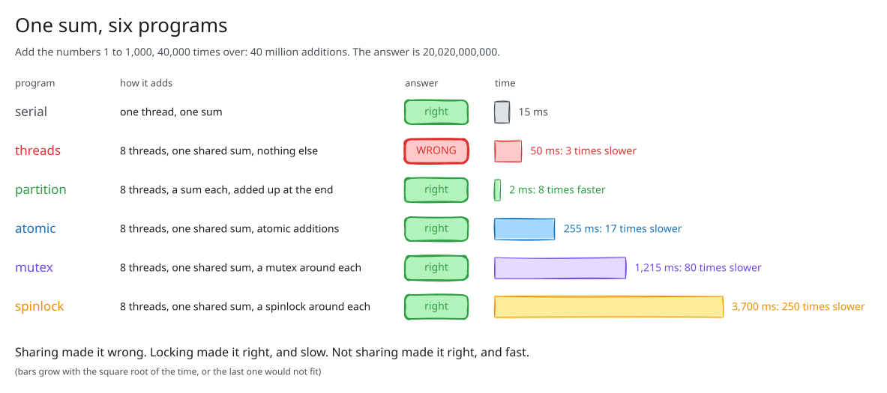
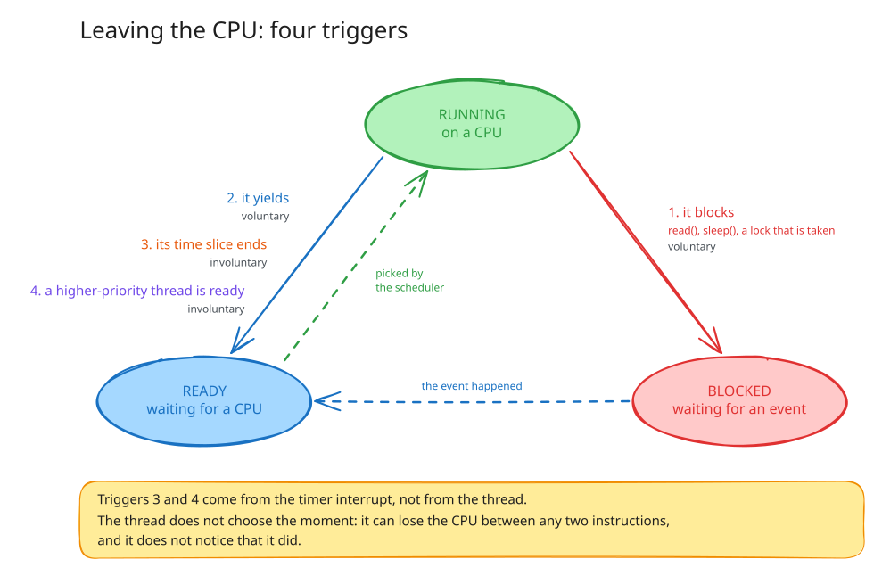
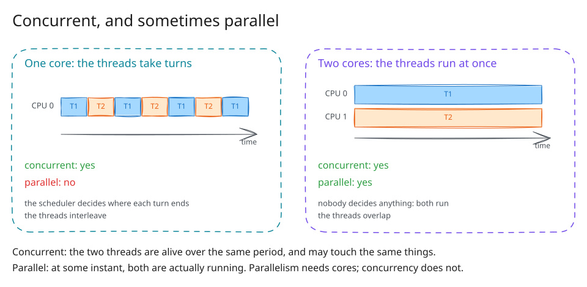
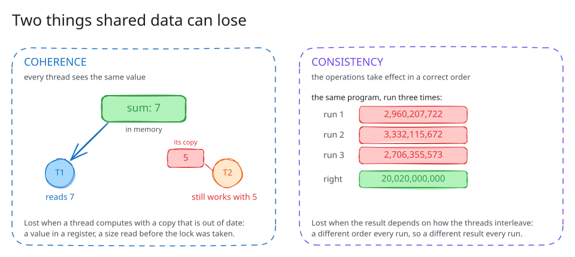
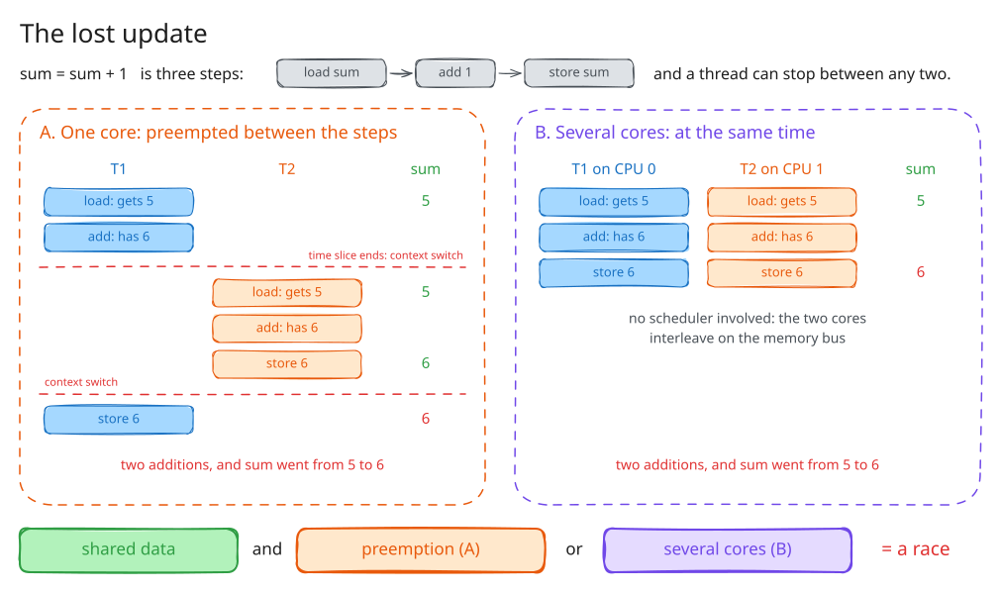
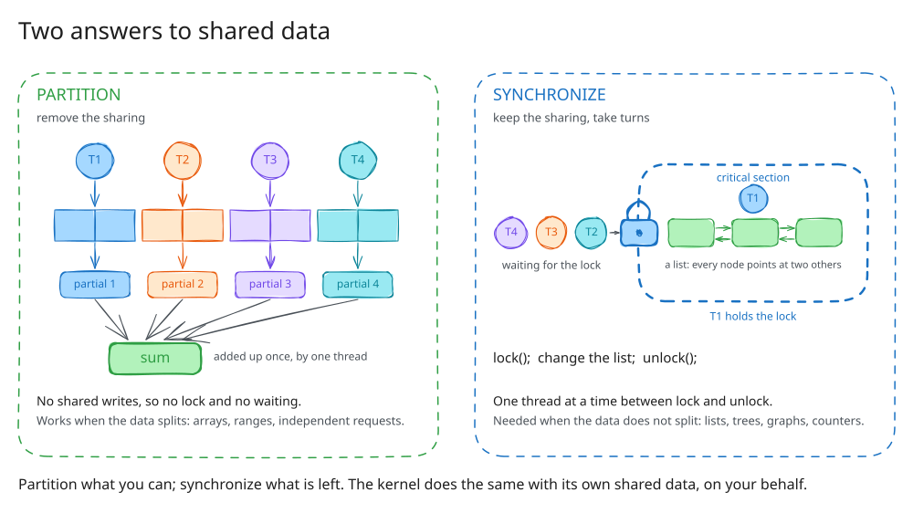
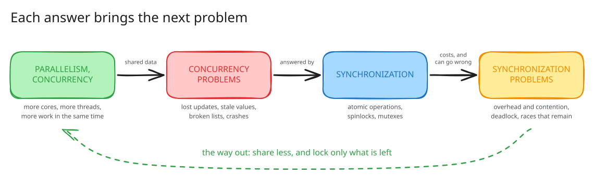
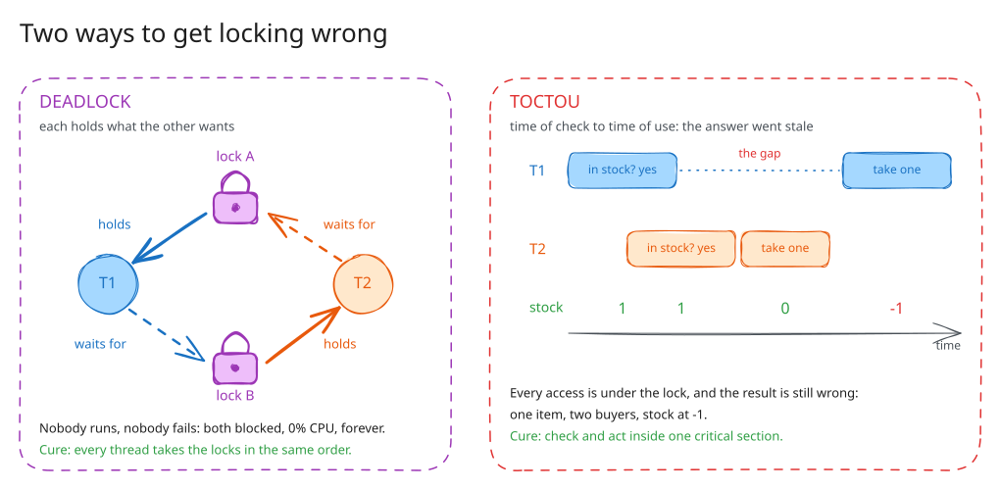

# Session 08: Concurrency - Full Contents

This is the complete version of the eighth lecture: the argument in full sentences, the diagrams, the demos with their reference output, and the reading behind each part.

Read it before the lecture if you want to follow the live delivery without taking notes, and after it for everything that was said once and quickly.
The one-page plan used during the lecture is [`08-concurrency-live/`](../08-concurrency-live).

Lecture 06 said what runs, threads; lecture 07 said when, and ended on a warning: the threads that share a CPU also share memory, and a context switch can land between any two instructions.
This lecture is about what follows from that.
It starts from one sum that eight threads get wrong, names what went wrong and the two things that cause it, and then goes through the two cures, not sharing and taking turns, and what the second one costs.

This is the third of the lectures on compute.
Lecture 06 was what runs, lecture 07 was when, and this one is what happens when several run over the same data.

## Learning objectives

By the end of this lecture you should be able to:

* Tell concurrency from parallelism, and say which of the two a single core can have.
* Explain why a statement such as `sum += i` is not one step, and walk through an interleaving of two threads that loses an update.
* Name the two root causes that turn shared data into a race, preemption and several cores, and tell from a measurement which one is at work.
* State what coherence and consistency of shared data mean, and recognise a program that has lost one or the other.
* Remove shared data by partitioning it, and say for a given data structure whether it can be partitioned.
* Protect shared data with an atomic operation, a spinlock or a mutex, and identify the critical section.
* Explain where the cost of synchronization comes from, and choose the granularity of a critical section.
* Recognise a deadlock and a check-then-act race, find them with `ps` and `gdb`, and remove them.

## What is here

| Part | What it answers | Demos |
| --- | --- | --- |
| [00. Pitch](#00-pitch-one-sum-six-programs) | Why do eight threads get a sum wrong, and take longer doing it? | [`00-pitch/`](demos/00-pitch) |
| [01. Reminder: leaving the CPU](#01-reminder-leaving-the-cpu) | When does a thread lose the CPU, and does it get a say? | -- |
| [02. Concurrency](#02-concurrency) | What is concurrency, how is it different from parallelism, and what can it break? | -- |
| [03. Root causes](#03-root-causes) | What exactly goes wrong, and what are the two things that cause it? | [`03-root-causes/`](demos/03-root-causes) |
| [04. Partitioning and synchronization](#04-partitioning-and-synchronization) | How is it put right: by not sharing, or by taking turns? | [`04-partitioning-synchronization/`](demos/04-partitioning-synchronization) |
| [05. Problems with synchronization](#05-problems-with-synchronization) | What does taking turns cost, and how does it go wrong? | [`05-synchronization-problems/`](demos/05-synchronization-problems) |
| [06. Conclusion](#06-conclusion) | What should survive the week? | -- |

The slides are in [`slides/`](slides); the demos, with build instructions and reference output, are in [`demos/`](demos).
The planned narrative of the live delivery is in [`STORYLINE.md`](STORYLINE.md), with [the storyline figure](media/00-pitch/storyline.svg) that walks through it.

## 00. Pitch: One Sum, Six Programs

Add the numbers from 1 to 1,000, and do it 40,000 times over.
That is 40 million additions, and the answer is 20,020,000,000.
The [sum demo](demos/00-pitch/sum) holds six programs that compute it.

**One thread.**

```text
$ ./sum_serial
serial         sum:  20020000000  expected:  20020000000  OK     time:    15 ms
```

Fifteen milliseconds, and the right answer.
The machine has 24 CPUs, and 23 of them did nothing.

**Eight threads.**
Lecture 06 said how to use the others: split the rounds between eight threads, and let each add into the same variable.

```text
$ ./sum_threads
threads        sum:   2960207722  expected:  20020000000  WRONG  time:    51 ms
$ ./sum_threads
threads        sum:   3332115672  expected:  20020000000  WRONG  time:    48 ms
$ ./sum_threads
threads        sum:   2706355573  expected:  20020000000  WRONG  time:    54 ms
```

Three runs, three answers, none of them right, and each about a seventh of what it should be.
And it took three times longer than one thread.
Eight cores lost to one, and could not add.

**Four more attempts.**
The other four programs change a few lines each.

```text
$ make run
serial         sum:  20020000000  expected:  20020000000  OK     time:    15 ms
threads        sum:   2960207722  expected:  20020000000  WRONG  time:    51 ms
partition      sum:  20020000000  expected:  20020000000  OK     time:     2 ms
atomic         sum:  20020000000  expected:  20020000000  OK     time:   255 ms
spinlock       sum:  20020000000  expected:  20020000000  OK     time:  3695 ms
mutex          sum:  20020000000  expected:  20020000000  OK     time:  1215 ms
```



* `sum_partition` gives each thread a variable of its own and adds the eight partial sums at the end.
  It is right, and it takes 2 ms: eight times faster than one thread, which is what eight cores should give.
* `sum_atomic`, `sum_spinlock` and `sum_mutex` keep the one shared variable and protect each addition, in three different ways.
  All three are right.
  They are 17, 250 and 80 times *slower* than one thread.

So there are three questions, and they are the lecture.
Why is the plain threaded version wrong, and wrong differently every time?
Why is the one that shares nothing the only one worth having?
And what are the other three doing that makes them correct, and so slow?

> **Takeaway.**
> Threads that write the same variable without care get a wrong result, and not even a stable one.
> Protecting the variable makes the result right and the program slow; not sharing the variable makes it right and fast.

## 01. Reminder: Leaving the CPU

### Three states, four triggers

Lecture 07 put every thread in one of three states: **running** on a CPU, **ready** and waiting for a CPU, or **blocked** and waiting for an event.
A context switch takes the running thread off a CPU and puts a ready one on, and the running thread leaves for one of four reasons.



| | Trigger | The thread goes to | Whose decision |
| --- | --- | --- | --- |
| 1 | it calls something that blocks | blocked | the thread's: voluntary |
| 2 | it yields the CPU | ready | the thread's: voluntary |
| 3 | its time slice expires | ready | the kernel's: involuntary |
| 4 | a thread with a higher priority became ready | ready | the kernel's: involuntary |

### When each one happens

A **voluntary** switch happens at a place the program wrote: a system call that waits, such as `read()`, `write()`, `sleep()`, `waitpid()` or `pthread_join()`, or an explicit `sched_yield()`.
Looking at the source, you can point at the lines where the thread may leave.

An **involuntary** switch happens wherever the thread happens to be.
A hardware timer interrupts every CPU at a fixed rate, hundreds of times a second.
Each interrupt enters the kernel, which updates its accounting: how much of its time slice the running thread has used, and whether some thread that was blocked has become ready and deserves the CPU more.
If the slice is used up, or a higher-priority thread is ready, the kernel does the switch on the way out of the interrupt.

The thread did not ask for this, is not told about it, and cannot tell afterwards that it happened: its registers are saved, another thread runs for a few milliseconds, the registers are restored, and the next instruction executes as if nothing had come between it and the previous one.
Something did: several milliseconds, in which other threads ran millions of instructions.

For a thread that works only on its own data, this does not matter, and that is the whole point of a context switch being transparent.
For a thread that shares data with the threads that ran in between, it is the start of this lecture.

> **Takeaway.**
> A thread leaves the CPU by choice, when it blocks or yields, or by force, when its time slice ends or a higher-priority thread is ready.
> The forced kind is driven by the timer interrupt and can land between any two instructions, without the thread knowing.

## 02. Concurrency

### Concurrent, and sometimes parallel

Two threads are **concurrent** when they are alive over the same period: one starts before the other has finished.
That is a statement about lifetimes, and it says nothing about how many CPUs there are.



On one core, concurrent threads take turns: one runs for a slice, then another, and the scheduler decides where each turn ends.
Their instructions are *interleaved*.
On several cores, concurrent threads can run at the same instant, each on a core of its own.
That is **parallelism**: actual simultaneous execution.

The two words are often used as one, and the difference matters here.
Parallelism is a property of the execution, it needs hardware, and it is what makes work finish sooner.
Concurrency is a property of the program, it needs only a scheduler, and it is what makes work go wrong.
A program can be concurrent without being parallel, as every multi-threaded program on a single-core machine was for decades; and all the problems of this lecture were known, and fixed, on those machines.

### Shared data

Concurrent threads become a problem when they use the same thing in an overlapping period.
The thing can be memory, a variable, a list, a buffer; it can also be a file, a device or a network connection.
For threads of one process the obvious one is memory: lecture 06 said that threads share the whole address space, and that this is exactly why they are cheap to create and quick to talk to each other.

When one thread only reads what another only reads, nothing can go wrong.
The trouble starts with a write.

### Coherence and consistency

Two things are expected of data that several threads use.



* **Coherence**: every thread sees the same value.
  If the sum in memory is 7, no thread should be computing with a 5 it read a while ago.
  A thread that has loaded a variable into a register holds a private copy of it, and the copy does not follow the original.
* **Consistency**: the operations on the data take effect in an order that makes sense, the same one for every thread that looks.
  A sign of consistency is that the program gives the same result on every run; a program whose result changes with the interleaving has lost it.

The threaded sum of the pitch lost both.
Its threads added to stale copies of the sum, which is a coherence failure, and its result was different on each of three runs, which is a consistency failure.

### What can go wrong

Concurrency over shared data brings a small family of problems, and the rest of the lecture meets most of them in a demo.

| Problem | What it looks like | How it is mitigated |
| --- | --- | --- |
| **Race condition** | The result depends on how the operations of several threads interleave. | Protect the shared state with a lock, use atomic operations, or do not share mutable state. |
| **Stale observation** | A thread does not see another thread's update when it expects to. | Use synchronization primitives with documented visibility and ordering guarantees; follow the language's memory model. |
| **Deadlock** | Threads wait forever for resources held by one another. | Take locks in one fixed order, keep critical sections short, avoid nesting locks, use timeouts where they make sense. |
| **Contention** | Threads spend their time waiting for a lock, or competing for memory or CPU, rather than working. | Share less mutable data, shorten what a lock covers, partition the work or the data, and measure before optimising. |
| **Starvation** | Some threads wait far longer than others, or never get their turn. | Fair locks and fair scheduling where needed; work queues in which nobody can be overtaken forever. |
| **Complexity** | Bugs that depend on timing, show up once in a thousand runs and vanish under a debugger. | Prefer designs that are simple to reason about, immutable data or message passing; stress tests, race detectors, and a clear rule for who owns what. |

The first row is the one everything else follows from, and part 03 takes it apart.

> **Takeaway.**
> Concurrency is threads alive at the same time; parallelism is threads running at the same instant, and it needs several cores.
> Concurrent threads that write shared data can break its coherence, a thread working with an out-of-date copy, and its consistency, a result that depends on the interleaving.

## 03. Root Causes

### Three steps, not one

The line that goes wrong in the pitch is `sum += i`.
In C it is one statement.
For the CPU it is three instructions, as the disassembly of `sum_threads` shows:

```text
$ objdump -d -M intel sum_threads
[...]
    133f:   mov    rdx,QWORD PTR [rip+0x2cea]        # 4030 <sum>
    1346:   mov    rax,QWORD PTR [rbp-0x8]
    134a:   add    rax,rdx
    134d:   mov    QWORD PTR [rip+0x2cdc],rax        # 4030 <sum>
```

**Load** `sum` from memory into a register; **add** `i` to the register; **store** the register back into `sum`.
Between the load and the store, the thread holds a private copy of the sum, and what it will store is computed from that copy.

Now let two threads do it, each adding 1 to a sum that is 5.
If the first does all three steps and then the second does, the sum goes 5, 6, 7.
If both load before either stores, both read 5, both compute 6, both store 6.
Two additions happened and the sum moved by one.
This is the **lost update**, and a program whose result depends on which of these interleavings occurred has a **race condition**.



### Two accomplices

Shared data on its own does nothing.
For the three steps of two threads to interleave, something has to put one thread's steps in between the other's, and there are exactly two things that can.

**A. Preemption.**
On a single core only one thread runs at a time, and the threads take turns.
The turn can end between the load and the store: the timer interrupt arrives, the time slice is over, the kernel switches to another thread.
That thread, and the ones after it, add to the sum for milliseconds.
When the first thread gets the CPU back, it finishes its addition with the value it loaded before the switch, and stores it over everything the others did.
The program has no say in where the switch falls; part 01 was the reminder of why.

**B. Several cores.**
With two cores, two threads really do run at the same instant, and no scheduler is involved.
Each core loads, adds and stores at its own pace, and the loads and stores of the two reach the memory in whatever order they happen to.
The interleaving is done by the hardware, on the memory bus.

A race needs **shared data, and at least one of the two**.
Take away the sharing and neither matters; that is part 04's first cure.
Keep the sharing and both have to be dealt with.

### Telling them apart

The [one-core-many-cores demo](demos/03-root-causes/one-core-many-cores) separates the two.
Eight threads each add 1 to a shared counter 50 million times.
The program is run on every core, and then with `taskset -c 0`, which confines all its threads to one core; and the addition is done in three ways.

| The addition | Every core | One core |
| --- | ---: | ---: |
| load, add, store: `counter = counter + 1` | about 80% lost | typically 14% lost, anything from nothing to a third |
| one instruction: `add QWORD PTR [counter], 1` | about 76% lost | nothing lost |
| one locked instruction: `lock add QWORD PTR [counter], 1` | nothing lost | nothing lost |

Read it row by row.

**Three instructions, one core:** updates are lost with nothing running in parallel.

```text
$ taskset -c 0 ./count
counter: 343945504  expected: 400000000  lost: 56054496 (14.0%)
involuntary context switches: 101
```

This is cause A alone.
About a hundred involuntary switches were enough to lose 56 million additions: most switches fall somewhere harmless, but one that falls between a load and a store throws away a whole time slice of everybody else's work.
That is also why the figure jumps about: twelve runs in a row lost between 0% and 28%, most of them near 14%, depending on where a handful of switches happened to land.
A race that depends on a few unlucky moments can pass a test and fail the next day.

**One instruction, one core:** nothing is lost.
An interrupt is taken between two instructions, never in the middle of one, so an addition that is a single instruction cannot be cut by the scheduler.
On one core, preemption was the only threat, and it has been removed.

**One instruction, every core:** three quarters are lost.

```text
$ ./count_one_insn
counter: 95873900  expected: 400000000  lost: 304126100 (76.0%)
```

This is cause B alone.
One instruction that adds to memory is still a read of memory followed by a write of memory, and another core can read between the two.
What is indivisible for the scheduler is not indivisible for the hardware.

**One locked instruction:** nothing is lost, anywhere.
The `lock` prefix makes the CPU keep exclusive hold of the memory, historically the whole bus and today the cache line, for the duration of the instruction, so no other core can get between its read and its write.
An operation that cannot be divided by anything is **atomic**, and this instruction is what `atomic_fetch_add()` in `sum_atomic` compiles to.

There is one more thing in the numbers.
On one core the plain counter finishes in 0.30 seconds; on every core it takes 0.60 seconds and uses 4.33 seconds of CPU.
Eight cores writing one variable keep taking its cache line away from each other, and that traffic is slower than the additions.
Parallelism over shared data is not just wrong; it is not even fast.

> **Takeaway.**
> `sum += i` is a load, an add and a store, and a thread that stops between them stores a stale value over other threads' work.
> A race needs shared data, plus preemption, which interleaves instructions on one core, or several cores, which interleave memory accesses under one instruction.

## 04. Partitioning and Synchronization

There are two answers to a race, and they attack different halves of its cause.



### Partitioning: remove the sharing

A race needs shared data.
**Partitioning** removes it: the data is cut into pieces, each thread is given a piece that no other thread touches, and the results are put together once, at the end, by one thread.

`sum_partition` does this to the sum of the pitch.

```c
static void *add_rounds(void *arg)
{
	unsigned long r, i;
	unsigned long mine = 0;

	for (r = 0; r < NUM_ROUNDS / NUM_THREADS; r++)
		for (i = 1; i <= N; i++)
			mine += i;

	*(unsigned long *)arg = mine;

	return NULL;
}
```

`mine` is on the thread's own stack.
The thread can be preempted anywhere and the other cores can do what they like: nobody else reads or writes `mine`, so there is nothing to lose.
The one write to shared memory is the partial sum at the end, to a slot only this thread writes, and the main thread reads the slots after `pthread_join()`, when the writers are gone.

It is right, and it takes 2 ms against 15 ms for one thread.
There is no lock to wait for and no cache line to fight over, so eight cores do eight times the work.
When partitioning is possible, it is the best answer there is, and the first design question for a parallel program is how to cut its data so that the threads do not meet.

### When the data does not split

Partitioning works when the pieces are independent.
An array is the easy case: element 3 knows nothing about element 5, so thread A can take the first half and thread B the second.
A range of numbers, a set of files, a batch of unrelated requests all split the same way.

A linked list does not.
Every node points at its neighbours; inserting at position 40 means walking 40 nodes that other threads may be changing; the list has one head and one size, and they belong to everybody.
Trees and graphs are the same, and so is any single value every thread must update: a counter of requests served, the balance of an account, the next free slot in a buffer.

The [list demo](demos/04-partitioning-synchronization/list) has ten threads adding to, removing from and searching one doubly-linked list.

```text
$ ./thread-list-app
Segmentation fault (core dumped)
$ ./thread-list-app
reached head when removing. not good.
Segmentation fault (core dumped)
```

Adding a node is four pointer writes, and between any two of them the list is broken.
A thread that walks it at that moment follows a pointer that is wrong, or one that leads into memory another thread has just freed.
The counter's race gave a wrong number; the list's gives a crash.

### Synchronization: take turns

When the data has to be shared, the threads have to take turns at it.
**Synchronization** makes the accesses to shared data happen in a correct order, and its basic form is **mutual exclusion**: while one thread is working on the data, no other thread is.

The part of the code that works on the shared data is a **critical section**, and a **lock** guards it.

```c
lock();
/* critical section: read the size, find the place, rewrite the pointers */
unlock();
```

A thread that calls `lock()` while another thread is inside waits; `unlock()` lets one waiter in.
From outside, the whole critical section looks like one step: no thread ever sees the list half changed.
This is the same idea as the atomic instruction of part 03, made as large as the program needs.

With a mutex around each operation, the list holds:

```text
$ ./thread-list-app-mutex
size kept by the list: 9002, nodes found by walking it: 9002
```

Three tools do the job, at three sizes.

| Tool | What it protects | A thread that finds it taken |
| --- | --- | --- |
| **Atomic operation** | one instruction on one variable: add, exchange, compare-and-swap | never waits in software; the hardware serializes the instructions |
| **Spinlock** | a critical section of any size | keeps trying, on its CPU, until it gets the lock: *busy waiting* |
| **Mutex** | a critical section of any size | is blocked by the kernel, and woken when the lock is released |

A spinlock is built from an atomic operation: a loop that atomically swaps "taken" into the lock until the old value comes back "free".
A mutex is built from a spinlock and a wait queue: a thread that finds the lock taken goes to the blocked state of part 01, which is trigger 1, a voluntary switch.
A lock is something to protect *data* with, not code: the rule is that a given piece of shared data is always touched under the same lock, wherever in the program that happens.

Some shared data is inevitable, and the design goal is to keep it small: partition what can be partitioned, and synchronize what is left.

### The kernel shares too

A user-space program shares more than its own variables.
Every system call works on kernel data, and much of that data is shared between the threads of a process: the address space, the table of open files, the current directory, the heap behind `malloc()`.
The kernel synchronizes all of it, which is why a program can call `write()` from two threads without corrupting anything.
The program does not have to care about correctness there.
It may still have to care about waiting.

The [kernel-contention demo](demos/04-partitioning-synchronization/kernel-contention) has workers that each map a page, touch it and unmap it, 50,000 times.
In user space they share nothing: perfect partitioning.

| Workers | As threads of one process | As separate processes |
| ---: | ---: | ---: |
| 1 | 108 ms | 92 ms |
| 2 | 222 ms | 87 ms |
| 4 | 561 ms | 87 ms |
| 8 | 1,635 ms | 109 ms |

Eight processes take the time of one, as they should.
Eight threads take fifteen times longer, with 12.5 seconds of system time and 33,639 voluntary context switches.
The threads share one address space, `mmap()` and `munmap()` change it, and the kernel lets one thread at a time do that; the eight processes have eight address spaces and never meet.

So there are two kinds of contention.
One is on shared data in your program, under locks you wrote and can redesign.
The other is on shared data in the kernel, under locks you cannot see or change; all you control is how often you call, and what your threads share.

> **Takeaway.**
> Partitioning removes the shared data: a piece per thread, results combined at the end, no lock and no waiting.
> Synchronization keeps the shared data and makes threads take turns in a critical section, with an atomic operation, a spinlock or a mutex.
> Partition what you can, synchronize what is left, and remember that the kernel synchronizes its own shared data on your behalf.

## 05. Problems with Synchronization

Synchronization fixes the race, and brings two kinds of trouble of its own: it costs time, and it can be done wrong.



### Overhead and contention

A critical section is, by construction, executed by one thread at a time.
Whatever is inside it is **serialized**: eight cores do it no faster than one.
On top of that comes the price of the turn-taking itself, and the pitch measured it.

| Program | Time | Against one thread | Where the time goes |
| --- | ---: | ---: | --- |
| `sum_serial` | 15 ms | -- | adding |
| `sum_atomic` | 255 ms | 17 times slower | each `lock add` waits for the cache line to come from another core |
| `sum_mutex` | 1,215 ms | 80 times slower | 7.18 s in the kernel; 557,111 threads put to sleep and woken |
| `sum_spinlock` | 3,695 ms | 250 times slower | 25.67 s of CPU; at any moment one thread adds and seven spin |

All of the work in these programs is inside the critical section, so there was never anything to run in parallel; the eight threads do one thread's work, one after the other, and pay for the hand-over forty million times.
This is **contention**: threads competing for the same lock, and spending their time on the competition.

The two locks pay differently.
A spinlock that finds the lock taken burns CPU until it is free, which is cheap if the wait is a few instructions and ruinous if it is long, or if the holder has been preempted.
A mutex that finds the lock taken makes a system call and a context switch, which is expensive for a short wait and the only sensible thing for a long one.
Spin for short critical sections that never block; sleep for everything else.

### Granularity

How much one lock/unlock pair covers is the **granularity** of the locking, and it is a choice.
The [granularity demo](demos/05-synchronization-problems/granularity) makes it both ways: a hundred threads each add 1 to a counter 100,000 times, under the same mutex.

```text
$ ./granularity-coarse
value: 10000000  expected: 10000000  time: 3 ms
$ ./granularity-fine
value: 10000000  expected: 10000000  time: 308 ms
```

| | Coarse: one lock per thread | Fine: one lock per addition |
| --- | ---: | ---: |
| Lock/unlock pairs | 100 | 10,000,000 |
| Elapsed | 3 ms | 308 ms |
| System time | 0.00 s | 6.34 s |
| Voluntary context switches | 122 | 64,016 |

Both are correct.
The fine-grained one takes the lock ten million times, most of them contended, and spends its time in the kernel.

That does not make coarse locks the answer.
A coarse lock is held for long, and while it is held nobody else gets in; here the other threads had nothing else to do, so it cost nothing.
If each thread also had work that does not need the counter, holding the lock across that work would stop the cores from doing it in parallel.
Fine-grained locking allows more parallelism and pays more overhead; coarse-grained locking pays less overhead and allows less parallelism.
The working rule is to hold a lock for as short a time as possible, take it as rarely as possible, and measure when the two pull apart.

### Getting it wrong: deadlock

A lock makes a thread wait, and a thread that waits can wait for something that will never happen.



The [deadlock demo](demos/05-synchronization-problems/deadlock) moves money between two accounts, each with its own lock.
A transfer locks the account it takes from, then the account it gives to.
One thread transfers from `a` to `b`, another from `b` to `a`.

```text
$ ./deadlock
transfers started
```

And nothing else.

```text
$ ps -L -o pid,tid,state,pcpu,wchan:20,comm -p $(pidof deadlock)
    PID     TID S %CPU WCHAN                COMMAND
 188884  188884 S  0.0 futex_wait_queue     deadlock
 188884  188886 S  0.0 futex_wait_queue     deadlock
 188884  188887 S  0.0 futex_wait_queue     deadlock
```

Every thread is blocked, in the `S` state of lecture 07, using no CPU.
The first thread locked `a` and wants `b`; the second locked `b` and wants `a`.
Each holds what the other is waiting for.
`gdb` shows the two threads inside `pthread_mutex_lock()`, and each lock's owner is the other thread.

A **deadlock** needs four things at once: locks that only one thread can hold; a thread holding one lock while waiting for another; no way to take a lock from its holder; and a cycle of threads each waiting for the next.
The cycle is the one a program can design away: if every thread takes the locks in the **same order**, no cycle can form.
`ordered` locks the lower-numbered account first, whichever way the money goes, and finishes:

```text
$ ./ordered
transfers started
transfers done: a = 1000, b = 1000, total = 2000
```

A deadlock is the opposite of the pitch's bug in one respect: the unsynchronized sum ran and gave a wrong answer, and the deadlocked program gives no answer and no error.

### Getting it wrong: the race that remains

Locking every access to shared data is necessary, and it is not sufficient.

The [toctou demo](demos/05-synchronization-problems/toctou) is a shop with a million items and eight buyers.
A buyer checks that there is an item left and, if there is, takes one.

```c
static int buy_one(void)
{
	if (!in_stock())	/* lock, read stock, unlock */
		return 0;

	take_one();		/* lock, decrement stock, unlock */

	return 1;
}
```

Both functions take the lock; no thread ever touches `stock` without it.

```text
$ ./toctou
in stock at the start: 1000000  sold: 1000002  left: -2
$ ./toctou
in stock at the start: 1000000  sold: 1000004  left: -4
```

The shop sold items it did not have.
With one item left, a buyer is told there is stock; before it takes the item, another buyer asks, is told the same, and takes it; the first buyer then takes one too.
Its answer was true when it was given and false when it was used.
This is a **time-of-check to time-of-use** race, TOCTOU for short: a decision and the action based on it are separated, and the world changes in the gap.

The cure is to put the check and the action in *one* critical section, so that the answer cannot go stale before it is acted on:

```text
$ ./check-and-act
in stock at the start: 1000000  sold: 1000000  left: 0
```

Two things make this the hardest bug of the lecture.
It is rare: a million sales, and only the last handful go wrong.
And it is invisible to the tools: a race detector such as ThreadSanitizer looks for two unprotected accesses to the same memory, a *data race*, and there is none here.
Every access is protected; the program is still wrong.
"No data races" and "no race conditions" are different claims.

The same pattern outside a program's memory is a classic security hole: a privileged program that checks with `access()` that the user may write a file, and then opens it, can have the file swapped for another one in between.

> **Takeaway.**
> A critical section runs one thread at a time, and the turn-taking costs more than the work: 17 to 250 times one thread, for the pitch's sum.
> Locks taken in opposite orders deadlock, with every thread blocked and no error; and locking a check and an action separately leaves a race that no tool reports.

## 06. Conclusion

The lecture went through:

* one sum computed six ways: wrong with unprotected threads, right and fast with partitioning, right and slow with an atomic operation, a spinlock and a mutex
* concurrency as threads alive at the same time, parallelism as threads running at the same instant, and coherence and consistency as what shared data can lose
* the lost update, from `sum += i` being a load, an add and a store
* the two root causes that go with shared data: preemption, which is enough on one core, and several cores, which need no scheduler at all
* partitioning, which removes the shared data, and synchronization, which keeps it and serializes the critical section; and the shared data the kernel synchronizes for us
* what synchronization costs, overhead and contention, set by granularity; and how it goes wrong, in a deadlock or in a race between a check and an action

In sentences:

* Using several cores runs into concurrency problems because some resources are limited and shared: memory, I/O, the network.
* A single core is not safe either, because of preemption.
* Concurrency can break the coherence and the consistency of shared data.
* The root causes are shared data, together with several cores or with preemption.
* Partitioning minimises shared data; synchronization keeps what is left consistent.
* Synchronization has problems of its own: overhead and contention when it is right, deadlocks and remaining races when it is not.
* The ideal is to shape the problem, the implementation and the data structures so that as much as possible is partitioned and as little as possible is synchronized.

If one thing survives the week, make it this.

> **Takeaway.**
> A race needs shared data, plus preemption or several cores.
> Partition what you can, synchronize what is left, keep critical sections few and short, and take locks in one order.
> The cheapest lock is the one you did not need.

## Where this goes next

* **Lab 08**, troubleshooting concurrency, is the practical side of this lecture: races, deadlocks and contention, in programs you run and repair yourself.
  Start at [`labs/08-concurrency-full/`](../../labs/08-concurrency-full).
* **Lecture 09** turns from computing to waiting: files, devices and the I/O interface, where a thread spends most of its life blocked and the kernel's shared data is the file table of part 04.
* **Lecture 07**, behind: the involuntary switch is cause A of part 03, a thread waiting for a mutex is in a wait queue, and the context-switch counters are how the cost of a lock was measured here.
* **Lecture 06**, behind: threads share the address space, which is where the shared data comes from; processes do not, which is why the eight processes of part 04 never contend.
* **Lab 07** split a job across threads and measured the speed-up; the partitioned sum is that lab's method, and the three protected sums are what happens when the split is not clean.

## References

### Manuals

* `man 7 pthreads`, the overview of POSIX threads
* `man 3 pthread_mutex_lock`, `man 3 pthread_mutex_trylock`, `man 3 pthread_spin_lock`
* `man 7 futex` and `man 2 futex`, the system call a contended mutex ends up in
* `man 1 taskset`, `man 2 sched_setaffinity`, to confine a program to chosen CPUs
* `man 2 getrusage` (`ru_nvcsw`, `ru_nivcsw`) and `man 1 time`, for the context-switch counts
* `man 2 access`, *NOTES*, on the file system version of TOCTOU

### Tools

* [ThreadSanitizer](https://github.com/google/sanitizers/wiki/ThreadSanitizerCppManual): build with `-fsanitize=thread`, and data races are reported with the two stacks involved
* [Helgrind](https://valgrind.org/docs/manual/hg-manual.html), Valgrind's thread error detector: data races, and locks taken in inconsistent orders
* `gdb`: `info threads` and `thread apply all bt` for a program that has stopped moving
* [`perf`](https://perf.wiki.kernel.org/index.php/Tutorial): `perf top` and `perf lock` for where the time of a contended program goes

### Kernel documentation

* [Lock types and their rules](https://docs.kernel.org/locking/locktypes.html), for what the kernel means by spinlock, mutex and their relatives
* [Runtime locking correctness validator](https://docs.kernel.org/locking/lockdep-design.html), how the kernel checks its own lock ordering
* [Unreliable Guide To Locking](https://docs.kernel.org/kernel-hacking/locking.html), Rusty Russell's introduction, readable without kernel experience

### Books

* Arpaci-Dusseau, [*Operating Systems: Three Easy Pieces*](https://pages.cs.wisc.edu/~remzi/OSTEP/), chapters 26 (concurrency: an introduction), 27 (the thread API), 28 (locks), 29 (lock-based concurrent data structures) and 32 (common concurrency problems)
* Silberschatz, Galvin and Gagne, *Operating System Concepts*, chapters 6 (synchronization tools), 7 (synchronization examples) and 8 (deadlocks)
* Tanenbaum and Bos, *Modern Operating Systems*, sections 2.3 (interprocess communication: race conditions, critical regions, mutual exclusion) and 6 (deadlocks)
* Paul McKenney, [*Is Parallel Programming Hard, And, If So, What Can You Do About It?*](https://www.kernel.org/pub/linux/kernel/people/paulmck/perfbook/perfbook.html), chapters 5 (counting) and 6 (partitioning and synchronization design), for the whole lecture at book length
* Kerrisk, *The Linux Programming Interface*, chapters 29 and 30 (threads: introduction and synchronization)

### Worth reading

* Jonathan Corbet, [The ongoing search for mmap_lock scalability](https://lwn.net/Articles/893906/), on LWN, for the kernel lock the contention demo runs into
* Rob Pike, [Concurrency is not Parallelism](https://go.dev/blog/waza-talk), the talk that made the distinction popular
* Ulrich Drepper, [Futexes Are Tricky](https://akkadia.org/drepper/futex.pdf), how a mutex is built from an atomic operation and a system call
* Nancy Leveson and Clark Turner, [An Investigation of the Therac-25 Accidents](https://www.cs.columbia.edu/~junfeng/08fa-e6998/sched/readings/therac25.pdf), a race condition with consequences
* [CWE-367: Time-of-check Time-of-use Race Condition](https://cwe.mitre.org/data/definitions/367.html)
