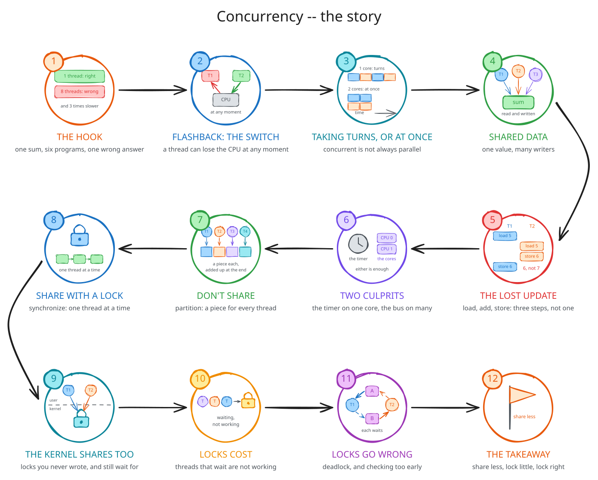

# Storyline: Concurrency

The planned narrative of the live delivery, one thread from start to finish.
The figure walks through it, station by station: [the storyline](media/00-pitch/storyline.svg).

1. **The hook:** one sum, forty million additions, and six programs that compute it.
   One thread gets it right in 15 ms.
   Eight threads get it wrong, a different wrong every run, and take three times longer.
   Eight cores lost to one, and could not even add.
   Why, and what does it take to put it right?
   That is the lecture.
1. **Flashback: the switch.**
   Lecture 07 said why a thread leaves the CPU: it blocks, it yields, its time slice ends, or a more important thread wakes up.
   The last two are not its choice.
   They come from the timer, and they can land between any two instructions.
   A thread never knows where it was interrupted, or who ran in the meantime.
1. **Taking turns, or at once.**
   Two threads are concurrent when they are alive over the same period and may touch the same things.
   On one core they take turns; on two cores they run at the same instant, and that is parallelism.
   Parallelism makes the work go faster.
   Concurrency is what makes it go wrong, and it does not need a second core.
1. **Shared data.**
   Threads of a process share its memory, and that is the point of having them.
   Two things are expected of a shared value: that every thread sees the same one, coherence, and that the operations on it take effect in an order that makes sense, so that the same program gives the same result every time, consistency.
   The sum of the hook lost both.
1. **The lost update.**
   `sum += i` looks like one step and is three: load, add, store.
   Two threads load the same 5, both add 1, both store 6.
   Two additions happened, and the sum moved by one.
   This is a race condition: the result depends on who got where first.
1. **Two culprits.**
   Shared data alone does nothing; it takes one of two accomplices.
   The first is preemption: on a single core, a thread stopped between its load and its store loses everything the others add meanwhile, typically 14% of the additions in the demo.
   The second is parallelism: on many cores no scheduler is needed, the cores interleave on the memory bus, and 80% is lost.
   Squeeze the addition into one instruction and one core is safe; lock the bus for that instruction and every core is.
1. **Don't share.**
   The first cure is to remove the shared data.
   Give each thread its own piece and its own partial sum, and add the partial sums once, at the end: right answer, 2 ms, eight times faster than one thread.
   This is partitioning, and when the data splits, nothing beats it.
1. **Share with a lock.**
   Some data does not split.
   Every node of a list points at its neighbours, and ten threads changing one list without care end in a segmentation fault.
   So the threads take turns: lock, change the list, unlock.
   The stretch in between is a critical section, and one thread at a time is in it.
   This is synchronization.
1. **The kernel shares too.**
   Eight threads that each map and unmap their own page share nothing, in user space.
   They take fifteen times longer than eight processes doing the same, because the threads share one address space, and the kernel changes it under one lock.
   Some shared data is not yours, some locks you never wrote, and you wait for them all the same.
1. **Locks cost.**
   Back to the hook: the atomic sum is 17 times slower than one thread, the mutex 80 times, the spinlock 250 times.
   A critical section is serial by definition, and the turn-taking is paid on top.
   How much a lock covers is a dial: the same counter takes 3 ms with one lock per thread and 308 ms with one lock per addition.
1. **Locks go wrong.**
   Two threads, two locks, opposite orders: each holds what the other wants, and the program stops with 0% CPU and no error.
   That is a deadlock.
   Or every access is locked, but the check and the action are locked separately, and the shop sells an item it no longer has.
   That is a race the locks did not prevent, and no tool reports it.
1. **What should survive the week:** concurrency problems come from shared data, plus preemption or several cores.
   Partition what you can; synchronize what is left; keep critical sections few and short, and take locks in one order.
   Every cure in this lecture has a cost, and the cheapest lock is the one you did not need.
   Next time: the threads stop computing and start waiting, for files, for devices, for each other.

## How the stations map onto the lecture

| Stations | Part |
| --- | --- |
| 1 | 00. Pitch |
| 2 | 01. Reminder: leaving the CPU |
| 3, 4 | 02. Concurrency |
| 5, 6 | 03. Root causes |
| 7, 8, 9 | 04. Partitioning and synchronization |
| 10, 11 | 05. Problems with synchronization |
| 12 | 06. Conclusion |

Station 1's six programs are the lecture's spine: the wrong one is explained by stations 5 and 6, the fast one by station 7, and the three slow ones by stations 8 and 10.
Station 2 belongs to lecture 07; it is short on purpose, and the hook should already be on the board when it is told.
Stations 10 and 11 return to the cure of station 8 and show its two prices, time and correctness, which is why the story ends on "share less" and not on "lock more".
