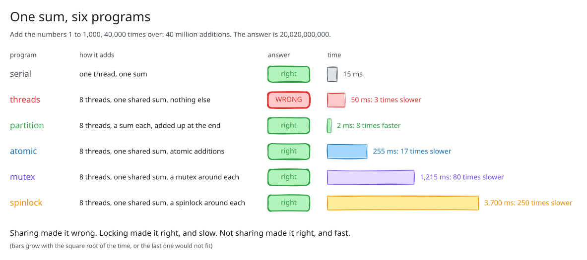
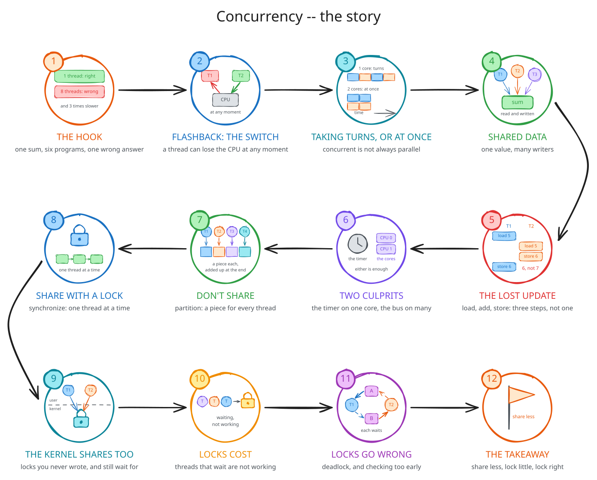
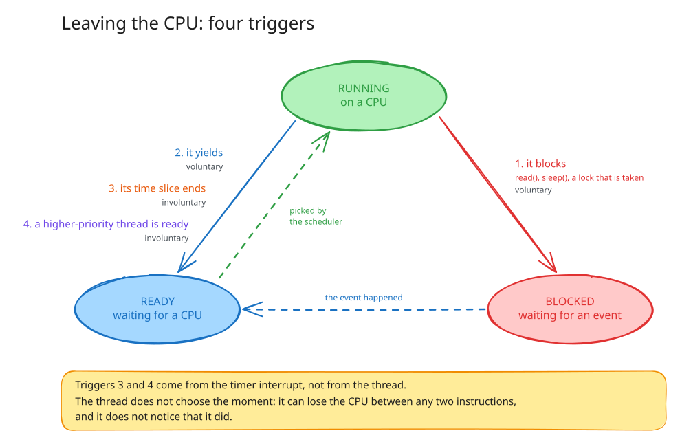
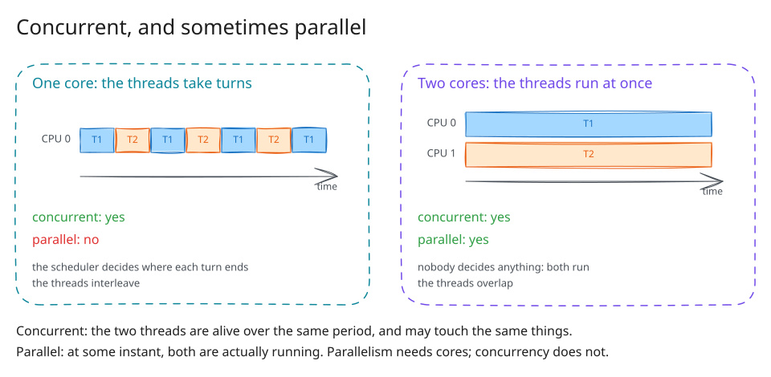
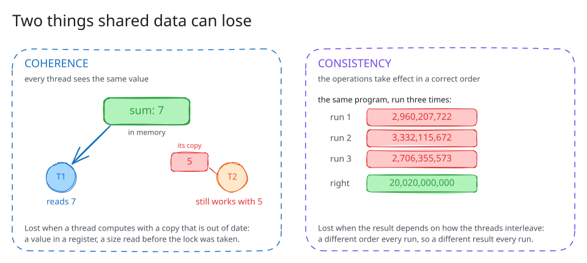
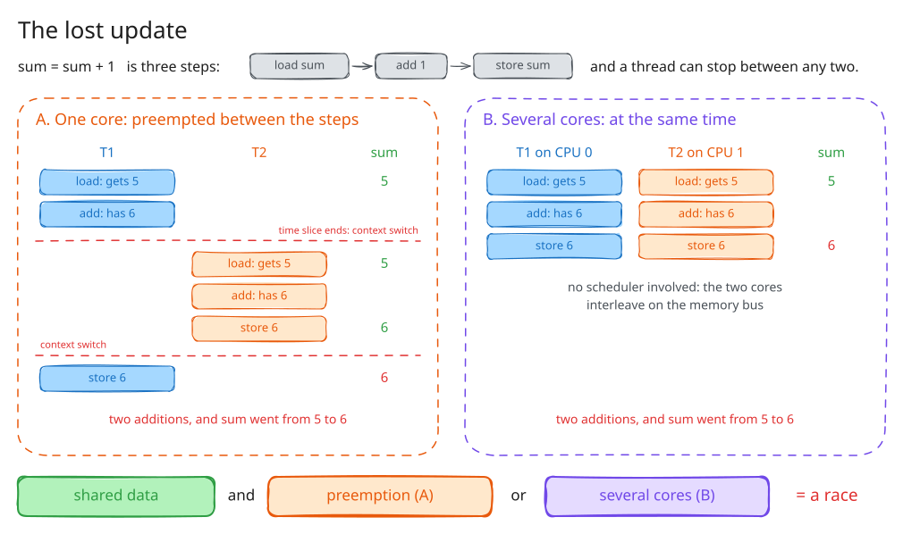
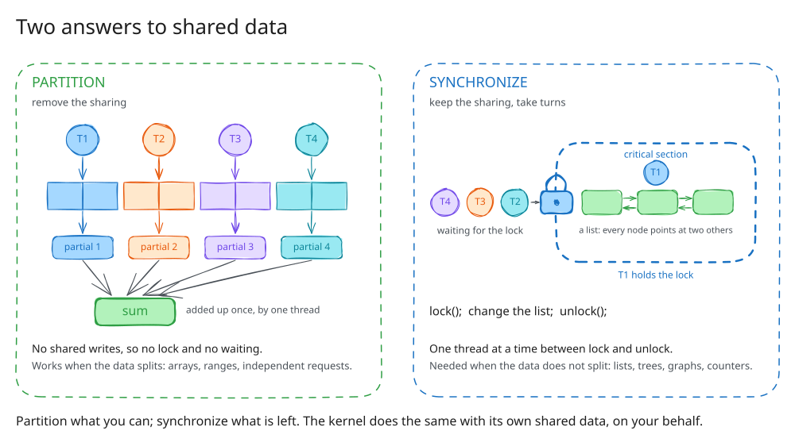
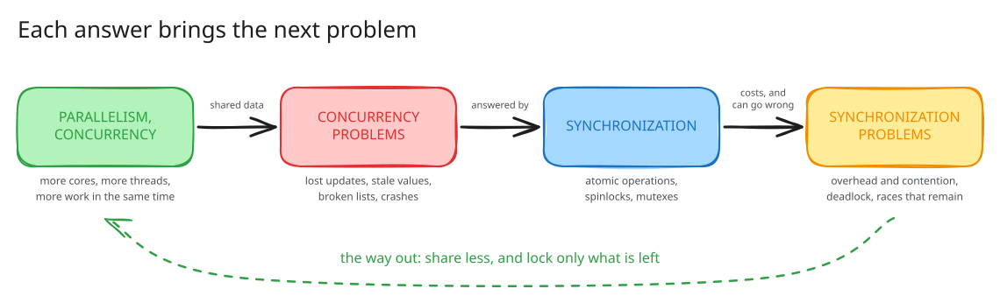
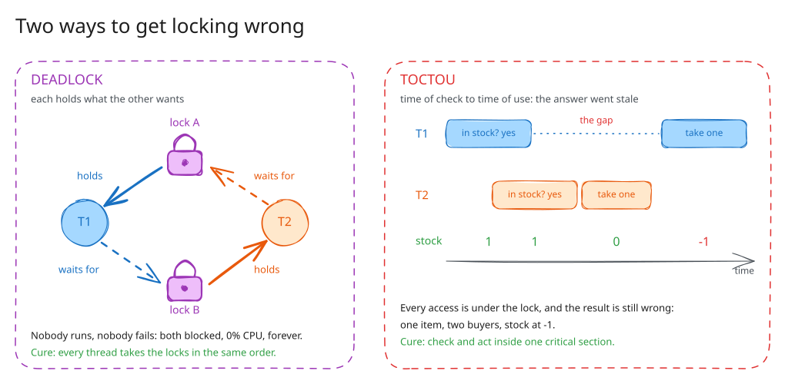

# 00. Pitch

## One sum, one thread

Add the numbers 1 to 1,000, 40,000 times over: 40 million additions.

```text
$ ./sum_serial
serial         sum:  20020000000  expected:  20020000000  OK     time:    15 ms
```

15 ms, the right answer, and 23 of 24 CPUs doing nothing.

::: {.notes}
Ask how to use the other CPUs. Lecture 06 gave the answer: threads.
:::

## The same sum, eight threads

```text
$ ./sum_threads
threads        sum:   2960207722  expected:  20020000000  WRONG  time:    51 ms
$ ./sum_threads
threads        sum:   3332115672  expected:  20020000000  WRONG  time:    48 ms
$ ./sum_threads
threads        sum:   2706355573  expected:  20020000000  WRONG  time:    54 ms
```

Three runs, three answers, none right.
And **three times slower** than one thread.

::: {.notes}
Run it three times and let the room read the numbers. Eight cores lost to one, and could not add.
:::

## Six programs

{fig-align="center" width="92%"}

::: {.notes}
Ask before make run: which of the other four will be right, and which fastest? Do not explain partition yet.
:::

## The story

{fig-align="center" width="78%"}

# 01. Reminder: leaving the CPU

## Three states, four triggers

{fig-align="center" width="70%"}

## Voluntary, and not

| | Trigger | Goes to | Whose decision |
| --- | --- | --- | --- |
| 1 | calls something that blocks | blocked | the thread's |
| 2 | yields | ready | the thread's |
| 3 | time slice expires | ready | the kernel's |
| 4 | higher-priority thread ready | ready | the kernel's |

**Voluntary:** at a line the program wrote --- `read()`, `sleep()`, `pthread_join()`, `sched_yield()`.

**Involuntary:** wherever the thread happens to be, on a timer interrupt.

::: {.notes}
Lecture 07 in one slide. The word to underline is involuntary.
:::

## Between any two instructions

The timer interrupts every CPU hundreds of times a second.
The kernel updates its accounting, and switches if the slice is over or someone more urgent is ready.

The thread is not asked, not told, and cannot tell afterwards.

Milliseconds pass; other threads run millions of instructions.

Harmless for a thread that works on its own data.
**The start of this lecture** for a thread that shares data with the others.

# 02. Concurrency

## Concurrent, and sometimes parallel

{fig-align="center" width="86%"}

## Two words

**Concurrent:** alive over the same period.
A property of the program; needs only a scheduler.

**Parallel:** running at the same instant.
A property of the execution; needs several cores.

Parallelism is what makes work finish sooner.
Concurrency is what makes it go wrong --- and it does not need a second core.

::: {.notes}
Every multi-threaded program on a single-core machine was concurrent and not parallel, and had every bug in this lecture.
:::

## Shared data

Threads of a process share its address space: that is why they are cheap, and why they can talk.

Many threads, one resource, an overlapping period: memory, a file, a device, a connection.

Read and read: fine.
The trouble starts with a **write**.

## Coherence and consistency

{fig-align="center" width="88%"}

::: {.notes}
The threaded sum lost both: threads adding to stale copies, and a different result each run.
:::

## What can go wrong

| Problem | Looks like | Mitigation |
| --- | --- | --- |
| **Race condition** | result depends on the interleaving | lock, atomic, or do not share |
| **Stale observation** | an update not seen when expected | primitives with ordering guarantees |
| **Deadlock** | threads wait for each other, forever | one lock order, short sections |
| **Contention** | waiting for locks, not working | share less, lock less, partition |
| **Starvation** | some threads never get a turn | fair locks, fair queues |
| **Complexity** | bugs once in a thousand runs | simple designs, race detectors |

::: {.notes}
One line each. The first row is the one the rest follows from.
:::

# 03. Root causes

## Three steps, not one

```text
$ objdump -d -M intel sum_threads
    133f:   mov    rdx,QWORD PTR [rip+0x2cea]        # 4030 <sum>
    1346:   mov    rax,QWORD PTR [rbp-0x8]
    134a:   add    rax,rdx
    134d:   mov    QWORD PTR [rip+0x2cdc],rax        # 4030 <sum>
```

`sum += i` is **load**, **add**, **store**.

Between the load and the store, the thread holds a private copy of the sum.

## The lost update

{fig-align="center" width="80%"}

## Two accomplices

A race needs **shared data**, and one of:

**A. Preemption.**
One core; the time slice ends between the load and the store.
The others add for milliseconds; the first thread stores its stale value over all of it.

**B. Several cores.**
No scheduler involved.
Two cores load, add and store at their own pace; the memory bus does the interleaving.

## One core, many cores

Eight threads, 50 million additions each. Additions lost:

| The addition | Every core | One core (`taskset -c 0`) |
| --- | ---: | ---: |
| load, add, store | about 80% | typically 14%; from 0 to a third |
| one instruction: `add [counter], 1` | about 76% | **0** |
| one locked instruction: `lock add [counter], 1` | **0** | **0** |

::: {.notes}
Row 1, one core: cause A alone. Row 2, every core: cause B alone. Row 2, one core: an interrupt never lands inside an instruction.
:::

## Cause A, alone

```text
$ taskset -c 0 ./count
counter: 343945504  expected: 400000000  lost: 56054496 (14.0%)
involuntary context switches: 101
```

Nothing runs in parallel.
A hundred involuntary switches; 56 million additions gone.

A switch between a load and a store throws away a whole time slice of everybody else's work.

## Cause B, alone

```text
$ taskset -c 0 ./count_one_insn
counter: 400000000  expected: 400000000  lost: 0 (0.0%)
$ ./count_one_insn
counter: 95873900  expected: 400000000  lost: 304126100 (76.0%)
```

One instruction cannot be cut by the scheduler.
It is still a read of memory and a write of memory, and another core gets in between.

`lock add` keeps the cache line for the whole instruction: an **atomic** operation.

## And it is not even fast

| `count` | Elapsed | CPU time |
| --- | ---: | ---: |
| one core | 0.30 s | 0.29 s |
| every core | 0.60 s | 4.33 s |

Eight cores writing one variable pass its cache line around.
The traffic is slower than the additions.

# 04. Partitioning and synchronization

## Two answers

{fig-align="center" width="86%"}

## Partition: remove the sharing

```c
static void *add_rounds(void *arg)
{
	unsigned long r, i;
	unsigned long mine = 0;

	for (r = 0; r < NUM_ROUNDS / NUM_THREADS; r++)
		for (i = 1; i <= N; i++)
			mine += i;

	*(unsigned long *)arg = mine;

	return NULL;
}
```

`mine` is on the thread's own stack. Nobody else can reach it.

**2 ms**, against 15 ms for one thread: eight cores, eight times the work.

## When the data does not split

Splits: an array, a range, a set of files, unrelated requests.

Does not: a list, a tree, a graph; one counter everybody updates; an account balance.

```text
$ ./thread-list-app
Segmentation fault (core dumped)
$ ./thread-list-app
reached head when removing. not good.
Segmentation fault (core dumped)
```

Adding a node is four pointer writes.
Between any two, the list is broken.

## Synchronize: take turns

```c
lock();
/* critical section: read the size, find the place, rewrite the pointers */
unlock();
```

One thread at a time in the **critical section**; from outside it looks like one step.

```text
$ ./thread-list-app-mutex
size kept by the list: 9002, nodes found by walking it: 9002
```

A lock protects **data**, not code: the same data, always under the same lock.

## Three tools

| Tool | Protects | Finding it taken |
| --- | --- | --- |
| **Atomic operation** | one instruction on one variable | the hardware serializes |
| **Spinlock** | a critical section | keep trying, on the CPU: busy waiting |
| **Mutex** | a critical section | blocked by the kernel, woken on release |

A spinlock is built from an atomic operation.
A mutex is built from a spinlock and a wait queue --- trigger 1, a voluntary switch.

## The kernel shares too

Workers that each map, touch and unmap a page, 50,000 times. Nothing shared in user space.

| Workers | As threads | As processes |
| ---: | ---: | ---: |
| 1 | 108 ms | 92 ms |
| 2 | 222 ms | 87 ms |
| 4 | 561 ms | 87 ms |
| 8 | 1,635 ms | 109 ms |

Threads share one address space; the kernel changes it under one lock.
12.5 s of system time, 33,639 voluntary switches.

::: {.notes}
Ask where the shared data is before saying it. It is not in the source.
:::

## Two kinds of contention

On shared data in **your program**: locks you wrote, and can redesign.

On shared data in **the kernel**: the address space, the file table, the heap behind `malloc()`.
Locks you cannot see or change; you control how often you call, and what your threads share.

Partition what you can. Synchronize what is left.

# 05. Problems with synchronization

## Each answer brings the next problem

{fig-align="center" width="92%"}

## Locks cost

| Program | Time | Against one thread | Where it goes |
| --- | ---: | ---: | --- |
| `sum_serial` | 15 ms | -- | adding |
| `sum_atomic` | 255 ms | 17 times | waiting for the cache line |
| `sum_mutex` | 1,215 ms | 80 times | 7.18 s in the kernel; 557,111 sleeps |
| `sum_spinlock` | 3,695 ms | 250 times | 25.67 s of CPU; one adds, seven spin |

A critical section is **serialized**: eight cores do it no faster than one.
The turn-taking is paid on top: **contention**.

::: {.notes}
Spin for short sections that never block; sleep for everything else.
:::

## Granularity

A hundred threads, 100,000 additions each, one mutex.

| | Coarse: one lock per thread | Fine: one lock per addition |
| --- | ---: | ---: |
| Lock/unlock pairs | 100 | 10,000,000 |
| Elapsed | 3 ms | 308 ms |
| System time | 0.00 s | 6.34 s |
| Voluntary switches | 122 | 64,016 |

Fine: more parallelism possible, more overhead.
Coarse: less overhead, less parallelism.

Hold a lock briefly, take it rarely, and measure when the two disagree.

::: {.notes}
The demo is rigged in favour of coarse: the threads have nothing to do outside the lock. Say so.
:::

## Two ways to get it wrong

{fig-align="center" width="86%"}

## Deadlock

```text
$ ./deadlock
transfers started

$ ps -L -o pid,tid,state,pcpu,wchan:20,comm -p $(pidof deadlock)
    PID     TID S %CPU WCHAN                COMMAND
 188884  188884 S  0.0 futex_wait_queue     deadlock
 188884  188886 S  0.0 futex_wait_queue     deadlock
 188884  188887 S  0.0 futex_wait_queue     deadlock
```

Every thread blocked, 0% CPU, no error.
One locked `a` and wants `b`; the other locked `b` and wants `a`.

Cure: every thread takes the locks in the **same order**.

## Four conditions

A deadlock needs all four:

1. locks that only one thread can hold
1. a thread holding one lock while waiting for another
1. no way to take a lock from its holder
1. a cycle of threads, each waiting for the next

Remove one. The cycle is the one a design can remove.

```text
$ ./ordered
transfers done: a = 1000, b = 1000, total = 2000
```

## The race that remains

```c
static int buy_one(void)
{
	if (!in_stock())	/* lock, read stock, unlock */
		return 0;

	take_one();		/* lock, decrement stock, unlock */

	return 1;
}
```

Every access to `stock` is under the lock. Is it correct?

::: {.notes}
Let the room defend it before running it.
:::

## Time of check to time of use

```text
$ ./toctou
in stock at the start: 1000000  sold: 1000002  left: -2
$ ./toctou
in stock at the start: 1000000  sold: 1000004  left: -4
$ ./check-and-act
in stock at the start: 1000000  sold: 1000000  left: 0
```

The answer was true when given, false when used.
Cure: the check and the action in **one** critical section.

Rare, and invisible to race detectors: there is no data race here.

# 06. Conclusion

## What we covered

* one sum, six programs: wrong; right and fast; right and slow, three ways
* concurrency against parallelism; coherence and consistency
* the lost update: load, add, store
* two root causes with shared data: preemption, several cores
* partitioning, synchronization, and the kernel's own shared data
* what locks cost, and how they go wrong: deadlock, TOCTOU

## {background-color="#f7f7f7"}

::: {style="font-size: 1.2em; text-align: center; margin-top: 1.2em;"}
**A race needs shared data, plus preemption or several cores.**

Partition what you can; synchronize what is left.

Keep critical sections few and short, and take locks in one order.

The cheapest lock is the one you did not need.
:::

## Next

* **Lab 08:** troubleshooting concurrency --- races, deadlocks and contention, in programs you run and repair.
* **Lecture 09:** the I/O interface --- threads that spend their lives blocked, and kernel objects shared between them.

## Reading

* Arpaci-Dusseau, [*Operating Systems: Three Easy Pieces*](https://pages.cs.wisc.edu/~remzi/OSTEP/), chapters 26, 28, 29, 32
* Paul McKenney, [*Is Parallel Programming Hard, And, If So, What Can You Do About It?*](https://www.kernel.org/pub/linux/kernel/people/paulmck/perfbook/perfbook.html), chapters 5 and 6
* Rob Pike, [Concurrency is not Parallelism](https://go.dev/blog/waza-talk)
* Ulrich Drepper, [Futexes Are Tricky](https://akkadia.org/drepper/futex.pdf)
* [ThreadSanitizer](https://github.com/google/sanitizers/wiki/ThreadSanitizerCppManual), [Helgrind](https://valgrind.org/docs/manual/hg-manual.html)

::: {.notes}
End on the bridge: next time the threads stop computing and start waiting.
:::
