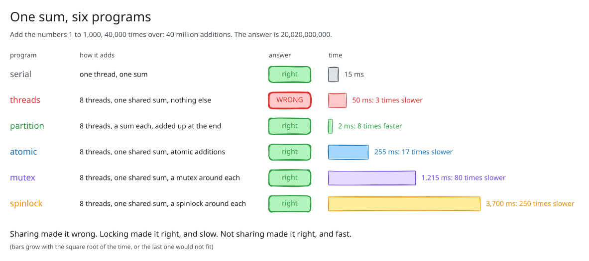
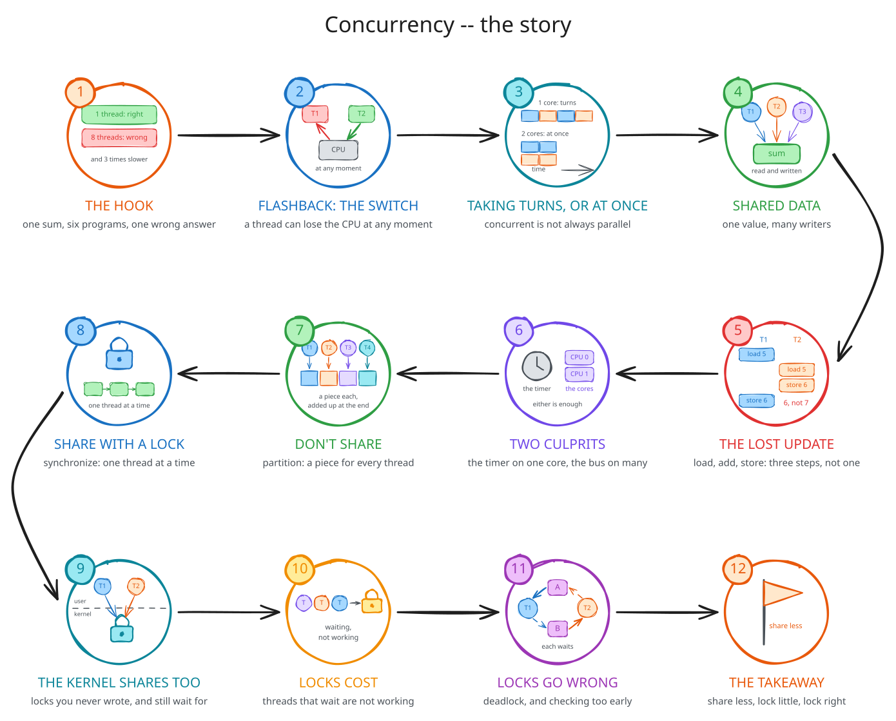
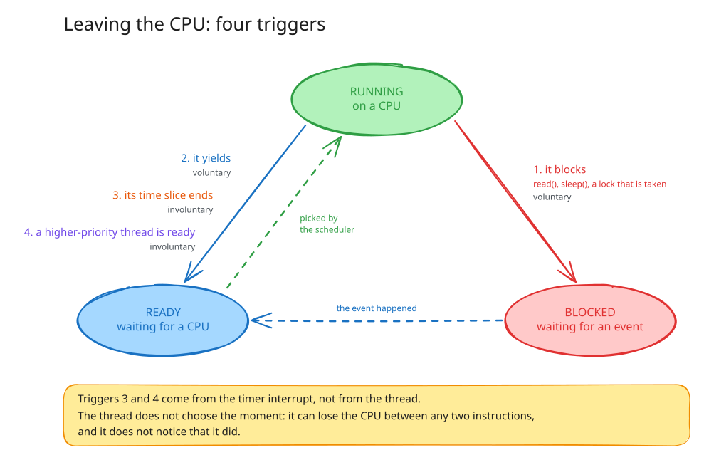
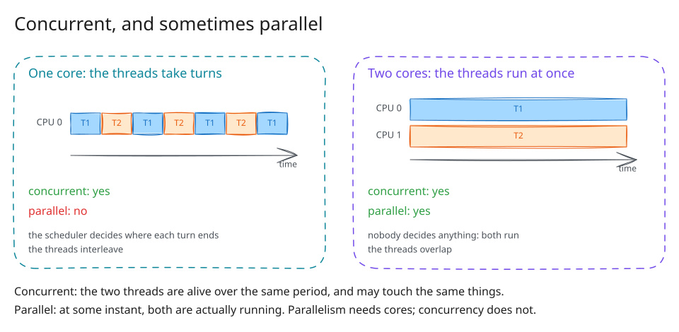
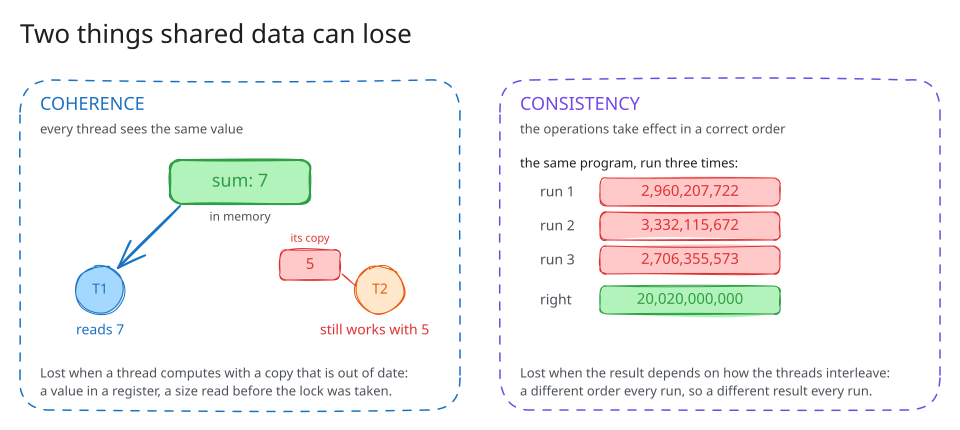
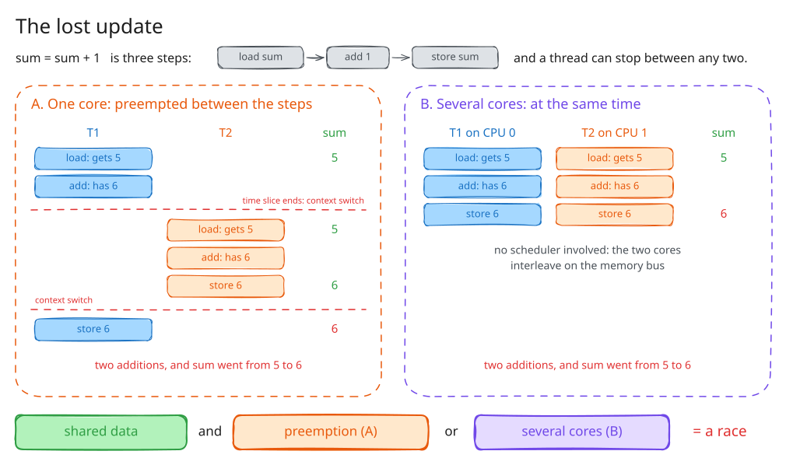
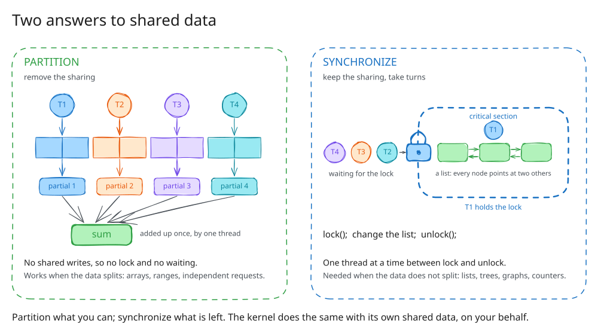
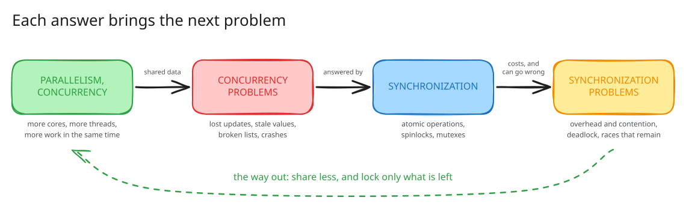
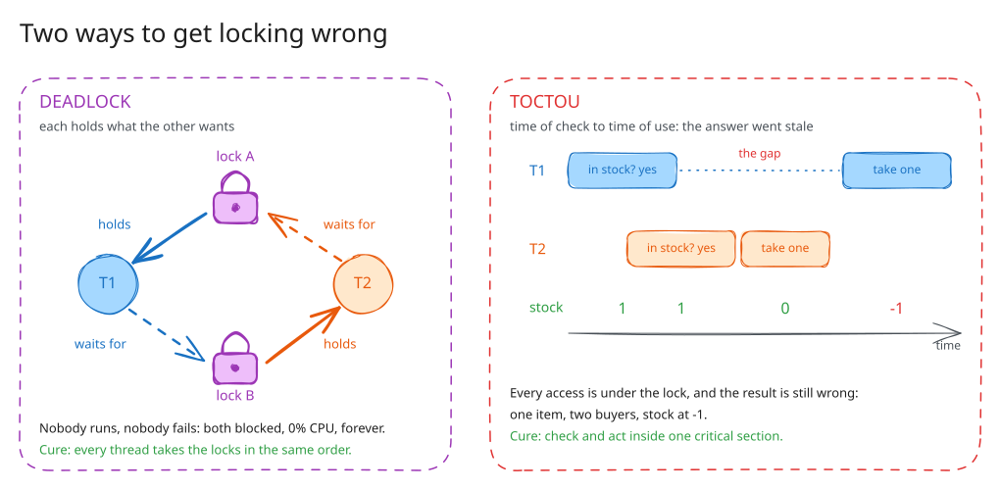

## One sum {background-color="#f7f7f7"}

```text
$ ./sum_serial
serial         sum:  20020000000  expected:  20020000000  OK     time:    15 ms

$ ./sum_threads
threads        sum:   2960207722  expected:  20020000000  WRONG  time:    51 ms
$ ./sum_threads
threads        sum:   3332115672  expected:  20020000000  WRONG  time:    48 ms
```

Eight cores lost to one, and could not add.
Why? And what does it take to put it right?

::: {.notes}
Run sum_threads three times. Ask for guesses before make run: which of the other four is right, which is fastest?
:::

## Six programs

{fig-align="center" width="92%"}

::: {.notes}
The wrong one: part 03. The fast one: part 04. The three slow ones: parts 04 and 05. Come back to this slide.
:::

## The story

{fig-align="center" width="78%"}

## Leaving the CPU

{fig-align="center" width="70%"}

::: {.notes}
Lecture 07 in one figure. Underline involuntary: between any two instructions, and the thread does not know.
:::

## Taking turns, or at once

{fig-align="center" width="86%"}

## What shared data can lose

{fig-align="center" width="88%"}

## The lost update

{fig-align="center" width="80%"}

::: {.notes}
objdump of sum_threads first: load, add, store. Then walk panel A, then panel B.
:::

## Two culprits

Eight threads, 50 million additions each. Additions lost:

| The addition | Every core | One core (`taskset -c 0`) |
| --- | ---: | ---: |
| load, add, store | about 80% | typically 14%; from 0 to a third |
| one instruction | about 76% | **0** |
| one locked instruction | **0** | **0** |

```text
$ taskset -c 0 ./count
counter: 343945504  expected: 400000000  lost: 56054496 (14.0%)
involuntary context switches: 101
```

::: {.notes}
count; taskset count (cause A alone); taskset count_one_insn; count_one_insn (cause B alone); count_locked_insn.
:::

## Two answers

{fig-align="center" width="86%"}

::: {.notes}
sum_partition.c on screen: mine is on the stack. Then the list: crash, four pointer writes, mutex.
:::

## The kernel shares too

Map, touch, unmap a page, 50,000 times. Nothing shared in user space.

| Workers | As threads | As processes |
| ---: | ---: | ---: |
| 1 | 108 ms | 92 ms |
| 8 | 1,635 ms | 109 ms |

Where is the shared data?

::: {.notes}
One address space, one lock in the kernel. 12.5 s of system time, 33,639 voluntary switches.
:::

## Each answer brings the next problem

{fig-align="center" width="92%"}

## Locks cost

| | Time | Against one thread |
| --- | ---: | ---: |
| `sum_atomic` | 255 ms | 17 times |
| `sum_mutex` | 1,215 ms | 80 times |
| `sum_spinlock` | 3,695 ms | 250 times |

```text
$ ./granularity-coarse
value: 10000000  expected: 10000000  time: 3 ms        one lock per thread
$ ./granularity-fine
value: 10000000  expected: 10000000  time: 308 ms      one lock per addition
```

::: {.notes}
A critical section is serial; the turn-taking is paid on top. The granularity demo is rigged for coarse: say so.
:::

## Locks go wrong

{fig-align="center" width="86%"}

::: {.notes}
deadlock with ps in the second terminal: S, 0.0. Then show buy_one() and ask if it is correct before running toctou.
:::

## {background-color="#f7f7f7"}

::: {style="font-size: 1.2em; text-align: center; margin-top: 1.2em;"}
**A race needs shared data, plus preemption or several cores.**

Partition what you can; synchronize what is left.

Keep critical sections few and short, and take locks in one order.

The cheapest lock is the one you did not need.
:::

::: {.notes}
Next time: the threads stop computing and start waiting, for files, for devices, for each other.
:::
