# Session 09: I/O Interface - Full Contents

This is the complete version of the ninth lecture: the argument in full sentences, the diagrams, the demos with their reference output, and the reading behind each part.

Read it before the lecture if you want to follow the live delivery without taking notes, and after it for everything that was said once and quickly.
The one-page plan used during the lecture is [`09-io-interface-live/`](../09-io-interface-live).

Lectures 03 to 08 stayed inside the process: its memory, its threads, who runs when, and what happens when several run over the same data.
All of that is computing, and a program that only computes is of no use to anybody: its input has to come from somewhere and its result has to go somewhere.
This lecture is about the way out.
It starts from one megabyte that takes anywhere between a third of a millisecond and ten seconds to write, and then follows a byte from the process to the outside: through an I/O channel, which the process holds as a small number, which is an index in a table, which leads to a structure in the kernel that remembers everything else.

This is the first of the lectures on I/O.
This one is the interface and the file; lecture 10 is communication between processes, and lecture 11 is the network.

## Learning objectives

By the end of this lecture you should be able to:

* Say what an I/O channel is, and tell the two families apart: file-like, to a device, and socket-like, to another process.
* Name the operations of the I/O interface, create, open, read, write, stat, control, close, delete, and say which of them concern the channel and which the thing at the other end.
* Explain what a file descriptor is, where the file descriptor table is kept, how large it can get, and which entry a new channel receives.
* List the channels of a running process with `lsof` and `/proc/<PID>/fd`, and say what kind each one is.
* Say how the second end of a channel finds the first: through a path, through a port, or through inheritance.
* Describe what the kernel keeps for an open file: the open permissions, the file pointer, a reference count and a reference to the file; and predict whether two descriptors share a file pointer.
* Predict what `read()`, `write()`, `lseek()` and `ftruncate()` do to the file pointer and to the size of a file.
* Tell the size of a file from the space it takes, and explain why one megabyte can take 0.3 ms or 10 s to write.

## What is here

| Part | What it answers | Demos |
| --- | --- | --- |
| [00. Pitch](#00-pitch-one-megabyte-four-ways) | How much I/O does a process do, and how long does it take to write a megabyte? | [`00-pitch/`](demos/00-pitch) |
| [01. Processes and the outside world](#01-processes-and-the-outside-world) | What does a process need from outside, and what carries it? | [`01-process-outside/`](demos/01-process-outside) |
| [02. The process I/O interface](#02-the-process-io-interface) | Which operations does a process have, and what does it hold on to? | [`02-io-interface/`](demos/02-io-interface) |
| [03. The file descriptor table](#03-the-file-descriptor-table) | What is a file descriptor a number *of*? | [`03-file-descriptor-table/`](demos/03-file-descriptor-table) |
| [04. Types of I/O channels](#04-types-of-io-channels) | Which channels are there, and how do the two ends of one find each other? | [`04-channel-types/`](demos/04-channel-types) |
| [05. File channel internals](#05-file-channel-internals) | What does the kernel remember about an open file? | [`05-channel-internals/`](demos/05-channel-internals) |
| [06. File channel operations](#06-file-channel-operations) | What does each call do to the file, as the process sees it? | [`06-file-channel-ops/`](demos/06-file-channel-ops) |
| [07. Conclusion](#07-conclusion) | What should survive the week? | -- |

The slides are in [`slides/`](slides); the demos, with build instructions and reference output, are in [`demos/`](demos).
The planned narrative of the live delivery is in [`STORYLINE.md`](STORYLINE.md), with [the storyline figure](media/00-pitch/storyline.svg) that walks through it.

## 00. Pitch: One Megabyte, Four Ways

### Every process does I/O

The kernel counts the bytes every process reads and writes, and the system calls that carry them, in `/proc/<PID>/io`.
The [process I/O demo](demos/00-pitch/process-io) reads it for two processes.

A shell that has been open for a few days:

```text
$ cat /proc/$$/io
rchar: 4260386
wchar: 103041
syscr: 5252
syscw: 912
[...]
```

And a browser, on the same machine, over the same days:

```text
$ cat /proc/30237/io
rchar: 211950963437
wchar: 114331016605
syscr: 84654797
syscw: 74501807
[...]
```

The browser read 211 GB and wrote 114 GB, in 84 million read calls and 74 million write calls: about a hundred of each, every second, for nine days.
Lectures 06 to 08 treated a process as something that computes.
Seen from here, it is something that moves bytes in and out, and computes a little in between.

### The same megabyte, four times

The [write-layers demo](demos/00-pitch/write-layers) holds four programs.
Each writes 2,048 records of 512 bytes, one megabyte, to the same file, and times the loop.
They differ in one line: the call that writes, or a flag given to `open()`.

```text
$ make run
fwrite                 2048 records of 512 bytes  time:      0.3 ms      0.14 us/record
write                  2048 records of 512 bytes  time:      0.8 ms      0.41 us/record
write O_DIRECT         2048 records of 512 bytes  time:     40.8 ms     19.94 us/record
write O_DIRECT|O_SYNC  2048 records of 512 bytes  time:  10511.3 ms   5132.49 us/record
```

A third of a millisecond, and ten and a half seconds.
The same bytes, the same file, the same disk, and a factor of 35,000.

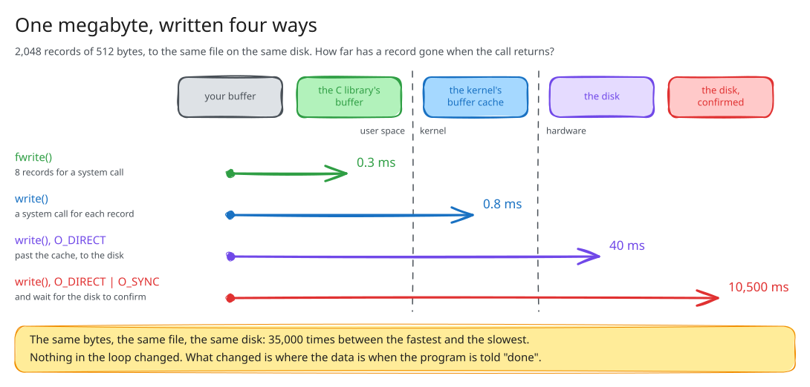

What differs is how far a record has travelled when the program is told that it was written.

* `fwrite()` copies it into a buffer of the C library, inside the process, and returns. One system call is made for every eight records.
* `write()` is a system call for each record. The kernel copies the record into its buffer cache, in memory, and returns.
* With `O_DIRECT` there is no cache: the record is handed to the disk, and the call waits for the disk to take it.
* With `O_SYNC` as well, the call waits until the disk confirms that the record is on stable storage.

Each step is a longer trip, and the price goes up fifty-fold and then 250-fold when the trip stops ending in memory.
The faster a write is, the less it has done.

So there are layers under a `write()`, and a lot of machinery whose job is to avoid the disk.
That machinery, the buffer cache, the file system and the driver, is not the subject today.
The lecture is about the part all four programs share: they obtained something from `open()`, and they handed it to every `write()`.
What is that something, where does it live, and what does the kernel remember behind it?

> **Takeaway.**
> A process spends its life reading and writing, and "written" means whatever the layer you asked was willing to promise.
> All of it passes through one interface, and the lecture is about that interface.

## 01. Processes and the Outside World

### Inside: compute

Everything the course has built so far is inside the process.
A process has a virtual address space, with its code, its data, its heap and its stacks; and it has threads, which run that code on that data.
Memory and CPU: that is what it takes to compute, and lectures 03 to 08 were about nothing else.

A process is also isolated, on purpose.
Lecture 04 showed that an address means something only inside the address space it belongs to, and that a process cannot name a byte of another process, or of a device.
The isolation that protects processes from each other also cuts each one off from everything it could be useful for.

### Outside: everything else

What a process works on, and what it works for, is outside: the file with the data, the keyboard and the screen, the network card, the camera, and the other processes.

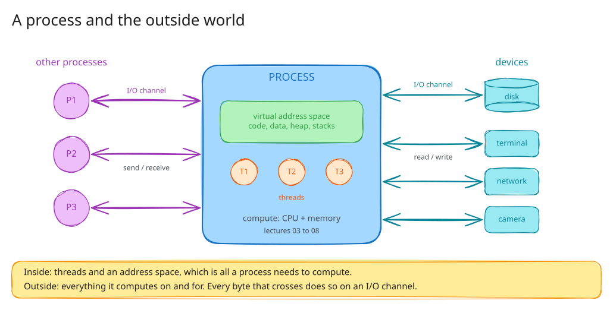

Something has to cross the boundary, and it has to be the kernel that carries it, since the process cannot reach the outside itself.
The connection between a process and something outside it is an **I/O channel**.

A channel has two properties worth stating early.

It carries **bytes**.
Whatever is at the other end, a spreadsheet on a disk, a person at a keyboard, a web server on another continent, the process sends a sequence of bytes and receives a sequence of bytes.
What the bytes mean is the business of the two ends.

And it is used with two verbs: **read**, to bring bytes in, and **write**, to send bytes out.
For some channels the verbs are spelled *receive* and *send*; they are the same two.

### Two families of channels

What is at the other end comes in two sorts, and they behave differently enough to be told apart from the start.

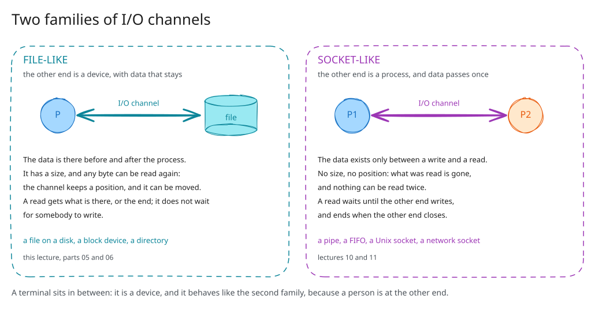

A **file-like** channel leads to a device that holds data.
The data was there before the process and will be there after it.
It has a size; any part of it can be read, and read again; and a read returns at once with what is there.
A file on a disk is the model.

A **socket-like** channel leads to another process.
The data exists only on the way from one to the other: once read, it is gone.
There is no size and no "again".
A read with nothing to read waits, for as long as it takes the other process to write.
A pipe and a network connection are the models.

The rest of this lecture uses the second family only as a contrast.
Parts 02 to 04 are about what every channel has in common, and parts 05 and 06 are about the file.
Lectures 10 and 11 take up the second family.

### Looking at the channels of a process

`lsof` lists the channels of a running process; the [lsof demo](demos/01-process-outside/lsof) runs it on a shell and on a browser.

```text
$ lsof -p $$ -a -d 0-1023
COMMAND  PID    USER   FD   TYPE DEVICE SIZE/OFF NODE NAME
bash    8851 student    0u   CHR 136,10      0t0   13 /dev/pts/10
bash    8851 student    1u   CHR 136,10      0t0   13 /dev/pts/10
bash    8851 student    2u   CHR 136,10      0t0   13 /dev/pts/10
bash    8851 student  255u   CHR 136,10      0t0   13 /dev/pts/10
```

The shell has four, all to its terminal.
The browser has 1,022: 741 to regular files, 257 to other processes through sockets and pipes, and 24 to kernel objects it uses for waiting.

Two columns matter for what follows.
`TYPE` says what is at the other end, and both families are there.
`FD` holds a number for each channel, 0, 1, 2 and up, and the next two parts are about that number.

> **Takeaway.**
> A process computes inside its address space and is cut off from everything else.
> It reaches the outside through I/O channels that carry bytes: file-like channels to devices that keep data, and socket-like channels to other processes.

## 02. The Process I/O Interface

### The life of a channel

A process can do a small number of things with a channel, and they come in a fixed order.

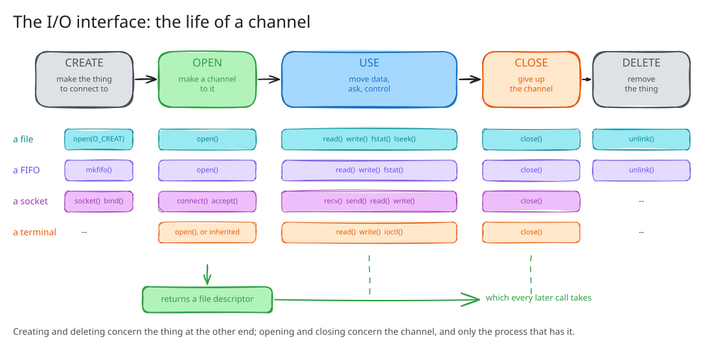

| Operation | What it does | Typical calls |
| --- | --- | --- |
| **create** | brings into existence the thing a channel will lead to | `open()` with `O_CREAT`, `mkfifo()`, `socket()` and `bind()` |
| **open** | makes a channel from this process to that thing, and returns a handle for it | `open()`, `connect()`, `accept()` |
| **read** | brings bytes in through the channel | `read()`, `recv()` |
| **write** | sends bytes out through the channel | `write()`, `send()` |
| **stat** | asks about the thing at the other end: its type, its size, its owner | `fstat()` |
| **control** | everything specific to one kind of device, which the other calls have no room for | `ioctl()`, `fcntl()` |
| **close** | gives up the channel | `close()` |
| **delete** | removes the thing | `unlink()` |

Two pairs in this list are easy to confuse, and the difference matters for the rest of the lecture.

**Create and delete** are about the thing at the other end.
A file that was created exists whether or not anybody has a channel to it, and goes on existing after every channel is closed.

**Open and close** are about the channel, which belongs to one process.
Opening a file does not change the file; it makes a connection.
Closing it ends the connection and leaves the file as it is.

`open()` blurs the line by doing both jobs when it is given `O_CREAT`, which is a convenience and not a reason to think of them as one.

**Control** deserves a word, since it is the escape hatch.
Reading and writing cover what every channel can do, and devices can do more: a terminal has a size in rows and columns, a disk can eject, a sound card has a sampling rate.
`ioctl()` takes a channel, a request number that means something to that kind of device, and an argument.
`stty size` prints the size of the terminal, and it gets it with one `ioctl()` on its standard input.

### The handle: a file descriptor

Every operation after `open()` has to say which channel it means.
It does not say it with a name.
`open()` returns a **file descriptor**, a small non-negative integer, and every later call takes that integer as its first argument.

The [file demo](demos/02-io-interface/file) prints its calls as it makes them.

```text
$ ./write_file
open("file_channel", O_WRONLY | O_CREAT | O_TRUNC) = 3
write(3, message, 13) = 13
close(3) = 0
$ ./read_file
open("file_channel", O_RDONLY) = 3
fstat(3) = 0: a file of 13 bytes
read(3, buffer, 255) = 13: Hello, file!
read(3, buffer, 255) = 0: the end of the file
close(3) = 0
```

The name `file_channel` is used once, in `open()`.
After that the program knows the file as 3.
It does not say where in the file to read, or whether it is allowed to: the kernel knows, and finds it from the 3.

There are good reasons for a number instead of a name.
Looking up a name is slow, and checking permissions on every read would be slower; with a handle, both are done once.
A name can also change its meaning while a program runs, if the file is renamed or replaced, and a handle goes on meaning what it meant when it was opened.
This is the check-then-use race of lecture 08, avoided by checking once and keeping the result.
And some channels have no name at all, as part 04 will show.

Three descriptors are in use before `main()` starts, by convention.

| Descriptor | Name | Used by |
| --- | --- | --- |
| 0 | standard input | `scanf()`, `getchar()`, `read(0, ...)` |
| 1 | standard output | `printf()`, `puts()`, `write(1, ...)` |
| 2 | standard error | `perror()`, `fprintf(stderr, ...)` |

Which is why the first `open()` of a program returns 3.

### The same interface, for something else

The [FIFO demo](demos/02-io-interface/fifo) does it again with a FIFO, a channel of the second family: one program writes, another reads what the first wrote.

```text
$ ./receive_fifo
mkfifo("fifo_channel") done
open("fifo_channel", O_RDONLY) ...
open("fifo_channel", O_RDONLY) = 3
read(3, buffer, 255) = 13: Hello, FIFO!
read(3, buffer, 255) = 0: the other end was closed
close(3) = 0
```

`open()`, `read()`, `close()`, on descriptor 3: the calls are those of the file demo.
What they do is not.

| | File | FIFO |
| --- | --- | --- |
| created with | `open(O_CREAT)` | `mkfifo()` |
| `open()` | returns at once | waits until the other end is opened too |
| `read()` with nothing to read | returns 0 | waits for the other end to write |
| `read()` returns 0 when | the end of the file is reached | the other end has closed |
| the data, after it is read | is still there | is gone |

This is the bargain of the I/O interface.
The calls are the same for every channel, so a program written to read from a descriptor works whatever the descriptor leads to: `sort` sorts a file, the keyboard, or the output of another program, and does not know which.
The behaviour belongs to the channel, and a program that does care, about waiting for instance, has to know what it is talking to.

> **Takeaway.**
> The I/O interface is a few operations in a fixed order: create, open, use, close, delete.
> `open()` returns a file descriptor, a small integer, and every other call names the channel by that integer and nothing else.
> The calls are the same for every kind of channel; what they do depends on the other end.

## 03. The File Descriptor Table

### A number of what

A file descriptor is an index.
For every process the kernel keeps a **file descriptor table**: an array in which entry *n* is either empty or points to a structure that describes an I/O channel.

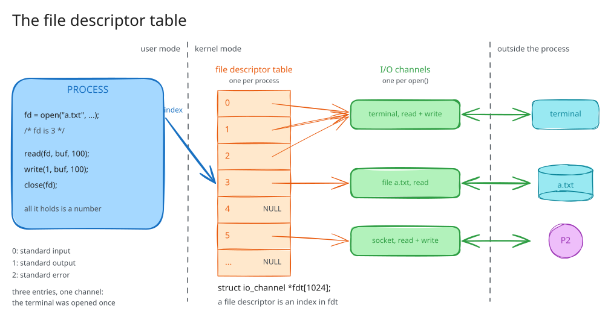

In C, the idea is one line:

```c
struct io_channel *fdt[1024];
```

`read(3, buf, 100)` makes the kernel take entry 3 of the table of the calling process, follow the pointer, and do the reading on the channel it finds.
If the entry is empty, the call fails with `EBADF`, *bad file descriptor*.

Three things follow from the picture.

**The table is in the kernel.**
The process holds the index and has no way to look at the entry, or at the structure behind it.
This is lecture 02's boundary at work: the channel is a kernel object, and the process is given a ticket for it.
A program that makes up a descriptor gets an error and nothing else.

**The table belongs to one process.**
Descriptor 3 in one process and descriptor 3 in another have nothing to do with each other.
Every program in the demos gets 3 from its first `open()`, and each means its own channel.
Threads are the exception that is no exception: the threads of a process share one table, as they share the address space, so a descriptor opened by one thread works in the others.

**Several entries can point to one channel.**
In the figure, entries 0, 1 and 2 lead to the same channel, to the terminal, which was opened once.
Part 05 comes back to this.

### How large it is

The [fdtsize demo](demos/03-file-descriptor-table/fdtsize) opens `/dev/null` in a loop and never closes anything.

```text
$ ulimit -n
1024
$ ./fdtsize
limit of open file descriptors: 1024
open() failed: Too many open files
opened 1021 file descriptors, from 3 to 1023
```

1,021 successes, from 3 to 1023, and then `EMFILE`.
The table has a maximum size, 1,024 entries by default, of which three were taken.

The maximum is a resource limit of the process, `RLIMIT_NOFILE`, which the shell shows and sets with `ulimit -n`.
It can be raised, and servers that hold tens of thousands of connections raise it.
It exists so that a program with a leak, one that opens channels and forgets to close them, fails by itself before it takes the whole machine's memory with it.

One file was opened 1,021 times, and that took 1,021 entries: an entry stands for an `open()`, whatever was opened.

### Which entry a new channel gets

The [lowest-fd demo](demos/03-file-descriptor-table/lowest-fd) opens three channels, closes the middle one, and opens again.

```text
$ ./lowest-fd
open()    = 3
open()    = 4
open()    = 5
close(4)
open()    = 4
close(0)
open()    = 0
[...]
```

The rule is in the manual page of `open()`: the new channel gets *the lowest-numbered file descriptor not currently open for the process*.
After `close(4)`, that is 4.
After `close(0)`, that is 0, and the program's standard input is now `/dev/null`.

The second half is the interesting one.
"Standard input" is entry 0 of the table, and it is whatever entry 0 leads to.
Change where entry 0 leads before a program starts, and the program reads from a file, with no change to the program: `sort < names.txt`.
Lecture 10 shows how the shell does it; the rule above is half of the trick.

`close()` empties an entry, and the number is free to be given out again.
A program that goes on using a descriptor after closing it may find itself writing to whatever was opened next.

> **Takeaway.**
> A file descriptor is an index in a table that the kernel keeps for each process; an entry points to a channel structure, or is empty.
> The table has a maximum size, a new channel gets the lowest free entry, and 0, 1 and 2 are ordinary entries with a conventional meaning.

## 04. Types of I/O Channels

### One table, many kinds

The [channel-list demo](demos/04-channel-types/channel-list) opens one channel of every kind it can, and prints its own table.

```text
$ ./channels
fd  type          found by others through  leads to
 0  char device   nothing: inherited       /dev/pts/10
 1  char device   nothing: inherited       /dev/pts/10
 2  char device   nothing: inherited       /dev/pts/10
 3  file          a path                   /home/student/[...]/channel-list/channels.c
 4  char device   a path                   /dev/null
 5  pipe / FIFO   nothing: inherited       pipe:[3693957]
 6  pipe / FIFO   nothing: inherited       pipe:[3693957]
 7  pipe / FIFO   a path                   /home/student/[...]/channel-list/fifo_channel
 8  socket        a path                   socket:[3693958]
 9  socket        TCP port 4242            socket:[3693959]
10  socket        UDP port 4242            socket:[3693960]
```

Eleven consecutive entries of one table, and behind them a file, two devices, a pipe, a FIFO and three sockets.
To the table they are all pointers to channel structures.

### File-like and socket-like, again

Part 01 named two families, and the entries above sort into them.

| Family | Channels | The other end | Typical use |
| --- | --- | --- | --- |
| file-like | regular file, directory, block device | data that stays, with a size and positions | storing |
| socket-like | pipe, FIFO, Unix socket, network socket | a process | communicating |

Character devices, such as the terminal and `/dev/null`, are devices that behave like the second family: a terminal has no size and cannot be re-read, because there is a person at the other end.

The family decides which operations make sense.
Every channel can be read or written.
Only a file-like channel has a position that can be moved and a size that can be changed; on a pipe or a socket, `lseek()` fails with `ESPIPE`, *illegal seek*.

### How the two ends meet

A file-like channel has one end that matters: the process opens the file, and the file waits.
A socket-like channel has a process at each end, and the second has to find what the first set up.
There are three ways, and the middle column of the output above names them.

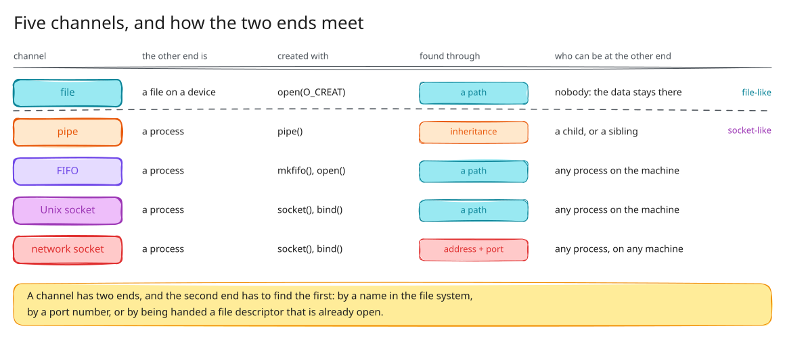

**Through a name in the file system.**
A FIFO and a Unix socket appear as entries in a directory, with a path.
Any process on the machine that knows the path, and has permission, can connect.
`ls -l` shows them with a `p` and an `s` where a file has a `-`.
The path leads to no data: it is a meeting point.

**Through a port.**
A network socket is given an address and a port number, and a process that knows them can connect, from the same machine or from another.
A path has a meaning on one machine only, and a port has one across a network, which is the reason for a second kind of name.

**Through inheritance.**
A pipe has no name of any kind.
The process that calls `pipe()` gets two descriptors, one for each end, and the only way another process obtains one is to be created with it: a child starts with a copy of its parent's descriptor table.
This is how every process gets its 0, 1 and 2, which it never opened.

The [comm-channels demo](demos/04-channel-types/comm-channels) passes one message through each of the five.
For the Unix socket, the receiver prints:

```text
$ ./receive_unix_socket
socket(AF_UNIX, SOCK_STREAM) = 3
bind(3, "socket_channel") done
accept(3) ...
accept(3) = 4
recv(4) = 20: Hello, Unix socket!
```

There is more ceremony than for a file: the socket is created without a name, `bind()` gives it one, and `accept()` waits for a sender and returns a *second* descriptor, for the connection to that sender.
What does not change is how it ends: a descriptor, and bytes read from it.

| Channel | Found through | Reaches |
| --- | --- | --- |
| file | a path | data on a device |
| pipe | inheritance | a related process, on this machine |
| FIFO | a path | any process, on this machine |
| Unix socket | a path | any process, on this machine |
| network socket | an address and a port | any process, on any machine |

Lecture 10 is about the middle three rows and lecture 11 about the last.

> **Takeaway.**
> The table holds channels of every kind under the same sort of number.
> File-like channels lead to data that stays; socket-like channels lead to a process, which is found through a path, through a port, or by inheriting a descriptor.

## 05. File Channel Internals

The rest of the lecture stays with one kind of channel, the channel to a file, and asks what the structure behind the table entry holds.

### What the kernel keeps for an open file

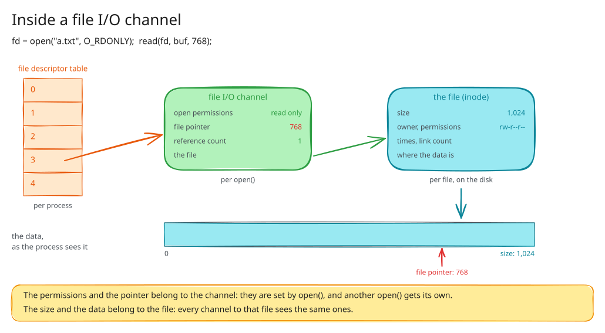

Three structures are in the picture, and each exists once per something different.

| Structure | One per | Holds |
| --- | --- | --- |
| entry in the file descriptor table | descriptor, in a process | a pointer to a channel |
| file I/O channel | `open()` call | open permissions, file pointer, reference count, a reference to the file |
| file (the inode) | file | size, owner, permissions, times, where the data is on the disk |

The channel structure is what POSIX calls an *open file description* and what Linux calls `struct file`.
The file's own record is the *inode*; older textbooks call it the file control block.
This lecture does not open it up; here it is a box with a size in it.

The channel holds four things.

* The **open permissions**: whether this channel is for reading, for writing, or both. Chosen by the `open()` call that made it.
* The **file pointer**: the position in the file where the next read or write will start. Part 06 is about it.
* A **reference count**: how many table entries point to this channel.
* A **reference to the file**.

What it does not hold is the name.
A path was used to find the file, once, and is not needed again.
A file can be renamed, or even deleted, while a channel to it is open, and the channel goes on working.

### Open permissions

There are two sets of permissions around a file, and they are checked at different moments.

The file's permissions, in the inode, are those `ls -l` shows.
They are checked by `open()`: the [open-perm demo](demos/05-channel-internals/open-perm) asks for each mode on a file with read permission only.

```text
$ chmod 444 f.txt; ./open-perm f.txt
f.txt has permissions 444 in the file system
  open(O_RDONLY)  = 3
  open(O_WRONLY)  refused: Permission denied
  open(O_RDWR  )  refused: Permission denied
```

The channel's permissions are what was asked for and granted.
They are a subset of what the file allows, and they are what `read()` and `write()` check, every time.

```text
$ ./channel-perm
1. the file is 644, the channel is opened O_RDONLY
  write(3)  refused: Bad file descriptor
2. the file is 644, the channel is opened O_RDWR
  write(3)  = 4
3. chmod 000: nobody may open the file any more
  open(O_RDONLY)  refused: Permission denied
4. the channel opened at step 2 is still here
  write(3)  = 4
```

In step 1 the owner may write the file, and may not write through this channel, which was opened for reading.
In step 4 nobody may open the file, and the channel opened earlier writes to it without trouble.

The file's permissions are consulted once, at `open()`; after that, the kernel looks only at the channel.
It is faster, a comparison of two flags against a walk through the file system, and it gives a clear rule: what you were granted when you opened is yours until you close.

### The file pointer, and who shares it

The file pointer is in the channel.
Whether two descriptors share a file pointer is therefore the question of whether they lead to the same channel, and the [file-pointer demo](demos/05-channel-internals/file-pointer) tries the three ways of having two descriptors for one file.

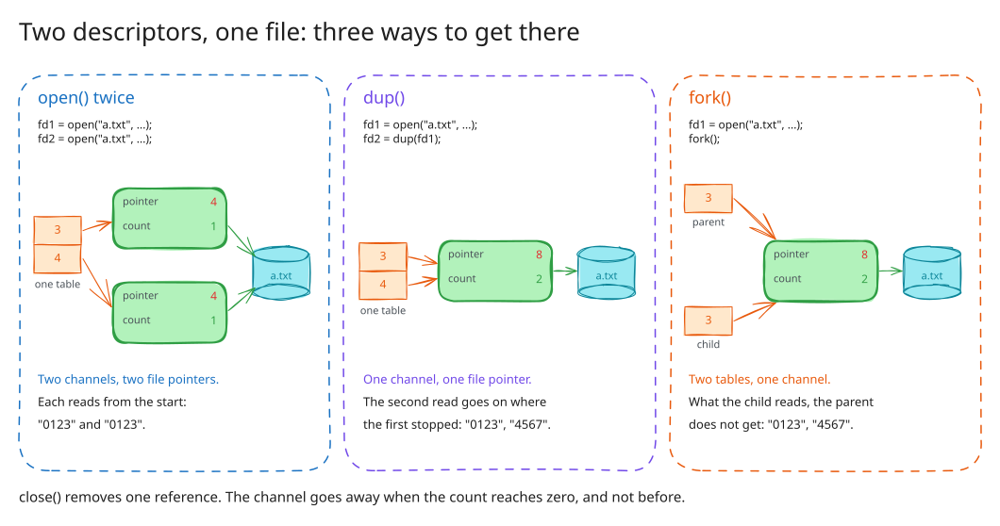

```text
$ ./file-pointer
1. fd1 = open(), fd2 = open(): two channels
         read(3) = "0123"   file pointer of 3 is now 4
         read(4) = "0123"   file pointer of 4 is now 4
2. fd1 = open(), fd2 = dup(fd1): one channel
         read(3) = "0123"   file pointer of 3 is now 4
         read(4) = "4567"   file pointer of 4 is now 8
  close(3)
         read(4) = "89ab"   file pointer of 4 is now 12
3. fd1 = open(), then fork(): one channel, two processes
  child  read(3) = "0123"   file pointer of 3 is now 4
  parent read(3) = "4567"   file pointer of 3 is now 8
```

**Two calls to `open()`** make two channels.
Each has its own file pointer and its own permissions, and both refer to one file.
Reading through one does not move the other.

**`dup()`** makes a new table entry that points to an existing channel.
There is one file pointer, and a read through either descriptor moves it for both.

**`fork()`** copies the table, entry by entry, so the child's descriptors point to the parent's channels.
One file pointer again, now shared between two processes.

That last case is what makes a parent and a child that write to the same output take turns down the file, each continuing where the other stopped.
With a pointer each, both would start at 0 and the second would write over the first.

### The reference count, and what `close()` does

In scenario 2 above, the program closes descriptor 3 and goes on reading through descriptor 4.

`close()` does two things: it empties the table entry, and it lowers the reference count of the channel the entry pointed to.
The channel itself is freed when the count reaches zero, when the last descriptor that leads to it, in any process, is closed.
Until then it works for whoever still holds one.

When a process ends, the kernel closes every entry of its table for it.
Not closing a file in a short program is untidy and harmless; not closing them in a program that runs for months is the leak of part 03.

> **Takeaway.**
> A channel to a file is a kernel structure made by `open()`: open permissions, a file pointer, a reference count and a reference to the file.
> Permissions are checked against the file once, at `open()`; two `open()` calls give two file pointers; `dup()` and `fork()` give two descriptors for one channel, and one file pointer.

## 06. File Channel Operations

### A file, as a process sees it

To a process, a file is an array of bytes.
Nothing else: no lines, no records, no types.
A line is a convention about the byte `\n`, and a structure in a file is whatever the program that wrote it decided.

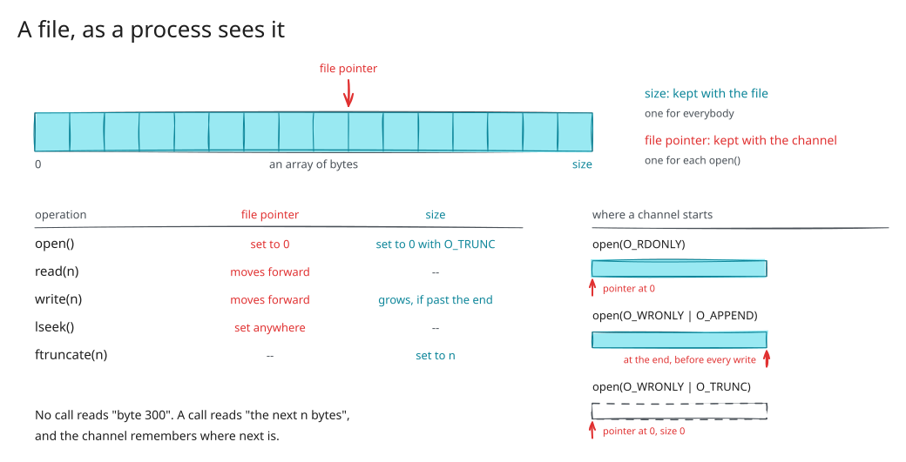

Two numbers go with the array.

The **size** is how many bytes there are.
It is a property of the file, stored in the inode, and the same for everybody.

The **file pointer** is a position between 0 and, usually, the size.
It is a property of a channel, and each channel has its own.

No call says "read byte 300".
`read()` means "the next *n* bytes from where this channel is", and moves the pointer past them.
The interface is that of a tape, a sequence read front to back, and `lseek()` is what turns it into an array by letting the pointer be put anywhere.

### What each call does

The [file-ops demo](demos/06-file-channel-ops/file-ops) makes seven calls on one file and prints the two numbers after each.

```text
$ ./file-ops
open() = 3                    pointer:    0   size:    0
write(1024) = 1024            pointer: 1024   size: 1024
lseek(-512, SEEK_CUR) = 512   pointer:  512   size: 1024
read(256) = 256               pointer:  768   size: 1024
ftruncate(256) = 0            pointer:  768   size:  256
read(256) = 0                 pointer:  768   size:  256
write(16) = 16                pointer:  784   size:  784
```

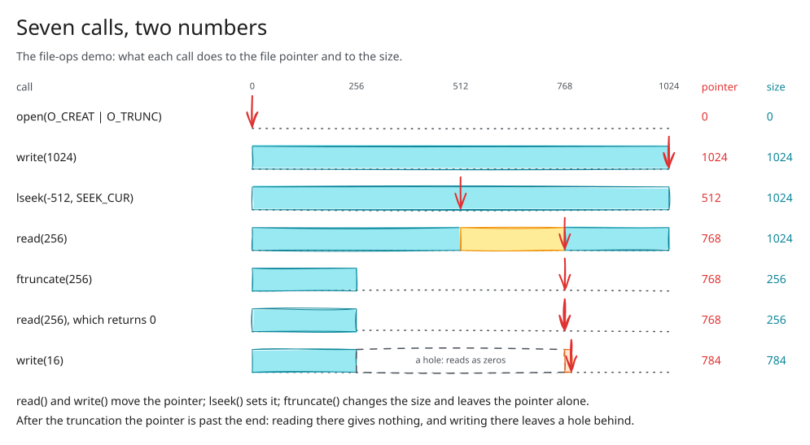

| Call | File pointer | Size |
| --- | --- | --- |
| `open()` | set to 0 | set to 0 with `O_TRUNC`, otherwise unchanged |
| `read(n)` | moves forward by what was read | unchanged |
| `write(n)` | moves forward by what was written | grows, if the write ends past the end |
| `lseek()` | set to the position asked for | unchanged |
| `ftruncate(n)` | unchanged | set to `n` |

Three rows of the output deserve a second look.

**`read()` asked for 256 and got 0**, the second time.
The pointer was at 768 and the file ended at 256.
A read returns what there is between the pointer and the end, which may be less than was asked, and is nothing when the pointer is at the end or beyond it.
Zero is how a file says "no more"; it is not an error.

**`ftruncate()` did not move the pointer.**
It changed the size, which is in the file, and has no business with the pointer, which is in the channel.
After it the pointer was left 512 bytes beyond the end.
There may be other channels to the same file, each with its own pointer, and the call could not fix them all if it wanted to.

**The last `write()` left a hole.**
It wrote 16 bytes at 768.
The size became 784, and the 512 bytes between the old end and the new data, which nobody wrote, read as zeros.

Three flags of `open()` decide where a channel starts.

| Flag | Effect |
| --- | --- |
| none | the pointer starts at 0, and the file is left as it is |
| `O_TRUNC` | the size is set to 0 first: the content is thrown away |
| `O_APPEND` | before every `write()`, the pointer is moved to the end |

`O_APPEND` is the one to remember for log files.
Several processes can append to one file, each through a channel of its own, and no record lands on top of another, because moving to the end and writing are done by the kernel as one step.
Doing the same with `lseek()` to the end followed by `write()` is the check-then-act race of lecture 08, across processes.

### Size is not space

The [truncate demo](demos/06-file-channel-ops/truncate) takes the hole to its limit.

```text
$ ./truncate
open(O_CREAT | O_TRUNC)       size:           0 bytes   on disk: 0 bytes
ftruncate(20 GiB)             size: 21474836480 bytes   on disk: 0 bytes
write(1) at 10 GiB            size: 21474836480 bytes   on disk: 4096 bytes
$ ls -lsh fake-gargantua.dat
4.0K -rw-r--r-- 1 student student 20G Nov 21 18:58 fake-gargantua.dat
```

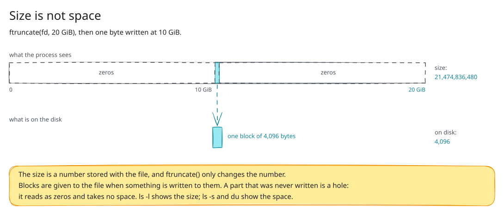

A file of 20 GiB, made in microseconds, that takes 4 KiB.

The size is a number in the inode, and `ftruncate()` writes the number.
Space on the disk is given to a file block by block, when something is written to that part of it.
A stretch that was never written is a hole: it takes no space, and reads as zeros.

So a file has two sizes.
`ls -l` and `st_size` give the logical one: how far the array of bytes goes.
`ls -s`, `du` and `st_blocks` give the physical one: how much of the disk is used.
A file for which the second is much smaller is a **sparse file**, and the disk images of virtual machines are the everyday example.

This closes a circle with lecture 04.
There, `mmap()` reserved a gigabyte of addresses, and memory was allocated page by page, on first touch.
Here, `ftruncate()` reserves twenty gigabytes of file, and disk is allocated block by block, on first write.
It is one idea, used twice: promise the large thing, and pay for the parts that are used.

> **Takeaway.**
> A file is an array of bytes with a size, in the file, and a file pointer, in each channel.
> `read()` and `write()` move the pointer, `lseek()` sets it, `ftruncate()` sets the size, and only `write()` can change both.
> The size is not the space: what was never written takes none.

## 07. Conclusion

The megabyte of the pitch travelled through an interface, and every part of the lecture was one piece of it.

* A process computes inside, and everything it needs is outside. It reaches the outside through **I/O channels**, which carry bytes.
* Channels come in two families: **file-like**, to a device that keeps data, and **socket-like**, to another process.
* The operating system exposes one **I/O interface** for all of them: create, open, read, write, stat, control, close, delete.
* `open()` returns a **file descriptor**, and every other call names the channel by it.
* A file descriptor is an index in the **file descriptor table** of the process; an entry points to a channel structure in the kernel.
* The second end of a channel finds the first through a **path**, a **port**, or **inheritance**.
* For a file, the channel structure holds the **open permissions**, the **file pointer**, a **reference count** and a reference to the file.
* File operations change the **content**, the **size** and the **file pointer**, and each call changes a known subset.

And the four writes of the pitch?
They used this interface in the same way, descriptor and all.
What made them 35,000 times apart is what the kernel does on the far side of the channel, between the structure of part 05 and the disk.

If one thing survives the week, make it this.

> **Takeaway.**
> A process talks to the outside through channels.
> It holds a number; the number is an index in its descriptor table; the entry points to a channel in the kernel; and the channel remembers how it was opened, where it is in the file, and which file it is.

## Where this goes next

* **Lab 09**, the I/O interface, is the practical side of this lecture: the calls, the descriptors and the file pointer, in programs you write yourself.
  Start at [`labs/09-io-interface-full/`](../../labs/09-io-interface-full).
* **Lecture 10** takes the socket-like family seriously: pipes, FIFOs and the other ways two processes on one machine talk, and how a shell rewires descriptors 0, 1 and 2 with the lowest-free-entry rule of part 03.
* **Lecture 11** is the last row of the table of part 04: sockets, addresses and ports, and channels that cross the network.
* **Lecture 02**, behind: `fwrite()` against `write()` is that lecture's buffering, and the file descriptor is the plainest example of its user and kernel boundary, a handle the process holds for an object it cannot touch.
* **Lectures 03 and 05**, behind: the buffer cache that makes `write()` fast is the memory of lecture 03, and the page cache of lecture 05.
* **Lecture 04**, behind: a sparse file is demand paging for the disk.
* **Lecture 07**, behind: a thread that reads from a FIFO with nothing in it is blocked, in the wait queue of that lecture, and the voluntary context switch is how I/O looks from the scheduler.
* **Lecture 08**, behind: a file pointer shared after `fork()` is shared data, `O_APPEND` is a critical section the kernel provides, and checking permissions once at `open()` is how the interface avoids a check-then-use race.

## References

### Manuals

* `man 2 open`, `man 2 close`, `man 2 read`, `man 2 write`, `man 2 lseek`, `man 2 ftruncate`, `man 2 fstat`, `man 2 unlink`
* `man 2 dup`, `man 2 fcntl`, `man 2 ioctl`
* `man 2 getrlimit`, under `RLIMIT_NOFILE`
* `man 3 mkfifo`, `man 7 fifo`, `man 7 pipe`, `man 7 unix`, `man 7 ip`
* `man 5 proc_pid_fd`, `man 5 proc_pid_fdinfo`, `man 5 proc_pid_io`
* `man 3 stdin`, `man 3 fopen`, `man 3 setvbuf`, for the C library's layer on top

### Tools

* `lsof`: the channels of a process, `lsof -p <PID>`, or the processes that have a file open, `lsof <file>`
* `ls -l /proc/<PID>/fd` and `cat /proc/<PID>/fdinfo/<N>`: the same, from the kernel, with the file pointer and the open flags
* `strace -e trace=desc`: every system call that takes or returns a file descriptor
* `ss -ltun`: the sockets that wait for connections, with their ports
* `stat`, `ls -ls`, `du`: the size of a file and the space it takes

### Kernel documentation

* [The `/proc` file system](https://docs.kernel.org/filesystems/proc.html), for `/proc/<PID>/fd`, `fdinfo` and `io`
* [Overview of the Linux Virtual File System](https://docs.kernel.org/filesystems/vfs.html), for `struct file` and `struct inode`, the two boxes of part 05
* [File management in the Linux kernel](https://docs.kernel.org/filesystems/files.html), on the descriptor table and how it is locked

### Books

* Arpaci-Dusseau, [*Operating Systems: Three Easy Pieces*](https://pages.cs.wisc.edu/~remzi/OSTEP/), chapters 36 (I/O devices) and 39 (interlude: files and directories)
* Kerrisk, *The Linux Programming Interface*, chapters 4 (file I/O: the universal I/O model), 5 (file I/O: further details) and 13 (file I/O buffering)
* Silberschatz, Galvin and Gagne, *Operating System Concepts*, chapters 12 (I/O systems) and 13 (file-system interface)
* Tanenbaum and Bos, *Modern Operating Systems*, sections 1.6 (system calls for file management) and 4.1 (files)
* Stevens and Rago, *Advanced Programming in the UNIX Environment*, chapter 3 (file I/O), with the classic drawing of the three tables

### Worth reading

* Dennis Ritchie and Ken Thompson, [The UNIX Time-Sharing System](https://dsf.berkeley.edu/cs262/unix.pdf), the 1974 paper in which a file is already a sequence of bytes and a device is already a file
* Jeff Moyer, [Ensuring data reaches disk](https://lwn.net/Articles/457667/), on LWN, for the layers of the pitch
* Neil Brown, [Ghosts of Unix Past: a historical search for design patterns](https://lwn.net/Articles/411845/), on LWN, on "everything is a file descriptor"
* [Sparse file](https://en.wikipedia.org/wiki/Sparse_file), on Wikipedia
