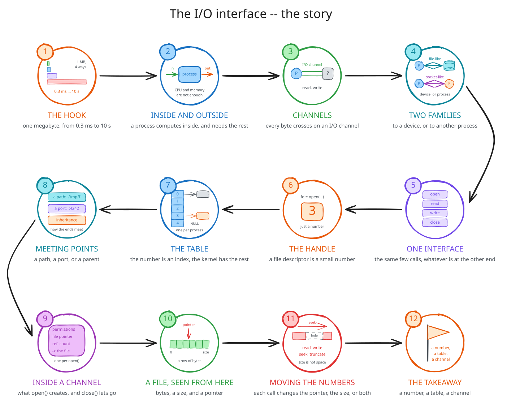

# Storyline: I/O Interface

The planned narrative of the live delivery, one thread from start to finish.
The figure walks through it, station by station: [the storyline](media/00-pitch/storyline.svg).

1. **The hook:** one megabyte, written to one file, by four programs that differ in one line.
   The first takes a third of a millisecond.
   The last takes ten seconds.
   Same bytes, same file, same disk, and a factor of 35,000.
   All four were told "written".
   What did each of them actually get, and what is the thing they all wrote *through*?
   That is the lecture.
1. **Inside and outside.**
   For six lectures a process was memory and threads: something that computes.
   It is also sealed, on purpose: it cannot name a byte outside its own address space.
   But the data it works on is outside, and so is everyone who wants the result.
   A browser on this machine made 84 million read calls in nine days.
   A process that only computes is of no use to anybody.
1. **Channels.**
   Whatever crosses the wall crosses on an I/O channel, and the kernel carries it.
   A channel moves bytes, and it has two verbs: read, to bring them in, and write, to send them out.
   What the bytes mean is for the two ends to agree on.
1. **Two families.**
   At the other end there is either a device that keeps data, or another process.
   A file is still there tomorrow, has a size, and can be read twice.
   What comes down a pipe is gone once read, and if nothing has come yet, you wait.
   File-like and socket-like: the same calls, two characters.
1. **One interface.**
   Create, open, read, write, stat, control, close, delete.
   Create and delete are about the thing at the other end; open and close are about your connection to it.
   And the calls are the same whatever is there, which is why `sort` can sort a file, the keyboard or another program's output without knowing which.
1. **The handle.**
   `open()` is given a name and gives back a number.
   From then on the program says 3, and never the name again: `read(3, ...)`, `write(3, ...)`, `close(3)`.
   It does not say where in the file, or whether it is allowed.
   Somebody else remembers.
   And why 3?
1. **The table.**
   Because 0, 1 and 2 were taken.
   The number is an index in a table the kernel keeps for each process, and each entry points to a channel.
   The table has an end: open a thousand files without closing and the next `open()` is refused.
   A new channel gets the lowest free entry, so close entry 0, open a file, and the program's standard input is that file.
1. **Meeting points.**
   One process, eleven entries: a file, devices, a pipe, a FIFO, three sockets, side by side.
   A channel to a process has a second end, and the other process has to find it.
   There are three ways: a path in the file system, a port number, or being born with the descriptor already open.
   That last one is how every program gets its 0, 1 and 2.
1. **Inside a channel.**
   Follow the pointer from the table, for a file.
   The kernel keeps four things: how the channel was opened, where in the file it is, how many descriptors lead to it, and which file it is.
   Permissions are checked once, at `open()`; make the file untouchable afterwards and the open channel still writes.
   Open a file twice and there are two positions; `dup()` it or `fork()`, and two descriptors share one.
1. **A file, seen from here.**
   A file is a row of bytes.
   No lines, no records: bytes, a size, and a pointer.
   The size belongs to the file, and is the same for everybody.
   The pointer belongs to the channel, and nobody ever asks for "byte 300": they ask for the next few, and the channel knows where next is.
1. **Moving the numbers.**
   Seven calls, and after each, two numbers.
   Reading and writing move the pointer; `lseek()` puts it anywhere; `ftruncate()` changes the size and leaves the pointer where it was, even beyond the end.
   Write there, and the file has a hole in it.
   Take it to the limit: a file of 20 GiB, made in no time, that takes 4 KiB on the disk.
   The size is a number; the space is another.
1. **What should survive the week:** a process reaches the outside through channels.
   It holds a number; the number is an index in its descriptor table; the entry points to a channel in the kernel; the channel remembers how it was opened, where it is, and which file it is.
   The four writes of the hook used all of this in the same way, and differed in what lies beyond it.
   Next time: the other family, where the far end of the channel is a process that answers back.

## How the stations map onto the lecture

| Stations | Part |
| --- | --- |
| 1 | 00. Pitch |
| 2, 3, 4 | 01. Processes and the outside world |
| 5, 6 | 02. The process I/O interface |
| 7 | 03. The file descriptor table |
| 8 | 04. Types of I/O channels |
| 9 | 05. File channel internals |
| 10, 11 | 06. File channel operations |
| 12 | 07. Conclusion |

Stations 6, 7 and 9 are one walk, and the spine of the lecture: the number, the table it indexes, and the structure the table points to.
Station 6 ends on a question, "why 3?", and station 7 opens with the answer; do not let the break fall between them.
Station 4 and station 8 are the same distinction met twice, first as a behaviour and then as a way of being found; station 8 is short on purpose, since lectures 10 and 11 are about it.
Station 1 is not resolved by the lecture, and station 12 says so: the hook shows that there is a lot beneath the interface, and the lecture describes the interface.
