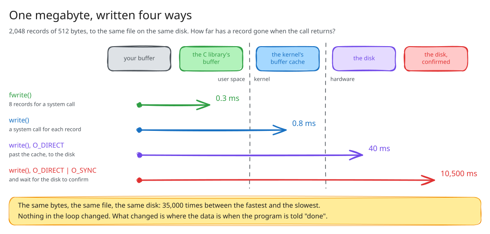

# Demo: One Megabyte, Four Ways

The same megabyte written to the same file by four programs that differ in one line, and take from a third of a millisecond to ten seconds.

## Goal

See that "written" has several meanings, that each is a place where the data can be when the call returns, and that the distance between them is five orders of magnitude.

## Background

Every program writes 2,048 records of 512 bytes, one megabyte in all, to `f.dat`, and times the loop.
`write.h` holds what they have in common: the size of the job, a clock, and the line printed at the end.

| Program | The call | When the call returns, a record is |
| --- | --- | --- |
| `fwrite` | `fwrite()` | in a buffer of the C library, in the memory of the process |
| `write` | `write()` | in the kernel's buffer cache, in memory |
| `write_o_direct` | `write()`, file opened with `O_DIRECT` | handed to the disk, past the buffer cache |
| `write_o_direct_o_sync` | `write()`, file opened with `O_DIRECT` and `O_SYNC` | on the disk, and the disk has confirmed it |

The last three are built from one source, `write.c`, with a different flag for `open()`.

`O_DIRECT` asks the kernel not to keep a copy of the data in its cache, and to pass the process's own buffer to the disk.
It comes with conditions: the buffer has to start at a multiple of the disk's block size, and so do the position in the file and the length.
That is why `write.c` gets its buffer from `posix_memalign()`, and why a record is 512 bytes.

`O_SYNC` asks that `write()` return only when the data, and what is needed to find it again, such as the new size of the file, is on stable storage.

## Build and run

```console
make
make run
```

`make run` runs the four programs in order.
The last one takes about ten seconds.

`O_DIRECT` needs a real file system under the directory: on `tmpfs`, as `/tmp` is on some systems, `open()` fails with `Invalid argument`.

## Results and explanations

```text
$ make run
fwrite                 2048 records of 512 bytes  time:      0.3 ms      0.14 us/record
write                  2048 records of 512 bytes  time:      0.8 ms      0.41 us/record
write O_DIRECT         2048 records of 512 bytes  time:     40.8 ms     19.94 us/record
write O_DIRECT|O_SYNC  2048 records of 512 bytes  time:  10511.3 ms   5132.49 us/record
```



**`fwrite`: 0.14 microseconds a record.**
`fwrite()` is a function of the C library, and it does not call the kernel.
It copies the record into a buffer of 4,096 bytes that the library keeps for the file, and returns.
When the buffer is full, after eight records, the library calls `write()` once for all eight.

```text
$ strace -c -e trace=write ./fwrite 2>&1 | grep write$
100.00    0.000453           1       257           write
$ strace -c -e trace=write ./write 2>&1 | grep write$
100.00    0.002185           1      2049           write
```

257 system calls instead of 2,049: 256 full buffers, and the line printed at the end.
This is lecture 02's buffering, measured again.

**`write`: 0.41 microseconds a record.**
Each record costs a system call, and the system call is most of the cost.
What the kernel does with the record is another copy: from the process's buffer into a page of its own, in the buffer cache.
The page is marked as changed, and `write()` returns.
Nothing has gone to the disk; the kernel will send it later, on its own schedule, usually within thirty seconds.

**`write_o_direct`: 20 microseconds a record, fifty times slower.**
There is no cache to copy into, so every `write()` becomes a request to the disk, and waits for the disk to take it.
A fast disk takes a small request in twenty microseconds, and a system call that waits for hardware is no longer a matter of nanoseconds.

**`write_o_direct_o_sync`: 5 milliseconds a record, 250 times slower again.**
A disk that has taken a request has not necessarily written it: disks have a cache of their own, in volatile memory.
`O_SYNC` makes the kernel tell the disk to empty that cache, and wait for it to answer, on every write.
Because the file also grows with every record, its new size has to reach the disk too, through the file system's journal.
On a consumer disk, emptying the cache takes milliseconds.

So the four programs give four different promises.

| Program | The data survives if | Time |
| --- | --- | ---: |
| `fwrite` | the process goes on to call `fflush()` or `fclose()` | 0.3 ms |
| `write` | the kernel keeps running for a few more seconds | 0.8 ms |
| `write_o_direct` | the disk keeps its power for a moment | 40 ms |
| `write_o_direct_o_sync` | always | 10,500 ms |

Between the fastest and the slowest there is a factor of 35,000, and the loop is the same.
The faster a write is, the less it has done.

All four go through the same interface: a channel to a file, obtained with `open()` and used through what `open()` returned.
What that channel is, where it is kept and what it remembers is the rest of the lecture.

## Going further

* Change `RECORD_SIZE` to 4096 in `write.h` and build again.
  Why are `fwrite` and `write` now the same speed?
* Add an `fsync(fd)` after the loop of `write.c`, inside the timed part, and run `./write`.
  One synchronization for the whole megabyte: how does it compare with one for every record?
  This is what a text editor does when it saves.
* Build `write.c` with `-DEXTRA_FLAGS=O_SYNC` alone, without `O_DIRECT`.
  Is the buffer cache what makes `write` fast, or the absence of waiting?
* Remove the `posix_memalign()` and write from a plain array.
  What does `write()` return with `O_DIRECT`, and what would happen in a program that does not check?
* Run `write_o_direct_o_sync` on another disk, if you have one: a USB stick, a hard disk, a server disk with a protected cache.

## References

* `man 2 open`, the sections on `O_DIRECT` and `O_SYNC`, and the *NOTES* on `O_DIRECT`
* `man 2 fsync`, `man 3 setvbuf`
* [Ensuring data reaches disk](https://lwn.net/Articles/457667/), Jeff Moyer, on LWN
* Arpaci-Dusseau, *Operating Systems: Three Easy Pieces*, chapter 39, [Files and Directories](https://pages.cs.wisc.edu/~remzi/OSTEP/file-intro.pdf), the section on `fsync()`
