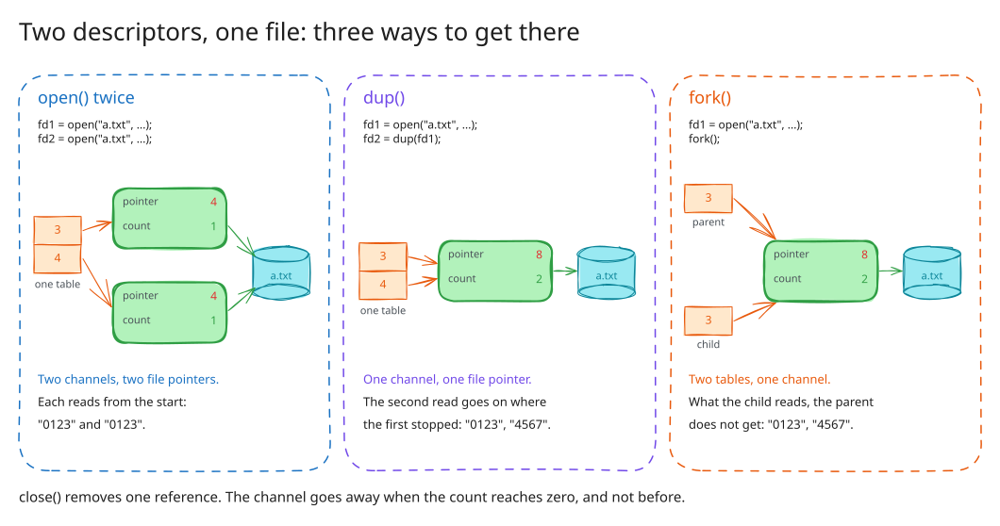

# Demo: Who Shares the File Pointer

One file, two file descriptors, obtained in three different ways, and a read of four characters through each.

## Goal

See that the file pointer belongs to the channel: two `open()` calls make two channels and two pointers, while `dup()` and `fork()` make a second descriptor for the same channel, and share one.

## Background

`file-pointer.c` writes the 16 characters `0123456789abcdef` to `digits.txt`.
Then it goes through three scenarios, and in each it reads four characters through one descriptor and four through the other.

| Scenario | How the second descriptor is obtained |
| --- | --- |
| 1 | `open()` is called a second time on the same file |
| 2 | `dup(fd1)`: a new descriptor for what `fd1` leads to |
| 3 | `fork()`: the child has a copy of the parent's descriptor table |

After every read the program prints the file pointer, which `lseek(fd, 0, SEEK_CUR)` returns without moving it.

## Build and run

```console
make
./file-pointer
```

## Results and explanations

```text
$ ./file-pointer
1. fd1 = open(), fd2 = open(): two channels
         read(3) = "0123"   file pointer of 3 is now 4
         read(4) = "0123"   file pointer of 4 is now 4
2. fd1 = open(), fd2 = dup(fd1): one channel
         read(3) = "0123"   file pointer of 3 is now 4
         read(4) = "4567"   file pointer of 4 is now 8
  close(3)
         read(4) = "89ab"   file pointer of 4 is now 12
3. fd1 = open(), then fork(): one channel, two processes
  child  read(3) = "0123"   file pointer of 3 is now 4
  parent read(3) = "4567"   file pointer of 3 is now 8
```



**Scenario 1.**
Both reads return `0123`.
Each `open()` made a channel of its own, with a file pointer that starts at 0, and reading through one does not move the other.
The file is the same; the two channels do not know about each other.

**Scenario 2.**
The second read returns `4567`: it went on from where the first stopped.
`dup()` did not make a channel.
It made a second entry in the table that leads to the channel `fd1` leads to, and there is one file pointer, in the channel, whichever number is used to reach it.

Then the program closes descriptor 3, and reads through 4 again, and gets `89ab`.
The channel is still there.
It keeps a count of the entries that lead to it; `close()` lowers the count, and the channel is given up when the count reaches zero.

**Scenario 3.**
The child reads `0123`, and the parent, afterwards, reads `4567`.
`fork()` copied the table, and a copy of an entry leads where the original leads: to the same channel.
Two processes, each with a descriptor 3, and one file pointer between them.

This is not an accident of the implementation.
It is what makes `(echo one; echo two) > out.txt` produce two lines: both commands inherit one channel to `out.txt`, and the second writes where the first stopped.
If each had a pointer of its own, the second would overwrite the first.

## Going further

* In scenario 1, open the second channel with `O_WRONLY`, write `XX` through it, then read through the first.
  Do two channels to one file see each other's data?
* In scenario 3, let the parent and the child each call `open()` after the `fork()`.
  What do they read?
* Scenario 3 has the parent wait for the child before reading.
  Remove the `wait()` and let both read at once, a few thousand times in a loop.
  Is this a race condition, in the sense of lecture 08, and who protects the file pointer?
* Run `./file-pointer` under `strace -f` and find the `dup()` and the `clone()`.

## References

* `man 2 open`, the paragraph on the *open file description*, which is what this lecture calls the I/O channel
* `man 2 dup`, `man 2 fork` (the paragraph on inherited file descriptors), `man 2 lseek`
* Kerrisk, *The Linux Programming Interface*, section 5.4, *Relationship Between File Descriptors and Open Files*
