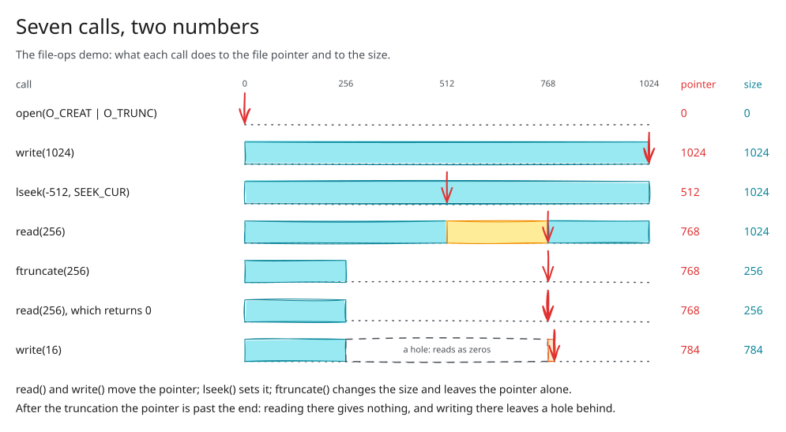

# Demo: The File Pointer and the Size

One file, one channel, seven calls, and two numbers printed after each.

## Goal

Know, for each of `open()`, `write()`, `lseek()`, `read()` and `ftruncate()`, whether it changes the file pointer, the size of the file, or both.

## Background

A process sees a file as an array of bytes, numbered from 0.
Two numbers describe where things stand.

* The **size** is how many bytes the file has. It is kept with the file.
* The **file pointer** is the position where the next `read()` or `write()` on a channel will start. It is kept with the channel.

`file-ops.c` opens `f.txt` and makes seven calls.
After each it prints the file pointer, taken with `lseek(fd, 0, SEEK_CUR)`, and the size, taken with `fstat()`.

With the argument `step`, the program waits for ENTER after every call, so that it can be looked at from another terminal.

## Build and run

```console
make
./file-ops
./file-ops step
```

While it waits, in another terminal:

```console
cat /proc/$(pidof file-ops)/fdinfo/3
ls -l f.txt
```

## Results and explanations

```text
$ ./file-ops
process 615180
open() = 3                    pointer:    0   size:    0
write(1024) = 1024            pointer: 1024   size: 1024
lseek(-512, SEEK_CUR) = 512   pointer:  512   size: 1024
read(256) = 256               pointer:  768   size: 1024
ftruncate(256) = 0            pointer:  768   size:  256
read(256) = 0                 pointer:  768   size:  256
write(16) = 16                pointer:  784   size:  784
close() = 0
```



**`open()`** with `O_TRUNC` empties the file, and a new channel starts at 0.

**`write(1024)`** puts 1,024 bytes at the pointer and moves the pointer past them.
The pointer was at the end, so the file grew: writing is the one call here that changes both numbers.

**`lseek(-512, SEEK_CUR)`** moves the pointer back 512 bytes from where it is.
Nothing is read or written, and the file is not touched: `lseek()` changes a number in the channel.

**`read(256)`** returns the 256 bytes that start at 512, and moves the pointer past them, to 768.
The size does not change; reading never changes it.

**`ftruncate(256)`** sets the size to 256.
The last 768 bytes of the file are gone.
The pointer is still 768, and it now points beyond the end of the file: `ftruncate()` changes the size and does not look at the pointer.

**`read(256)`** at 768, in a file of 256 bytes, returns 0: there is nothing there.
This is the same answer as at the end of a file, and the pointer does not move.

**`write(16)`** at 768 is allowed.
The 16 bytes go to positions 768 to 783, and the size becomes 784.
The bytes from 256 to 767 were never written by anyone, and they read as zeros.

```text
$ od -A d -c f.txt
0000000   A   A   A   A   A   A   A   A   A   A   A   A   A   A   A   A
*
0000256  \0  \0  \0  \0  \0  \0  \0  \0  \0  \0  \0  \0  \0  \0  \0  \0
*
0000768   A   A   A   A   A   A   A   A   A   A   A   A   A   A   A   A
0000784
```

Such a stretch is called a **hole**, and the [truncate demo](../truncate) makes a very large one.

The kernel shows the pointer of any channel of any process.
With `./file-ops step` stopped after the `read(256)`:

```text
$ cat /proc/$(pidof file-ops)/fdinfo/3
pos:	768
flags:	0100002
mnt_id:	32
ino:	28197811
```

`pos` is the file pointer.
`flags` is what the channel was opened with, in octal: the final 2 is `O_RDWR`.
Both are in the channel, which is why they are found under a file descriptor and not under the file.

| Call | File pointer | Size |
| --- | --- | --- |
| `open()` | set to 0 | set to 0 with `O_TRUNC`, otherwise unchanged |
| `read(n)` | moves forward by what was read | unchanged |
| `write(n)` | moves forward by what was written | grows, if the write ends past the end |
| `lseek()` | set to the position asked for | unchanged |
| `ftruncate(n)` | unchanged | set to `n` |

## Going further

* Add `O_APPEND` to the flags of `open()` and run the program again.
  Where does the last `write(16)` go now, and what is the size at the end?
* Replace the `lseek(-512, SEEK_CUR)` with `lseek(0, SEEK_END)`, and with `lseek(100, SEEK_SET)`.
  What does each return?
* `pread(fd, buffer, 256, 512)` reads 256 bytes at position 512.
  Use it for the first read. What happens to the file pointer, and why would a program with several threads prefer it?
* Run `./file-ops step`, and at the first pause run `ls -l f.txt` after each ENTER.
  Which of the two numbers can `ls` show, and why not the other?

## References

* `man 2 lseek`, `man 2 read`, `man 2 write`, `man 2 ftruncate`, `man 2 pread`
* `man 5 proc_pid_fdinfo`
* Kerrisk, *The Linux Programming Interface*, sections 4.7 (*Changing the File Offset*) and 5.8 (*Truncating a File*)
