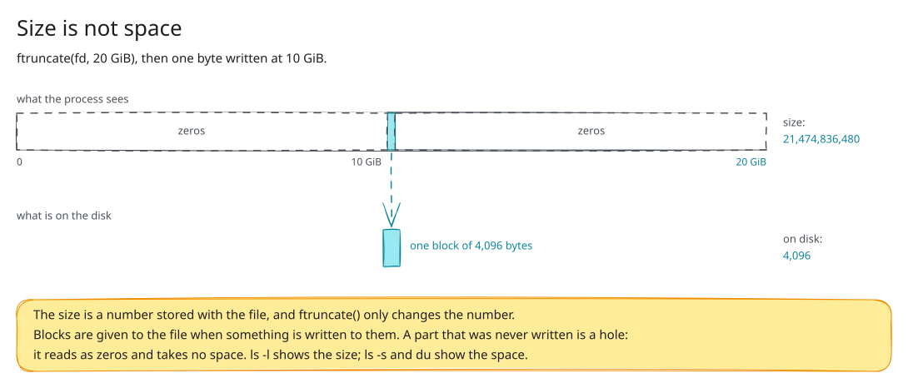

# Demo: Size Is Not Space

A program that makes a file of 20 GiB in no time, on a disk that may not have 20 GiB free.

## Goal

Tell the size of a file, a number stored with it, from the space the file takes on the disk, and see that the first can be far larger than the second.

## Background

`truncate.c` creates `fake-gargantua.dat`, sets its size to 20 GiB with `ftruncate()`, then moves the file pointer to the middle and writes one byte.
After each step it prints two fields of what `fstat()` returns.

| Field | Meaning |
| --- | --- |
| `st_size` | the size of the file, in bytes |
| `st_blocks` | the space allocated to the file, in units of 512 bytes |

`ftruncate()` is the call that sets the size of a file.
The name says "truncate" because cutting a file short was its first use; it extends a file just as well.

## Build and run

```console
make
./truncate
ls -lh fake-gargantua.dat
ls -sh fake-gargantua.dat
du -h fake-gargantua.dat
make clean
```

`make clean` removes the file.

## Results and explanations

```text
$ ./truncate
open(O_CREAT | O_TRUNC)       size:           0 bytes   on disk: 0 bytes
ftruncate(20 GiB)             size: 21474836480 bytes   on disk: 0 bytes
write(1) at 10 GiB            size: 21474836480 bytes   on disk: 4096 bytes
$ ls -lsh fake-gargantua.dat
4.0K -rw-r--r-- 1 student student 20G Nov 21 18:58 fake-gargantua.dat
$ du -h fake-gargantua.dat
4.0K	fake-gargantua.dat
$ du -h --apparent-size fake-gargantua.dat
20G	fake-gargantua.dat
```



After `ftruncate()` the file is 20 GiB long and takes nothing.
The size is a number in the file's record on the disk, and `ftruncate()` changed the number.
No data was written, so no space was needed.

The whole file is a hole.
Reading anywhere in it works, and returns zeros, which the kernel produces without reading the disk.

Writing one byte in the middle makes the file system give the file one block, 4,096 bytes, which is the smallest amount it hands out.
The file now takes 4 KiB, and is still 20 GiB long.

`ls -l` shows the size, and `ls -s` and `du` show the space.
For most files the two are close, with the space a little larger because it is counted in whole blocks.
A file where the space is much smaller than the size is called a **sparse file**.

Sparse files are in everyday use.
The image of a virtual machine's disk is one: it is created at the full size of the disk, say 50 GiB, and takes space only as the guest system writes to it.

The other side of the bargain: a write into a hole needs a new block, and can fail with *no space left on device* in the middle of a file that seemed to exist already.

## Going further

* Time `cat fake-gargantua.dat > /dev/null`.
  It reads 20 GiB. Is the disk involved, and where do the bytes come from?
* Copy the file with `cp fake-gargantua.dat copy.dat` and with `cp --sparse=never`, on a disk with room for it, and compare `du` on the results.
* Shrink the file from the shell with `truncate -s 100 fake-gargantua.dat`, and look at the size and the space again.
* Run `fallocate -l 1G real.dat` and compare with a file of 1 GiB made by `truncate -s 1G`.
  Which of the two is guaranteed to have room for its data?

## References

* `man 2 ftruncate`, `man 2 fstat` (and `man 3 stat` for `st_blocks`), `man 1 truncate`
* `man 2 lseek`, under `SEEK_HOLE` and `SEEK_DATA`
* `man 1 du`, under `--apparent-size`
* [Sparse file](https://en.wikipedia.org/wiki/Sparse_file), on Wikipedia
