# 00. Pitch

## Every process does I/O

```text
$ cat /proc/$$/io            # a shell, open for nine days
rchar: 4260386
wchar: 103041
syscr: 5252
syscw: 912

$ cat /proc/30237/io         # a browser, same nine days
rchar: 211950963437
wchar: 114331016605
syscr: 84654797
syscw: 74501807
```

211 GB read, 114 GB written: about **a hundred read calls a second**, day and night.

::: {.notes}
rchar and wchar are bytes asked for; syscr and syscw are the system calls. A process moves bytes, and computes a little in between.
:::

## One megabyte, four programs

2,048 records of 512 bytes, to the same file. The programs differ in one line.

```text
$ make run
fwrite                 2048 records of 512 bytes  time:      0.3 ms      0.14 us/record
write                  2048 records of 512 bytes  time:      0.8 ms      0.41 us/record
write O_DIRECT         2048 records of 512 bytes  time:     40.8 ms     19.94 us/record
write O_DIRECT|O_SYNC  2048 records of 512 bytes  time:  10511.3 ms   5132.49 us/record
```

Same bytes, same file, same disk: a factor of **35,000**.

::: {.notes}
Run the first three, ask for a guess, then run the fourth and let the ten seconds pass.
:::

## How far did the data get?

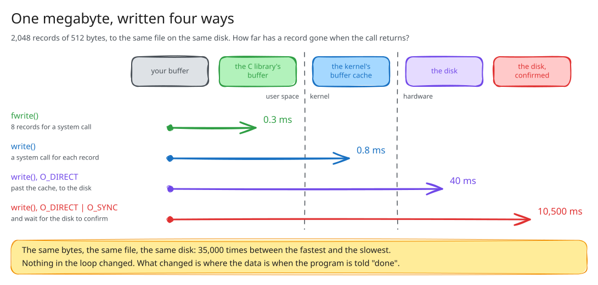{fig-align="center" width="92%"}

::: {.notes}
The faster a write is, the less it has done. All four went through the same interface: something from open(), handed to every write(). That something is the lecture.
:::

## The story

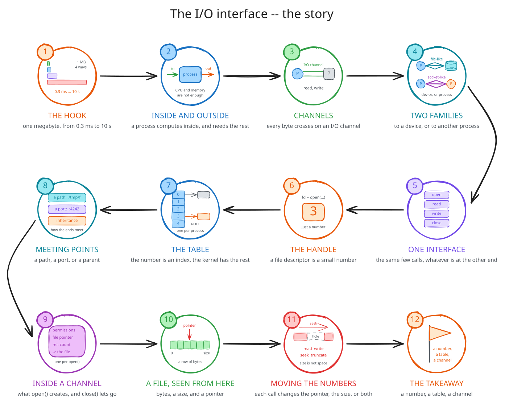{fig-align="center" width="78%"}

# 01. Processes and the outside world

## Inside, and outside

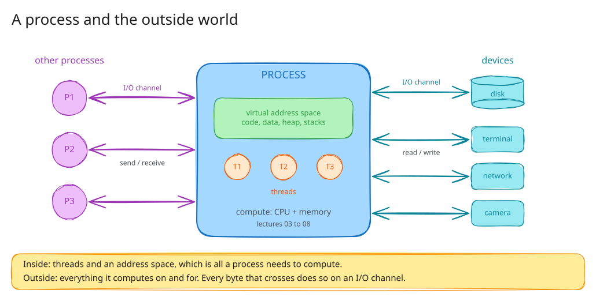{fig-align="center" width="88%"}

::: {.notes}
Lectures 03 to 08 were the blue box. Isolation, from lecture 04, also cuts the process off from everything it is useful for.
:::

## I/O channels

The connection between a process and something outside it.

* It carries **bytes**, whatever is at the other end.
  What they mean is for the two ends to agree on.
* It has two verbs: **read** brings bytes in, **write** sends bytes out.
  For some channels they are spelled *receive* and *send*.
* The kernel carries the bytes; the process cannot reach outside by itself.

## Two families

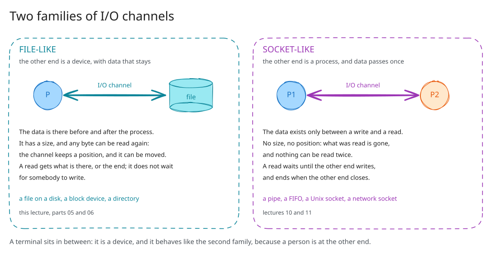{fig-align="center" width="88%"}

## The channels of a process

```text
$ lsof -p $$ -a -d 0-1023
COMMAND  PID    USER   FD   TYPE DEVICE SIZE/OFF NODE NAME
bash    8851 student    0u   CHR 136,10      0t0   13 /dev/pts/10
bash    8851 student    1u   CHR 136,10      0t0   13 /dev/pts/10
bash    8851 student    2u   CHR 136,10      0t0   13 /dev/pts/10
bash    8851 student  255u   CHR 136,10      0t0   13 /dev/pts/10
```

A browser: **1,022** channels.

| `TYPE` | Channels | The other end |
| --- | ---: | --- |
| `REG` | 741 | a file |
| sockets | 249 | a process |
| `FIFO` | 8 | a process, through a pipe |
| `a_inode` | 24 | a kernel object |

::: {.notes}
Two columns to point at: TYPE, where both families show, and FD, a number for each channel. The next half hour is about that number.
:::

# 02. The process I/O interface

## The life of a channel

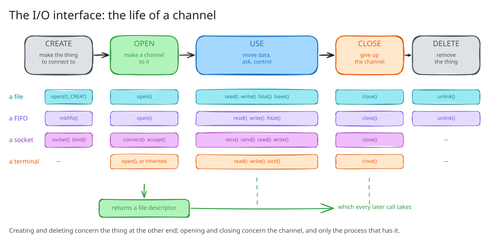{fig-align="center" width="90%"}

## Eight operations

| Operation | What it does | Typical calls |
| --- | --- | --- |
| **create** | makes the thing a channel will lead to | `open(O_CREAT)`, `mkfifo()`, `socket()` + `bind()` |
| **open** | makes a channel to it, returns a handle | `open()`, `connect()`, `accept()` |
| **read** | brings bytes in | `read()`, `recv()` |
| **write** | sends bytes out | `write()`, `send()` |
| **stat** | asks about the other end | `fstat()` |
| **control** | whatever is specific to one device | `ioctl()`, `fcntl()` |
| **close** | gives up the channel | `close()` |
| **delete** | removes the thing | `unlink()` |

Create and delete: about **the thing**. Open and close: about **the channel**.

::: {.notes}
A file exists with no channel to it. Opening does not change the file. open() with O_CREAT does both jobs, which is a convenience.
:::

## The handle

```text
$ ./write_file
open("file_channel", O_WRONLY | O_CREAT | O_TRUNC) = 3
write(3, message, 13) = 13
close(3) = 0
$ ./read_file
open("file_channel", O_RDONLY) = 3
fstat(3) = 0: a file of 13 bytes
read(3, buffer, 255) = 13: Hello, file!
read(3, buffer, 255) = 0: the end of the file
close(3) = 0
```

The name is used **once**. After that, the program says 3.

::: {.notes}
Ask: why 3? Leave it open. Also: read asked for 255 and got 13; 0 means the end.
:::

## A file descriptor

A small non-negative integer that `open()` returns and every other call takes.

Why a number, and not the name?

* The name is looked up, and permissions are checked, **once**.
* A name can change its meaning while the program runs; a handle cannot.
* Some channels have no name at all.

| Descriptor | Name | Used by |
| --- | --- | --- |
| 0 | standard input | `scanf()`, `getchar()` |
| 1 | standard output | `printf()`, `puts()` |
| 2 | standard error | `perror()` |

## The same calls, on a FIFO

```text
$ ./receive_fifo
mkfifo("fifo_channel") done
open("fifo_channel", O_RDONLY) ...
open("fifo_channel", O_RDONLY) = 3
read(3, buffer, 255) = 13: Hello, FIFO!
read(3, buffer, 255) = 0: the other end was closed
close(3) = 0
```

| | File | FIFO |
| --- | --- | --- |
| `open()` | returns at once | waits for the other end |
| `read()` with nothing to read | returns 0 | waits |
| the data, once read | is still there | is gone |

::: {.notes}
Same calls, other behaviour. This is why sort can sort a file, the keyboard or another program's output.
:::

# 03. The file descriptor table

## A number of what?

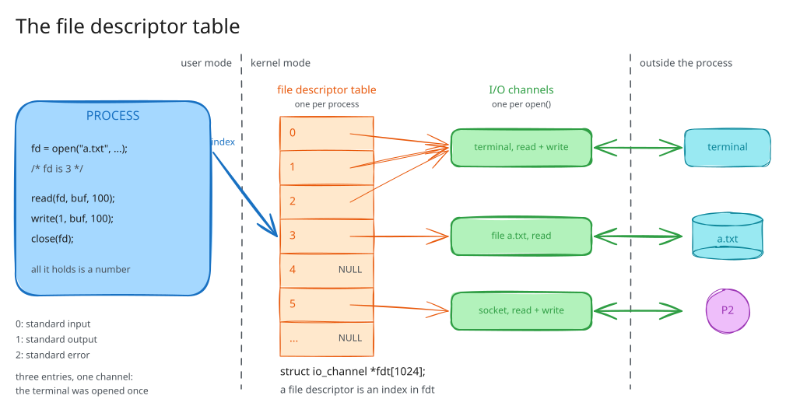{fig-align="center" width="88%"}

## Three things in the picture

```c
struct io_channel *fdt[1024];
```

* **The table is in the kernel.**
  The process holds an index, and cannot look at the entry.
  A made-up descriptor gets `EBADF`.
* **The table belongs to one process.**
  Descriptor 3 here and descriptor 3 there are unrelated.
  Threads of one process share one table.
* **Several entries can point to one channel.**
  0, 1 and 2 lead to one channel to the terminal.

## How large

```text
$ ulimit -n
1024
$ ./fdtsize
limit of open file descriptors: 1024
open() failed: Too many open files
opened 1021 file descriptors, from 3 to 1023
$ (ulimit -n 64; ./fdtsize)
limit of open file descriptors: 64
open() failed: Too many open files
opened 61 file descriptors, from 3 to 63
```

A limit of the process, `RLIMIT_NOFILE`. One file, opened 1,021 times: an entry stands for an `open()`.

::: {.notes}
Why 1,021 and not 1,024? The limit protects the machine from a program that leaks descriptors.
:::

## Which entry

```text
$ ./lowest-fd
open()    = 3
open()    = 4
open()    = 5
close(4)
open()    = 4
close(0)
open()    = 0
```

*The lowest-numbered file descriptor not currently open for the process.*

"Standard input" is whatever entry 0 leads to.

::: {.notes}
Ask for each number before it appears. After close(0) and open(), scanf() reads the file. sort < names.txt: lecture 10.
:::

# 04. Types of I/O channels

## One table, every kind

```text
$ ./channels
fd  type          found by others through  leads to
 0  char device   nothing: inherited       /dev/pts/10
 1  char device   nothing: inherited       /dev/pts/10
 2  char device   nothing: inherited       /dev/pts/10
 3  file          a path                   /home/student/[...]/channels.c
 4  char device   a path                   /dev/null
 5  pipe / FIFO   nothing: inherited       pipe:[3693957]
 6  pipe / FIFO   nothing: inherited       pipe:[3693957]
 7  pipe / FIFO   a path                   /home/student/[...]/fifo_channel
 8  socket        a path                   socket:[3693958]
 9  socket        TCP port 4242            socket:[3693959]
10  socket        UDP port 4242            socket:[3693960]
```

## How the two ends meet

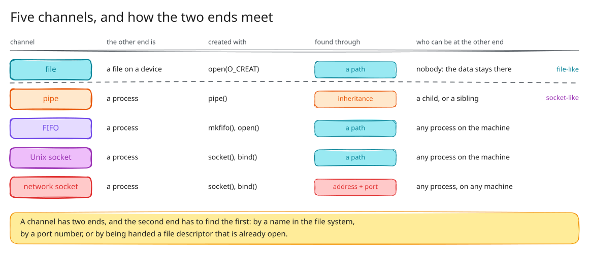{fig-align="center" width="92%"}

## A path, a port, a parent

* **A name in the file system.**
  A FIFO and a Unix socket have a path; `ls -l` shows `p` and `s`.
  The path leads to no data: it is a meeting point.
* **A port.**
  A network socket has an address and a port, which mean something across machines.
* **Inheritance.**
  A pipe has no name.
  A child starts with a copy of its parent's table: that is how every process gets 0, 1 and 2.

```text
$ ./receive_unix_socket
socket(AF_UNIX, SOCK_STREAM) = 3
bind(3, "socket_channel") done
accept(3) = 4
recv(4) = 20: Hello, Unix socket!
```

::: {.notes}
More ceremony than a file, and it ends the same way: a descriptor, and bytes read from it. Lectures 10 and 11.
:::

# 05. File channel internals

## What the kernel keeps

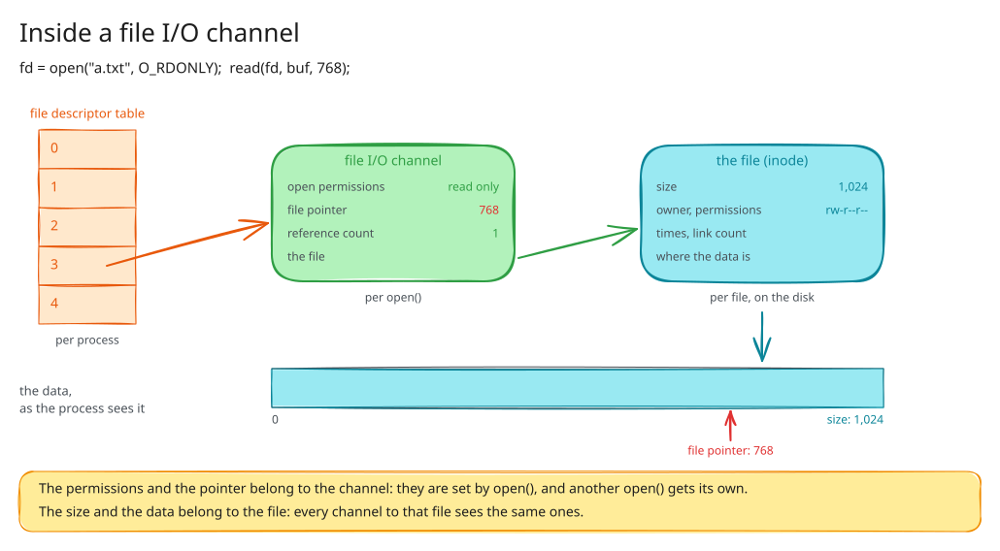{fig-align="center" width="86%"}

## Three structures

| Structure | One per | Holds |
| --- | --- | --- |
| table entry | descriptor, in a process | a pointer to a channel |
| file I/O channel | `open()` call | open permissions, file pointer, reference count, reference to the file |
| file (inode) | file | size, owner, permissions, where the data is |

The channel: POSIX *open file description*, Linux `struct file`.

The channel does not hold the **name**: a file can be renamed or deleted while it is open.

## Open permissions

```text
$ ./channel-perm
1. the file is 644, the channel is opened O_RDONLY
  write(3)  refused: Bad file descriptor
2. the file is 644, the channel is opened O_RDWR
  write(3)  = 4
3. chmod 000: nobody may open the file any more
  open(O_RDONLY)  refused: Permission denied
4. the channel opened at step 2 is still here
  write(3)  = 4
```

The file's permissions are checked **once**, by `open()`.
After that, only the channel is consulted.

::: {.notes}
Step 1: EBADF, not EACCES; write() never looks at the file's permissions. Step 4: what you were granted is yours until you close.
:::

## Who shares the file pointer

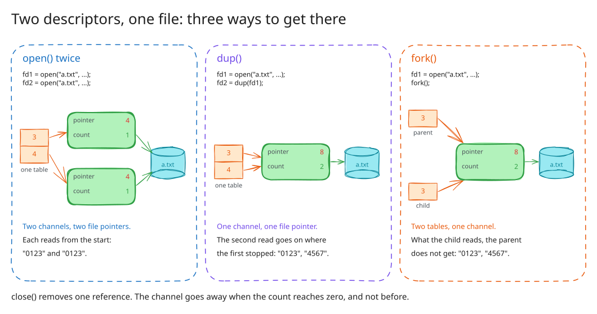{fig-align="center" width="86%"}

## Two descriptors, three ways

```text
$ ./file-pointer
1. fd1 = open(), fd2 = open(): two channels
         read(3) = "0123"   file pointer of 3 is now 4
         read(4) = "0123"   file pointer of 4 is now 4
2. fd1 = open(), fd2 = dup(fd1): one channel
         read(3) = "0123"   file pointer of 3 is now 4
         read(4) = "4567"   file pointer of 4 is now 8
  close(3)
         read(4) = "89ab"   file pointer of 4 is now 12
3. fd1 = open(), then fork(): one channel, two processes
  child  read(3) = "0123"   file pointer of 3 is now 4
  parent read(3) = "4567"   file pointer of 3 is now 8
```

`close()` empties an entry and lowers the count; the channel goes when the count is zero.

::: {.notes}
Ask for a prediction before each scenario. Scenario 3 is why (echo one; echo two) > out.txt gives two lines.
:::

# 06. File channel operations

## A file, as a process sees it

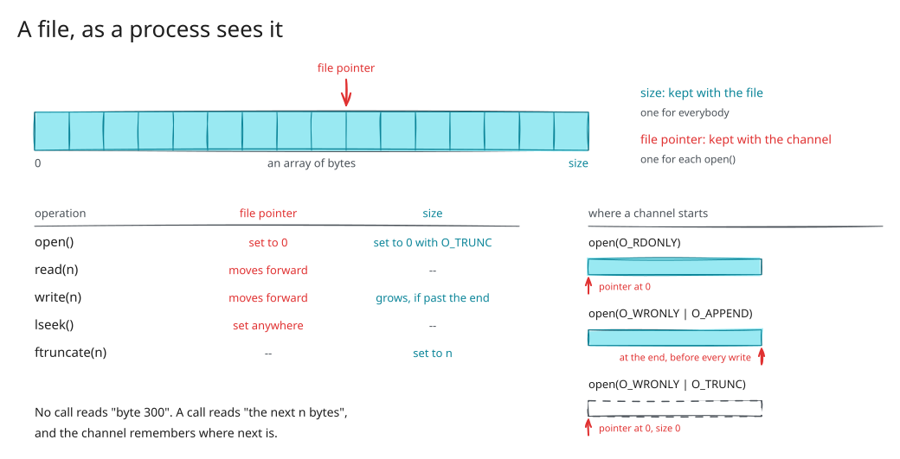{fig-align="center" width="88%"}

## Seven calls, two numbers

```text
$ ./file-ops
open() = 3                    pointer:    0   size:    0
write(1024) = 1024            pointer: 1024   size: 1024
lseek(-512, SEEK_CUR) = 512   pointer:  512   size: 1024
read(256) = 256               pointer:  768   size: 1024
ftruncate(256) = 0            pointer:  768   size:  256
read(256) = 0                 pointer:  768   size:  256
write(16) = 16                pointer:  784   size:  784
```

::: {.notes}
./file-ops step, asking for both numbers before each ENTER. fdinfo from the second terminal after read(256): pos 768.
:::

## What each call did

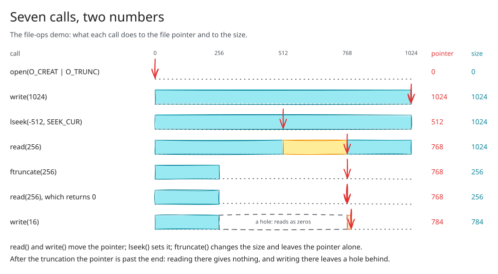{fig-align="center" width="86%"}

## Which call changes what

| Call | File pointer | Size |
| --- | --- | --- |
| `open()` | set to 0 | set to 0 with `O_TRUNC` |
| `read(n)` | moves forward | unchanged |
| `write(n)` | moves forward | grows, if past the end |
| `lseek()` | set anywhere | unchanged |
| `ftruncate(n)` | unchanged | set to `n` |

`O_APPEND`: before every `write()`, the pointer is moved to the end, in one step with the write.

::: {.notes}
O_APPEND is how several processes share a log file. lseek to the end followed by write is lecture 08's check-then-act race.
:::

## Size is not space

```text
$ ./truncate
open(O_CREAT | O_TRUNC)       size:           0 bytes   on disk: 0 bytes
ftruncate(20 GiB)             size: 21474836480 bytes   on disk: 0 bytes
write(1) at 10 GiB            size: 21474836480 bytes   on disk: 4096 bytes
$ ls -lsh fake-gargantua.dat
4.0K -rw-r--r-- 1 student student 20G Nov 21 18:58 fake-gargantua.dat
```

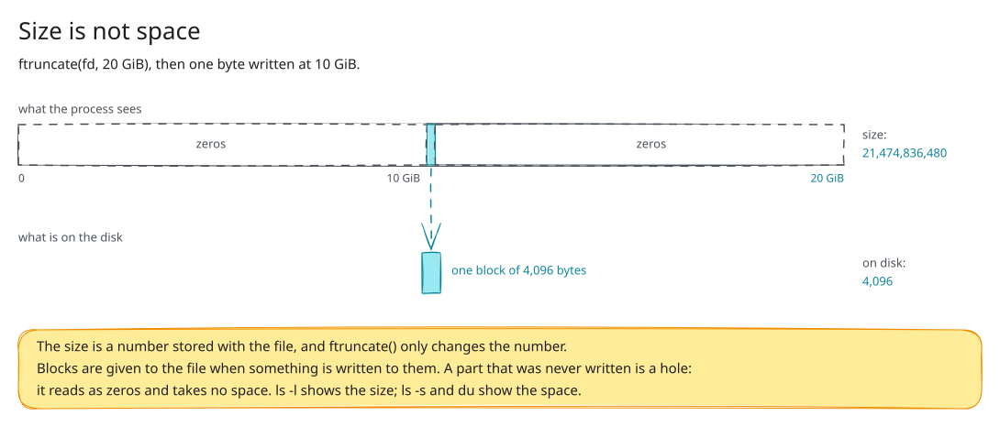{fig-align="center" width="70%"}

::: {.notes}
The size is a number in the inode. Blocks are given on first write, as pages were given on first touch in lecture 04.
:::

# 07. Conclusion

## What the lecture said

* A process reaches the outside through **I/O channels**, which carry bytes.
* Two families: **file-like**, to a device; **socket-like**, to a process.
* One **I/O interface**: create, open, read, write, stat, control, close, delete.
* `open()` returns a **file descriptor**: an index in the per-process **file descriptor table**.
* The other end is found through a **path**, a **port**, or **inheritance**.
* A file channel holds **open permissions**, a **file pointer**, a **reference count** and a reference to the file.
* File operations change **content**, **size** and **file pointer**.

## {background-color="#f7f7f7"}

::: {style="font-size: 1.2em; text-align: center; margin-top: 1.2em;"}
**A process talks to the outside through channels.**

It holds a number.

The number is an index in its descriptor table.

The entry points to a channel in the kernel, which remembers how it was opened, where it is in the file, and which file it is.
:::

::: {.notes}
The four writes used all of this in the same way; they differ in what lies beyond it. Next time: the other family.
:::

## Where this goes next

* **Lab 09:** the calls, the descriptors and the file pointer, in programs you write.
* **Lecture 10:** pipes and communication between processes; how a shell rewires 0, 1 and 2.
* **Lecture 11:** sockets, addresses and ports.

Reading: OSTEP chapters 36 and 39; Kerrisk, *The Linux Programming Interface*, chapters 4 and 5.
