## One megabyte {background-color="#f7f7f7"}

```text
$ make run
fwrite                 2048 records of 512 bytes  time:      0.3 ms      0.14 us/record
write                  2048 records of 512 bytes  time:      0.8 ms      0.41 us/record
write O_DIRECT         2048 records of 512 bytes  time:     40.8 ms     19.94 us/record
write O_DIRECT|O_SYNC  2048 records of 512 bytes  time:  10511.3 ms   5132.49 us/record
```

Same bytes, same file, same disk: a factor of 35,000.
All four were told "written". What did each get?

::: {.notes}
/proc/PID/io of a shell and of a browser first. Then the first three programs, a guess, and the fourth: let the ten seconds pass.
:::

## How far did the data get?

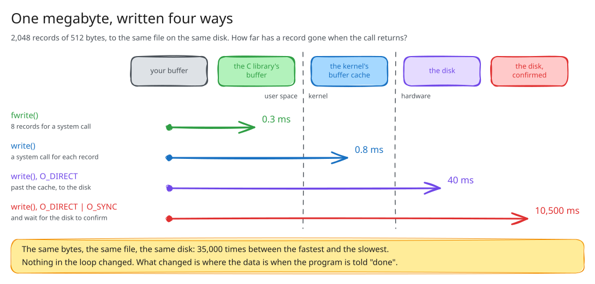{fig-align="center" width="92%"}

::: {.notes}
All four went through the same interface: something from open(), handed to every write(). That something is the lecture.
:::

## The story

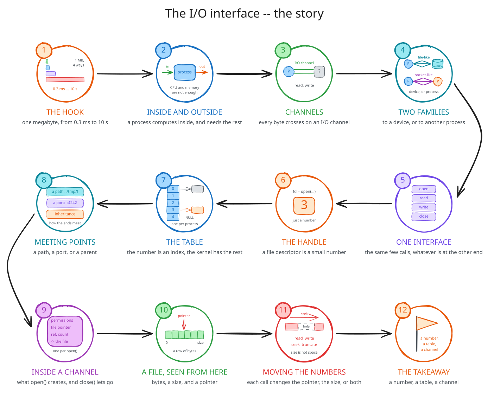{fig-align="center" width="78%"}

## Inside, and outside

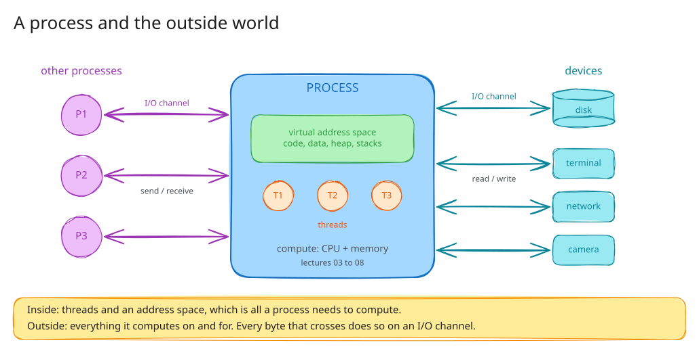{fig-align="center" width="88%"}

## Two families

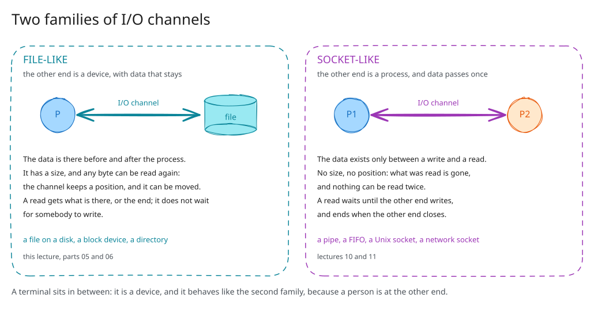{fig-align="center" width="88%"}

::: {.notes}
lsof on the shell, then on the browser. Point at TYPE and at FD.
:::

## The life of a channel

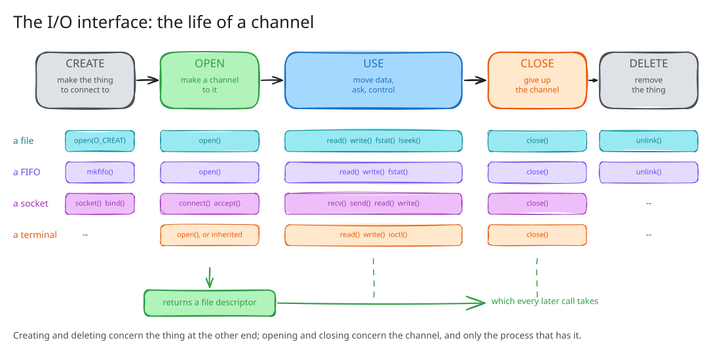{fig-align="center" width="90%"}

::: {.notes}
write_file, read_file. Ask: why 3? Then receive_fifo and send_fifo in two terminals: same calls, other behaviour.
:::

## A number of what?

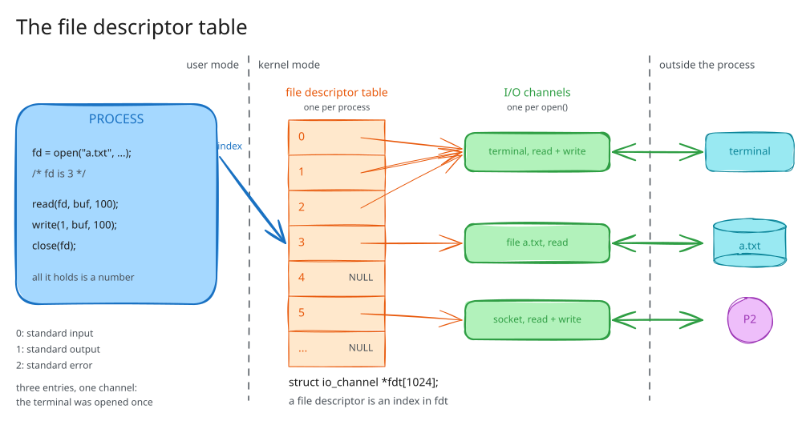{fig-align="center" width="88%"}

::: {.notes}
fdtsize: why 1,021? lowest-fd: ask for each number; close(0) then open().
:::

## How the two ends meet

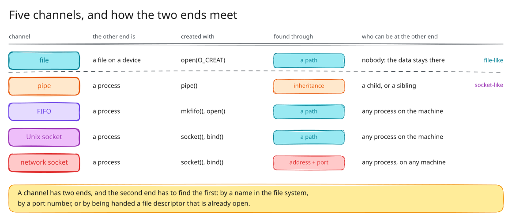{fig-align="center" width="92%"}

::: {.notes}
channels first, then this figure. pipe and the Unix socket pair. Short: lectures 10 and 11.
:::

## What the kernel keeps

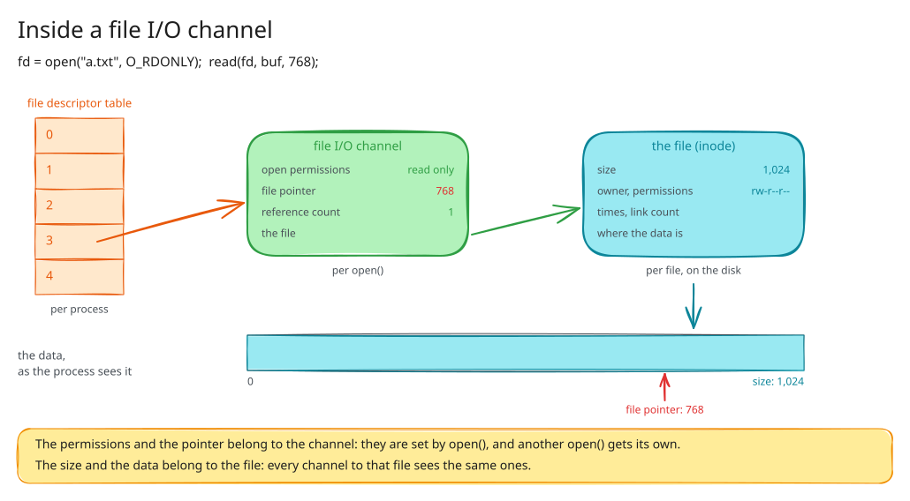{fig-align="center" width="86%"}

::: {.notes}
channel-perm: show step 1 in the source, ask what write() does. Checked once, at open().
:::

## Who shares the file pointer

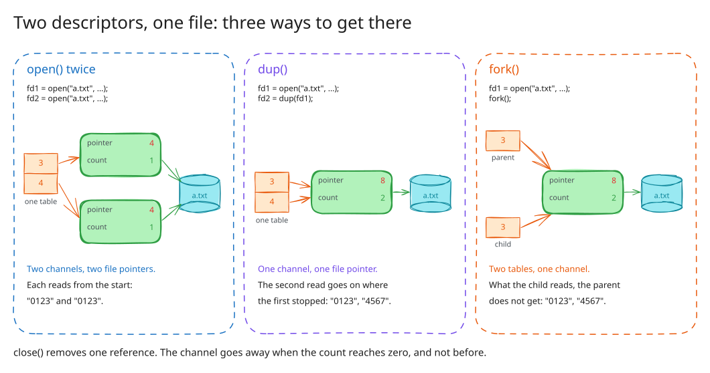{fig-align="center" width="86%"}

::: {.notes}
file-pointer: a prediction before each scenario.
:::

## A file, as a process sees it

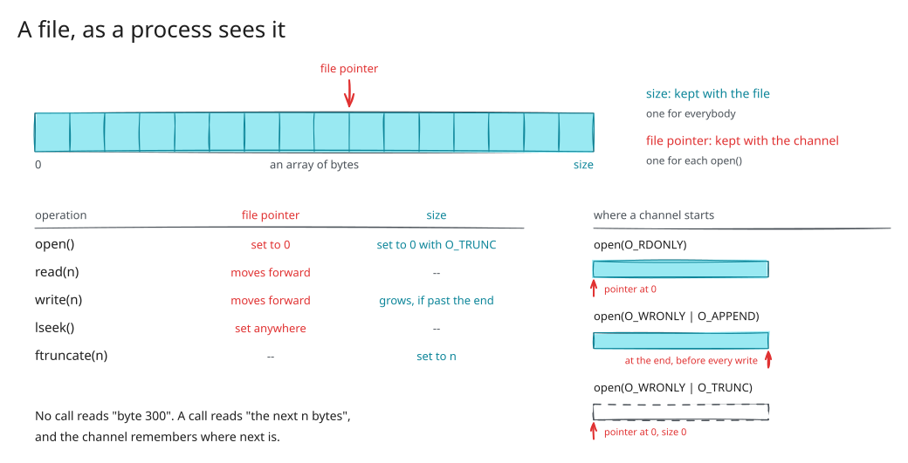{fig-align="center" width="88%"}

## Seven calls, two numbers

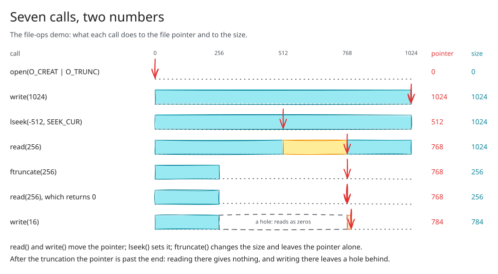{fig-align="center" width="86%"}

::: {.notes}
./file-ops step, both numbers predicted before each ENTER. fdinfo after read(256).
:::

## Size is not space

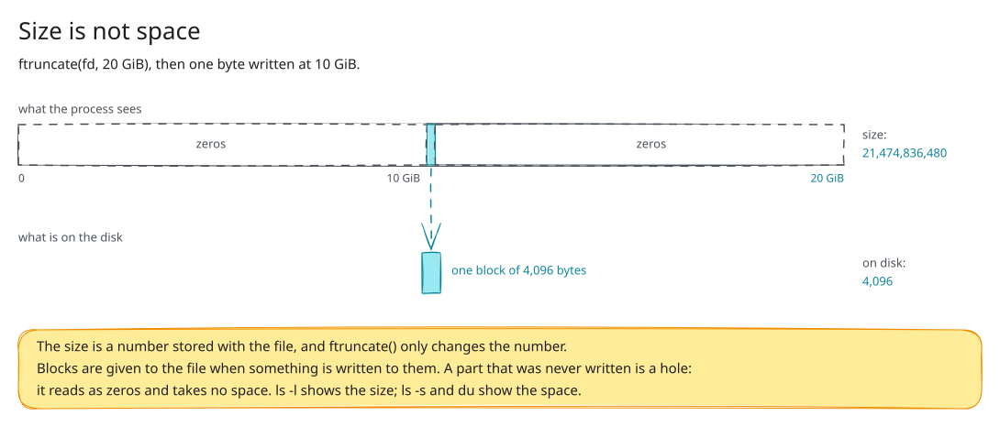{fig-align="center" width="82%"}

::: {.notes}
df -h, ./truncate, ls -lh, ls -sh, du -h. make clean.
:::

## {background-color="#f7f7f7"}

::: {style="font-size: 1.2em; text-align: center; margin-top: 1.2em;"}
**A process talks to the outside through channels.**

It holds a number.

The number is an index in its descriptor table.

The entry points to a channel in the kernel, which remembers how it was opened, where it is in the file, and which file it is.
:::

::: {.notes}
Next time: the other family, where the far end of the channel is a process that answers back.
:::
